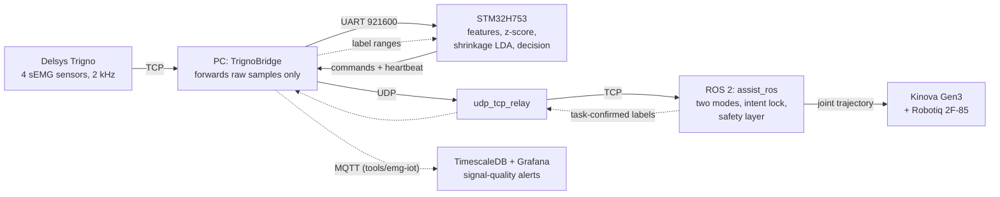

# 在微控制器上每次配戴自我校正的肌電介面，與輔助機械臂

碩士論文研究的程式、韌體、實驗工具和研究紀錄（2026-10 ～ 2026-11）。

**一句話**：sEMG 手勢介面每天重新戴上就會變不準。這個專案讓 STM32H753 上的分類器每次只做幾秒的校正，把歷次配戴累積起來，並在操作輔助機械臂（Kinova Gen3）時，用任務完成後確認的標籤持續更新模型。

> 第一次來？先讀 [`docs/接手指南.md`](docs/接手指南.md)：研究做到哪裡、先跑什麼、哪些試過沒用、哪些坑要避開。



## 實測指標

| 指標 | 數值 | 怎麼量的 | report |
|---|---|---|---|
| PC 送出視窗 → 收到板子的分類結果 | P50 6.70 ms、P95 7.20 ms、P99 7.38 ms | 板子實測（FreeRTOS 版，含學習 task 滿載的壓力測試），PC 時鐘，含 UART 傳輸 | 35.37 |
| 用標籤更新模型（收縮 LDA 重解） | 3.9 ms（任務標籤一次 4.7 ms，在低優先 task，分類延遲不變） | 板子實測，480 MHz | 35.23、35.37 |
| 板子和 PC 參考實作 | 預測**逐視窗相同** | 同一份 C 程式、同一份資料 | 35.13–35.14、35.39 |
| 韌體 | Flash 映像 26,056 bytes；靜態 RAM 370,220 bytes（512 KB 的 70.6 %，含 256 個視窗的標籤緩衝） | linker 輸出，可從 `firmware/` 逐位元重建 | 35.102 |
| 每次配戴一輪短校正的效果 | 下一次配戴 47.4 %，不校正 37.2 % | NinaPro DB6：10 人、7 種抓握＋休息共 8 類、8 顆等距環狀電極（不是貼目標肌肉）、每類只有 1 次提示 | 35.38 |
| S7 手勢組（作者本人，兩次配戴） | 離線視窗準確率 82.6 %（取對數的前端 86.2 %，待確認） | 7 類（4 個手腕方向、握拳、張開、休息）、4 顆貼目標肌肉、每類 2 輪提示；只有 1 人，而且是作者本人 | 35.80、35.97 |
| 控制層轉送 | 來回 1.0 ms | relay 的 ack | 35.85 |
| 閉迴路拿取放置（模擬：真韌體＋真實錄音） | 成功 99.8 %、每次約 54 s（擁擠場景） | 400 個試驗；模擬的使用者照指令操作 | 35.100 |

**怎麼讀這張表**：三個準確率量的是不同的東西，不能直接比。
- DB6 的 47.4 % 是公開資料裡較難的設定：8 類抓握、電極等距環繞而不是對準肌肉、每類只校正一次。
- S7 的 82.6 % 是類別較少、電極對準目標肌肉的設定，而且只有作者一人，可能有「作者知道系統怎麼運作」的偏差，要由其他受試者驗證（要先通過 IRB）。
- 99.8 % 是**系統層級**的任務成功率：分類器每個視窗只有約八成準，靠控制層（連續 5 個視窗才成立、出力閘門、意圖鎖定、兩種模式）把它變成可靠的動作。這正是 RQ1（分類器）和 RQ4（系統）的分工。

**實機 Kinova 還沒做**，但上實機前已經完成：
- 用真韌體的閉迴路模擬（`src/assist/closed_loop_fw.py`）；
- Gazebo 全系統彩排、實機 launch 的假硬體測試、故障注入（掉封包、斷線、控制器停止；`src/pc/s7_test/`）；
- 試驗紀錄程式和演練（35.101）。

設計和工具見 `lab_kit/實驗設計_Kinova實機.md`。

## 研究問題

| | 問題 | 主要結果在 |
|---|---|---|
| RQ1 | 跨天累積：把每次配戴的校正存成充分統計量累積在 MCU 上，能不能比只用當天的校正更準？ | report 35.9–35.16、35.51、35.53、35.76 |
| RQ2 | 任務確認的標籤：輔助機械臂完成任務後回頭確認的標籤有多可靠、能帶來多少增益？ | report 35.17–35.27、35.55–35.56、35.65–35.71、35.83 |
| RQ3 | 可部署性：分類、校正、用標籤更新能不能在 MCU 上即時跑，而且和 PC 參考逐位元相同？ | report 35.10–35.14、35.22–35.25、35.36–35.39 |
| RQ4 | 應用：分類器不完美時，配合輔助控制能不能安全完成拿取和放置？ | report 35.57–35.72、35.82–35.101 |

## 系統細節

最上面的流程圖是全貌；每一層做什麼、為什麼這樣設計、防護設計做了哪些、還缺哪些，見 [`ARCHITECTURE.md`](ARCHITECTURE.md)。

## 資料夾

| 位置 | 內容 |
|---|---|
| `src/c/` | MCU 上的 C 程式（特徵、收縮 LDA、即時迴圈 `rt_lda.c`、決策、通訊協定）；PC 上用同一份程式驗證 |
| `firmware/` | STM32 專案（CubeMX＋CMake）和建置腳本；可以逐位元重建板子上的韌體（[`firmware/README.md`](firmware/README.md)） |
| `src/*.py` | 分析和模擬（公開資料、自我測試、閉迴路模擬），每支檔案開頭的說明寫了對應的 report 節次 |
| `src/assist/` | 輔助控制（`modes.py` 兩種模式、`assist.py`、`labeler.py` 事後標籤）、閉迴路模擬（`closed_loop_fw.py` 用真韌體）和測試 |
| `src/pc/` | 實驗室電腦的工具：`TrignoBridge.cs`、`TaskScreen.cs`、`ExperimentPanel.cs`、`udp_tcp_relay.py` 等 |
| `src/pc/sim/` | ROS 2 / Gazebo：`assist_ros.py`（實機也用這支）、`kinova_trials.py`（實機試驗紀錄） |
| `src/pc/s7_test/` | 演練和檢查腳本（Gazebo 彩排、故障注入、時間穩定性） |
| `lab_kit/` | 實驗室用的操作程序：`SOP_自我測試.md`、`SOP_Kinova實機.md`、`實驗設計_Kinova實機.md` |
| `tools/emg-iot/` | 副專案：MQTT → TimescaleDB → Grafana 的訊號品質監控 |
| `tools/local-monitor/` | 本地 AI 監看：規則偵測異常，本機 LLM（Ollama）寫成中文說明；只讀紀錄、不送指令 |
| `docs/` | 接手指南、論文初稿、計畫書、設計筆記、文獻、資料取得方式、report 索引、早期路線的文件 |
| `report.md` | **研究紀錄的正本**：每個實驗的做法、判準、數字、結果檔，依時間排列（第 35 節是現在的主線） |
| `results/` | 每個 report 節次的輸出（CSV、文字報告） |
| `docker/` | 分析用的 Docker 環境（Python 3.12.3 和固定版本的套件、gcc、arm-none-eabi-gcc） |

## 快速開始（不需要任何硬體）

在 WSL2 / Linux：

```bash
git clone https://github.com/momotoofurry/pppp.git ~/emg && cd ~/emg
docker/run.sh build                      # 建分析用的映像檔（一次）
cd src/assist && for t in modes_test modes_assist_test labeler_test lockrule_test; do python3 $t.py | tail -1; done
python3 ../pc/sim/kinova_trials_test.py | tail -1
```

輔助控制的測試只需要 numpy。要跑閉迴路模擬或分析，需要資料（[`docs/資料.md`](docs/資料.md)）。

## 訊號品質監控（tools/emg-iot）

邊緣節點每 100 ms 送一筆訊號品質（各通道 RMS、60 Hz 干擾量、預測、標籤）到 MQTT；後端驗證格式、偵測掉包，寫進 TimescaleDB，Grafana 顯示漂移並發出告警。告警規則來自研究發現：60 Hz 市電干擾是間歇的，常在受試者「放鬆」時出現，整段平均看不出來，但會讓模型把干擾學成「放鬆」（report 35.97）。用 Docker Compose 一行啟動，見 [`tools/emg-iot/README.md`](tools/emg-iot/README.md)。

## 研究的方法慣例

- **判準先寫、再跑**：每個要下結論的實驗，判準都在算結果之前寫好並 commit（例如 `results/structure_97/PREREG_R16.md`）。沒通過的結果照樣寫進 report。
- **凍結**：錄資料前凍結的韌體和判準，錄的時候不改（現在的板子是 `rtl_task_s7f`，git tag 同名）。
- 大小一律 1 KB = 1024 bytes。
- report 每一節寫清楚：為什麼做、怎麼做、數字、結果檔、限制。

## 歷史

這個 repo 一開始是重現並壓縮「自我校正隨機森林」（Jiang 等，2024；上游 `self-calibrating-rf`），目標是放進 MCU（report 第 1–34 節）。外部資料驗證發現免標籤自我校正沒有確認的增益，而短時有標籤校正就有大部分的效果（report 24、35.3、35.16），之後改成現在的收縮 LDA＋任務標籤路線（report 35）。早期的 README、架構、實驗計畫放在 [`docs/history/`](docs/history/)。
