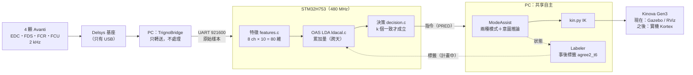

# 系統架構與共享自主的實現方式（2026-11-20）

> 依據：程式 `src/pc/sim/assist.py`、`modes.py`、`labeler.py`、`assist_ros.py`（2026-11-19 版），以及 report.md 35.13–35.72。
> 參數都是程式裡的設計值，還沒有用人驗證。結果數字以報告為準，本文只描述設計。

## 1. 一句話

肌電解碼和校正學習在 STM32 上做；PC 只轉送肌電、控制手臂。共享自主分工如下：**使用者決定方向、時機，並確認；系統負責深度、對準、夾取、放下和避碰。**

## 2. 整體架構

**「在 MCU 上」的範圍**：特徵、分類、投票、OAS 累加量、跨天累積、標籤更新都在 MCU 上；模型不離開板子。PC 不分類、不重訓，也不拿肌電或特徵去學習。PC 送給板子的提示或任務標籤只是監督訊號。限制要寫進論文：肌電要經 PC 轉送（Delsys 基座只有 USB），產品可以改用類比前端直接接 MCU。

## 3. 各層的角色和現況

| 層 | 放在哪 | 做什麼 | 現況 |
|---|---|---|---|
| 感測 | 前臂 | 4 顆 Avanti 貼在 EDC、FDS、FCR、FCU；複製成 8 通道，和既有韌體相容 | 第 1 天自我測試排在 11/23 |
| 轉送 | PC，`TrignoBridge.cs` | 轉送樣本；提示校正（cal）、驗證、任務指令；`--classes 9 --firmware lda` | 已完成 |
| 特徵 | MCU，`features.c` | 200 ms 視窗、100 ms 步長，每通道 10 個特徵，共 80 維；每次配戴用提示資料做 z-score | 已上板 |
| 分類與校正 | MCU，`ldacal.c`、`rt_lda.c` | OAS 收縮 LDA，只存各類的和與共變異累加量（閉式解），跨天直接累加 | 已上板；9 類版本是 `rtl_task_9c2` |
| 決策 | MCU，`decision.c` | 前兩名的差 ≥ m、連續 k 個視窗一致才成立指令；目前 k = 3、m = 0 | 計畫改成 100 / 50 ms、k 4、m 1、k_rest 2（兩天錄完後） |
| 共享自主 | PC，`modes.py`（建在 `assist.py` 上） | 每 100 ms：指令 → 末端速度 | 已在 RViz 和 Gazebo 驗證 |
| 事後標籤 | PC，`labeler.py` | 放下時回頭標記整段拿取、搬運、放置 | 目前只在 PC 記錄，還不送到板子 |
| 手臂 | `kin.py`、`assist_ros.py` | IK → 一點的 JointTrajectory；夾爪用 GripperCommand | 模擬（mock hardware、Gazebo）；實機還沒做 |

## 4. 每 100 ms 的一步

1. 板子把 200 ms 視窗分類，經決策模組得到「成立的指令」：上、下、左、右，或放鬆（停）。
2. PC 的 `ModeAssist.step(cmd, x)` 依目前模式和末端位置 x 算出末端速度 v。
3. `kin.py` 把 v 換成關節目標，送一段軌跡給控制器。
4. `Labeler` 在這一步的前後記下系統知道的事：指令、位置、模式、階段。放下確認後，一次產生整段的標籤。

**放鬆在任何狀態都會讓手臂停下。** 這是最高優先的規則。

## 5. 共享自主怎麼實現

### 5.1 分工

| | 使用者 | 系統 |
|---|---|---|
| 方向 | 上、下、左、右（手腕伸、屈、橈偏、尺偏） | 模式 1 依推論的目標把方向彎過去（最多 60 %） |
| 深度（前後） | 模式 2 用 W 前進、S 後退 | 前進時順便修正上下左右的對準；在架子裡只直進直出 |
| 時機 | 何時動、何時停 | — |
| 確認 | 在物體或放置點**放鬆 1 秒** | 夾起；或檢查放置點有效後自動降下、打開夾爪 |
| 安全 | 隨時放鬆就停 | 靠近架子減速、禁止在架子裡橫移、高度限制、切換後要先放鬆 |

### 5.2 兩種模式（`modes.py`）

**模式 1：自由控制**
- W、S、A、D 在架子前方 2 cm 的「行進平面」上移動（上下左右），深度固定。
- 空手時，系統把方向彎向可能的目標（見 5.3）。
- 在物體前方停下（上下左右距離 < 5 cm，`LOCK_ALIGN`）→ 鎖定這個物體，切到模式 2「拿取」。
- 夾著物體停在架子前方，物體底部在架面下 2 cm 到架面上 10 cm 之間 → 切到模式 2「放置」。

**模式 2：前後**

| 階段 | W | S | 放鬆 1 秒 |
|---|---|---|---|
| 拿取 | 接近物體，路上修正對準 | 退回；到行進平面後回模式 1 | 在物體上（< 1.5 cm）→ 夾起，進入「退出」 |
| 放置 | 太低先抬、太高先降，再直進，停在架子後緣前 3 cm 或前方物體之前 | 退回 | 位置有效（離邊緣、離其他物體夠遠）→ 自動降下、打開；無效 → 提示原因 |
| 退出 | 夾著物體時最多抬 2 cm | 退回行進平面 → 模式 1 | — |
| 手動（E 鍵切換） | 前進到架子前緣為止 | 後退 | — |

**防止誤操作的規則**
- 只有在行進平面上才能回模式 1；在架子裡按 A、D 不會動，會提示「先按 S 退出」。
- **切換後先放鬆**（`wait_release`）：W、S 在兩種模式的意思不同。用 S 退回切到模式 1 時，如果使用者還按著 S，手臂會直接往下掉，所以要先放鬆一次才繼續（35.68）。
- 剛離開的物體或架子，要等末端移開才會再被鎖定；在原地停 1 秒算刻意選擇，會重新鎖定（35.68）。

### 5.3 模式 1 的意圖推論和混合（`assist.py`、`modes.py` 的 `_steer`）

1. **推論目標**：每個候選物體 g 累積「指令方向」和「往它的預備點方向」的一致度：
   s_g ← 0.9 · s_g + cos(u, 往 g 的方向)，只在使用者有出力時更新；P(g) = softmax(3 · s)。
2. **作用範圍**：末端離某物體的預備點超過 12 cm（上下左右距離），對這個物體就不幫忙；4 cm 內全力幫（`zone`）。範圍外是純直接控制。
3. **混合方向（rule `mix`）**：m = Σ P(g) · zone_g · 往 g 的單位方向。
   - 兩個可能的目標在相反方向時，m 互相抵消，系統就不幫。
   - 輔助比例 a = 0.6 · ramp(|m|, 0.3, 0.8)，所以**使用者的份量至少 40 %**。
   - 速度 v = V_MAX · unit((1 − a) · u + a · m̂)，V_MAX = 8 cm/s。
4. **永不反推**：輔助方向和使用者相反的部分直接拿掉。
5. **自動退出**：連續 10 步（1 秒），指令都不符合任何候選目標，或和輔助方向相反，輔助就暫停，直到使用者放鬆（35.67）。
6. **顯示**：畫面一直顯示目前模式和系統猜的物體（RViz 標記、中文提示）。實機要改成燈號或聲音，週一後再決定。

設計參考：依信心度混合（Dragan & Srinivasa, 2013）、多目標共同方向（Javdani et al., 2018）、輸入不符就退出（Zurek et al., 2021）。完整書目要補。

## 6. 事後標籤（`labeler.py`，規則 agree2_t6）

- **觸發**：物體放下時，回頭標記這一趟（接近、夾取、搬運、放置）的每一步；退回行進平面時，再標記退出那段（S = 下）。
- **兩個規則都同意才標**（agree2）：
  - 位置規則：鎖定點和末端的差距，以及系統當時的階段；
  - 指令規則：當時成立的指令。
  - 兩者給出同一類才採用。
- **換指令前 6 步不標**（t6）：使用者其實已經換了，解碼器還沒跟上。
- **復原檢查**：放回離拿起處 3 cm 內，視為反悔，整趟不標，退出段也不標。
- **暫存**：每步的狀態只有幾個 bytes，整趟都留；特徵視窗只留每次確認前 200 步（20 秒）。MCU 版設計是 50 ms 步長、400 個視窗，int16 約 62.5 KB；待確認的類別總和約 1.6 KB。
- **輸出的類別**：上、下、左、右、放鬆（5 類）。在模式 2，W、S 就是上、下的手勢。
- **現況**：只在 PC 產生和記錄。送到板子要改板子和 PC 的協定，等兩天的自我測試錄完。

## 7. 手勢和指令：還沒定案的地方

- 目前的兩種模式是為 **5 類**（4 個方向 + 放鬆）設計的：前後靠模式 2 的 W、S，夾放靠「放鬆 1 秒」。
- 9 手勢自我測試會用同一份資料比較 9、7、5 類（`selftest9_analysis.py`）：
  - 9 類：方向 6 個（多前、後）、夾爪開、夾爪夾、放鬆；
  - 如果 7 類或 9 類分得開，前後和夾爪可以直接下指令，模式 2 可以簡化。
- 手動切換目前是 E 鍵。肌電版（手腕共同收縮，用振幅偵測）還沒做，也還沒有資料。

## 8. 從模擬到實機還要做的事

| 項目 | 模擬已經有 | 實機要做 |
|---|---|---|
| 手臂介面 | ROS 2 mock hardware、Gazebo Classic 11 | 換成 Kortex 驅動；重新量軌跡段和反應時間（35.69） |
| 夾取 | Gazebo 附著（不驗證摩擦） | 真的夾爪能不能夾住、物體會不會滑 |
| 碰撞 | 只檢查夾爪中心和夾著的物體 | 手肘等其他部位；工作空間限制 |
| 安全 | 減速區、禁止橫移、放鬆就停 | 依 Gen3 手冊（文獻搜尋 3-8）設定 soft limits、保護區和 e-stop。**注意：保護區只在笛卡兒模式有效，角度（關節）模式無效（手冊 p.96）。** 目前 `assist_ros.py` 是 IK 後送關節軌跡，上實機時建議改送笛卡兒 twist，讓保護區和笛卡兒 soft limits 生效；手臂沒有機械煞車，e-stop 會斷電，手臂會下落（p.7、p.38） |
| 板子連線 | 鍵盤或模擬的解碼器 | 板子的 PRED 指令接進 `ModeAssist`；控制週期改 50 ms，以步數計的參數改成以秒計 |
| 標籤回送 | PC 記錄 | 協定加「軟標籤更新」，板上的待確認總和 |
| 顯示 | RViz 顏色、響鈴 | 燈號或聲音 |

## 9. 主要參數（程式裡的設計值）

| 參數 | 值 | 位置 |
|---|---|---|
| 決策步長 DT | 0.1 s（計畫改 0.05 s） | `assist.py` |
| 最大速度 V_MAX | 0.08 m/s；架子附近減半 | `assist.py`、`modes.py` |
| 預備點 PRE | 物體前方 10 cm | `assist.py` |
| 鎖定距離 LOCK_ALIGN | 5 cm（上下左右） | `modes.py` |
| 確認時間 CONFIRM_STEPS | 10 步 = 1 秒 | `assist.py` |
| 夾取容許 GRASP_TOL | 1.5 cm | `assist.py` |
| 輔助上限 level | 0.6 | `modes.py` |
| 混合門檻 MIX_ON / MIX_FULL | 0.3 / 0.8 | `modes.py` |
| 退出條件 | 10 步、cos < −0.2 | `modes.py` |
| 推論 LAMBDA / BETA | 0.9 / 3.0 | `assist.py` |
| 作用範圍 zone / ZONE_FULL | 12 cm / 4 cm | `modes.py`、`assist.py` |
| 標籤 N_TAIL / BUF | 6 步 / 200 步 | `labeler.py` |

## 10. 待改進清單（2026-11-20 架構檢視）

> 都還沒實作。照約定，兩天自我測試錄完之後才動韌體和板子–PC 協定。

### 一、安全（上實機前必做）

- [ ] **1. 獨立於分類器的低振幅強制停**
  - 問題：「放鬆就停」完全靠分類器。最危險的是誤啟動：已經放鬆，分類器卻判成某個方向，手臂就會動。
  - 改法：MCU 上加一個保守的低振幅門檻；振幅低於門檻，不管分類結果都當作放鬆。
  - 和 35.69 被否決的振幅門檻不同：那個是為了停得快，門檻高、握住時會一頓一頓；這個門檻低，只用來擋誤啟動。
- [ ] **2. 通訊看門狗**
  - 問題：PC 當機、板子停止送指令或 USB 斷線時，Kinova 可能還在執行最後一個速度指令。
  - **已查（文獻搜尋 3-9）**：twist 不會自己停。`duration` 尚未實作，ros2_kortex 會一直重送最後一則；唯一的保底是 session 的 `connection_inactivity_timeout`（預設 2,000 ms），失聯到停下要多久沒實測。
  - 改法：PC 連續幾步沒收到有效的 PRED，就送全零 twist 或 `Stop()`；放鬆時也明確送全零；e-stop 放在手邊。ros2_kortex 的 twist 是工具座標，方向要先換算。
- [ ] **3. 改送笛卡兒 twist**
  - 理由：保護區和笛卡兒 soft limits 只在笛卡兒模式有效（Gen3 手冊 p.96）。
  - 附帶好處：IK 交給 Kinova 處理，避開 `kin.py` 在奇異點附近可能的跳動。
- [ ] **4. 用夾爪回饋確認夾取**
  - 問題：系統以為夾到了，不代表真的夾到。實機上夾空或滑掉，這一趟的標籤會全部錯。
  - 改法：讀夾爪的開合位置和電流。夾空就判定失敗、不產生標籤、回到模式 1。
  - **已查（文獻搜尋 3-9）**：cyclic 回饋的 `status_flags` 有 `ROBOTIQ_STAT_OBJECT_DETECTED`（0x02），還有位置（0–100 %）和馬達電流（mA）；高階控制時也讀得到。實機上可不可靠要實測。

### 二、標籤品質

- [ ] **5. 用自己的資料驗證 agree2 的增益**
  - 問題：agree2 只在位置規則和成立的指令一致時才標。指令本身錯的段落整段不標，增益主要來自「投票救回來的個別視窗」。
  - 模擬假設視窗錯誤彼此獨立；真實誤判常常連續發生〔35.70〕，增益可能比模擬小。
  - 可以改進的方向：使用者修正前那段「錯誤指令」的視窗，用位置規則給低權重的軟標籤。要先在模擬裡用連續錯誤的設定測試，確認不會引入太多錯誤標籤。
  - **已做（report 35.73 B，GrabMyo 43 人）**：
    - 標籤改由模型自己的預測決定後，後期增益 +4.16（95 % CI +3.18 到 +5.20，40/43），比 35.70 隨機抽的 +4.98 低 0.82。被標到的視窗只有 4.2 % 是模型原本判錯的。
    - 修正段給權重 0.3 的標籤，回到 +4.97；修正段標籤錯 20 % 時仍有 +4.85。
    - 還沒做：加上使用者行為（猶豫、超過）的版本；用自己的資料重做。
- [ ] **6. 標籤和視窗用序號對應**
  - 問題：PC 用步數標記、板子有自己的視窗。沒有序號對應，標籤可能錯位一兩個視窗，換指令附近就會標錯。
  - 改法：每個 PRED 帶上視窗序號，標籤引用這個序號。現有封包格式已有 `seq` 欄位，設計新協定時要確認標籤能用它對上。

### 三、控制

- [ ] **7. 依分類器信心度調整速度**（加分）
  - 改法：板子已經會送分數差。信心低的指令走慢一點，信心高的走正常速度。
  - 注意：LDA 的機率通常過度自信，門檻要用自己的資料校準。
- [ ] **8. 把「停」和「確認」分開，並考慮取消模式**（看 9 類分析結果再決定）
  - 問題一：放鬆同時代表停和確認，停下來休息時可能意外夾起或放下。
  - 問題二：W、S 在兩種模式意思不同，容易出現模式錯誤。
  - 改法：握拳、張開手分得開的話，用它們確認夾取和放下，放鬆只代表停；前、後也分得開的話，直接用六個方向，取消兩種模式。
- [ ] **9. PC 改成收到 PRED 就計算**
  - 問題：PC 和板子各自每 100 ms 一步、時間沒有對齊，最多可能多出接近一步的延遲。
  - 改法：PC 收到 PRED 立刻計算、送出，不用自己的計時器輪詢；和改成 50 ms 一起做。

### 四、MCU 上的累加量

- [ ] **10. 累加量改成 double**（report 35.73 A）
  - 問題：float32 的 `s_g` 在累積約 20 萬個視窗以內沒有影響；超過之後預測開始和 float64 不同，到幾百萬個視窗時 fit 會失敗。50 ms 步長連續使用 1 小時最多約 7.2 萬個視窗，長期跨天使用會碰到。
  - 改法：只把 `s_g`、`s_sum`、`s_n` 和 `G − s sᵀ / n` 改成 double，求解維持 float32。合成資料的所有情境都和 float64 的預測 100 % 一致。RAM 多 15,876 B（約 15.5 KB）。
  - 要量：板子上 `ld_add`、`ld_fit` 變慢多少。

### 優先順序

| 時機 | 項目 |
|---|---|
| 上實機前必做 | 1、2、3、4 |
| 改板子時一起做 | 10 |
| 設計新協定時一起做 | 6、9 |
| 用自己的資料驗證 | 5 |
| 看 9 類結果再決定 | 8 |
| 加分 | 7 |
