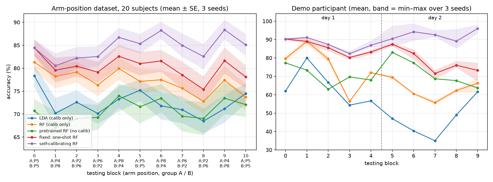
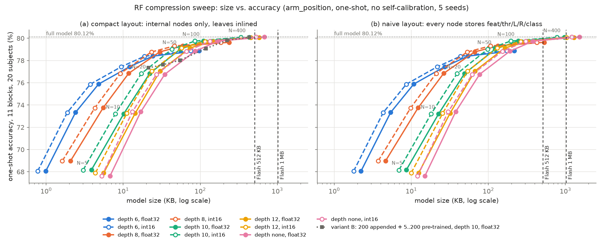

# 自我校正隨機森林肌電控制：PC 基準重現與 STM32H743 記憶體分析

> 論文題目：在 STM32H7 上實現有記憶體預算、不需要標籤的自我校正隨機森林（RF）肌電手勢控制
> 日期：2026-10-17　｜　目標硬體：NUCLEO-H743ZI2（Cortex-M7，2 MB Flash，AXI SRAM 512 KB + SRAM1–4 + DTCM 128 KB）
> 上游程式碼與資料：MoveR-Digital-Health-and-Care-Hub/self-calibrating-rf（commit `48ea4d1`）

報告中的數字，除了明確標示為「估算」的部分，都來自實際執行的結果。每個數字都可以用 `README.md` 裡的指令重新產生。
各階段的詳細說明在 `results/stage1_summary.md`、`stage2_summary.md`、`stage3_summary.md`。
本報告的數字都是在 Windows 11 上跑出來的；之後的實驗改在 WSL2 + Docker（`docker/`）進行，兩個平台的差異見 1.6 節。

## 摘要

| 問題 | 答案 |
|---|---|
| PC 基準重現得出來嗎？ | 可以。自我校正 RF 在 arm_position 資料（20 人、11 個 block）的平均準確率是 **84.63 ± 8.58%**，論文是 84.6 ± 8.5%；所有和論文對得上的指標差距都 < 1 個百分點。 |
| 原始模型放得進 H743 嗎？ | 推論模型可以。論文的完整設定（剪枝後的 200 棵 + 附加的 200 棵，深度不限）用 compact float32 格式，編譯後 Flash 是 **693.8 KB**；照題目設定的 naive 格式要 1519 KB，也放得進 2 MB Flash。 |
| 推薦的壓縮設定 | **100 棵、深度 10、int16 門檻值**：Flash 88.1 KB，one-shot 準確率 79.75%（完整模型是 80.12%，差 −0.37 個百分點）。Flash 夠用的話，400 棵、深度 10、int16 只差 −0.04 個百分點，要 345.5 KB。**自我校正之後**（3.1 節）：100 棵是 83.96%，完整模型 84.43%，差 −0.47 個百分點，差距沒有明顯擴大。 |
| 推論需要多少 RAM？ | 實測 **552 B**（特徵緩衝區 + 最壞情況的 stack）。 |
| 自我校正放得進 MCU 嗎？（估算） | 照論文原樣做（float32 buffer + t-SNE）約需 1208 KB，**放不下**。改用 int16 buffer、100 棵樹、不做 t-SNE，約 334 KB，放得進 AXI 512 KB。但「不做 t-SNE」在論文的 ablation 裡準確率比較低，這是論文要解決的核心問題。 |
| 能壓到 256 KB 以下嗎？（實測，3.5–3.6 節） | 可以：buffer 375 筆（int16）＋ 新樹 32 葉 ＋ t-SNE，自我校正 83.44%、增益 +3.76，RAM 估算 219 KB，和基準無顯著差異（p = 0.17）。250 筆開始明顯變差。t-SNE 在 PC 上每次 2.1 s（1500 筆 9.3 s），MCU 上的時間還沒量。 |
| t-SNE 迭代可以減少嗎？（實測，3.7 節） | 可以減半：同一設定下 500 次迭代自我校正 83.27%、增益 +3.59，和 1000 次（83.44%、+3.76）差 −0.17 個百分點，不顯著（p = 0.14）；PC 上 t-SNE 時間 1.96 → 1.01 s。400 次開始顯著變差（−0.41，p = 0.017），250 次增益只剩 +0.48。 |
| 降低 t-SNE perplexity 有用嗎？（實測，3.8 節） | 不太有用：perplexity 3／5／7 在 PC 上**不省時間**（時間由 octree 排斥力決定，和近鄰數無關），只省 t-SNE 的近鄰表 RAM（估算 100 → 54–81 KB），準確率全都比 perplexity 10 低（−0.07 到 −0.69，部分顯著）。維持 perplexity 10、500 次迭代。 |
| 上板前能先用 C 做完嗎？（實測，第 6 節） | 可以：特徵擷取、t-SNE、K-Means、建樹、整個自我校正迴圈都用 C（靜態記憶體）寫好並在 PC 上驗證，端到端 83.22%（sklearn 83.27%，p = 0.90；修正樹的亂數種子之後，7.1 節），沒有一項有顯著差異。跨兩天的 demo（1 人）上，C 韌體邏輯把第 2 天的 75% 拉回 93%（6.6 節）。MCU 時間要等板子。 |
| one-shot 校正也能在 MCU 上做嗎？（實測，第 7 節） | 可以：剪枝和 Python 逐節點相同（20/20 人），one-shot 79.40%（sklearn 79.68%，p = 0.52），自我校正後 82.98%（83.27%，p = 0.28）。整個路線 B 韌體（序列協定＋即時迴圈＋MCU 上 one-shot＋自我校正）linker 實測 RAM 約 248.7 KB（含中斷 stack 上界），Flash 115.6 KB；加上硬體層（只編譯）253.2 KB。之後 octree 改配 2.5 n（準確率逐列不變）：路線 B 242.1 KB、含硬體層 246.5 KB（7.5 節）。 |
| 怎樣才放得進 512 KB？（實測，3.3–3.4 節） | **不必拿掉 t-SNE**：buffer 存成 int16（無損失）並縮到 750 筆，自我校正 83.83%、增益 +4.15，RAM 估算 394 KB；500 筆 280 KB、增益 +3.78。新樹限制 32 葉讓附加樹保證 ≤ 10.6 KB、準確率無顯著差異。兩者合併使用還沒實測。 |
| 不做 t-SNE 會掉多少？（實測，3.2 節） | 推薦設定上，只用 K-Means 81.03%、不分群 81.64%，t-SNE 版 83.98%；自我校正增益從 +4.30 掉到 +1.35 / +1.96 個百分點（20 人配對 p < 0.001）。完整模型的結果重現了論文的 ablation（84.66 / 80.89 / 82.16 vs 論文 84.6 / 81.0 / 82.7）。 |
| 換平台結果會變嗎？ | 特徵、預測、one-shot、C/ARM 編譯在 Docker（Linux）和 Windows 上都相同。**自我校正不會逐位元相同**：Linux 84.66% vs Windows 84.43%（差 0.23 個百分點，和 seed 之間的變動同一個等級）。同一個比較只用同一個平台的數字（1.6 節）。 |

---

## 1. 重現結果（vs. 論文）

### 1.1 環境與作法
- Python 3.12.3（conda-forge 版），numpy 2.1.2 / scipy 1.14.1 / scikit-learn 1.5.2（版本和 requirements 一樣，joblib 模型才能正確載入）。
- 上游程式沒有設亂數種子，所以用 `src/run_upstream.py` 先固定 numpy 的全域種子再執行，上游程式碼不做任何修改。同一個 seed 重跑兩次，結果逐位元相同。
- arm_position 跑了 3 個 seed（0/1/2），每個 seed 約 57 分鐘；demo 也跑了 3 個 seed。

### 1.2 方法重點（讀程式碼得到）
| 項目 | 實際做法 |
|---|---|
| 濾波 | 每個 channel 用 4 階 Butterworth 帶通 10–500 Hz，`lfilter`（單向、因果） |
| 視窗 | 200 ms（400 點），步長 100 ms；每個 2 秒的 trial 只取後 1 秒 → 10 個視窗 |
| 特徵（10 種 × 8 ch = 80 維） | RMS、WL、SSC、ZC、MAV、偏度、VCF、MDF、MNF、PKF（Welch：Hamming、nperseg 400、nfft 512）；用該受試者 calibration 資料的 mean/std 做 z-score |
| One-shot 校正 | 6 個手勢各 1 個 trial（共 60 個視窗）。預訓練的 200 棵樹由下往上剪枝（calibration 準確率**嚴格提高**才剪），再附加 200 棵只用這 60 筆訓練的新樹 → 400 棵 |
| 自我校正 | 每個 block 結束後，把資料放進最多 1500 筆的 buffer（滿了就刪掉數量最多的偽標籤類別中最舊的一筆）。每類都 ≥ 10 筆時，先做類別平衡 → t-SNE 3 維 → 用 RF 預測的各類中心初始化 K-Means，得到偽標籤。用「偽標籤 + 60 筆真標籤」訓練 80 棵樹，取代 200 棵附加樹中的 80 棵 |
| 偽標籤篩選 | **沒有信心門檻**。buffer 裡的樣本全部會用到（只做類別平衡） |

程式和論文描述不一樣的地方：
- 剪枝條件：論文寫 `≤`，程式是嚴格 `>`。
- 偽標籤初始化：論文寫用「current model」，程式其實一直用最初的 one-shot 模型。
- 比較方向：預測用 `x < thr`，剪枝和 sklearn 用 `x <= thr`。
- bootstrap 比例：JNE 寫 7%，實際模型是 1%–2%。

### 1.3 arm_position 結果（20 人 × 11 block，3 個 seed 平均；`results/baseline.csv`、`baseline_by_position.csv`）

| 方法 | P2 | P4 | P5 | P6 | P8 | 全部 |
|---|---|---|---|---|---|---|
| LDA（只用 calibration） | 69.59 | 70.15 | 75.99 | 71.47 | 73.06 | 72.41 |
| RF（只用 calibration） | 75.67 | 77.84 | 77.37 | 76.25 | 78.66 | 77.18 |
| 預訓練 RF（不校正） | 68.09 | 70.35 | 71.46 | 70.36 | 73.62 | 70.84 |
| **固定模型：one-shot RF** | 78.09 | 81.04 | 81.17 | 78.63 | 81.63 | **80.21** |
| **自我校正 RF** | 82.24 | 85.59 | 84.95 | 83.88 | 86.33 | **84.63** |

20 人中有 18 人的自我校正準確率高於固定模型。

### 1.4 和論文比較（Front. Neurorobot. 2024，只用論文文字和 Table 1 裡的數字；`results/paper_comparison.csv`）

| 指標 | 論文 | 我們（3 個 seed 平均） | 差距 |
|---|---|---|---|
| 自我校正 RF，全部 block | 84.6 ± 8.5 | 84.63 ± 8.58 | +0.03 |
| LDA @P5 | 76.0 ± 9.3 | 75.99 ± 9.26 | −0.01 |
| RF @P5 | 77.6 ± 9.6 | 77.37 ± 10.05 | −0.23 |
| LDA 換到 P2/P4/P6/P8 的下降 | 6.4 / 5.8 / 4.5 / 2.9 | 6.40 / 5.84 / 4.52 / 2.94 | ≤ 0.04 |
| one-shot 比 RF 多的增益 P2/P4/P5/P6/P8 | 2.5 / 3.5 / 4.2 / 2.6 / 3.1 | 2.42 / 3.20 / 3.80 / 2.38 / 2.97 | −0.08 ~ −0.40 |
| 自我校正比 one-shot 多的增益 P2/P4/P5/P6/P8 | 3.3 / 4.2 / 3.7 / 5.0 / 4.1 | 4.14 / 4.55 / 3.77 / 5.25 / 4.69 | +0.07 ~ +0.84 |

**差距都很小，沒有需要特別解釋的大差異。** 可能的小差異來源：
1. RF 訓練和 t-SNE 本身有隨機性：3 個 seed 之間，自我校正的全部平均在 84.38–84.80% 之間變動。
2. 論文本身沒寫 seed 數量和重複次數。
3. 自我校正增益在 P2、P8 的論文值落在我們 seed 的範圍外（+0.8、+0.6），可能來自論文作者用的程式版本或亂數。我們無法再細分原因。

### 1.5 Demo（JNE 2025 的 1 位受試者、10 個 block、跨兩天）
3 個 seed 平均：固定 one-shot 81.89% → 自我校正 90.02%。到了第 2 天後段（block 7–9），固定模型降到 71.6–76.0%，自我校正則是 89.1–96.0%。
JNE 論文報告的是 28 人平均（固定模型 84.3% → 78.6%，自我校正最後 86.5%），不是這位受試者的數字，所以只能比較趨勢：趨勢一致。

### 1.6 實驗環境與跨平台可重現性（`results/platform_check.md`）
原本的結果在 Windows 11 上產生（conda-forge Python 3.12.3、MinGW gcc 8.1、WSL2 裡的 arm-none-eabi-gcc 10.3.1）。
之後的實驗在 WSL2 + Docker 執行（Ubuntu 22.04、Python 3.12.3、同樣的套件版本、gcc 11.4、arm-none-eabi-gcc 10.3.1），
專案放在 WSL 的 `~/model`。兩個平台的比較（實測）：

| 部分 | Docker（Linux）vs. Windows |
|---|---|
| 特徵擷取 | 10 種特徵中 7 種逐位元相同；MNF、偏度、VCF 只差最後一位（相對誤差 ≤ 7e-15） |
| 預測、壓縮掃描（subject 0，660 列）、one-shot（20 人 × 3 seed，660 列） | 完全相同 |
| C 匯出、PC 檢查、Cortex-M7 編譯 | text/data/bss/stack 和預測完全相同 |
| 自我校正（400 棵、深度不限、float64，20 人 × 3 seed） | Linux **84.66%**（84.50–84.81）vs Windows **84.43%**（84.08–84.83）；只有 157/660 個 block 相同 |

- 每個 (seed, 受試者) 的差（Linux − Windows）：平均 +0.23 個百分點，SD 0.85；20 人的 Wilcoxon 檢定 p = 0.040。
  差異小於 Windows 自己 seed 之間的差距（0.75 個百分點），只有 3 個 seed，不足以判斷是系統性的還是偶然。
- 原因：t-SNE → K-Means → 重新訓練樹 這條鏈對極小的浮點差異很敏感；連 Linux 單執行緒和多執行緒的結果都不一樣。
  **Windows 單執行緒**（和原本 joblib worker 的條件一樣）可以逐位元重現原本的結果，所以差異來自平台，不是程式錯誤。
- **規則**：同一張表、同一個比較的數字只用同一個平台的結果；新的實驗都在 Docker 裡跑，對照組也一起在 Docker 裡重跑。

---

## 2. 原始模型大小，以及能不能放進 H743

### 2.1 預訓練模型結構（`results/model_stats.csv`）
| | 38 人模型 | 66 人模型 |
|---|---|---|
| 樹數 / 特徵 / 類別 | 200 / 80 / 6 | 200 / 80 / 6 |
| 每棵樹節點數 平均（最大） | 778.6（855） | 821.4（895） |
| 深度 平均（最大） | 18.6（31） | 18.5（24） |
| 平均葉節點深度 | 10.8 | 10.7 |
| 總節點數 | 155,730 | 164,284 |

### 2.2 原始大小（只算走得到的節點，外加每棵樹 4 B 的 offset 表）
| 66 人預訓練模型 | float32 | int16 |
|---|---|---|
| naive（每個節點都存 feature u8 + thr + L/R u16 + class u8） | 1605 KB | 1284 KB |
| compact（只存內部節點，葉節點編在 child index 裡） | 722 KB | 562 KB |

實際部署的是「剪枝後的 200 棵 + 附加的 200 棵」。剪枝只讓每棵預訓練樹從 821 個節點降到約 764 個；
附加樹只用 60 筆資料訓練，每棵約 13 個節點。實測：compact float32 是 682 KB、naive float32 是 1519 KB。
**結論：放得進 2 MB Flash（naive 格式佔約 74%），但不論哪種格式都超過 512 KB 的參考線。**

---

## 3. 壓縮取捨曲線與推薦設定

掃描做法（`src/compression_sweep.py`，20 人 × 11 block × 5 個 seed，**one-shot 固定模型**）：
把預訓練樹截到深度 d → 剪枝 → 保留 N/2 棵 → 附加 N/2 棵新樹（max_depth = d）。
int16 用 Q5.10 定點（z-score 後的門檻值範圍是 −9.9 到 20.8，放得進 ±32）。

one-shot 準確率（%，int16；和 float32 的差距在所有設定下都 ≤ 0.023 個百分點）：

| depth \ N | 5 | 10 | 20 | 50 | 100 | 400 |
|---|---|---|---|---|---|---|
| 6 | 68.06 | 73.32 | 75.87 | 77.44 | 78.38 | 78.88 |
| 8 | 68.97 | 73.75 | 76.84 | 78.76 | 79.31 | 79.62 |
| 10 | 68.16 | 73.21 | 76.82 | 79.01 | 79.75 | 80.08 |
| 12 | 67.89 | 73.25 | 77.04 | 79.13 | 79.72 | 80.06 |
| 不限 | 67.61 | 73.39 | 76.75 | 78.83 | 79.74 | 80.11 |

大小（KB，compact int16）：深度 10 時，N = 5/10/20/50/100/400 分別是 3.0 / 7.9 / 17.1 / 42.8 / 85.4 / 338.2。
完整表格在 `results/sweep_summary.csv`，Pareto 前緣在 `results/sweep_pareto.csv`。

觀察：
1. **int16 量化完全沒有準確率損失**，大小少 22%。
2. **深度 10 就夠了**：和不限深度的差距 ≤ 0.1 個百分點，大小少 36%。
3. **準確率主要看樹的數量**：N = 100 時差 −0.37 個百分點，N = 20 時差 −3.3，N = 10 時差 −6.9。
   題目舉的「20 棵、深度 10」只要 17 KB，但要付出 3.3 個百分點的代價。
4. 變體 B（固定保留 200 棵附加樹，只減少預訓練樹）只有在深度 6 時有幾個點落在 Pareto 前緣上，在深度 10 都比一半一半的組合差。

**推薦設定：100 棵（50 棵剪枝後的預訓練樹 + 50 棵附加樹）、深度 10、int16 Q5.10。**
理由：Flash 只要 88 KB（佔 2 MB 的 4%），one-shot 準確率只差 0.37 個百分點；而且只有 50 棵附加樹會被自我校正替換，放在 RAM 的部分比較小（見第 5 節）。
備選：400 棵、深度 10、int16（345.5 KB，−0.04 個百分點），適合 Flash 很充裕、想最接近原始模型的情況。

上面的準確率都是 one-shot（固定模型）。自我校正之後的結果在 3.1 節。

### 3.1 壓縮後模型的自我校正準確率（`src/selfcal_sweep.py` → `results/selfcal_sweep*.csv`）

做法：照上游 `main_replay_arm_position.py` 的迴圈重寫（buffer_update / manifold_clustering / replace 直接呼叫上游函式，沒有改）。
設定 (N, d, 精度)：預訓練樹截到深度 d → 剪枝 → 保留 N/2 棵 → 附加 N − N/2 棵；每個 block 之後用
buffer（1500 筆）+ t-SNE（3 維、perplexity 10）+ K-Means（min_sample_class 10）產生偽標籤，
訓練 round(0.4 × 附加樹數) 棵新樹（同樣 max_depth；N = 400 時是 80 棵）替換隨機選的附加樹。
所有預測（包含 manifold_clustering 內部的預測）都用該設定的精度；新樹用 float64 訓練。
照上游行為，K-Means 初始中心用的偽標籤一律由**最初的 one-shot 模型**產生，不是當下自我校正過的模型。
亂數照上游走 numpy 全域 RNG，每個 (seed, 受試者) 呼叫 `np.random.seed`。20 人 × 11 block × 3 個 seed（0/1/2）。

**驗證**：(400, 不限, float64) 得到 **84.43%**（seed 0/1/2 = 84.38 / 84.08 / 84.83），
上游 3 個 seed 是 84.38–84.80（平均 84.63），平均值落在範圍內。one-shot 80.03%（上游 80.21%）。

| 設定 (N, 深度, 精度) | one-shot | 自我校正（seed 範圍） | 增益 | 自我校正 vs 完整模型 | one-shot vs 完整模型 |
|---|---|---|---|---|---|
| 400, 不限, float64（上游） | 80.03 | **84.43**（84.08–84.83） | +4.40 | — | — |
| 400, 不限, float32 | 80.03 | 84.46（84.25–84.67） | +4.43 | +0.03 | 0.00 |
| 400, 10, int16 | 79.84 | 84.37（84.17–84.54） | +4.53 | −0.06 | −0.19 |
| **100, 10, int16（推薦）** | 79.68 | **83.96**（83.89–84.07） | +4.28 | **−0.47** | −0.35 |
| 50, 8, int16 | 78.77 | 83.19（82.94–83.40） | +4.42 | −1.24 | −1.26 |
| 20, 10, int16 | 77.17 | 81.93（81.69–82.14） | +4.76 | −2.50 | −2.86 |

（%，20 人平均；增益的 seed 範圍在 `results/selfcal_sweep_summary.csv`。受試者間標準差 8.7–9.5。
這裡的 one-shot 是 3 個 seed、全域 RNG，和上面 5 個 seed 的掃描差 ≤ 0.1 個百分點。）

觀察：
1. **自我校正的增益在所有壓縮設定下都差不多（+4.3 到 +4.8 個百分點）**，所以 one-shot 的差距大致原樣保留：
   推薦設定從 −0.35 變成 −0.47（差 0.12，和 seed 範圍同等級），N = 20 反而從 −2.86 縮小到 −2.50。
2. **int16 和深度 10 在自我校正後仍然沒有損失**：400 棵、深度 10、int16 只差 −0.06。
3. **自我校正後的樹比 one-shot 的附加樹大很多**（實測，`results/selfcal_sweep_trees.csv`）：
   one-shot 附加樹只用 60 筆 calibration 資料訓練，平均 13 個節點；自我校正後的附加樹是用 buffer + calibration 訓練的，

   | 設定 | 自我校正後附加樹節點數：平均 / 最大 | 整個模型 compact 大小：one-shot → 自我校正後平均（最大） |
   |---|---|---|
   | 400, 不限, float32 | 149 / 443（深度最深 26） | 682.4 → 802.3 KB（942.1） |
   | 400, 10, int16 | 133 / 343 | 338.2 → 420.5 KB（494.8） |
   | 100, 10, int16 | 135 / 331 | 85.4 → 106.3 KB（122.6） |
   | 50, 8, int16 | 105 / 223 | 23.2 → 31.1 KB（36.3） |
   | 20, 10, int16 | 141 / 309 | 17.1 → 21.5 KB（24.9） |

   深度 10 的單棵樹最大 331–343 個節點（165–171 個內部節點），比原本的近似值（每棵最多 107 個內部節點，
   來自 `compression_sweep.py` 不做 t-SNE/K-Means 的近似訓練集）大約 1.6 倍。但不會每棵樹都長到最大，
   所以 5.2 節改用**實測的整個附加樹區塊**：二元樹的內部節點數 = (節點數 − 1) / 2，每次執行的區塊大小 =
   附加樹數 × (平均節點數 − 1) / 2 × 每節點 bytes，再取 20 人 × 3 個 seed 中的最大值。
   推薦設定（50 棵附加樹）：平均 22.9 KB、最大 **38.8 KB**；400 棵、深度 10、int16：平均 90.5 KB、最大 163.5 KB；
   400 棵、深度不限、float32：平均 130.4 KB、最大 267.8 KB。

### 3.2 低記憶體的偽標籤方法（實測，Docker；`src/analyze_pseudo.py` → `results/pseudo_label_summary.csv`）

`selfcal_sweep.py --pseudo` 用上游 `manifold_clustering` 原有的分支比較三種偽標籤做法（上游程式不改）：
t-SNE + K-Means（上游預設）、只用 K-Means（80 維，`embedding=None`）、不分群（`min_sample_class = ∞`，
直接用 one-shot 模型的預測、只做類別平衡）。20 人 × 11 block × 3 seed，全部在 Docker 上跑，彼此可以直接比較
（但不要和上面 Windows 的數字混著比，見 1.6 節）。RAM 是 5.2 節的估算方式，但可替換附加樹用**各方法自己實測**的樹大小。

| 模型 | 偽標籤方法 | 自我校正後（seed 範圍） | 增益 | 和 t-SNE 版比（20 人配對） | 論文 ablation | RAM（估算） |
|---|---|---|---|---|---|---|
| 400 棵、深度不限、float64 | t-SNE + K-Means | **84.66**（84.50–84.81） | +4.63 | — | 84.6 | 1206 KB |
| | 只用 K-Means | 80.89（80.77–81.06） | +0.86 | −3.77，3/20 人較好，p < 0.001 | 81.0 | 879 KB |
| | 不分群 | 82.16（82.02–82.29） | +2.13 | −2.50，4/20 人較好，p < 0.001 | 82.7 | 758 KB |
| 100 棵、深度 10、int16 | t-SNE + K-Means | **83.98**（83.90–84.03） | +4.30 | — | — | 737 KB |
| | 只用 K-Means | 81.03（80.94–81.21） | +1.35 | −2.94，2/20 人較好，p < 0.001 | — | **341 KB** |
| | 不分群 | 81.64（81.60–81.66） | +1.96 | −2.33，3/20 人較好，p < 0.001 | — | **327 KB** |

（one-shot 都是 80.03%（400 棵）和 79.68%（100 棵）；配對差異是 seed 平均後的 20 人 Wilcoxon 檢定。）

觀察：
1. **重現了論文的 ablation**：完整模型的三個數字和論文高低順序相同，差距 ≤ 0.6 個百分點，所以這裡的實作和論文作者的做法一致。
   「不分群」比「只用 K-Means」好，和論文一樣。
2. **壓縮後研究問題仍然成立**：放得進 AXI 512 KB 的兩種做法（只用 K-Means、不分群），自我校正增益從 +4.30 掉到 +1.35 / +1.96，
   少了一半以上；20 人中只有 2–3 人比 t-SNE 版好。t-SNE 本身（估算 401 KB）是放不進去的主因。
3. 只用 K-Means 的附加樹長得比較大（完整模型最大 597 個節點，t-SNE 版 449），偽標籤比較雜時樹會變複雜，RAM 也跟著變大。

### 3.3 限制自我校正新樹的大小（實測，Docker；`src/analyze_leaf_buffer.py` → `results/leaf_buffer_summary.csv`）

推薦設定（100 棵、深度 10、int16）＋ t-SNE + K-Means，只限制自我校正時新訓練的樹（one-shot 的附加樹不變），
20 人 × 11 block × 3 seed。基準是同一模型、不限制（3.2 節的 Docker 結果 83.98%）。
附加樹區塊 = 50 棵 × (平均節點數 − 1) / 2 × 7 B，取 20 人 × 3 seed 中最大的一次；`max_leaf_nodes = L` 時另有保證上限 50 × (L − 1) × 7 B。

| 新樹的限制 | 自我校正後（seed 範圍） | 增益 | 和不限制比（20 人配對） | 附加樹區塊（實測最大） | 保證上限 |
|---|---|---|---|---|---|
| 不限制 | 83.98（83.90–84.03） | +4.30 | — | 40.3 KB | 無 |
| **max_leaf_nodes 32** | **83.90**（83.78–84.05） | +4.22 | −0.08，7/20 人較好，p = 0.35 | **10.6 KB** | **10.6 KB** |
| max_leaf_nodes 64 | 84.05（83.89–84.22） | +4.37 | +0.07，9/20，p = 0.73 | 21.5 KB | 21.5 KB |
| max_leaf_nodes 128 | 84.00（83.78–84.15） | +4.32 | +0.02，11/20，p = 0.76 | 38.5 KB | 43.4 KB |
| min_samples_leaf 5 | 83.83（83.70–83.91） | +4.15 | −0.14，8/20，p = 0.12 | 24.9 KB | 無 |
| min_samples_leaf 10 | 83.75（83.66–83.87） | +4.07 | −0.22，6/20，p = 0.064 | 16.1 KB | 無 |

觀察：
1. **`max_leaf_nodes = 32` 把附加樹的 RAM 從「實測最大 40 KB、沒有上限」變成保證 ≤ 10.6 KB，準確率沒有可量測的損失**（−0.08 個百分點，在 seed 範圍內，p = 0.35）。
2. `min_samples_leaf` 也能讓樹變小，但沒有保證上限，而且準確率掉得比較多；MCU 上要配置固定大小的記憶體池，所以用 `max_leaf_nodes`。
3. 這組結果是在 t-SNE + K-Means 上量的；和低記憶體偽標籤方法（3.2 節）一起用時的準確率還沒量。

### 3.4 buffer 大小與 int16 buffer（實測，Docker；同上 `leaf_buffer_summary.csv`）

推薦設定 ＋ t-SNE + K-Means，不限制樹大小。`--buffer-int16`：buffer 和自我校正訓練用的校正資料都存成 Q5.10 int16
（量化後再讀回來做 t-SNE、K-Means 和訓練），one-shot 模型不變。RAM 用 5.2 節的算法，buffer、t-SNE、K-Means、偽標籤、
RF 訓練暫存都依 buffer 大小重算，附加樹用各組實測的最大區塊。

| buffer | 自我校正後（seed 範圍） | 增益 | 和基準比（20 人配對） | t-SNE | 自我校正 RAM 合計（估算） |
|---|---|---|---|---|---|
| 1500 筆 float32（基準，上游） | 83.98（83.90–84.03） | +4.30 | — | 401 KB | 980 KB |
| 1500 筆 int16 | 84.00（83.95–84.04） | +4.32 | +0.02，11/20 人較好，p = 0.96 | 401 KB | 735 KB |
| 1000 筆 int16 | 84.05（83.80–84.40） | +4.37 | +0.08，11/20，p = 0.48 | 268 KB | **508 KB** |
| **750 筆 int16** | **83.83**（83.62–84.18） | **+4.15** | −0.15，11/20，p = 0.87 | 201 KB | **394 KB** |
| 500 筆 int16 | 83.46（83.40–83.55） | +3.78 | −0.52，9/20，p = 0.11 | 134 KB | **280 KB** |
| （3.2 節）不分群，1500 筆 int16 | 81.64（81.60–81.66） | +1.96 | −2.33，3/20，p < 0.001 | 0 | 327 KB |

觀察：
1. **int16 buffer 沒有損失**（84.00 vs 83.98，p = 0.96），buffer 和校正資料的 RAM 直接減半。
2. **縮小 buffer 就能把 t-SNE 版放進 AXI 512 KB，而且增益幾乎都保住**：750 筆 394 KB、增益 +4.15；500 筆 280 KB、增益 +3.78。
   在差不多的 RAM 下，小 buffer 的 t-SNE 遠比拿掉 t-SNE 好（不分群 327 KB、增益只有 +1.96）。
3. 所以 5.2 節「放得進 512 KB 的只有不做 t-SNE 的做法」要修正：**t-SNE 本身不必拿掉，縮小 buffer 就夠了**。
   下一個真正的限制是 256 KB 以下（目前最小 280 KB），以及 t-SNE 在 MCU 上的運算時間（還沒量）。
4. 小 buffer ＋ `max_leaf_nodes 32` 一起用的結果在 3.5 節。

### 3.5 小 buffer ＋ 新樹限制 32 葉（實測，Docker；同上 `leaf_buffer_summary.csv`）

推薦設定 ＋ t-SNE + K-Means，buffer 存成 int16，新樹 `max_leaf_nodes = 32`（附加樹保證 ≤ 10.6 KB），20 人 × 11 block × 3 seed。

| buffer | 自我校正後（seed 範圍） | 增益 | 和基準比（20 人配對） | t-SNE | 自我校正 RAM 合計（估算） |
|---|---|---|---|---|---|
| 750 筆 | 83.78（83.68–83.88） | +4.10 | −0.20，9/20 人較好，p = 0.60 | 201 KB | 382 KB |
| 500 筆 | 83.58（83.51–83.66） | +3.90 | −0.39，7/20，p = 0.14 | 134 KB | 273 KB |
| **375 筆** | **83.44**（83.17–83.69） | **+3.76** | −0.54，7/20，p = 0.17 | 100 KB | **219 KB** |
| 250 筆 | 82.83（82.53–83.03） | +3.15 | −1.15，2/20，**p = 0.001** | 67 KB | 164 KB |

觀察：
1. **256 KB 以下也做得到**：buffer 375 筆 ＋ 32 葉，RAM 估算 219 KB，增益 +3.76（基準 +4.30），和基準沒有顯著差異。
2. 250 筆開始明顯變差（−1.15 個百分點，20 人中 18 人變差，p = 0.001），所以 buffer 的下限大約在 375 筆。
3. 和兩項限制分開跑的結果一致（750 筆：單獨 83.83、合併 83.78；500 筆：83.46 / 83.58），兩項限制之間沒有明顯的交互作用。

### 3.6 t-SNE 的運算量（PC 實測；`src/tsne_cost.py` → `results/tsne_cost.csv`）

用和自我校正相同的 buffer（int16、類別平衡後才進 t-SNE）和相同的 t-SNE 設定（3 維、perplexity 10、Barnes-Hut），
在 PC 上單執行緒量每次 t-SNE 的 CPU 時間，3 位受試者平均：

| buffer | 實際進 t-SNE 的點數 | 迭代次數 | PC CPU 時間 | 相對 1500 筆 |
|---|---|---|---|---|
| 1500 | 1060 | 999 | 9.3 s | 1.00 |
| 1000 | 776 | 999 | 6.0 s | 0.64 |
| 750 | 650 | 999 | 4.7 s | 0.50 |
| 500 | 444 | 999 | 2.8 s | 0.31 |
| 375 | 362 | 999 | 2.1 s | 0.22 |
| 250 | 188 | 999 | 0.9 s | 0.10 |

- 時間大致和點數成正比；buffer 375 筆時是 1500 筆的 22%。
- **每次都跑到迭代上限（sklearn 預設 1000 次）**，沒有提早停止，所以減少迭代次數是另一個可以省運算量的方向（準確率影響還沒量）。
- 這是 PC（x86、sklearn 的 Cython 實作）的時間，**不是 Cortex-M7 的時間**；MCU 上要用 C 實作 Barnes-Hut t-SNE 後在板子上量。
  自我校正每個 block（30 個 trial）才做一次，所以 MCU 上能接受的時間比即時推論寬鬆得多，但具體能不能接受要等實測。

### 3.7 減少 t-SNE 迭代次數（實測，Docker；`src/analyze_tsne_iter.py` → `results/tsne_iter_summary.csv`）

設定和 3.5 節的 256 KB 以下版本相同（100 棵、深度 10、int16、buffer 375 筆 int16、新樹 32 葉），只改 t-SNE 的迭代次數
（sklearn `max_iter`；`src/selfcal_sweep.py --tsne-iter`，上游程式不改，在 worker 裡把 `emg_functions.TSNE` 換成固定 `max_iter` 的版本）。
20 人 × 3 seed；比較對象是同一次執行的 1000 次（上游預設），它和 3.5 節的結果 660 個 block 完全相同。
時間是 `src/tsne_cost.py --sizes 375 --iters ...`：CPU 空閒時單執行緒、3 位受試者平均、同一個 t-SNE 輸入和 seed。

| 迭代次數 | 自我校正 | seed 範圍 | 增益 | vs 1000 次（20 人配對） | 較好／較差人數 | Wilcoxon p | PC t-SNE CPU 時間 | 相對 1000 次 |
|---|---|---|---|---|---|---|---|---|
| 250 | 80.16 | 79.72–80.84 | +0.48 | −3.28 | 0 / 20 | < 0.001 | 0.46 s | 0.23 |
| 300 | 82.15 | 81.96–82.47 | +2.47 | −1.28 | 2 / 18 | < 0.001 | 0.62 s | 0.32 |
| 350 | 82.72 | 82.57–82.93 | +3.04 | −0.72 | 5 / 15 | < 0.001 | 0.78 s | 0.40 |
| 400 | 83.03 | 82.84–83.29 | +3.35 | −0.41 | 6 / 14 | 0.017 | 0.81 s | 0.41 |
| **500** | **83.27** | 83.13–83.37 | **+3.59** | −0.17 | 8 / 12 | 0.14 | **1.01 s** | **0.51** |
| 750 | 83.41 | 83.25–83.58 | +3.73 | −0.03 | 9 / 11 | 0.50 | 1.63 s | 0.83 |
| 1000（上游） | 83.44 | 83.17–83.69 | +3.76 | — | — | — | 1.96 s | 1.00 |

觀察：
1. **500 次迭代可以把 t-SNE 時間減半**（PC 上 1.96 → 1.01 s），準確率差 −0.17 個百分點，和 1000 次沒有顯著差異。
   但「不顯著」不等於「相同」：20 人中 12 人略差，只有 3 個 seed，所以論文裡要寫成「差異小於 seed 間的變動」，不能寫成無損。
2. **400 次以下開始顯著變差**，250 次幾乎沒有增益（+0.48）。原因是 sklearn 的前 250 次是 early exaggeration 階段，
   只跑這一段時嵌入還沒收斂成可分群的形狀；之後每多 50–100 次迭代都還有明顯的改善，到 500 次才趨於平緩。
3. 時間大致和迭代次數成正比（每次迭代的運算量固定）。這次 1000 次量到 1.96 s，3.6 節是 2.1 s：同一個輸入在不同時間量的差異，
   所以只在同一次量測裡比較相對值。
4. 這仍然是 PC 的時間；迭代次數對 MCU 時間的影響要等 C 版 t-SNE 上板後量（預期也大致成正比，但沒有實測就不報數字）。

---

### 3.8 降低 t-SNE perplexity（實測，Docker；`src/analyze_tsne_px.py` → `results/tsne_px_summary.csv`）

同 3.7 節的設定，perplexity 改成 3／5／7（每個點的近鄰數 3 × perplexity + 1 = 10／16／22，上游 10 → 31），各配 500 和 1000 次迭代
（`src/selfcal_sweep.py --tsne-perplexity`；上游呼叫時自己傳了 `perplexity=10`，所以替換的 TSNE 會強制覆寫這個參數）。
perplexity 10 的兩列來自 3.7 節那次執行。比較對象：上游設定（perplexity 10、1000 次）。時間：`src/tsne_cost.py --perplexities`，CPU 空閒時單執行緒、3 人平均。
RAM 是估算（t-SNE 近鄰表依近鄰數縮放，其他項同 3.5 節）。

| perplexity | 迭代 | 近鄰數 | 自我校正 | 增益 | vs 上游（20 人配對） | 較好／較差 | p | PC t-SNE 時間 | t-SNE RAM（估算） | 總 RAM（估算） |
|---|---|---|---|---|---|---|---|---|---|---|
| 3 | 500 | 10 | 82.75 | +3.07 | −0.69 | 4 / 16 | 0.004 | 1.15 s | 54 KB | 173 KB |
| 3 | 1000 | 10 | 83.01 | +3.33 | −0.42 | 8 / 12 | 0.19 | 2.06 s | 54 KB | 173 KB |
| 5 | 500 | 16 | 83.19 | +3.51 | −0.25 | 8 / 12 | 0.13 | 1.08 s | 67 KB | 186 KB |
| 5 | 1000 | 16 | 83.21 | +3.53 | −0.23 | 8 / 12 | 0.23 | 2.12 s | 67 KB | 186 KB |
| 7 | 500 | 22 | 83.05 | +3.37 | −0.38 | 4 / 16 | 0.012 | 1.05 s | 81 KB | 199 KB |
| 7 | 1000 | 22 | 83.36 | +3.68 | −0.07 | 9 / 11 | 0.65 | 2.01 s | 81 KB | 199 KB |
| **10** | **500** | 31 | **83.27** | **+3.59** | −0.17 | 8 / 12 | 0.14 | **0.99 s** | 100 KB | 219 KB |
| 10（上游） | 1000 | 31 | 83.44 | +3.76 | — | — | — | 1.99 s | 100 KB | 219 KB |

觀察：
1. **降低 perplexity 在 PC 上不省時間**：同樣迭代次數下，perplexity 3–10 的時間差不到 ±0.1 s（perplexity 小的甚至略慢）。
   3.6 節的工作量模型（近鄰吸引力 n × k ＋ octree n log n）認為近鄰項是大宗，**這個假設不成立**：sklearn 的時間主要在
   Barnes-Hut 排斥力（octree），和近鄰數無關。C 版 t-SNE 要優化的應該是排斥力那一段（例如 angle、octree 的實作）。
2. **只省 RAM**：近鄰表從 100 KB 降到 54–81 KB（估算），總 RAM 219 → 173–199 KB。但 219 KB 已經在 256 KB 以內，這不是目前的瓶頸。
3. **準確率都比較低**，而且不是單調的（perplexity 7、500 次比 5、500 次差），看起來是 seed 層級的雜訊加上真實的小損失；
   3／500 和 7／500 顯著變差。沒有一個設定同時比 perplexity 10、500 次更快又更準。
4. 結論：**維持 perplexity 10、500 次迭代**。如果之後 RAM 預算要降到 200 KB 以下，perplexity 5 是可以考慮的備案（−0.25，不顯著）。

## 4. 編譯後的 Flash/RAM 用量

PC 正確性檢查（MinGW gcc 8.1，3300 筆測試視窗）：3 個設定 × 2 種實作，C 和 Python 的預測**100% 一致**（`results/c_check.csv`）。
在 Docker 裡用 gcc 11.4 重跑，結果也相同（`results/logs/linux/c_check.csv`）。

交叉編譯（WSL2，arm-none-eabi-gcc 10.3.1；`-mcpu=cortex-m7 -mthumb -mfpu=fpv5-d16 -mfloat-abi=hard -Os -ffunction-sections -fdata-sections -Wl,--gc-sections --specs=nano.specs --specs=nosys.specs`；`results/arm_size.csv`）：

| 設定 | 實作 | text | data | bss† | Flash | 靜態 RAM | 最壞 stack | 推論 RAM |
|---|---|---|---|---|---|---|---|---|
| 400 棵 / 不限 / float32 | 自寫 table | 710,480 | 4 | 324 | **693.8 KB** | 328 B | 72 B | **400 B** |
| 400 棵 / 不限 / float32 | emlearn inline | 2,024,756 | 4 | 324 | 1977.3 KB | 328 B | 192 B | 520 B |
| 400 棵 / 深度 10 / int16 | 自寫 table | 353,796 | 4 | 484 | **345.5 KB** | 488 B | 64 B | **552 B** |
| 400 棵 / 深度 10 / int16 | emlearn loadable | 404,180 | 32 | 488 | 394.7 KB | 520 B | 212 B | 732 B |
| **100 棵 / 深度 10 / int16** | **自寫 table** | 90,204 | 4 | 484 | **88.1 KB** | 488 B | 64 B | **552 B** |
| 100 棵 / 深度 10 / int16 | emlearn loadable | 103,108 | 32 | 488 | 100.7 KB | 520 B | 212 B | 732 B |

† 已經扣掉 linker script 為 stack 保留的 4096 B。最壞 stack 是用 `-fcallgraph-info=su` 沿最深的呼叫路徑加總。

重點：
- 自寫 table 格式的實際大小和階段 2 的估算完全相同，每種設定都比 emlearn 小 12.5%–65%。
  emlearn 的 int16 節點因為 padding 是 8 B（我們是 7 B）；emlearn 的 float inline 把每個節點都編成程式碼。
- emlearn 的 float inline 用 `%.6f` 印門檻值，93% 的門檻值有最多 9.5e-7 的誤差。這次測試沒有任何預測因此改變，但仍然有風險。**建議用自寫的 table runtime。**
- C 端一定要用 `x < thr`。在 int16 下換成 `<=`，預測只有 99.70% 相同。
- **Cycle 數沒有量。** QEMU 和 Renode 都不模擬 Cortex-M7 的 pipeline、cache 和 Flash wait state，它們的 cycle 數其實是用指令數推算的，所以不報。
  要拿到真正的推論時間，就燒到 NUCLEO 板上讀 `g_cycles`（main.c 已經用 DWT CYCCNT 量好）。ARM 上的預測正確性也要在板子上確認。

---

## 5. 下一步

### 5.1 特徵擷取移植到 C
- **濾波**：把 4 階 Butterworth 帶通改成 4 個 biquad（SOS 形式），每個 channel 串流處理。
  上游用的是 `lfilter` 的 b/a 形式，每個 trial 都從 0 初始狀態開始；串流處理的初始狀態不同，所以要先在 PC 上確認 SOS 串流版和上游的特徵差多少（暫態大約在前 1 秒內衰減，而上游本來就只用後 1 秒）。
- **時域特徵**（RMS/WL/SSC/ZC/MAV/偏度）：單次掃過視窗就能算完。
- **頻域特徵**：Hamming（400 點，常數表放 Flash）+ CMSIS-DSP 的 `arm_rfft_fast_f32`（512 點）→ Welch PSD（257 個 bin）→ MNF/MDF/PKF/VCF。要逐項和 scipy 對照。
- **驗收方式**：用 dataset 的原始 EMG 在 PC 上跑 C 版特徵，和 `features_arm_position/` 比對誤差，再把 C 版特徵丟進 RF，確認準確率不變。
- **RAM 估算**：濾波後的 ring buffer 12.5 KB + IIR 狀態 0.25 KB + FFT 4 KB + PSD 1 KB ≈ **18 KB**（依設計計算，`results/ram_estimate.csv`）。

### 5.2 MCU 上自我校正需要的 RAM（估算，`src/ram_estimate.py` → `results/ram_scenarios.csv`）

| 項目 | 大小 | 依據 |
|---|---|---|
| Buffer 1500 × 80，float32 / int16 | 468.8 / 234.4 KB | 上游參數（論文寫「~500 KB」） |
| Calibration 資料 60 × 80，float32 / int16 | 18.8 / 9.4 KB | |
| 可替換的附加樹區塊（自我校正後，20 人 × 3 seed 中最大的一次）：50 棵深度 10 int16 / 200 棵深度不限 float32 | 38.8 / 267.8 KB | **實測**（`results/selfcal_sweep_trees.csv`，第 3.1 節） |
| RF 訓練暫存（一次訓練一棵樹） | 26.2 KB | 索引陣列、排序後的特徵值、2^11 個節點的建樹緩衝區 |
| K-Means（80 維） | 5.2 KB | |
| Barnes-Hut t-SNE（3 維，31 個鄰居） | 401 KB | 稀疏 P 矩陣 272.5 KB + 嵌入/梯度 70.3 KB + octree 58.6 KB |

| 情境 | 合計 | 放進 AXI 512 KB？ |
|---|---|---|
| A 照論文原樣：float32 buffer、400 棵（深度不限）、t-SNE + K-Means | **1208 KB** | 否（連全部 SRAM 都放不下） |
| B int16 buffer、100 棵、t-SNE + K-Means | 735 KB | 否（要拆到好幾塊 SRAM，沒有這麼大的連續區塊） |
| C int16 buffer、100 棵、只用 K-Means | **334 KB** | 是 |

（合計已包含推論 552 B、特徵擷取約 18 KB、偽標籤 1.5 KB、RF 訓練暫存 26 KB。）

**論文的核心問題就在這裡**：t-SNE 是最大的記憶體負擔，但論文的 ablation（Frontiers Table 1）顯示：
- 拿掉 t-SNE、只做 K-Means：81.0%
- t-SNE 和 K-Means 都拿掉：82.7%
- 完整模型：84.6%

也就是說，直接拿掉 t-SNE 會掉 3.6 個百分點。在記憶體預算內找到 t-SNE 的替代方案，就是論文的主要貢獻。

> **更新（3.4 節實測）**：上表都假設 buffer 是 1500 筆。實際上不必拿掉 t-SNE：buffer 存成 int16 並縮到 750 筆，
> t-SNE 版約 394 KB（估算）、增益 +4.15，放得進 512 KB。所以研究問題改成：能不能壓到 256 KB 以下，以及 t-SNE 在 MCU 上算不算得完。

### 5.3 具體待辦（依優先順序）
0. ~~量壓縮後模型的自我校正準確率~~（已完成，3.1 節）：推薦設定（100 棵、深度 10、int16）自我校正後 83.96%（seed 範圍 83.89–84.07），
   比完整模型（84.43%）低 0.47 個百分點；one-shot 階段的差距是 −0.35，自我校正後沒有明顯擴大。
   另外發現自我校正後的單棵附加樹比原本的近似值大約 1.6 倍（深度 10 最大 165 個內部節點）；5.2 節已改用實測的附加樹區塊大小重算。
1. ~~**限制自我校正新樹的大小**~~（已完成，3.3 節）：`max_leaf_nodes = 32` 讓附加樹區塊保證 ≤ 10.6 KB，準確率 83.90%（不限制 83.98%，p = 0.35）。
2. **低記憶體的偽標籤方法**：在 PC 上比較下面幾種，看準確率和 RAM 的取捨：
   - ~~K-Means 直接在 80 維做~~、~~不分群~~（已完成，3.2 節：增益只剩 +1.35 / +1.96 個百分點，t-SNE 版是 +4.30）
   - 先投影到低維（PCA 或用 calibration 資料訓練的 LDA）再做 K-Means
   - t-SNE 縮小 buffer（例如 500 筆）
   - 依信心門檻篩選樣本
3. ~~**Buffer 精度和大小**~~（已完成，3.4 節）：int16 buffer 無損失；750 筆 394 KB、增益 +4.15。
   ~~(a) 小 buffer ＋ 32 葉一起跑~~、~~(b) 往 256 KB 以下推~~（已完成，3.5 節：375 筆 219 KB、增益 +3.76）。
   接著要做：~~(c) 用 C 實作 Barnes-Hut t-SNE~~（已完成，6.1 節；Cortex-M7 上的時間要等板子）；
   ~~(d) 減少 t-SNE 迭代次數~~（已完成，3.7 節：500 次時間減半、−0.17 個百分點不顯著；400 次以下顯著變差）。
   ~~降低 perplexity~~（已完成，3.8 節：PC 上不省時間，只省近鄰表 RAM，準確率較低；維持 perplexity 10）。
4. ~~**特徵擷取移植到 C**~~（已完成，6.4 節：連續特徵相對誤差中位數 ≤ 1.3e-5，自我校正準確率不變）。
5. **上板**：設定好時脈（480 MHz）和 I/D-cache，量 `rf_predict` 和特徵擷取的 cycle 數，並在板上確認 `g_pred`。
6. ~~**MCU 上的 RF 訓練**~~（已完成，6.2 節：C 版 CART，max_features = 8（sklearn 的 sqrt(80)），暫存 5.0 KB，自我校正 −0.33 不顯著）。
7. ~~C 版 t-SNE、整個自我校正迴圈、Cortex-M7 編譯~~（已完成，6.1、6.3、6.5 節）。**剩下的都需要板子**：燒錄 `main_selfcal.c`，
   量 `sc_push`／`sc_end_block`／`fe_push` 的 cycle 數（480 MHz、開 I/D-cache），確認板上的預測和 PC 相同。

---

## 6. 上板前的 C 實作（實測，Docker；PC 驗證＋Cortex-M7 編譯）

推薦設定（100 棵、深度 10、int16、buffer 375 筆 int16、新樹 32 葉、t-SNE 500 次）的自我校正**整條管線都已經用 C 寫好**，
全部是靜態記憶體（沒有 malloc），並在 PC 上逐段和 sklearn／上游程式對照。彙整：`src/analyze_c_impl.py` → `results/c_impl_summary.csv`。
比較對象都是同一設定、同一次 Docker 執行的 sklearn 版（3.7 節，500 次 83.27%）；配對檢定為 seed 平均後 20 人的 Wilcoxon。

| 用 C 取代的部分 | 自我校正 | 增益 | vs sklearn | 較好／較差 | p |
|---|---|---|---|---|---|
| t-SNE（`src/c/tsne.c`），500 次 | 83.23 | +3.55 | −0.04 | 13 / 7 | 0.65 |
| t-SNE，1000 次（對照 sklearn 1000 次 83.44） | 83.59 | +3.91 | +0.16 | 14 / 6 | 0.14 |
| t-SNE＋K-Means（`kmeans.c`） | 83.23 | +3.55 | −0.04 | 13 / 7 | 0.65 |
| 建樹（`rf_train.c`） | 82.94 | +3.26 | −0.33 | 7 / 13 | 0.076 |
| 以上全部（Python 迴圈呼叫） | 83.23 | +3.55 | −0.04 | 9 / 11 | 0.70 |
| **整個韌體邏輯（`selfcal.c`，端到端）** | **83.04** | **+3.36** | −0.23 | 9 / 11 | 0.20 |
| 上游流程，但特徵改用 C 版（`features.c`） | 83.23 | +3.55 | −0.04 | 8 / 12 | 0.67 |

**沒有一項和 sklearn／上游有顯著差異。** 下面分段說明。

### 6.1 Barnes-Hut t-SNE（`src/c/tsne.c`；`src/check_tsne_c.py` → `results/tsne_c_check.csv`）
- 照 sklearn 1.5 的演算法寫：kNN（k = 31）＋困惑度二分搜尋、自由度 2、early exaggeration 12（前 250 次）、momentum 0.5 → 0.8、gains、
  learning rate auto、octree 用 sklearn 的近似條件（θ = 0.5）。輸入是 buffer 裡的 int16 列（用列指標，不複製），計算用 float32。
  和 sklearn 的差別：對稱化的 P 不轉成 CSR，改成每條 kNN 邊同時作用在兩端（數學上相同）；沒有實作「KL 沒進步就停」（實測從來沒觸發）。
- 20 位受試者的真實 buffer、同一個初始嵌入：精確 KL 500 次 C 0.735／sklearn 0.716，1000 次 0.584／0.596；
  K-Means 偽標籤 C 和 sklearn 的一致率 84%（500 次）／90%（1000 次）。t-SNE 對微小的數值差異很敏感（會收斂到不同的局部解），
  所以逐點不會相同，但接進自我校正之後準確率沒有差異（上表）。
- octree 最多用到 2.1 n 個 cell（當時配置 3 n，沒有溢位），最大深度 18。之後改配 2.5 n，見 7.5 節。
- PC 單執行緒時間（500 次）：C 0.30 s，sklearn 0.90 s。**這是 x86 的時間，不是 MCU 的時間。**

### 6.2 K-Means 與建樹（`src/c/kmeans.c`、`src/c/rf_train.c`；`src/c_train.py`）
- K-Means 照 sklearn 的 Lloyd（給定初始中心、相對 tol、空群重新指派）：自我校正的結果和 sklearn **逐位元相同**。
- 建樹照 sklearn 的 RandomForest 單棵樹：bootstrap、每個節點隨機 8 個特徵、Gini、max_leaf_nodes 時用 best-first 展開；資料直接用 int16。
  **門檻值的位置很重要**：一開始取「右側最小值」，在 60 筆 calibration 上準確率掉了約 12 個百分點；改成和 sklearn 一樣取中點（向上取整，
  使 `x < thr` 在訓練資料上的切法完全不變）之後就和 sklearn 一致（4 位受試者 80.5／80.4、54.7／55.8、83.7／84.5、77.3／77.1%）。
- C 建樹在自我校正裡 −0.33 個百分點（p = 0.076，不顯著）；和 C t-SNE、C K-Means 一起用時 −0.04。

### 6.3 整個自我校正韌體邏輯（`src/c/selfcal.c`；`src/check_selfcal_c.py` → `results/selfcal_c_check.csv`）
- 一位使用者的完整上游迴圈：一次性模型（50 棵剪枝後的預訓練樹＋50 棵 calibration 樹）在 Flash，**每次 calibration 只寫一次 Flash**，
  自我校正期間不寫 Flash；50 個可替換的位置，每個位置用原本的一次性樹（Flash）或新樹（RAM，≤ 32 葉）。
- 每來一筆特徵就 `sc_push()`（預測＋放進 buffer），block 結束時 `sc_end_block()`：用原始的一次性模型重新標記 buffer、類別平衡、
  t-SNE＋K-Means 偽標籤、訓練 20 棵新樹、隨機替換 20 個位置。buffer 的順序和淘汰規則和上游 `buffer_update` 相同，
  但不必把整個 block（48 KB）存在 RAM：串流版和整個 block 一次處理的結果**逐位元相同**。亂數用 C 自己的（xorshift）。
- **更新（2026-10-23，7.1 節）**：發現並修正樹的亂數種子相關的 bug，重跑後 C 韌體邏輯是 **83.22%**、增益 +3.54，
  和 sklearn 差 −0.05（p = 0.90）；下面這一點是修正前的數字，保留作紀錄（`results/selfcal_c_check.csv` 已是修正後的結果）。
- PC 端到端（20 人 × 3 seed）：一次性模型的預測和 Python 的 int16 預測**完全相同**（79.68%）；自我校正 **83.04%**、增益 +3.36，
  和 sklearn 差 −0.23（p = 0.20）。99.5% 的 block 有做 t-SNE 分群，新樹最多 31 個內部節點（32 葉），t-SNE 最多 372 點、792 個 cell。

### 6.4 特徵擷取（`src/c/features.c`；`src/check_features_c.py` → `results/features_c_check.csv`）
- 串流處理：每個樣本 4 個 biquad（SOS，float32，和上游一樣每段錄音從零狀態開始）→ 400 點 ring buffer → 每 200 點算一次 80 個特徵
  （Hamming＋512 點 FFT 算 Welch PSD）。PSD 的縮放在 4 個頻域特徵裡都會約掉，所以不算。
- 全部 20 人的原始資料（每種特徵 537,600 個值）：連續特徵的相對誤差中位數 2.6e-7（WL）到 1.3e-5（偏度）；
  SSC／ZC／MDF／PKF 分別只有 27／245／22／4 個值不同（≤ 0.05%）。
- 用 C 版特徵跑整個自我校正：一次性模型 660 個 block 中 658 個準確率完全相同，自我校正 83.23% vs 83.27%（p = 0.67）。

### 6.5 Cortex-M7 編譯（`src/build_arm_selfcal.py` → `results/arm_selfcal_size.csv`、`arm_selfcal_modules.csv`）
arm-none-eabi-gcc 10.3.1，旗標同第 4 節，`-Os`；`.bss` 放 512 KB AXI SRAM、stack 放 DTCM（`src/c/stm32h743_axi.ld`）。
一次性模型用 `build/d10_n100_i16/rf_model.h`（subject 0）。**以下是 linker 實測，不是估算。**

| 韌體 | Flash（text＋data） | AXI SRAM（.bss） | .data | 最壞 stack | RAM 合計 |
|---|---|---|---|---|---|
| 自我校正（重播 calibration 特徵） | 112.8 KB | 222.2 KB | 104 B | 1.27 KB | **約 223.6 KB** |
| 完整管線（原始 EMG → 特徵 → 推論 → 自我校正） | 181.1 KB | 243.1 KB | 104 B | 1.78 KB | **約 245.0 KB** |

- RAM 的組成（.bss）：自我校正狀態 89.5 KB（buffer 375 × 80 int16 = 58.6 KB、calibration 9.4 KB、RAM 樹 10.6 KB、工作陣列），
  t-SNE 121.8 KB（P 45.4 KB、octree 39.6 KB、近鄰表 22.7 KB、梯度等 17.6 KB），建樹 5.0 KB，K-Means 1.8 KB，特徵擷取 20.3 KB。
  3.5 節的估算是 219 KB（自我校正部分），實測 223.6 KB，相差 2%。
- **更新（2026-10-23）**：one-shot 的樹需要最多 64 片葉，`RFT_MAX_LEAVES` 由 32 改成 64，建樹的工作陣列多約 3 KB；
  同樣兩個版本重新編譯後是 226.7 KB／248.2 KB（`results/arm_selfcal_size.csv`）。正式的路線 B 韌體見 7.4 節。
- Flash 裡的 88 KB 是一次性模型；完整版另含 64 KB 的原始 EMG 範例資料（替代 ADC）、9.6 KB 的 calibration 範例資料，正式版不需要。
- `src/c/main_selfcal.c` 已經用 DWT 包好 `sc_push`、`sc_end_block`、`fe_push` 的 cycle 計數，**板子到了直接燒錄就能量時間**。
  沒有板子不報 cycle 數。
- octree 配置 3 n 個 cell，實測最多 2.11 n，若改配 2.5 n 可再省約 6.6 KB（已在 7.5 節完成）。

### 6.6 跨兩天的 demo 資料（實測，Docker；`results/c_impl_demo.csv`）
JNE 2025 的 demo 錄音（1 位受試者、10 個 block、跨兩天，上游 `demo_replay.py` 的預訓練模型 `model_pretrain.joblib`），10 個 seed：
`selfcal_sweep.py --dataset demo` 和 `check_selfcal_c.py --dataset demo`。

| 設定 | 一次性 | 自我校正（seed 範圍） | 增益 | 第 2 天後段 block 7–9：一次性 → 自我校正 |
|---|---|---|---|---|
| 完整模型（400 棵、不限深度，論文設定） | 82.40 | 89.33（87.33–90.83） | +6.93 | 74.8 → 92.0 |
| 100 棵、深度 10、int16，上游設定（buffer 1500） | 81.93 | 89.55（86.93–91.60） | +7.62 | 75.4 → 91.8 |
| MCU 設定（buffer 375 int16、32 葉、t-SNE 500 次），sklearn | 81.93 | 91.29（89.93–92.47） | +9.36 | 75.4 → 92.8 |
| **MCU 設定，C 韌體邏輯（`selfcal.c`）** | 81.93 | **91.30**（89.67–92.27） | **+9.37** | 75.4 → **92.8** |

- 第 2 天固定模型掉到約 75%，MCU 設定的 C 韌體邏輯把它拉回 93%，**跨日的自我校正增益在記憶體預算內保住了**。
  （修正樹的亂數種子之後重跑的數字；修正前是 90.89%、增益 +8.95、第 2 天後段 92.2%。）
- MCU 設定甚至比完整模型高（91.3 vs 89.3）；可能是較小的 buffer 對第 2 天的變化反應比較快，但**只有 1 位受試者**，不能下結論。
  跨日的效果要靠正式實驗（RQ2，每人兩天）驗證。
- Docker 上完整模型 89.33%，1.5 節的 Windows 結果是 90.02%（3 seed），差異和平台／seed 數一致（1.6 節）。

---

## 7. 韌體：one-shot 上 MCU、指令決策、路線 B（實測，Docker；PC 驗證＋Cortex-M7 編譯，2026-10-23）

板子改成 NUCLEO-H753ZI（和 H743 同一塊 MB1364 板，只多加密模組），**還沒到**。這一節的東西都只有「編譯通過、PC 驗證」。
完整的狀態和待辦見 `results/firmware_report.md`。

### 7.1 one-shot 校正搬上 MCU（`src/c/oneshot.c`；`src/check_oneshot_c.py`）
- MCU 自己做：校正特徵的平均和標準差（同 `pipeline.load_subject`）→ Q5.10 → 把上游 `emg_functions.prune` 移植成 C（Flash 裡的預訓練樹不動，
  剪枝結果是 RAM 裡的位元圖＋排序過的「節點 → 類別」清單）→ 用 `rf_train.c` 長 50 棵新樹（深度 10，葉數上限 64，60 筆資料實際最多 14 片葉）
  → 全部串流寫進 Flash 最後一個 128 KB sector 的 one-shot image（每個位元組只寫一次，PC 上用模擬 Flash 檢查）。
  工作記憶體借用 t-SNE 的工作區（約 39 KB），所以不多佔 RAM。
- **剪枝決策和 Python 逐節點相同：20／20 位受試者**（每人 370–934 個剪枝節點；`results/oneshot_prune_check.csv`）。
  比對時兩邊用同一組 Q5.10 校正資料，Python 端把門檻 T 換成 (T − 0.5)/1024，讓它的 `x <= thr` 等於 MCU 的 `x < T`。
- 端到端（20 人 × 3 seed；`results/oneshot_c_summary.csv`）：one-shot **79.40%** vs sklearn 79.68%（−0.28，p = 0.52）；
  自我校正後 **82.98%** vs 83.27%（−0.29，p = 0.28）。one-shot image 6.1–8.6 KB。
- **找到的 bug**：韌體用同一條 xorshift32 序列的連續輸出當每棵樹的種子，而 xorshift 是線性的，第 k+1 棵樹的亂數等於第 k 棵往後錯一步，
  bootstrap 幾乎一樣、樹高度相關。one-shot 因此低了 0.91 個百分點（p = 0.027）。消融（`src/diag_oneshot.py`，`results/oneshot_ablation_summary.csv`）
  顯示 Q5.10 剪枝、C 建樹各自都 ≤ 0.1 個百分點。改用 splitmix32 打散每棵樹的種子後就沒有差異；同一個 bug 也影響 `selfcal.c` 的新樹，
  修正後第 6 節的韌體邏輯從 83.04% 變成 83.22%，demo 從 90.89% 變成 91.30%。

### 7.2 多數決平滑＋低信心拒絕（`src/c/decision.c`；`src/eval_decision.py`）
- 每個 100 ms 視窗：最高票比例 < τ 就拒絕；連續 k 個被接受的視窗同一類才「確立」，確立時送一次該手勢的指令（Tripod＝夾、Open＝放、
  Power／Pointer＝預設位置 A／B，Lateral、Rest 不送），一直維持同一手勢不會重複送。
- 回放：MCU 韌體（MCU 上 one-shot＋自我校正）跑 20 人 × 3 seed，共 198,000 個視窗（330 分鐘）；C 的決策和 Python 重寫版在三組設定下逐窗相同。
- 自我校正後（`results/decision_sweep.csv`，圖 `results/decision_tradeoff.png`）：

| τ | k | 拒絕的視窗 | 被接受視窗的準確率 | 錯誤指令／分鐘 | 送對指令的試次 |
|---|---|---|---|---|---|
| 0（不平滑） | 1 | 0% | 83.0% | 26.1 | 86.8% |
| 0.5 | 1 | 25.6% | 91.5% | 7.3 | 82.9% |
| 0.6 | 3 | 43.0% | 95.4% | 1.17 | 58.7% |
| 0.7 | 3 | 59.6% | 97.8% | 0.40 | 41.4% |
| 0.8 | 3 | 76.3% | 99.1% | 0.05 | 22.1% |

- 這個資料集每個試次只有 1 秒（10 個視窗），k 越大越難在試次內確立；實際使用時手勢可以維持更久，所以「送對指令的試次」會被低估。
  門檻要用每位受試者第 1 天的資料決定（RQ1／RQ2 的實驗設計），這裡只提供工具和曲線。

### 7.3 路線 B：序列協定與即時迴圈（`src/c/protocol.c`、`src/c/rt.c`、`src/pc/`；`src/check_rt.py`、`src/pc/test_pc_tools.py`）
- 封包：`A5 5A | type | seq | len | payload | CRC-16/CCITT-FALSE`；樣本 int16、0.25 µV/LSB（±8.19 mV），每包 20 幀，32.9 KB/s（921600 baud 的 36%）。
- 解析器：故意損壞的串流（2% 位元翻轉、1% 掉包、2% 插入雜訊、隨機切段，5 組）中，每個完好的封包都依序收到、沒有損壞的封包被接受，C 和 Python 相同。
- 即時迴圈：UART 中斷裡做解析 → 特徵 → z-score → 推論 → 決策 → 指令；主迴圈做 one-shot 建模和自我校正。自我校正期間的視窗只分類不進 buffer；
  換樹時那個位置暫時改用 Flash 的 one-shot 樹，中斷不會讀到寫到一半的樹。
- 回放（原始 EMG → int16 → 封包 → `rt_rx`，校正也在「MCU」上做；`results/rt_summary.csv`）：自我校正若在 block 結束時立刻完成，
  準確率 **82.99%**，和用上游浮點特徵的同一套韌體（82.98%）相同（p = 0.87）；若自我校正跑 20／50 個視窗（2／5 秒），
  那段時間的視窗不進 buffer，準確率 82.46%／82.37%（−0.52，p = 0.006／−0.61，p = 0.040）。
- PC 工具（標準函式庫＋pyserial）：`trigno_bridge.py`（TCU 50040／50041 → CSV → 序列埠，同時記錄 MCU 回傳）、`mcu_logger.py`。
  整合測試：假的 TCU → bridge → TCP → C 的 `rt.c` → 回傳狀態 → CSV，24,000 幀逐筆正確（`results/pc_tools_test.csv`）。
  TCU 的實際協定（參照 pytrigno）和序列埠都要在實驗室電腦上驗證。

### 7.4 交叉編譯（`src/build_arm_selfcal.py` → `results/arm_selfcal_size.csv`、`arm_selfcal_modules.csv`）
arm-none-eabi-gcc 10.3.1，`-Os`，.bss 在 AXI SRAM，stack 在 DTCM，最後一個 Flash sector 保留給 one-shot image。**linker 實測：**

| 韌體 | Flash | .bss | .data | stack（thread＋中斷上界） | RAM 合計 |
|---|---|---|---|---|---|
| 路線 B 正式版（`main_rt.c`：協定、即時迴圈、MCU 上 one-shot、自我校正） | 115.6 KB | 246.4 KB | 108 B | 1,776 + 432 B | **248.7 KB** |
| 基準測試版（`main_selfcal.c` device：重播資料、MCU 上 one-shot） | 194.9 KB | 245.3 KB | 108 B | 2,272 B | 247.6 KB |

- 中斷的 stack：`rt_rx` 由 UART 中斷透過函式指標呼叫、封包處理又是函式指標，呼叫圖接不起來，所以用「`rt_rx` 深度＋`on_packet` 深度＋104 B 例外框架」當上界。
- 正式版的 Flash 裡沒有任何範例資料；約 89 KB 是預訓練的 50 棵樹（`main_rt.o` 的 text 91,037 B，表格在其中）。

### 7.5 硬體層（`src/c/board_h7.c`、`src/c/startup_h7.c`；**只編譯，沒有對照 RM0433／UM2407**）
- CMSIS 標頭檔（使用者同意後下載）：ST `cmsis-device-h7` v1.10.7、ARM `CMSIS_5` 5.9.0，來源、大小、SHA-256 見 `src/c/cmsis/README.md`。
- 480 MHz（HSE bypass 8 MHz、PLL1 M=1 N=120 P=2、VOS0、Flash 4 個等待週期）、I/D cache＋AXI SRAM 的 MPU 區、TIM2 1 MHz 時間戳、
  USART3（PD8／PD9、AF7、921600 baud）接收中斷 → 環形緩衝 → SysTick 1 kHz 交給 `rt_rx`、bank 2 sector 7 的抹除和 256-bit 寫入。
  暫存器名稱來自官方標頭檔（能編譯），**數值沒有對照手冊**（手冊不在授權下載範圍），程式裡每一處都標了 `check:`。
- 含硬體層的路線 B 韌體（`board` 版本，`-Os`，沒有警告）：Flash 117.5 KB、.bss 250.5 KB、stack 1,776 B＋中斷上界 836 B，
  **RAM 合計約 253.2 KB**，離 256 KB 只剩約 2.8 KB（`results/arm_selfcal_size.csv`）。

### 7.5 t-SNE octree 改配 2.5 n（省 6.6 KB）

- `src/c/tsne.h`：`TSNE_CELLS` 從 3 × 375 = 1,125 改成 2.5 × 375 = 937 個 cell。
- 重跑 `check_selfcal_c.py`（20 人 × 3 seed，660 列）和 `--dataset demo`（1 人 × 10 seed，100 列）：one-shot 和自我校正準確率**逐列完全相同**，實際最多用到 787／749 個 cell，沒有溢位（溢位時會合併點，準確率就會變）；`check_oneshot_c.py`、`check_rt.py` 的結果檔沒有變化。
- 每個版本的 .bss 都少 6,768 B，Flash 不變。含硬體層的完整系統（`board`，`-Os`）：**RAM 253.2 → 246.5 KB**，離 256 KB 的餘裕 2.8 → 9.5 KB；路線 B（`rt`）248.7 → 242.1 KB（`results/arm_selfcal_size.csv`）。

### 7.6 t-SNE 的 P 改存 16 位元（省 22.7 KB）

- `src/c/tsne.c`：P 原本存成 float32（375 × 31 條邊 × 4 B = 46.5 KB）。每個點的 31 個條件機率加起來等於 1，所以每個值都在 [0, 1]；
  改成存「條件機率 × 65535」的 uint16，正規化常數 1 / (2 Σ) / 65535 另存一個 float，計算吸引力時再乘回去（絕對誤差 ≤ 7.6e-6）。
  編譯選項 `TSNE_P16`（`tsne.h` 預設 1，韌體用）；`c_tsne.py`（3.7 節 sklearn 對照實驗）指定 `-DTSNE_P16=0`，之前的結果不受影響。
- t-SNE 的工作陣列併成一個結構，`tsne_scratch()` 借出整塊（約 70 KB），MCU 上的 one-shot 需要 39,915 B，仍然夠用。
- PC 驗證（和改之前的 float 版本配對 Wilcoxon，都在 Docker）：

| 檢查 | float32 | uint16 | 差 | p |
|---|---|---|---|---|
| 自我校正韌體（`check_selfcal_c.py`，20 人 × 3 seed） | 83.22% | 83.23% | +0.01 | 0.70 |
| 跨兩天 demo（1 人 × 10 seed） | 91.30% | 91.06% | −0.24 | 0.28 |
| MCU 上 one-shot＋自我校正（`check_oneshot_c.py`） | 82.98% | 83.06% | +0.08 | 0.38 |
| 即時迴圈回放（`check_rt.py`，延遲 0／20／50 視窗） | 82.99／82.46／82.37% | 82.94／82.40／82.54% | −0.05／−0.06／+0.16 | 0.26／0.73／0.26 |

  one-shot 準確率逐列完全相同（one-shot 不用 t-SNE，借工作區也正常）；自我校正只有第一個 block（還沒跑 t-SNE）相同，之後因為 t-SNE
  對微小數值差異敏感而不同，但平均沒有顯著差異。
- RAM（.bss 少 23,252 B）：含硬體層的完整系統 **246.5 → 223.8 KB**（離 256 KB 32.2 KB），路線 B 242.1 → 219.4 KB；Flash 多約 0.1 KB。
- 三個版本的 RAM 與各模組 .bss 整理在 `results/ram_history.csv`（`src/ram_history.py` 從各 commit 的結果檔讀出）。

## 8. 電極轉一格（45°）的模擬（實測，Docker，2026-10-25；`src/shift_sweep.py` → `results/shift_sweep*.csv`）

> **更正（同日）**：這一節的做法是先用 calibration 統計值做 z-score，再把特徵欄位挪一格，等於每個通道還是用「它自己電極」的
> 平均和標準差標準化；裝置上是用模型通道原本的 calibration 統計值，所以低估了轉動的影響。正確的版本在 8.1（轉原始 EMG
> 再算特徵、再標準化）：轉一格固定模型是 45.9％／47.0％（不是 52.2％／50.1％），UHC 反而變差。下面的表保留作紀錄，請以 8.1 為準。

- 情境：第 1 天照原位置做 one-shot 校正；所有測試 block 都把電極環轉一格（模型的第 c 通道讀到第 c ± 1 個電極的 10 個特徵）。
  假設通道 1–8 依序繞前臂一圈（作者沒有寫明）。保留的 calibration 資料不轉（和裝置上一樣）。
- 設定：作者的 66 人模型＋推薦 MCU 設定（100 棵、深度 10、int16、375 筆 int16 buffer、20 棵 ≤ 32 葉新樹、t-SNE 500 次），20 人 × 11 block × 3 seed。
- 比較：本研究的 t-SNE＋K-Means 偽標籤，和 Campbell 等人（JNER 2024）的 UHC 基準：用目前模型自己的預測當偽標籤，只取最高票比例 ≥ 0.6 的列（少於 10 列就不更新）。

| 轉動 | 固定模型 | t-SNE 自我校正 | 差（p，贏的人數） | UHC | 差（p） | t-SNE − UHC（p） |
|---|---|---|---|---|---|---|
| 0（對照） | 79.68% | 83.27% | +3.59（< 0.001，19／20） | 80.02% | +0.34（0.31） | +3.25（< 0.001） |
| +1 格 | 52.18% | 58.08% | +5.90（< 0.001，18／20） | 52.39% | +0.21（0.84） | +5.69（0.002） |
| −1 格 | 50.09% | 54.36% | +4.28（0.009，16／20） | 49.68% | −0.40（0.29） | +4.68（0.004） |

- 轉 0 格時 t-SNE 版 83.27% 和 `selfcal_sweep` 的參考值相同，程式沒有改到原本的流程。
- 電極轉一格，固定模型掉約 28–30 個百分點；t-SNE 自我校正顯著拉回 4–6 個百分點，但最後幾個 block（8–10）也只有 58.1％／55.8％，
  離沒轉時差很遠。UHC 完全沒有效果（和 Campbell 2024 的結論一致）：轉動後符合門檻的列平均只有約 92 列（t-SNE 版 184–214 列），
  而且是模型自己的錯誤預測，重新訓練只會強化錯誤。
- 解讀：免標籤自我校正能處理小幅的日間變化，但處理不了整圈電極轉一格這麼大的偏移。正式實驗要在皮膚上標記電極位置；
  如果穿戴時可能轉動，需要另外的對策（例如重新做 one-shot、或通道重排對齊），這是待驗證的方向。

### 8.1 束帶情境：部分偏移與開機對齊（`shift_sweep.py --raw` → `results/shift_sweep_raw*.csv`）

- 背景：感測器要固定在束帶上給受試者戴，重戴時整圈轉動是真實情況，而且通常不是剛好一格。
- 做法：轉動加在**原始 EMG** 上：轉 s = k + f 格時，每個通道錄到 (1 − f) × 第 c + k 個電極 ＋ f × 第 c + k + 1 個電極
  （相鄰兩個電極的線性內插，是一階近似：兩個訊號相加不等於中間那個位置真的會錄到的訊號），再用 C 特徵擷取算特徵，
  最後用（沒轉的）calibration 統計值標準化。沒轉時 83.23％，和 C 特徵的參考值相同（6.4 節）。
- 開機對齊（`align`，免標籤）：用第一個測試 block，算每個通道 log RMS／MAV／WL 的平均，和 calibration 的同一組輪廓比，
  在 8 種整數轉法中挑相關最高的，把通道排回去。裝置上只用到已經存著的 calibration 平均值，計算量可以忽略（未在 MCU 上量）。
- 20 人 × 11 block × 3 seed，作者的 66 人模型＋推薦 MCU 設定；配對 Wilcoxon（seed 平均後 20 人）。

| 偏移（格） | 固定模型 | 自我校正 | 對齊＋自我校正 | 對齊 vs 自我校正（p） | 對齊後 vs 沒轉（p） | 估到的轉法（人數） |
|---|---|---|---|---|---|---|
| 0 | 79.68% | 83.23% | 83.23% | 0 | 0 | 0：20 |
| +¼ | 76.59% | 79.83% | 79.83% | 0 | −3.40（< 0.001） | 0：20 |
| −¼ | 77.24% | 80.60% | 80.60% | 0 | −2.64（0.009） | 0：20 |
| +½ | 66.43% | 70.88% | 71.42% | +0.55（0.48） | −11.81（< 0.001） | 0：12、1：7、−3：1 |
| −½ | 65.84% | 70.96% | 71.42% | +0.46（0.81） | −11.81（< 0.001） | −1：12、0：7、−4：1 |
| +¾ | 53.95% | 59.65% | 80.60% | +20.94（< 0.001） | −2.64（0.009） | 1：20 |
| +1 | 45.90% | 49.99% | 83.23% | +33.25（< 0.001） | 0 | 1：20 |
| −1 | 46.97% | 50.39% | 83.23% | +32.84（< 0.001） | 0 | −1：20 |

- 同樣做法下的 UHC（`shift_sweep_raw_summary_uhc.csv`）：轉 +1／−1 格時 43.74％／45.84％，比固定模型**低** 2.16（p = 0.027）／1.13（p = 0.053），
  比 t-SNE 自我校正低 6.25／4.55（p < 0.001／0.003）；沒轉時 80.02％（+0.34，不顯著）。
- 結論：
  1. 整數格的轉動，開機對齊 20／20 人都估對，準確率完全回到沒轉的水準；¾ 格會被對到最近的一格，剩下 ¼ 格（約 80.6％）。
  2. 最難的是**半格**（約 22°、1.5 cm）：兩個方向一樣像，對齊沒有幫助（不顯著），自我校正後也只有約 71％，比沒轉低約 12 個百分點。
     ¼ 格時掉約 3 個百分點。
  3. 自我校正在每一種偏移下都顯著比固定模型好（+3.2～+5.7），但單靠它救不了 ½ 格以上的偏移。
  4. 所以束帶方案要兩件事一起做：配戴時對齊記號把偏移壓在 ¼ 格（約 0.7 cm）以內，加上開機對齊處理整格的轉動。
     半格的情況可能要更密的電極或內插式對齊，這是待驗證的方向。
- 限制：內插只是近似；arm_position 資料的電極是貼的，不是束帶；沒有模擬使用中慢慢滑動（對齊只在開機做一次）。

## 9. 從訊號判斷論文 1–8 通道的順序（實測，Docker，2026-10-25；`src/channel_order.py` → `results/channel_order_*.csv`）

目的：作者沒寫明 8 個通道在前臂上的排法。先導實驗時想用自己知道位置的資料比對出來；這裡先在作者的 arm_position
資料上（20 人，不在 66 人預訓練模型的訓練資料裡）檢查兩件事。

**A. 誰跟誰相鄰（環狀順序）**：相鄰電極有串音，帶通 10–500 Hz 後的原始 EMG 相關性比較高。對每個人算 8 × 8 相關矩陣
（所有 trial 平均），在全部 2,520 種環狀排法中找相鄰相關總和最大的。

- 20 人的平均和**每一個人**的最佳環都是 **1-2-3-4-5-6-7-8**（8 接回 1）；相鄰通道的相關約 0.28–0.45，隔一個以上約 0.03–0.16
  （`channel_order_corr.csv`、`channel_order_ring.csv`）。
- 所以電極轉動模擬（第 8 節）假設的「1–8 依序繞一圈」有資料支持；第 1、8 通道相鄰，原本以為 1–4、5–8 是兩段的看法不對。

**B. 打亂的順序能不能還原**：留一人驗證，把這個人的通道隨機打亂（10 種＋原順序，共 220 次），只用其他 19 人當參考。

| 方法 | 8 個全對 | 平均對幾個 | 每一種都全對的人數 |
|---|---|---|---|
| 手勢指紋（每個通道在 6 個手勢下的相對大小、MNF；一對一配對） | 35% | 5.6 | 7／20 |
| 相關結構（比對 8 × 8 相關矩陣，試全部 8! 種） | 55% | 4.4 | 11／20 |
| **兩者合用** | **95%** | 7.6 | **19／20** |
| 模型當裁判（合用的前 50 名，挑 66 人模型最準的） | 15% | 4.75 | 3／20 |

- 只用相關結構會分不出環的轉動和鏡像（環是對稱的）；只用手勢指紋會把相鄰、相似的通道弄錯；兩者合用互補。
- **唯一失敗的是第 12 人**：每一種打亂都 0／8，但它一致地估成「錄到的第 c 通道在別人的第 c + 1 個位置」，也就是整圈轉了一格；
  照這個順序排回去，66 人模型（不做 one-shot）的準確率從 41.4% 升到 65.8%（20 人照原順序平均 73.1%）。
  第 12 人自己的相關矩陣環狀順序也是 1–8，所以**很可能是第 12 人的電極整圈貼偏了一個位置**，不是方法出錯（推論，資料裡沒有位置紀錄可以確認）。
- 模型當裁判不可靠：它挑出的順序平均比真的順序準 4.41 個百分點（最多 25.9，就是第 12 人），表示跨人時「讓模型最準的排法」
  不一定是真正的排法。這是用有標籤的測試資料挑的，偏樂觀，只能說明它不能拿來判斷位置。
- 對先導實驗的意義：自己錄的資料（知道位置、有手勢標籤）用「手勢指紋＋相關結構」和作者 20 人的平均比，在同一份資料內 95% 能完全還原；
  換成不同實驗室、不同人，準確度會更低（待驗證），要報成「最可能的排法＋前幾名的分數差」。先導時手勢要和論文一樣（6 個），
  錄 calibration 加幾個 block 就夠算指紋。

## 10. z-score 線上更新（免標籤特徵統計量對齊）（實測，Docker，2026-10-26；`src/zscore_sweep.py` → `results/zscore_sweep*.csv`）

- 動機：特徵的 z-score 一直用第 1 天 calibration 的平均和標準差；Odeyemi & Zhang 2026（arXiv 2607.27568）發現免標籤的特徵統計量對齊是唯一讓每位受試者都進步的方法。
- 做法：每個 block 結束後，用這個 block（無標籤）的視窗更新 80 個特徵的平均與變異數：μ ← (1 − a) μ + a · 平均(block)，σ² 同理；
  下一個 block 才用新的值（因果，不偷看當前 block）。裝置上是兩個 80 維向量（約 640 B）。比較 a = 0.1／0.3／1，
  以及 a = 0.3 但只用「休息佔一半」的子集算統計值（arm_position 每個 block 6 種手勢數量相同，日常使用不會）。
  每次同時記錄固定模型（＝只做 z-score 更新）和自我校正後的準確率。buffer 內的列保留存入時的標準化；新樹用的 calibration 仍用第 1 天的統計值。
- arm_position：20 人 × 11 block × 3 seed，66 人模型＋推薦 MCU 設定，C 特徵，電極環偏移 0／¼／½／1 格（都加開機對齊）。
  demo：1 人跨兩天、10 seed、上游 model_pretrain.joblib。不更新時 arm 83.23%、demo 91.29%，和之前的結果相同。

| 資料 | 偏移 | 更新方式 | 只更新 z-score（vs 不更新） | 自我校正＋更新（vs 只自我校正） |
|---|---|---|---|---|
| arm | 0 | 不更新 | 79.68% | 83.23% |
| arm | 0 | a = 0.1 | 81.36%（+1.68，p < 0.001，17／20） | 84.22%（+0.98，p = 0.024） |
| arm | 0 | a = 0.3 | 81.92%（+2.24，p = 0.002） | **84.61%（+1.37，p = 0.030）** |
| arm | 0 | a = 1 | 81.34%（+1.66，p = 0.064） | 83.34%（+0.10，p = 0.90） |
| arm | 0 | a = 0.3，休息佔一半 | 66.84%（**−12.84**，p < 0.001，0／20） | 71.04%（**−12.19**，p < 0.001） |
| arm | ¼ | 不更新／a = 0.3 | 76.59% → 79.78%（+3.18，p < 0.001） | 79.83% → 82.41%（+2.58，p = 0.001） |
| arm | ½ | 不更新／a = 0.3 | 67.70% → 72.02%（+4.32，p = 0.002） | 71.42% → 75.33%（+3.91，p = 0.012） |
| arm | 1（對齊後） | — | 和偏移 0 逐列相同 | 和偏移 0 逐列相同 |
| demo | 0 | 不更新／a = 0.1／0.3／1 | 81.93 → 85.03／84.85／83.81% | 91.29 → 92.69／92.37／88.34% |
| demo | 0 | a = 0.3，休息佔一半 | 71.90%（−10.04） | 81.39%（−9.90） |

- 結論：
  1. 手勢比例平均時，慢速更新（a = 0.1–0.3）有效：只做 z-score 更新就 +1.7～+4.3，和自我校正疊加還有 +1.0～+3.9（都 p < 0.05），
     偏移越大幫助越多（½ 格 71.4% → 75.3%）。更新太快（a = 1）不穩定，demo 上反而讓自我校正掉 3.0。
  2. **但手勢比例不平均時會嚴重變差**（休息佔一半就掉約 12 個百分點，20 人沒有一人變好）：統計值被休息拉走，其他手勢全部偏掉。
     arm_position 的 block 是平衡的，所以上面的正面結果偏樂觀，不能直接放進韌體。
  3. 下一步（待驗證）：做「類別平衡」的更新，用模型預測的類別各自累積平均，再把 6 類等權平均（或只用被接受、信心高的視窗），
     看能不能在休息佔多數時保住好處。RAM 會變成 6 × 80 × 2 個值（約 3.8 KB，int16），仍在 32 KB 餘裕內。

### 10.1 類別平衡的更新（`zscore_sweep.py --suffix _bal` → `results/zscore_sweep_bal.csv`、`zscore_sweep_summary_bal.csv`）

- 做法（仍然不用標籤）：把 block 的視窗依**自我校正模型的預測類別**分組，每個至少有 5 個視窗的類別算自己的平均和變異數，
  再把各類別**等權**合起來（平均 = 類別平均的平均；變異數 = 類別變異數的平均＋類別平均之間的變異數），之後一樣用 a = 0.3 更新。
  `balconf` 另外只用最高票比例 ≥ 0.6 的視窗。同樣測「休息佔一半」的情況（只有統計值用這個子集，準確率照全部視窗算）。
- 同一次執行也重跑了不更新、a = 0.3（混合）和 a = 0.3（休息佔一半），三者和第 10 節逐位相同。

| 偏移 | 更新方式 | 只更新 z-score（vs 不更新） | 自我校正＋更新（vs 只自我校正） |
|---|---|---|---|
| 0 | 不更新 | 79.68% | 83.23% |
| 0 | 混合，手勢平均 | 81.92%（+2.24，p = 0.002） | 84.61%（+1.37，p = 0.030） |
| 0 | 混合，休息佔一半 | 66.84%（−12.84） | 71.04%（−12.19） |
| 0 | **類別平衡，手勢平均** | 81.39%（+1.71，p = 0.002） | 84.14%（+0.90，p = 0.14） |
| 0 | **類別平衡，休息佔一半** | 81.56%（+1.88，p = 0.001，17／20） | 84.17%（+0.94，p = 0.083） |
| 0 | 類別平衡＋信心，休息佔一半 | 80.17%（+0.48，p = 0.76） | 83.06%（−0.18，p = 0.81） |
| ¼ | 不更新／類別平衡，休息佔一半 | 76.59% → 79.35%（+2.76，p = 0.001） | 79.83% → 81.85%（+2.01，p = 0.003） |
| ½ | 不更新／類別平衡，休息佔一半 | 67.70% → 71.47%（+3.77，p = 0.003） | 71.42% → 74.65%（+3.23，p = 0.021） |
| demo | 不更新／類別平衡，休息佔一半 | 81.93% → 84.69% | 91.29% → 92.55% |
| demo | 類別平衡＋信心，休息佔一半 | 84.98% | 93.38% |

- 結論：
  1. **類別平衡解決了手勢比例的問題**：休息佔一半時，混合更新掉 12 個百分點，類別平衡和手勢平均時幾乎一樣（84.17% vs 84.14%）。
  2. 代價是手勢平均時的增益小一點（84.14% vs 混合的 84.61%）；沒有偏移時，疊加在自我校正上的增益不顯著（+0.9，p = 0.08–0.14），
     有偏移時顯著（¼ 格 +2.0，½ 格 +3.2）。只做 z-score 更新時各種情況都顯著（+1.7～+3.8）。
  3. 加信心門檻（balconf）在 arm_position 休息佔一半時沒有幫助（反而抵消了增益），只在 demo（1 人）上最好，所以不採用。
  4. 建議放進韌體的版本：類別平衡、a = 0.3、每類至少 5 個視窗。MCU 上每個 block 要累積 6 類 × 80 特徵的和與平方和（float32 約 3.8 KB，
     還在 32 KB 餘裕內），block 結束時更新兩個 80 維向量；用的是自我校正模型本來就算出的預測類別，不需要標籤。尚未寫成 C、未在 MCU 上量時間。
- 限制：類別是模型預測的，預測錯的視窗會混進別的類別；「休息佔一半」只是一種簡化的不平衡情境，真實使用中可能長時間只有一兩種手勢，
  那時每類少於 5 個視窗的類別會被跳過（可能整個 block 都不更新），要在先導資料上確認。

## 11. 偽標籤前的嵌入：t-SNE 能不能換成線性投影或拿掉（實測，Docker，2026-10-27；`src/embed_sweep.py` → `results/embed_sweep*.csv`）

- 動機：t-SNE 佔韌體 RAM 92.5 KB（223.8 KB 中最大的一塊），PC 上每個 block 要 2.5–3.2 s CPU；Colot 等 2026（BSPC 111:108283）
  只用 LDA＋K-Means 就能產生免標籤偽標籤。
- 做法：上游 `manifold_clustering` 不改，只替換它呼叫的 `TSNE(...).fit_transform`（輸出照樣標準化，再由 one-shot 模型的類別中心初始化 K-Means）。
  比較：t-SNE（現行）、不嵌入（K-Means 直接在 80 維上，`embedding=None`）、用第 1 天 calibration 擬合的 LDA（5 或 3 維，裝置上是 80 × 5 矩陣）、
  在 buffer 上 LDA 與 K-Means 交替 3 輪（Colot 式）、PCA 5 維。z-score 不更新；arm_position 20 人 × 11 block × 3 seed（偏移 0 與 ½ 格，加開機對齊），demo 1 人 × 10 seed。

| 嵌入 | 偏移 0 | vs t-SNE（p） | 偏移 ½ | vs t-SNE（p） | demo | PC 時間／block |
|---|---|---|---|---|---|---|
| t-SNE（現行） | 83.23% | — | 71.42% | — | 91.29% | 3.19 s |
| **不嵌入（K-Means 80 維）** | **83.21%** | **−0.03（0.65）** | **71.18%** | **−0.24（0.83）** | **91.25%** | 不需要 |
| LDA（calibration，5 維） | 83.33% | +0.10（0.62） | 70.39% | −1.03（0.030） | 91.30% | 0.001 s |
| LDA（calibration，3 維） | 82.91% | −0.32（0.28） | 69.47% | −1.95（0.002） | 91.21% | 0.001 s |
| LDA（buffer，與 K-Means 交替） | 82.95% | −0.29（0.26） | 71.51% | +0.09（0.47） | 89.67% | 0.10 s |
| PCA 5 維 | 82.83% | −0.41（0.26） | 70.78% | −0.64（0.30） | 91.56% | 0.007 s |

  所有方法的自我校正增益都顯著（p ≤ 0.005）；固定模型 79.68%（偏移 ½：67.70%；demo 81.93%）。不嵌入、t-SNE 時，arm 偏移 0 的數字和第 6–10 節一致。
- 和第 3 節的差異：第 3 節（buffer 1,500 筆 float、新樹不限葉數）t-SNE 增益 +4.30、只用 K-Means +1.35；在現在的 MCU 設定
  （375 筆 int16 buffer、新樹 ≤ 32 葉、t-SNE 500 次）t-SNE +3.55、只用 K-Means +3.53。也就是 **t-SNE 的好處只在大 buffer 時出現**，
  小 buffer 時 K-Means 直接在 80 維上就夠。
- 結論：
  1. 在 MCU 設定下，**t-SNE 可以拿掉**，三種情境都沒有顯著差異（≤ 0.25 個百分點）。用 calibration 擬合的 LDA 在偏移時顯著變差（投影是第 1 天的），不採用；
     buffer 上交替的 LDA 和 t-SNE 差不多，但比不嵌入多一個解特徵值的步驟，沒有理由用。
  2. RAM（估算，未重新編譯）：t-SNE 的 92.5 KB 不再需要，但 MCU 上的 one-shot 借用 t-SNE 的工作區（39,915 B，7.6 節），要另外給它一塊；
     完整韌體約 223.8 − 92.5 + 39.0 ≈ 170 KB，餘裕從 32 KB 變成約 86 KB。每個 block 少了數秒的 t-SNE（MCU 上未量）。
  3. 下一步（待驗證）：省下的 RAM 可以換成更大的 buffer（例如 750 筆 int16 多 60 KB），看「不嵌入＋大 buffer」能不能超過現在的 83.23%；
     還要把韌體改成不嵌入版、重新用 linker 量 RAM，並在 C 版上逐列比對。（兩者都已做，見 11.1、第 12 節）

### 11.1 不嵌入時 buffer 要多大（`embed_sweep.py --embed tsne none --buffers 375 500 750 1000 --suffix _buf`）

| 設定 | 偏移 0 | vs t-SNE 375（p） | 偏移 ½ | vs t-SNE 375（p） | demo |
|---|---|---|---|---|---|
| t-SNE，375 筆（原本） | 83.23% | — | 71.42% | — | 91.29% |
| 不嵌入，375 筆 | 83.21% | −0.03（0.65） | 71.18% | −0.24（0.83） | 91.25% |
| 不嵌入，500 筆 | 83.04% | −0.20（0.65） | 70.75% | −0.67（0.29） | 91.33% |
| 不嵌入，750 筆 | 82.60% | −0.63（0.20） | 70.44% | −0.98（0.13） | 89.97% |
| 不嵌入，1,000 筆 | 82.19% | −1.04（0.13） | 70.32% | −1.11（0.18） | 89.17% |

- 不嵌入時 buffer 越大反而越差（不顯著但趨勢一致，demo 也一樣）：大 buffer 混了更舊、分布不同的資料，在 80 維上直接分群時更難分開；
  t-SNE 的好處正好是在大 buffer 時把它們拉開（第 3 節：1,500 筆時 t-SNE +4.30、只用 K-Means +1.35）。
- 所以韌體維持 375 筆、不做 t-SNE，省下的 RAM 當成餘裕，不拿去換大 buffer。

## 12. 韌體 v2：不做 t-SNE＋開機對齊＋類別平衡 z-score 更新（PC 驗證＋Cortex-M7 編譯，2026-10-27）

- 改動（`src/c/`）：
  - `selfcal.h/.c`：編譯選項 `SC_EMBED`（預設 0）。0 = K-Means 直接在 375 筆 buffer 的 80 個 int16 特徵上跑（上游 `embedding=None`），
    以 one-shot 模型的類別中心初始化；1 = 原本的 t-SNE 版。
  - `kmeans.c`：新增 `km_fit_q`／`group_centres_q`（直接讀 buffer 列、不複製，和 3 維版同樣的 sklearn Lloyd 規則）。
  - `oneshot.c/.h`：沒有 t-SNE 時不能借 t-SNE 工作區，改用自己的 40,960 B（`OS_WORK_BYTES`；需要 39,915 B）。
  - `adapt.c/.h`（新）：開機對齊（`ad_align_push`／`ad_align_finish`，和 `shift_sweep.estimate_rotation` 同一算法）、
    `ad_map`（通道重排）、`ad_normalize`（目前統計值的 z-score＋Q5.10）、`ad_observe`／`ad_end_block`（類別平衡更新，Welford，a = 0.3、每類 ≥ 5 個視窗）。
  - `rt.c/.h`：`RT_ADAPT`（預設 1）。特徵 → `ad_map` → `ad_normalize` → `sc_push_votes` → `ad_observe(預測類別)`；
    每個自我校正 block 後 `ad_end_block`；新控制指令 `RT_ALIGN_START`／`RT_ALIGN_END`（收一段任意動作、估轉法，狀態事件 `RT_EV_ALIGNED`）。
  - 舊版仍可用 `-DSC_EMBED=1 -DRT_ADAPT=0` 編出；`check_selfcal_c.py`、`check_oneshot_c.py`、`check_rt.py` 固定用舊版（它們的結果檔是舊版做的）。
- PC 驗證（`src/check_adapt_c.py` → `results/adapt_c_check*.csv`）：同一個 one-shot 模型，C（`adapt.c`＋`selfcal.c`，SC_EMBED = 0）
  對照 Python（`zscore_sweep.run(..., embed='none')`），20 人 × 11 block × 3 seed，偏移 0／½／1 格：

| 偏移 | z-score 更新 | C 自我校正 | Python | C − Python（p） | 估到的轉法相同 |
|---|---|---|---|---|---|
| 0 | 關 | 83.20% | 83.21% | −0.01（0.52） | 60／60 |
| 0 | **開** | **83.87%** | 83.67% | +0.21（0.058） | 60／60 |
| ½ | 關 | 71.17% | 71.18% | −0.01（0.93） | 60／60 |
| ½ | **開** | **74.74%** | 74.56% | +0.18（0.11） | 60／60 |
| 1（對齊後） | 開 | 83.87% | 83.67% | +0.21（0.058） | 60／60 |

  更新關閉時 one-shot 準確率 C 和 Python 完全相同（79.68%）；更新開啟時差異來自 C 用 float32 統計值、樹的亂數不同，都不顯著。
  PC 上 `sc_end_block` 平均 0.025 s CPU（t-SNE 版約 1 s；MCU 時間未量）；K-Means 跑了 96.3% 的 block（其餘是某類別少於 10 筆，用模型標籤）。
- Cortex-M7 編譯（`build_arm_selfcal.py` 新增 `rt2`／`board2`，`results/arm_selfcal_size.csv`、`arm_selfcal_modules.csv`）：

| 版本（含硬體層，-Os） | RAM | Flash | 最大的幾塊 |
|---|---|---|---|
| 舊版 `board`（t-SNE） | 223.8 KB | 117.6 KB | t-SNE 工作區 94.5 KB、buffer 60.0 KB |
| **新版 `board2`** | **175.9 KB** | 111.1 KB | buffer 60.0 KB、one-shot 工作區 40.0 KB、特徵 ring 12.5 KB、RAM 樹 10.6 KB、adapt 5.0 KB |

  離 256 KB 的餘裕從 32.2 KB 變成 80.1 KB。舊版各變體重新編譯後 RAM 不變（±4 B 對齊）。最深 stack 路徑從 t-SNE 變成建樹（`rft_train`）。
- 準確率對照：新版完整流程（不嵌入＋z-score 更新）83.87%，t-SNE 版＋類別平衡更新（第 10.1 節）84.14%、只自我校正 83.23%。
- 尚未做：上板量時間；路線 A／B 實際串流測試（`check_rt.py` 仍是舊版）；`RT_ALIGN_*` 指令的 PC 端工具。

## 13. 校正資料的轉動增強：用模擬的束帶偏移訓練附加樹（實測，Docker，2026-10-27；`src/aug_sweep.py` → `results/aug_sweep*.csv`）

- 做法：第 1 天校正的原始 EMG 用第 8.1 節同一個混合模型轉 ±¼、±½ 格，C 特徵、用未轉動校正的統計值正規化，標籤沿用校正標籤。
  其餘是韌體 v2 的 Python 流程（開機對齊、剪枝 50 棵、50 棵附加樹、K-Means 不嵌入、類別平衡 z-score 更新）。
  - `app`：50 棵附加樹用 校正＋4 種轉動 訓練；`app25`：只加 ±¼；`appsc`：同 app，且每次自我校正的標籤集也用增強後的校正資料（300 筆，RAM 中校正集變 5 倍）。
  - 注意：測試偏移和增強用同一個混合模型模擬，所以這是對這個想法偏樂觀的檢查。
- 20 人 × 11 block × 3 seed，對照「不增強」（同偏移，Wilcoxon 配對）：

| 偏移 | 不增強（自我校正） | app | app25 | appsc | 固定模型：不增強 → app |
|---|---|---|---|---|---|
| 0 | 83.67% | 83.00%（−0.67，p = 0.13） | 83.18%（−0.48，p = 0.097） | 82.22%（**−1.45，p = 0.007**） | 81.39% → 78.87%（**−2.52，p = 0.001**） |
| ¼ | 81.18% | 81.49%（+0.31，p = 0.57） | 81.34%（+0.16，p = 0.60） | 80.99%（−0.19，p = 0.60） | 79.12% → 78.39%（−0.74，p = 0.17） |
| ½ | 74.56% | 75.52%（+0.96，p = 0.37，10／20 人變好） | 75.00%（+0.44，p = 0.12） | 75.12%（+0.56，p = 0.99） | 71.26% → 71.52%（+0.25，p = 0.96） |

- −½ 和 ½、1 和 0 的結果逐列完全相同：開機對齊後兩者是同一份資料（估到的轉法剛好差 1），所以表中只列 3 種。
- 後段 block（8–10）偏 ½：不增強 77.55%、app 77.02%，增強的好處沒有留到後段。
- 結論：**不採用**。偏 ½ 格沒有顯著改善（+0.96，p = 0.37），沒偏移時固定模型顯著變差（−2.52），把增強資料放進自我校正的標籤集更差。
  可能的原因（未驗證）：增強讓附加樹學到「通道混在一起」的邊界，犧牲了沒偏移時的精準度；而自我校正和 z-score 更新本來就在補偏移。

## 14. 更大的預訓練樹池：one-shot 時挑最適合的 50 棵（實測，Docker，2026-10-27；`src/pool_sweep.py` → `results/pool_sweep*.csv`）

- 作者的 66 人模型只有 200 棵樹，所以樹池最多 200 棵（沒有 400 棵可用）；比較樹池 100 和 200 棵。
- 做法：樹池的樹（深度 10）只用校正資料打分數，取前 50 棵剪枝；其餘為韌體 v2 的 Python 流程。剪枝會用校正資料重新標記節點，剪枝後的校正準確率分不出好壞，所以比較兩種分數：
  - `raw`：未剪枝的樹在校正資料上的準確率
  - `cv`：每類校正資料按時間分前後兩半，一半剪枝、另一半算準確率，兩個方向取平均
- Flash（我們的表格式，未剪枝深度 10）：50 棵 88.7 KB、100 棵 175.9 KB、200 棵 351.2 KB（2 MB 內都放得下）。
- 20 人 × 11 block × 3 seed，自我校正後的準確率，對照「前 50 棵」（同偏移，Wilcoxon 配對）：

| 偏移 | 前 50 棵 | raw 100 | cv 100 | raw 200 | cv 200 |
|---|---|---|---|---|---|
| 0 | 83.67% | 84.03%（+0.36，p = 0.76） | 83.88%（+0.21，p = 0.60） | 83.62%（−0.04，p = 0.63） | 83.35%（−0.32，p = 0.13） |
| ¼ | 81.18% | 81.40%（+0.22，p = 0.65） | 81.16%（−0.02，p = 0.26） | 80.97%（−0.21，p = 0.12） | 80.79%（−0.39，p = 0.076） |
| ½ | 74.56% | 74.50%（−0.06，p = 0.73） | 74.57%（+0.02，p = 0.90） | 74.24%（−0.32，p = 0.33） | 74.21%（−0.35，p = 0.41） |

- 固定模型（只 one-shot）：樹池 200 在 ¼ 格（cv，−0.30，p = 0.027）和 ½ 格（raw，−0.32，p = 0.033）顯著變差，其餘都不顯著。
- 挑出來的 50 棵中，原本前 50 棵的比例：樹池 100 約 26 棵、樹池 200 約 13.5 棵（等於隨機的期望值 25、12.5），表示 60 筆校正資料打的分數幾乎分不出樹的好壞。
- 結論：**不採用**，維持前 50 棵。可能的原因（未驗證）：60 個校正視窗太少，分數主要是雜訊；樹池越大，越可能挑到只是剛好符合校正資料的樹。

## 15. 決策模組調整：τ × 平滑規則（韌體 v2 的票數；實測，Docker，2026-10-27；`src/decision_v2.py` → `results/decision_v2_*.csv`）

- 票數：韌體 v2 的 C 版流程（同 `check_adapt_c.py`，開機對齊＋類別平衡 z-score 更新＋不嵌入自我校正），記下每個 100 ms 視窗 100 棵樹的票數；
  20 人 × 3 seed × 偏移 0／½，共 396,000 個視窗。每個試次 1 秒（10 個視窗），狀態每個試次重設（同 7.2 節）。
- 規則：
  - `streak k`：`decision.c`（連續 k 個被接受的視窗同一類，用 C 的 `dc_replay`）；k = 1–5
  - `major N`（新，只有 Python）：最近 N 個視窗裡某一類超過一半（被拒絕的視窗不算票）；N = 3／5／7
  - τ = 0、0.30–0.95（間隔 0.05）
- 指標：**有效準確率**＝（指令手勢試次的第一個指令正確＋Rest／Lateral 試次沒有送指令）／全部試次；錯誤指令／分鐘；延遲（試次開始到第一個正確指令）。
- 用「留一人」選設定（在其他 19 人、偏移 0 上選，套到被留下的人、兩種偏移），對照韌體目前的預設 τ = 0.6、streak 3：

| 自我校正後 | 選法 | 選到的設定（20 次中） | 有效準確率 | 錯誤指令／分 | 延遲 | 拒絕 |
|---|---|---|---|---|---|---|
| 偏移 0 | 預設 τ 0.6、k 3 | — | 73.6% | 1.14 | 376 ms | 39.7% |
| 偏移 0 | 只看有效準確率 | major7 τ 0.3（16 次） | **86.2%**（19／20 人較好，p < 0.001） | **6.72** | 422 ms | 0.6% |
| 偏移 0 | 錯誤指令 ≤ 1／分 | major5 τ 0.65（15 次） | 71.3%（p = 0.0003，較差） | 1.06 | 400 ms | 46.2% |
| 偏移 ½ | 預設 | — | 60.2% | 1.20 | 405 ms | 54.6% |
| 偏移 ½ | 只看有效準確率 | 同上 | 77.9%（19／20，p < 0.001） | 9.85 | 436 ms | 1.4% |
| 偏移 ½ | 錯誤指令 ≤ 1／分 | 同上 | 57.2%（較差，p < 0.001） | 1.05 | 425 ms | 61.8% |

- 同樣的錯誤指令預算下，兩種規則幾乎一樣（全部 20 人的曲線，偏移 0）：

| 錯誤指令預算 | streak 最好 | major 最好 |
|---|---|---|
| ≤ 0.5／分 | 64.7%（k 4、τ 0.65、0.42／分、483 ms） | 64.8%（N 5、τ 0.70、0.38／分、416 ms） |
| ≤ 1.2／分 | 73.7%（k 1、τ 0.70、1.17／分、223 ms） | 73.5%（N 7、τ 0.6、1.05／分、472 ms） |
| ≤ 2／分 | 78.0%（k 3、τ 0.55、1.90／分、359 ms） | 78.0%（N 3、τ 0.6、1.98／分、277 ms） |
| ≤ 4／分 | 84.1%（k 5、τ 0.35、3.91／分、523 ms） | 82.7%（N 5、τ 0.5、3.42／分、346 ms） |

  （這張表是在全部受試者上挑的，偏樂觀，只用來看曲線形狀。）
- 結論：
  - 有效準確率可以從 73.6% 拉到 86%，但代價是錯誤指令從每分鐘約 1 次變成約 7 次；同樣錯誤率下沒有「免費」的進步。
  - 「最近 N 筆多數決」和 streak 在同一條取捨曲線上，**不加進韌體**；目前的 τ 0.6、k 3 已經在曲線上（1.14／分、73.6%）。
  - 同一錯誤率下，延遲可以靠選規則調（例如 ≤ 1.2／分時 streak 1、τ 0.7 只要 223 ms，但拒絕 58%）。
  - 該選哪一點取決於任務能容忍多少誤觸發（Kinova 夾放：錯誤的「放」比慢一點嚴重），要在先導實驗中決定；
    這個資料集每試次只有 1 秒，k、N 大的設定被低估（同 7.2 節）。

## 16. 偽標籤篩選：K-Means 和森林投票一致才拿來訓練（實測，Docker，2026-10-27；`src/filt_sweep.py` → `results/filt_sweep*.csv`）

- 做法：韌體 v2 的 Python 流程；K-Means 給出 buffer 的偽標籤後，只留下和森林投票一致的列再訓練 20 棵新樹（剩不到 10 列就不更新）。
  - `os`：和 one-shot 模型一致；`sc`：和目前自我校正模型一致；`both`：三者一致。
  - 診斷用：buffer 旁邊另外記真實標籤（只用來算偽標籤正確率，流程不用）。upstream 的 buffer 不是先進先出（會刪掉最多的那類），所以用列的內容對回標籤。
  - 裝置成本：每個 block 對 ≤ 375 列多跑一次森林、375 B 的遮罩。
- 20 人 × 11 block × 3 seed，對照不篩選（同偏移，Wilcoxon 配對）：

| 偏移 | 篩選 | 留下的列 | 偽標籤正確率（全部 → 留下的） | 自我校正後 | vs 不篩選（p，變好人數） |
|---|---|---|---|---|---|
| 0 | 不篩選 | 100% | 84.1% | 83.67% | — |
| 0 | os | 84.8% | 84.0% → 90.4% | 83.74% | +0.07（0.96，9／20） |
| 0 | **sc** | 85.8% | 84.2% → 91.2% | 83.96% | +0.30（0.31，12／20） |
| 0 | both | 82.4% | 84.2% → 91.7% | 83.76% | +0.09（0.84，9／20） |
| ¼ | 不篩選／sc | 100%／84.0% | 81.6%／81.7% → 89.3% | 81.18%／81.08% | −0.10（0.67） |
| ½ | 不篩選／sc | 100%／81.0% | 74.7%／75.0% → 82.9% | 74.56%／74.66% | +0.10（0.81） |

- 結論：**不採用**。篩選讓偽標籤正確率提高約 7–8 個百分點，但最後的準確率沒有顯著改變（−0.24～+0.30，全部 p ≥ 0.27）。
  可能的原因（未驗證）：被篩掉的多半是兩個模型都不確定的邊界列，新樹本來就從校正資料學得到乾淨的部分；少了這些列，新樹學到的邊界資訊也變少，兩者抵消。

## 17. 比較組：Zanghieri 2023 [8] 的免標籤 PCA 對齊（實測，Docker，2026-10-27；`src/pca_baseline.py` → `results/pca_baseline*.csv`）

- [8] 的做法（讀原始程式 github.com/pulp-bio/online-semg-posture-adaptation 的 `protocol.calibration_experiment`）：分類器（MLP）訓練在
  參考 session 標準化後通道的主成分上；新 session 不用標籤，重新估平均、尺度和主成分（Oja SGA，用參考主成分初始化），
  依參考主成分重新排序並對齊正負號，再用新的主成分投影。**分類器不更新**。
- 套到本研究（我們的改寫，不是原文設定）：
  - 每種特徵（10 種）各自在 8 個通道的空間做同樣的 PCA 對齊：參考＝第 1 天校正，新＝測試 block 0（無標籤，和開機對齊用同一份資料）。
  - 對齊後的主成分座標放回參考特徵空間，所以同一個 one-shot RF（第 1 天 z-score）可以直接分類。
  - 用批次 PCA（`eigh`）取代 Oja：等於線上估計收斂後的結果，是 [8] 的最好情況。
  - `pca`：只用 block 0 估一次；`pca_cum`：每個 block 用之前所有 block 重新估（因果）。
  - 原文是 4 個通道、手臂姿勢改變、MLP；這裡是 8 通道、束帶轉動、RF，結果只代表這個改寫在本資料上的表現。
- 20 人 × 11 block × 3 seed，同一個 one-shot 模型（同 seed）。韌體 v2 的數字取自 `aug_sweep.csv`（不增強），同 seed、同模型：

| 偏移 | 不適應（不對齊） | [8] PCA（block 0） | [8] PCA（逐 block） | 韌體 v2（本研究） | v2 − [8] block 0（p，人數） | v2 − [8] 逐 block（p，人數） |
|---|---|---|---|---|---|---|
| 0 | 79.68% | 72.07%（−7.61，p < 0.001） | 75.68%（−4.00，p = 0.003） | **83.67%** | +11.59（< 0.001，20／20） | +7.99（< 0.001，20／20） |
| ¼ | 76.59% | 73.73%（−2.86，p = 0.11） | 74.76%（−1.83，p = 0.13） | **81.18%** | +7.45（< 0.001，20／20） | +6.42（< 0.001，20／20） |
| ½ | 66.43% | 68.43%（+2.00，p = 0.19） | 70.92%（+4.49，p = 0.006） | **74.56%** | +6.13（0.002，18／20） | +3.65（0.009，16／20） |
| 1 | 45.90% | 49.63%（+3.74，p = 0.076） | 50.80%（+4.91，p = 0.012） | **83.67%** | +34.03（< 0.001，20／20） | +32.86（< 0.001，20／20） |

- 「不適應」和第 8.1 節的固定模型逐位相同（79.68／76.59／66.43／45.90%），流程沒有改到。
- 結論：
  1. 在這份資料上，[8] 的 PCA 對齊**沒偏移時反而顯著變差**（−7.6），偏 ½ 格和 1 格時逐 block 版有小幅改善（+4.5／+4.9）。
  2. 本研究的韌體 v2 在每一種偏移下都顯著比 [8] 好：對 [8] 較好的逐 block 版 +3.6～+32.9（16–20／20 人，p ≤ 0.009）。
     整格轉動的差距主要來自開機對齊；半格時（開機對齊沒有幫助）差距 +3.6 來自自我校正＋z-score 更新。
  3. 可能的原因（未驗證）：PCA 對齊假設新舊資料只差一個旋轉，但 block 0 的手勢分布和校正資料不同，主成分本身會變；
     而且 8 維、每種特徵分開做，排序和正負號的配對容易出錯。RF 也不像 [8] 的 MLP 是在主成分上訓練的。
- 限制：這是改寫，不是 [8] 原文的完整重現（原文的 MLP、量化、UniBo-INAIL 資料都沒有用）；正式論文要說明這一點，最好也在先導資料上跑。

## 18. 第一次上板：韌體 v2 在 NUCLEO-H753ZI 上的時間（實測，2026-10-29；`src/c/bench.c` → `results/bench_board_*.txt`）

- 板子：NUCLEO-H753ZI（STM32H753ZI rev V，ST-LINK V3）。專案用 STM32CubeMX 產生（CMake、HAL），時脈和 USART3 用 CubeMX 的設定；
  韌體模組由 `src/export_stm32.py` 複製進去，硬體層用 `src/c/board_hal.c`（HAL 的 Flash 抹除／寫入，取代還沒對照手冊的 `board_h7.c`）。
  變數放 AXI SRAM（連結腳本的複製版）：RAM 168,848 B（AXI）＋ 1,536 B（DTCM，stack），Flash 529,716 B（其中 384 KB 是測試錄音）。
- 編譯：gnu-tools-for-stm32 14.3.1，Release `-Os -g`（`-g` 不改變程式碼，大小逐位相同）。
- 量了兩種設定（同一份程式，只改 CubeMX 的時脈和快取）：
  - 最慢：SYSCLK 64 MHz（HSI）、I-cache 和 D-cache 都關（`results/bench_board_64mhz_nocache.txt`）
  - **正式：SYSCLK 480 MHz**（HSI → PLL1 M=4 N=60 P=2，HCLK 240 MHz，APB 120 MHz，VOS0，LDO，Flash latency 4），**I-cache、D-cache 開**
    （`results/bench_board_480mhz_cache.txt`；用 STM32_Programmer_CLI 2.23.0 燒錄、ST-LINK 虛擬 COM port 115200 收結果）
- 流程（`bench.c`，和 `rt.c` 同樣的步驟）：MCU 上 one-shot 校正（60 個校正特徵向量 → 剪枝 50 棵＋建 50 棵 → 寫進 Flash bank 2 sector 7）
  → 開機對齊（50 個視窗）→ 3 個 block × 300 個視窗（特徵 → 通道重排＋z-score → 100 棵投票 → 類別統計），每個 block 後自我校正＋z-score 更新。
  輸入是受試者 0 testing_block0 每個手勢第一段 2 秒錄音（`build/bench/raw_bench.h`），讓 buffer 有 6 類、走 K-Means 的路徑。每個呼叫用 DWT 計數器量。

| 步驟 | 次數 | 480 MHz＋快取：平均（最大） | 64 MHz 無快取：平均（最大） | 備註 |
|---|---|---|---|---|
| **每個 100 ms 視窗合計** | — | **2.75 ms**（預算的 2.8%） | 46.0 ms | 平均值相加 |
| 特徵（完成一個視窗的那次 `fe_push`：FFT、PSD、80 個特徵） | 950 | 2.23 ms（2.24 ms） | 37.5 ms（37.6 ms） | 480 MHz 時佔一個視窗的 81% |
| 濾波（其他 199 個樣本，每個） | 199,050 | 1,094 cycles ≈ 2.3 µs（2.9 µs） | 39 µs（41 µs） | 一個視窗 0.45 ms／7.8 ms |
| 通道重排＋z-score | 900 | 8 µs（8 µs） | 79 µs（80 µs） | |
| 100 棵樹投票（`sc_push_votes`） | 900 | 58 µs（74 µs） | 0.61 ms（0.75 ms） | |
| 類別統計（`ad_observe`） | 900 | 6 µs（6 µs） | 60 µs（62 µs） | |
| **自我校正一次（`sc_end_block`）** | 3 | **0.125 s**（0.150 s） | 1.65 s（1.98 s） | 每 300 個視窗（30 s）一次，背景執行 |
| z-score 更新（`ad_end_block`） | 3 | 0.11 ms | 1.0 ms | |
| **one-shot 校正＋寫 Flash** | 1 | **1.03 s** | 2.0 s | 每次配戴一次 |
| 開機對齊（估轉法） | 1 | 15 µs | 0.14 ms | |

（bench 印出的微秒是整數除法，濾波一列用 cycle 數換算：1,094 ÷ 480 MHz。）

- 和 PC 對照（`results/bench_pc.txt`，同一份 `bench.c`、gcc -O2）：每類預測次數（142／92／191／100／128／247）、對的視窗數（568／900）、
  每個 block 的 K-Means、選用列數、新樹最大節點數、one-shot 模型大小（6,323 B）、剪枝節點數、新樹節點數**全部相同**；
  一開始 one-shot 模型的雜湊（板子 `577de879`、PC `d43d66c3`）和票數的雜湊（板子 `c0268fe1`、PC `302aed91`）都不同；兩種時脈／快取設定下板子自己的結果逐位相同。查出兩個原因：
  1. **模型檔：寫 Flash 的程式錯誤（已修正）。** 用 STM32_Programmer_CLI 把 sector 讀回、和 PC 的模型檔逐位元組比對：只有 48 個位元組不同，
     都在各段之間的對齊空隙（PC 是 0xFF、沒寫），內容是前一個 Flash word 同位置的資料，sector 在模型檔結尾後也有 13 個位元組不是 0xFF。
     原因：`board_hal.c`（和從它來源的 `board_h7.c`）重設 32 位元組暫存區時寫成 `memset(s_word, 0xFF, sizeof s_word)`，`s_word` 是指標，只清了 4 個位元組，
     沒填滿的 Flash word 尾端就帶到前一個 word 的資料。這些位元組不在任何一段裡，`os_model` 不讀，所以模型的行為沒有受影響。改成清整個 32 位元組後，
     板子的模型檔雜湊變成 `d43d66c3`，**和 PC 逐位相同**（`results/bench_board_480mhz_cache_fixed.txt`；時間不變）。
  2. **票數：FMA。** 把 `emg/` 用 `-ffp-contract=off` 編（CMake `-DEMG_NO_FMA=ON`），板子的票數雜湊變成 `302aed91`，**和 PC 逐位相同**
     （`results/bench_board_480mhz_nofma.txt`），確認差異來自 ARM 編譯器把乘加合成 FMA 指令；預設編譯（有 FMA）時部分視窗的票數有小差異，但每類預測次數完全相同。
     關掉 FMA 時每個視窗 2.71 ms（有 FMA 2.75 ms），所以正式韌體維持預設（FMA）。
- 解讀：
  1. **480 MHz＋快取：每個 100 ms 視窗 2.75 ms，只用掉 2.8% 的時間**；自我校正一次 0.125 s（最大 0.15 s），每 30 s 才做一次。
     即時分類和自我校正都遠在時間預算內（RQ3 的時間部分）。最慢的設定（64 MHz、無快取）也只用掉 46%。
  2. 從 64 MHz 無快取到 480 MHz＋快取：每個視窗快 16.7 倍、自我校正快 13 倍（時脈 7.5 倍，其餘來自快取：特徵擷取的 cycle 數從 2.40 M 降到 1.07 M）。
  3. **one-shot 只快 2 倍**，而且 cycle 數反而從 128 M 變成 492 M：表示它的時間主要不是計算，而是 Flash 扇區抹除（固定的實際時間，不隨時脈變快）。
     這是從 cycle 數推論的，抹除時間沒有單獨量。1 s 對「每次配戴一次」的步驟沒有影響。
  4. 時間主要花在特徵擷取（81%），FFT 是自己寫的 radix-2，換成 CMSIS-DSP 的 `arm_rfft_fast_f32` 還能再快；RF 推論只要 58 µs，不是瓶頸。
- 尚未做：功耗（量法見 19.1）；用真正的 Trigno 資料在板子上跑準確率。（模型檔比對見上；路線 B 見第 19 節。）

## 19. 路線 B 上板：PC 即時串流錄好的 EMG，板子跑整條即時迴圈（實測，2026-10-29；`src/board_replay.py` → `results/board_replay_*.csv`）

- 韌體：`src/c/app_rt.c`（`rt.c` 接在 HAL 硬體層上，CMake `-DEMG_APP_RT=ON`），USART3 921600 baud。接收：USART3 中斷（最高優先）→ 4 KB 環形緩衝 →
  TIM6 1 kHz 中斷把位元組交給 `rt_rx()`（特徵、投票、決策、送封包）；main loop 跑 `rt_idle()`（one-shot 校正、自我校正）。
  main loop 送封包時會暫時遮掉 TIM6，兩個情境的封包不會交錯。warmup 9 個視窗（和上游同樣用每段 2 秒錄音的第 9–18 個視窗）。
  RAM 173,996 B（AXI）＋ 1,536 B（DTCM），Flash 124,176 B。
- PC 端：`board_replay.py make` 用 `protocol.py` 產生受試者 0 的串流：6 段校正錄音（RESET、CAL_START、4000 個樣本、CAL_END）→ CALIBRATE → 停 3 秒 →
  testing_block0、1（每段 RESET＋樣本），int16 0.25 µV、每封包 20 個樣本，依 2 kHz 的時間送；`src/pc/serial_replay.ps1`（Windows 內建的
  System.IO.Ports，不用裝 pyserial）照時間送出、記下收到的每個位元組和時間；`board_replay.py decode` 解碼，並把同一串流餵給 PC 版的
  `rt.c`（v2：不嵌入、開機對齊、z-score 更新，同 seed、warmup 9）逐視窗比較。共 13,280 個封包、4.34 MB、135 秒。

| | block 0 | block 1 |
|---|---|---|
| 板子的準確率（300 個視窗） | 88.00% | 86.67% |
| PC 同一串流 | 88.00% | 86.67% |
| **逐視窗和 PC 相同** | **100%** | **100%** |
| 延遲：送出含視窗最後一個樣本的封包 → 收到板子的結果，中位數 6.7 ms（全部 600 個視窗）；p95 | 7.2 ms | 7.2 ms |
| 延遲最大 | 101.6 ms（見下） | 8.2 ms |

- 板子回報：校正視窗 60 個、one-shot 建立成功（0）、自我校正 2 次、遺失封包 0、CRC 錯誤 0；送出 27 個指令。
- 最大延遲 101.6 ms 只發生在 block 0 第 27 段的連續 5 個視窗（101 → 65 → 29 → 36 → 18 ms）：PC 端的送出記錄在 70.0 s 有 960 ms 的空檔
  （Windows 的排程），之後累積的約 96 個封包一次送出，以 921600 baud 要約 0.34 s 才傳完；板子的時間戳顯示這些視窗依位元組到達的速度
  每 35 ms 處理一個，不是板子延遲。第一次自我校正在 75.1 s 才完成，和這段無關。其餘 595 個視窗的延遲都在 5.8–8.2 ms。
- 解讀：PC → UART → 板子（特徵、100 棵樹、決策、z-score 統計、背景自我校正）→ UART → PC 的整條路在板子上可用，結果和 PC 模擬逐視窗相同；
  端到端約 7 ms，其中板子的計算約 2.75 ms（第 18 節），其餘是兩個方向的 USB 虛擬序列埠。換成 Trigno 只要把 PC 端的資料來源換成
  `trigno_bridge.py`（尚未在真的 TCU 上測）。
- 限制：只用 1 位受試者、2 個 block；錄好的資料，不是即時配戴；PC 端用 USB 虛擬序列埠，Kinova 的指令轉送還沒接。

### 19.1 功耗的量法（待做，要電流表）

- NUCLEO-144 板上有一個標示 **IDD** 的跳線（依 UM2407 確認位置，Nucleo-144 通常是 JP5）：拔掉跳線，在兩個腳之間串一個電流表（mA 檔），
  量到的就是 STM32 本身（不含 ST-LINK）的電流；電壓用板子的 3.3 V（燒錄時 CubeProgrammer 讀到 3.28 V）。
- 三種情況各量一次（燒對應的程式，等數值穩定後讀）：
  1. 閒置：路線 B 韌體開機後沒有資料（主迴圈 `__WFI()` 睡眠）
  2. 即時分類：路線 B 串流中（`board_replay.py make` 的 test 部分）
  3. 自我校正：bench 韌體跑 `sc_end_block` 時（約 0.125 s，電流表要能看最大值，或改成連續重複做）
- 功率 = 3.3 V × 電流；每個 100 ms 視窗的能量 ≈ 功率 ×（2.75 ms 的計算時間），其餘時間是閒置功率。

## 20. 評估有效性：因果的開機對齊、buffer 的座標（實測，Docker，2026-10-30；`src/causal_check.py` → `results/causal_check*.csv`）

起因：老師角度的審查提出兩個疑點，對照程式後都成立。

- **開機對齊偷看了 block 0。** `check_adapt_c.py`（第 12 節的 83.87%）用整個 block 0（300 個視窗）估轉法，再回頭分類、計分同一批視窗。
  韌體裡對齊期間的視窗不分類也不進 buffer（`rt.c` 的 `RT_MODE_ALIGN`），所以因果的做法是：block 0 的前 N 個視窗只拿來對齊，
  從第 N 個視窗開始才分類、計分。block 0 的順序是一次一個手勢錄音（受試者 0 前 100 個視窗：0×20、5、2、0、2、5、1、3、5 各 10），
  N = 30／60／100 ≈ 3／6／10 秒，分別含 2／3／5 種手勢。另外測只用 block 0 裡 Power（`g0`）或 Rest（`g5`）的視窗對齊（開機只做一種動作）。
- **buffer 混了不同的座標。** buffer 存的是當時已經標準化的 int16，而且跨 block 保留（375 筆），z-score 更新後舊資料還是舊的統計值；
  校正資料一直是第 1 天的統計值。新增 `sc_rescale()`（`selfcal.c`，韌體沒有呼叫）：q → q × (inv_new／inv_old) + 1024 ×(mu_old − mu_new) × inv_new，
  不用多佔記憶體。比較：`off` 不更新 z-score；`base` 韌體 v2（先 `sc_end_block` 再 `ad_end_block`）；`R1` base 後把 buffer 轉到新座標；
  `R2` 先更新 z-score、轉 buffer，再訓練新樹（新樹和之後的輸入同一個座標）；`R3` R2 再加上校正資料也轉。
- 20 人 × 3 seed × 3 種偏移，同一個 one-shot 模型（同 check_adapt_c.py 的 seed），每個組合從 `sc_init`／`ad_init` 重新開始。
  主要指標：block 1–10 的準確率（每個組合計分的視窗都一樣）；p 是 20 人配對 Wilcoxon（3 seed 先在每人內平均）。
- 重現檢查：`leak`＋`base` 的 11 個 block 準確率 83.87%（偏 ½ 格 74.74%），和第 12 節逐位相同。

開機對齊（z-score 更新＝`base`；括號是和現在的 `leak` 比，block 1–10）：

| 對齊用的資料 | 沒偏移／整格 1 格 | 估的轉法和 leak 相同 | 偏 ½ 格 | 估的轉法和 leak 相同 |
|---|---|---|---|---|
| 整個 block 0（leak，現在報的） | 83.84% | — | 75.38% | — |
| 前 30 個視窗（3 秒） | 81.18%（−2.65，p = 0.66） | 19／20 | 74.81%（−0.57，p = 0.65） | 14／20 |
| **前 60 個視窗（6 秒）** | **83.94%（+0.10，p = 0.47）** | 20／20 | **74.40%（−0.98，p = 0.076）** | 14／20 |
| 前 100 個視窗（10 秒） | 83.73%（−0.11，p = 0.43） | 20／20 | 72.08%（−3.29，p = 0.027） | 13／20 |
| 只做 Power | 70.90%（−12.94，p = 0.011） | 15／20 | 66.49%（−8.88，p = 0.058） | 10／20 |
| 只做 Rest | 57.08%（−26.76，p < 0.001） | 7／20 | 58.39%（−16.98，p < 0.001） | 8／20 |

buffer 座標（括號是和同一種對齊的 `base` 比：差、變好／變差人數、p）：

| 對齊 | z-score 做法 | 沒偏移／整格 1 格 | 偏 ½ 格 |
|---|---|---|---|
| 前 60 個視窗 | off（不更新） | 83.25%（−0.69，9／11，p = 0.43） | 71.16%（−3.24，4／16，p = 0.002） |
| | base（韌體 v2） | 83.94% | 74.40% |
| | R1 | 84.16%（+0.22，13／7，p = 0.033） | 75.04%（+0.64，15／5，p = 0.015） |
| | R2 | 84.29%（+0.35，15／5，p = 0.053） | 75.65%（+1.25，16／4，p = 0.001） |
| | **R3** | **84.71%（+0.78，15／5，p = 0.030）** | **75.76%（+1.36，17／3，p < 0.001）** |
| leak | R3 | 84.69%（+0.85，p = 0.070） | 76.68%（+1.31，19／1，p < 0.001） |

- 整格 1 格的數字和沒偏移完全相同：轉法估對時，通道重排把整格轉動完全還原（第 8.1 節）。
- 結論：
  1. **偷看 block 0 讓數字略為偏高，但不大**：用前 6 秒（3 種手勢）因果對齊，沒偏移時一樣（83.94% vs 83.84%），偏半格低 1.0 個百分點
     （p = 0.076）。11 個 block 合計：沒偏移 83.91%（原報 83.87%），偏半格 74.04%（原報 74.74%）。之後報因果版的數字。
  2. **開機只做一種動作，對齊會壞**：只做 Power 時 20 人裡 5 人估錯、準確率掉 12.9 個百分點；只做 Rest 時 13 人估錯、掉 26.8。
     3 秒也不夠（1 人估錯，平均 −2.65）。開機對齊必須規定「依序做幾種手勢、至少約 6 秒」，或加上信心門檻（第 1 名和第 2 名差太小就不轉）。
     偏半格時轉法本來就模稜兩可（14／20 和 leak 相同），對齊資料越多反而越差（10 秒 −3.29），原因還沒查。
  3. **buffer 座標的問題是真的，修正後有小而一致的增益**：R3（先更新 z-score，再把 buffer 和校正資料都轉到新座標，最後訓練新樹）
     比韌體 v2 高 0.78（沒偏移，15／20 人變好）和 1.36 個百分點（偏半格，17／20 人）。不用多佔記憶體，只多一次 375＋60 筆 × 80 維的乘加。
  4. 只更新 z-score 不自我校正、只自我校正不更新 z-score 的拆解見 `results/adapt_c_check_summary.csv`（79.68／81.42／83.20／83.87%）。
- 限制：這些組合（N、R1–R3）都是在同一批 20 人上比較、挑選的，挑出來的 R3＋6 秒算是開發結果，要用獨立受試者（先導資料）確認；
  `g0`／`g5` 只是 block 0 裡現成的那一種手勢的視窗（約 50 個），不是真的開機流程。

### 20.1 放進韌體（2026-10-30；`src/check_align_rt.py` → `results/align_rt_check.csv`）

- `rt.c`：`RT_RESCALE = 1`（預設）時 block 結束的順序改成 R3：`ad_end_block_map()`（更新 z-score，同時算出舊→新座標的
  scale／offset）→ `sc_rescale(…, 1)`（buffer＋校正資料）→ `sc_end_block()`。`RT_RESCALE = 0` 是韌體 v2 的順序。
  `causal_check.py` 的 R1–R3 也改用同一個 C 函式算 scale／offset，重跑結果和用 Python 算的到小數第 2 位相同（上表）。
- 開機對齊：`RT_ALIGN_END` 時視窗少於 `RT_ALIGN_MIN = 60`，轉法不變，改送 `RT_EV_ALIGN_SHORT`（值＝收到的視窗數）。
  TrignoBridge 新增 `align`：reset＋`ALIGN_START`，8 秒後自動 `ALIGN_END`（79 − 9 warmup = 70 個視窗），請使用者依序做 6 個手勢。
- 順便修了一個 bug：`ad_init()` 只清了每類的視窗數，沒清平均和平方和。一個 block 還沒結束就重新校正時，上一段的平方和會混進
  第一次 z-score 更新（板子上就是沒斷電重新 `calibrate`）。PC 測試時同一個 library 跑第二次結果會不同，才發現的。
  `causal_check.py` 不受影響（每個組合最後都有 `ad_end_block()`，會清掉）。
- 即時迴圈測試（PC 版 `rt.c`，走真的序列協定；受試者 0：校正 → 開機對齊用 block 0 前 8 段錄音連續串流 → block 1、2，
  每段錄音的 8 個通道都轉 r 格）：

| 情況 | 對齊結果 | block 1 | block 2 |
|---|---|---|---|
| 只給 1 段錄音（10 個視窗） | too short（10），轉法不變 | 79.33% | 85.33% |
| 8 段錄音，r = 0／1／2／−1 | 轉法 0／−1／−2／+1（全對） | 79.33% | 85.33%（4 種逐視窗相同） |
| r = 1，不對齊 | — | 44.00% | 51.00% |
| r = 0，`RT_RESCALE = 0`（v2 的順序） | 0 | 79.33% | 84.00% |

- Cortex-M7（`build_arm_selfcal.py`，`board2`，-Os）：RAM 176.5 KB（.data 116＋.bss 178,104＋stack 2,496 B；多了 scale／offset 640 B），
  餘裕 79.5 KB。CubeMX 專案（`build/rt`）：Flash 124.6 KB、AXI SRAM 174.6 KB＋DTCM 1.5 KB。
- lab_kit 的 replay 預期值（PC 版 `rt.c`，受試者 0）：新韌體 88.00%／85.00%，舊韌體 88.00%／86.67%（和之前板子上的結果相同，
  所以修 bug 沒有改到正常流程）。這個受試者的 block 1 用 R3 低 1.67 個百分點；20 人平均是 +0.78（15 人變好、5 人變差），他是變差的 5 人之一。
- 上板（2026-10-30，`build/rt` 燒進 NUCLEO-H753ZI，`serial_replay.ps1`＋`board_replay.py decode`）：block 0／1 準確率 88.00%／85.00%，
  和 PC 版逐視窗 100% 相同；CRC 錯誤 0、遺失封包 0；板子上做了 2 次自我校正；延遲平均 6.9 ms，整段（含更新期間）最大 8.46 ms，但沒有逐窗標出哪些視窗碰上更新。
  `results/board_replay_*.csv` 換成這次的結果（之前的韌體是 88.00%／86.67%，第 19 節）。

## 21. 驗收 A：背景更新會不會傷到即時控制（板子實測，2026-10-30；`board_replay.py --continuous` → `results/board_replay_longrun_*.csv`）

- 韌體只加診斷，演算法沒變（PC 版 2 個 block 的預測和之前逐視窗相同）：每次自我校正前後送 `RT_EV_SC_BEGIN`（當時的視窗數）／
  `RT_EV_SC_END`（花了幾 µs），兩者之間收到的 PRED 就是更新期間分類的視窗；主迴圈每 10 秒送接收環形緩衝（4 KB）的最大深度、
  stack 峰值（開機時把 DTCM 頂端以下 32 KB 填上固定圖樣，看被蓋到多深）、UART 丟掉的位元組與錯誤數。
- 串流：受試者 0 校正後，11 個測試 block 重複 3 次、**中間不 reset**（像真實使用一樣連續，19,790 個視窗全部分類、全部進 buffer；
  只有每段錄音的第 9–18 個視窗計分，共 9,900 個），1,995 秒（33 分鐘），PC 照錄音時間即時送出。
- 前兩次失敗、資料不用：一次是 `build/board_longrun` 是 Docker 建的、Windows 寫不進結果；一次是 USB 接觸不良加上筆電進入
  Modern Standby。之後 `serial_replay.ps1` 改成出錯也存下已收到的資料，並在串流期間要求螢幕和系統保持開著。
  第一次有效但每段錄音都 reset 的版本（15.6 分鐘）發現：更新都落在 reset 後的 warmup 裡，「更新期間」一個視窗都沒有，測不到要測的東西，
  所以改成連續串流。

| 指標 | 結果 | 建議門檻（VALIDATION_PLAN 4A） |
|---|---|---|
| 自我校正 | 65 次；每次平均 179 ms、最長 285 ms（每 100 ms 一個視窗，所以每次有 1–3 個視窗在更新期間進來） | — |
| 遺失 | 封包 0、CRC 錯誤 0、UART 丟掉 0 位元組；19,790 個視窗全部有回 PRED | 0 |
| 更新期間的視窗 | 81 個：全部有分類、有送出決策（不進 buffer）；更新期間送出 3 個指令 | 每個視窗都有輸出 |
| 延遲（PC 送出完成視窗的封包 → 收到 PRED） | 全部：P50 6.79、P95 7.27、P99 7.42、最大 41.9 ms；更新期間：P50 6.83、P99 7.83、最大 9.72 ms | 最大 < 100 ms |
| 接收緩衝最大深度 | 251 B（4 KB 的 6.1%） | < 50% |
| stack 峰值（執行期） | 2,160 B（靜態分析上界 2,496 B） | — |
| UART 錯誤 | 1（開機時、串流開始前就有，之後沒有增加） | — |

- 最大的 41.9 ms 在第 1 個 block 的第 19 段錄音，不在更新期間（排第 2 的 18.7 ms 也不是）；更新期間最大只有 9.7 ms，所以這些尖峰
  應該是 PC 端（Windows 排程／USB），不是板子；沒有另外證明。
- 換樹後 10 個視窗（共 341 個計分視窗）準確率 89.15%，其他時間 91.17%；同一串流的 PC 版也一樣低（87.39% vs 91.12%），
  所以是模型更換（或剛好落在那些錄音）的效果，不是板子的時序問題。樣本少，沒做檢定。
- 板子和 PC 逐視窗 95.9% 相同：連續串流時板子每次更新有 1–3 個視窗不進 buffer，PC 版只能用固定的延遲（2 個視窗）模擬，
  buffer 內容不同、新樹就不同；加上板子編譯開著 FMA（第 18 節）。逐位一致的證據仍是第 18 節（關 FMA）和第 20.1 節（reset 版串流 100%）。
- 結論：門檻都通過。33 分鐘、65 次更新中，即時分類沒有中斷、沒有掉資料，更新期間延遲沒有變長，緩衝只用到 6%。
- 限制：只有 1 位受試者的錄音、同一批資料重複 3 次（準確率 91% 不能當泛化效能，後面的重複已經看過前面的資料）；
  PC 只送資料，沒有同時接 Trigno 與 Kinova；量的是傳輸＋運算延遲，不是使用者的反應時間。

## 22. 驗收 B：壓力測試與回退規則（開發資料，Docker，2026-10-30；`src/stress_check.py` → `results/stress_check*.csv`）

- C 版韌體（6 秒因果開機對齊＋R3），20 人 × 3 seed（每人先平均 3 seed，p 是 20 人配對 Wilcoxon）。情況：
  `base` 照錄的 block；`rest2` 每個 block 只留 Rest、Tripod、Open（約 150 個視窗）；`absent` Power 在 block 1–6 消失、7–10 回來；
  `wrong` block 1–4 用電極整圈轉 1 格的錄音（開機對齊後束帶滑掉，沒有重新對齊）、5–10 恢復；`half` 校正每個手勢只用前 5 個視窗；
  `low` 校正的原始 EMG × 0.5 再算特徵（出力弱；ZC／SSC 的門檻作用在縮小後的訊號上）。
- 候選規則：`abs90`／`abs80` 更新後的模型在存著的校正資料上準確率 < 90%／80% 就退回（樹、z-score、buffer 座標都還原）；
  `drop05`／`drop10` 比更新前低 > 5／10 點就退回；`cls4`／`cls5` 這個 block 的預測裡 ≥ 5 個視窗的類別少於 4／5 類就整次不更新。
- 「重點」欄：`absent` 是 Power 回來後（block 7–10）的召回率，`wrong` 是恢復後（block 5–10）的準確率，其他是 block 1–10。

| 情況（重點） | 固定模型 | 韌體 | abs90 | drop05 | cls4 | cls5 |
|---|---|---|---|---|---|---|
| base | 79.22 | **84.71** | 84.71 | 84.71 | 84.71 | 84.73 |
| rest2 | **87.71** | 81.29（−6.42，18／20 人變差，最差 −24.0） | 81.29 | 81.36 | 83.18 | **86.40**（−1.31，p = 0.38） |
| absent（Power 召回） | 74.07 | 76.43（+2.37，p = 0.29；最差 −25.7） | 76.43 | 76.43 | 76.43 | 77.62 |
| wrong（恢復後） | 78.69 | 81.64（+2.94，p = 0.027；平均 2.1 個 block 回到正常的 2 點內，20／20 都回得來） | 81.64 | 81.81 | 81.89 | 81.80 |
| half | 79.22 | 84.84（+5.62） | 84.84 | 84.84 | 84.84 | 84.88 |
| low | 42.23 | **72.66**（+30.42，20／20） | 71.04 | 68.41 | 70.95 | 62.77（比韌體 −9.89，12／20 人變差） |

- `rest2` 時韌體把沒出現的手勢（Power、Lateral、Pointer）預測出來的比例從 10.6%（固定模型）升到 18.0%；cls5 降到 12.6%。
- 結論：
  1. **最嚴重的失敗模式是「一段時間只出現少數手勢」**：自我校正比不更新還差 6.4 點、有人差 24 點。這正是真實使用（大多休息、只夾放）會發生的情況。
  2. **用校正資料檢查的回退規則沒有用**：在 rest2 幾乎不觸發（模型在校正資料上仍然很準），在 low 反而把該做的更新退回去（drop05 −4.25）。不採用。
  3. **cls5（少於 5 類就不更新）擋住了 rest2**（−6.42 → −1.31，不顯著），base／half／wrong 不受影響、absent 小幅變好；
     但第 1 天校正很差（low）時，一開始預測集中在少數類，更新一直被跳過，拉不回來（比韌體低 9.9 點）。
  4. 所以兩者互斥：要嘛靠 cls5 防止少數手勢時越學越差，同時在第 1 天確認校正品質（不合格就重做校正）；要嘛維持現狀、把 rest2 寫成限制。
- 限制：開發資料（同一批 20 人），規則和門檻都在這裡挑；`rest2`、`absent` 是把錄音挑掉一部分，不是真的休息時的訊號；`low` 只模擬整體振幅變小。

### 22.1 採用：cls5 放進韌體＋第 1 天的校正檢查（2026-10-30；`src/verify_check.py` → `results/verify_check*.csv`）

- 韌體（`rt.c`）：`RT_MIN_CLASSES = 5`。block 結束時，預測裡 ≥ 5 個視窗的類別（`ad_classes()`，只算進了 buffer 的視窗）少於 5 類，
  就整次不更新（`sc_skip_block()`／`ad_skip_block()`：不更新 z-score、不訓練新樹，這個 block 的資料留在 buffer），並送
  `RT_EV_SC_SKIP`（值＝類別數）。和 `stress_check.py` 的 `cls5` 同一條規則。
- cls5 在第 1 天校正很差時會拉不回來，所以第 1 天加校正檢查：校正完後每個手勢再做一次（有標籤，2 秒，TrignoBridge `verify <手勢>`），
  第 1 天的模型認對的比例 < 70%（60 個視窗中 < 42 個）就重做校正。門檻在開發資料上模擬（驗證＝block 0 裡每個手勢的第一段錄音，
  和校正同一天、同一個手臂姿勢；20 人 × 3 seed）：

| 校正 | 驗證準確率 平均（5 百分位，最低） | 門檻 65% 通過 | **門檻 70% 通過** | 門檻 75% 通過 |
|---|---|---|---|---|
| 正常 | 85.8%（69.5，55.0） | 95.0% | **95.0%** | 81.7% |
| 每個手勢只用一半視窗 | 83.2%（64.9，58.3） | 95.0% | 85.0% | 80.0% |
| 出力弱（原始 EMG × 0.5） | 46.9%（16.7，16.7） | 20.0% | **8.3%** | 5.0% |

  → 70%：正常校正 5% 要重做一次，出力弱的校正 92% 會被擋下來。
- 驗證：
  - PC 版 `rt.c`：一般的 2 個 block 回放預測和之前逐視窗相同（6 類都在，不會跳過）；`check_align_rt.py` 原本的 7 個情況結果不變；
    新加的情況（block 1–4 只有 Rest、Tripod、Open）跳過 2 次、沒有做自我校正。
  - 板子：燒進去重跑 2 個 block 的回放，88.00%／85.00%，和 PC 逐視窗 100% 相同，CRC 錯誤 0。
  - Cortex-M7 RAM 176.5 KB（`board2`：.data 116＋.bss 178,104＋stack 2,488 B），和之前一樣。
- 這兩條是在開發資料上訂的；凍結成 `pilot-freeze-2`，先導資料只驗證。

## 23. 重開機、斷電與實驗條件切換（2026-10-30；`src/check_load_rt.py` → `results/load_rt_check.csv`，板子實測）

- 問題：第 1 天的模型寫在 Flash，但重開機後韌體不會讀回來（只有 `CALIBRATE` 會建模型），而且 Flash 裡沒有自我校正要用的校正資料、
  開機對齊要用的通道輪廓。板子在兩天之間斷電（或 USB 接觸不良）就得重新校正，第 2 天「不重新校正」的設計就不成立。
  交叉設計也需要在同一塊板子上切換「固定模型」和「完整系統」，原本只能用編譯選項（`RT_ADAPT`）。
- 修改（演算法不變）：
  - one-shot 映像檔版本 2：最後多存校正的原始特徵（60 × 80 float）和標籤；header 仍然最後寫，斷電寫到一半的映像檔沒有有效 header，會被忽略。
    `os_cal_data()` 讀回。映像檔多 19.3 KB（Flash 一個 sector 128 KB）。
  - `RT_LOAD`（TrignoBridge `load`）：從 Flash 還原第 1 天的狀態（模型、z-score、校正資料、開機對齊的輪廓、自我校正的亂數種子），
    和剛 `CALIBRATE` 完完全一樣；適應過的樹不寫回 Flash（不磨損 Flash，每次校正只擦寫 1 次），所以每次 `load` 都從第 1 天重新開始。
    回 `RT_EV_LOADED`（值＝還原的校正筆數，−1＝沒有有效的映像檔）。
  - `RT_SET_ADAPT 0／1`（TrignoBridge `adapt 0／1`）：0＝固定的第 1 天模型（分類但不進 buffer：沒有 z-score 更新、自我校正、開機對齊）。
- 驗證（PC 版 `rt.c`，走序列協定）：

| 情況 | 結果 |
|---|---|
| B：校正後重開機（RAM 清掉、Flash 保留）→ `load` → 測試 | 預測和沒重開機的 A 逐視窗相同（600／600） |
| C：校正後把映像檔 header 清掉（模擬 header 寫入前斷電）→ 重開機 → `load` | 回 −1，之後一個視窗都不分類 |
| D：用完兩個 block 後 `load` 再跑同兩個 block | 第二遍和第一遍完全相同（適應從第 1 天重新開始） |
| E：`adapt 0` 跑兩個 block → `load` → `adapt 1` 再跑 | 固定模型那遍不做自我校正（block 1 有 36 個視窗和完整系統不同）；完整系統那遍和 A 相同 |

- 板子實測（NUCLEO-H753ZI）：只送校正 → **硬體重置板子** → `load`＋2 個 block：88.00%／85.00%，和沒中斷的 PC 版逐視窗 100% 相同；
  一般回放也一樣（88.00%／85.00%，100%）。重置清掉 RAM、Flash 保留，等於斷電再開機（真的拔電源中途斷電沒有在板子上做，只在 PC 模擬 header 遺失）。
- Cortex-M7 RAM 176.5 KB（`board2`：.data 120＋.bss 178,108＋stack 2,504 B），Flash 112.1 KB。
- 凍結成 `pilot-freeze-3`。實驗流程（每個條件先 `load`，再 `adapt 0` 或 `adapt 1`）寫在 `PROTOCOL.md`。

## 24. 外部資料驗證：Kyranou 2025 的 8 人兩天資料（預先登錄，Docker，2026-11-02；`src/external_check.py` → `results/external_check*.csv`）

- 計畫 `EXTERNAL_PLAN.md` 在看資料前 commit（8d16592）；通道對應與分析程式在跑任何分類前 commit（82653be）；照計畫**只跑一次**。
  韌體 `pilot-freeze-3` 的同一份 C 碼（PC 版），參數全部沒改。這份資料從此不再是獨立資料。
- 資料：Kyranou, Szymaniak, Nazarpour, *Sci Data* 2025（Dryad doi:10.5061/dryad.8sf7m0czv，CC0）。8 位健常受試者、Delsys Trigno 16 通道 2 kHz、
  兩天、每天 2 個 session（同一天兩個 session 之間沒拿下感測器；論文說感測器最多錄 3 小時就要拿下充電，所以**推測**兩天之間是重新配戴；論文與 README 沒有明寫，
  2026-11-05 精讀全文後更正原本「是重新配戴」的寫法。論文裡引用時要寫成「依充電限制推測重新配戴」）。
  README 與 metadata 的 SHA-256 和 Dryad 公布的相同；`data.zip` 由使用者用瀏覽器下載解壓（Dryad API 要 token、網頁下載有機器人檢查），zip 本身沒有比對 hash。
- 分類前定下的事（`src/external_check.py` 開頭）：
  - 手勢編號照錄製程式 `graspsDict`：1 Power、2 Lateral、3 Tripod、4 Pointer、5 Open、6 Rest → 標籤＝編號 − 1（和 arm_position 同順序）。
  - 通道排列文件沒寫。不看標籤的包絡相關（`src/external_channels.py`）呈鋸齒狀 9–1–10–2–…–16–8：通道 1–8 和 9–16 各是一圈、照檔案順序、
    互相錯開半格＝計畫的預設。哪一圈從尺側伸腕肌開始看不出來（不影響分析）。
  - 單位、取樣率、長度和開發資料相同（V、2 kHz；每段取 4000 個樣本當一段錄音），每通道 RMS 10–45 µV（開發資料 17–54 µV）。
- 校正檢查：48 次（8 人 × 3 seed × 2 個時間段）中 46 次第一次就過、2 次第二次過；第一次的平均 93.0%；沒有人被排除。
- 結果（每人 3 seed 平均；F＝固定模型、不對齊；A＝完整系統；兩者都不計前 60 個視窗）：

| 比較（0–2 秒，主分析） | F | A | A − F（95% CI） | 變好／變差 | 最差的人 | 開機對齊估 ≠ 0 |
|---|---|---|---|---|---|---|
| **A1 跨日 P5 → P5（主）** | 73.07% | 71.75% | **−1.32（−8.27, +5.63）**，Wilcoxon p = 0.38 | 6／2 | −21.54（受試者 8） | 6／24 次（25%） |
| A2 同日 session 2，同一圈（對照） | 84.70% | 81.75% | −2.95（−9.93, +4.03） | 0／1 | −23.61 | 3／24 |
| A2 同日 session 2，錯開半格的另一圈 | 53.58% | 52.76% | −0.82（−12.11, +10.47） | 2／3 | −21.67 | −1：12、0：9、−4：3 |
| A3 手臂位置 P2／P4／P6／P8（合併） | 80.32% | 77.73% | −2.58（−7.56, +2.39） | 4／4 | −15.62 | 6／96 |

  - 敏感度（每段改取 2–4 秒）：A1 68.77 → 69.77%，+1.00（−5.24, +7.23），5／2；A3 合併 −1.91（−5.77, +1.95）。
  - A2 只有 1 個 block，自我校正的更新碰不到計分的視窗，所以 A2 只比較「開機對齊」。
- **判讀（照計畫）：A1 的 95% CI 含 0 → 在這份獨立的 8 人跨日資料上「沒有確認」增益**（不是「無效」；8 人可偵測 dz ≥ 1.16）。
  開發資料上同樣的比較是 79.68 → 84.63%（第 20 節）。
- 真實的錯開半格（另一圈電極）讓固定模型從 84.70% 掉到 53.58%（−31 點），開機對齊沒有救回來（估到 −1 的 12 次、0 的 9 次、−4 的 3 次）。
  開發資料上用內插模擬的偏半格是 67.70 → 75.29%：內插的模擬比真實的另一圈樂觀很多（另一圈還差了前後位置）。
- **事後診斷（不是預先登錄的分析，`src/external_posthoc.py` → `results/external_posthoc.csv`）**：A1、A3 裡束帶沒有被轉動，開機對齊卻估出轉了
  （A1：受試者 1、8 三個 seed 都估 +1；A3：P2 一人估 −1、P8 一人估 −3）。估對（k = 0）的 18 次 A1：A − F 平均 +1.51（13／4）；
  估錯的 6 次：−9.81。A3 估錯的 6 次平均 −49.1。也就是說主要的損失來自**開機對齊的誤轉**，不是自我校正本身；
  估對時的增益也比開發資料小（+1.5 vs 約 +5）。
- 限制：8 人；A1 只有 2 個 block（自我校正只更新 1 次就結束，開發資料有 11 個 block）；這 8 人是否在預訓練模型的 66 人裡不知道
  （同一個實驗室；上游只說 66 人是 Jiang 2024 [JNE] 用過的全部資料，沒有名單，要問作者）；資料在錄製時已經濾波（20–450 Hz）。
- 之後的處理（照 `EXTERNAL_PLAN.md` 第 6 節）：若因此修改開機對齊（例如對齊信心不足就不轉、或只接受 ±1），修改後的版本要用新的資料
  （先導受試者）驗證，不能再用這份資料宣稱改善。

## 25. 開機對齊的信心規則：沒把握就不轉（2026-11-02；`src/align_margin.py` → `results/align_margin.csv`、`causal_check_freeze4*.csv`、`external_check*_freeze4.csv`）

- 起因：第 24 節的外部資料上，主要損失來自開機對齊在束帶沒轉時估成轉了（A1 受試者 8 −21.5 點；A3 P2、P8 各一人）。
  **這個修改是看過第 24 節之後才做的，所以 Kyranou 從此只能當開發資料，不能證明修改有效**；有效與否要靠先導受試者。
- 規則（`adapt.h`）：估到的轉法 k 只在 |k| ≤ 1（`AD_ALIGN_KMAX`），而且分數比 k = 0 高至少 0.20（每個輪廓項；`AD_ALIGN_MARGIN`）時採用，
  否則維持 k = 0，並回新的狀態 `RT_EV_ALIGN_UNSURE`（值＝被拒絕的 k，TrignoBridge 顯示「alignment unsure … redo align if the strap moved」）。
  - 0.20 只用開發資料決定：在開發資料上，真的轉一格時最佳轉法比 k = 0 高 0.222–1.39（40／40）；取「讓 40 個都照樣被認出的最大 0.05 倍數」。
  - 代價：束帶轉兩格以上不再修正（開發資料 ±2 格 40／40 都改成不轉）。實驗時靠束帶上的記號，戴的時候偏差不能到兩格。
  - C 版和 Python 版的規則在開發資料 140 次與 Kyranou 48 次逐次相同。RAM 多 4 B；板子的韌體可以編譯（RAM 174.7 KB、Flash 122.6 KB），**還沒燒進板子**。
- 開發資料（arm_position 20 人 × 3 seed，`causal_check.py --tag _freeze4`，全部計分視窗）：

| 開機時做的動作／電極偏移 | pilot-freeze-3 | 加信心規則 | 估法和整個 block 一致的人數（舊 → 新） |
|---|---|---|---|
| 規定的 6 種手勢，沒偏移 | 84.63% | 84.63% | 20 → 20 |
| 規定的 6 種手勢，轉一格 | 84.63% | 84.63% | 20 → 20 |
| 規定的 6 種手勢，偏半格（內插） | 75.29% | **76.74%** | 14 → 19 |
| 只做 Power，沒偏移 | 71.28% | **83.94%** | 15 → 20 |
| 只休息，沒偏移 | 57.35% | **80.39%** | 7 → 17 |
| 只做 Power，轉一格 | 71.28% | 75.96% | 15 → 15 |
| 只休息，轉一格 | 57.35% | 59.92% | 7 → 4 |

  照規定做時完全沒有變差；做錯開機流程時，誤轉造成的大損失大部分消失了（真的轉了卻只休息時仍然救不回，所以開機時仍要做 6 種手勢）。
- 即時迴圈（`check_align_rt.py`，PC 版 `rt.c` 走序列協定）：轉 0／1／−1 格、對齊太短、不對齊、RT_RESCALE 0、少於 5 類的情況和之前逐項相同；
  轉 2 格現在回 `ALIGN_UNSURE −2`、不轉（準確率 33.3%／36.7%，之前 79.3%／85.3%）。
- Kyranou（**不獨立**，`external_check.py --tag _freeze4`，同一個預先登錄的分析）：A1 跨日 73.07 → 74.44%，+1.37（95% CI +0.01, +2.74），6／1，
  最差 −0.56（之前 −1.32，最差 −21.54）；敏感度 2–4 秒 +1.24（−0.19, +2.68）。A2 錯開半格 +4.37（−2.40, +11.15）。
  A3 的 P2 那一人（同一天、沒動束帶、分數領先 0.43）規則擋不住，仍然 −64 點：門檻再高就會漏掉開發資料上真的轉一格的情況。
  這些數字只說明「規則照設計擋下了大部分誤轉」，不能寫成外部驗證的增益。
- 凍結成 `pilot-freeze-4`（演算法只改開機對齊；其他參數和 `pilot-freeze-3` 相同）。

## 26. `pilot-freeze-4` 上板與任務畫面端到端（板子實測，2026-11-03；`board_replay.py --tag _freeze4` → `results/board_replay_freeze4_*.csv`、`results/taskscreen_e2e_freeze4.csv`）

- 燒錄：`export_stm32.py` → `D:\stm32\blink`、`cmake --build build/rt`（text 125,436、data 108、bss 176,084 B，和 report 25 相同），
  STM32_Programmer_CLI 2.23.0 SWD 寫入並驗證成功。
- 板子回放（受試者 0，校正＋2 個 test block，135 秒，`serial_replay.ps1`，COM6）：block 0／1 準確率 88.00%／85.00%，和 PC 版 `rt.c`
  **逐視窗 100% 相同**（600 個視窗）；CRC 錯誤 0、遺失封包 0、one-shot 成功、自我校正 2 次（156–166 ms）、27 個指令；
  延遲 p50 6.76 ms、p95 7.30 ms、最大 18.3 ms；receive ring 最高 249 B、stack 峰值 2,100 B、UART 錯誤 1（和之前的韌體一樣）。
- 端到端（板子 → `TrignoBridge replay` → UDP → `TaskScreen`）：同一個串流再跑一次，任務畫面收到 27 個指令和 64 個狀態，
  指令的視窗編號和板子回傳的 27 個逐一相同。`TrignoBridge replay` 本身也報 88.00%／85.00%（修正：新版 `windows.csv` 多一欄
  `test_block`，原本照固定欄位讀標籤會顯示 0%，改成照欄名讀；實驗室包裡舊格式的檔案也重跑一次，88.00%／85.00%）。
- 沒測到的：真的 Trigno → 板子 → 任務畫面（要實驗室的 TCU）、Kinova。

## 27. 文獻精讀後的補充分析與實驗工具（2026-11-05；韌體 `pilot-freeze-4` 不變）

起因：精讀 48 篇相關度高、中的論文之後（Notion「文獻精讀整理」），能在不改凍結版、不需要 IRB 的情況下先做的事。

### 27.1 偽標籤品質與下一段的增益（`src/pseudo_quality.py` → `results/pseudo_quality*.csv`）

- 問題：Odeyemi 2026 指出目標日準確率約 67% 時偽標籤會讓模型變差。我們在 Kyranou 上沒有增益，是不是偽標籤太雜？
- 做法：PC 版韌體 C 碼多一個編譯選項 `SC_DIAG`，記錄每次 `sc_end_block()` 拿來訓練的列和它們的偽標籤，再和真實標籤比對。
  - 韌體不受影響：`SC_DIAG = 0` 時 Cortex-M7 的 `selfcal.o` 機器碼和改之前逐位元相同（`.text` md5 一致）。
  - 每次更新（沒被 cls5 跳過的 block b）記錄：
    - **偽標籤準確率**：訓練列中偽標籤正確的比例；
    - 偽標籤在 K-Means 之前（one-shot 模型重新標的）的準確率；
    - 下一個 block 的增益 A − F，以及增益的變化（b+1 減 b）。
- 重現檢查：開發資料 block 1–10 是 A 84.73%、F 79.22%，和 report 22 的 `cls5` 相同；Kyranou A1 是 A 74.44%、F 73.07%，和 report 25 相同。

| 資料 | 更新次數（被跳過） | K-Means 有跑 | 訓練列數 | 偽標籤準確率 平均（10 百分位） | K-Means 前 | 下一段增益 A − F |
|---|---|---|---|---|---|---|
| 開發 base（20 人 × 3 seed） | 657（3） | 98.8% | 281 | **86.5%**（69.7） | 84.6% | +5.53 |
| 開發 rest2（只有 3 種手勢） | 195（465） | 95.9% | 196 | 71.3%（53.4） | 70.8% | −3.06 |
| Kyranou A1 跨日（8 人 × 3 seed） | 42（6） | **45.2%** | 114 | **71.8%**（50.1） | 70.0% | +1.41 |
| Kyranou A3 手臂位置 | 190（2） | 63.2% | 162 | 76.7%（47.6） | 74.3% | −0.77 |

依偽標籤準確率分組，看下一段的增益 A − F（所有更新合併；括號是更新次數）：

| 偽標籤準確率 | < 60% | 60–70% | 70–80% | 80–90% | ≥ 90% |
|---|---|---|---|---|---|
| 開發資料 | −5.11（66） | +1.61（84） | +3.61（141） | +4.22（171） | +5.37（319） |
| Kyranou | −5.81（34） | +1.94（28） | +3.97（10） | +1.21（24） | +1.67（19） |

- 結論：
  1. **外部資料的偽標籤明顯比開發資料雜**：71.8% 對 86.5%，正好落在 Odeyemi 2026 說會出問題的範圍。
     偽標籤準確率低於 60% 的更新，之後的增益在兩份資料上都是負的（−5.1、−5.8）。
  2. **在 Kyranou 上 K-Means 大多沒跑**：只有 45% 的更新有跑 K-Means，其他次因為某一類少於 10 列，直接用模型標籤。
     原因是每個 block 只有 300 個視窗，而 A1 只更新 1–2 次，buffer 還沒累積起來（114 列；開發資料是 281）。
     K-Means 在三組資料上的淨效果都只有約 +2 個百分點：開發 base 改對 6.7%、改錯 4.8%；Kyranou A1 改對 3.5%、改錯 1.6%。
  3. 偽標籤準確率和「下一段增益」的相關在 rest2（Spearman r = 0.38，p < 0.001）和 A3（r = 0.25，p = 0.014）明顯，
     在開發 base 幾乎沒有（r = 0.03）：base 的偽標籤大多已經夠準。
  4. 論文可以這樣寫：增益取決於偽標籤品質。外部資料上第 1 天模型在第 2 天只有約 73% 準確，偽標籤約 72% 對，
     所以自我校正能拿的增益很小。下一版可考慮的方法（先導之後、新版本）：
     - 偽標籤品質的估計值不夠時就不更新，例如用 K-Means 和森林投票的一致率，不需要標籤；
     - 每類列數不夠時先累積，不要直接用模型標籤。
- 限制：開發資料與 Kyranou 都已經用過，這是診斷，不能拿來挑參數。「下一段增益」也受當時模型本身準確率影響（混淆），只能當相關，不是因果。

### 27.2 「6 個通道和 8 個一樣」的巢狀重測（`src/channel_nested.py` → `results/channel_nested*.csv`）

- 問題：之前的 backward elimination（`channel_sweep.py --greedy`）用 20 人的平均挑通道，再用同一批 20 人報結果：
  6 通道 `ch123567` 81.53% 對 8 通道 81.85%，p = 0.99，寫成「沒有差別」（簡報 10/24）。挑選和檢驗用了同一批人，有挑選偏差。
  Çalıkuşu 2026 也提醒過，不能把這種結果寫成「6 = 8」。
- 做法：設計、程式、種子都和原本一樣（2-fold 預訓練、推薦的 MCU 設定、t-SNE＋K-Means，seed 0–2），只改挑選方式：
  - 要在 fold A（受試者 0–9）上報結果時，只用 fold B（10–19）的分數挑掉 2 個通道；
  - fold B 反過來做；
  - 最後 20 人每人一個「挑出來的 6 通道 − 8 通道」差值。
- 重現檢查：8 通道 81.85%，和原本相同。
- 結果（44 分鐘）：
  - 兩個 fold 挑出**不同**的通道：A 挑 `ch123567`（和原本一樣），B 挑 `ch123568`；
  - 6 通道 80.48% 對 8 通道 81.85%：**−1.37 個百分點**（95% t CI −3.45, +0.71；bootstrap −3.48, +0.26），Wilcoxon p = 0.50；
  - 10 人變好、10 人變差，最差的一人 −16.6；
  - 用同一份結果算原本的偏差版（同一批人挑、同一批人報）是 −0.32。
- 結論：挑選偏差讓差距看起來小了約 1 個百分點，而且兩半資料挑出不同的通道，挑選不穩定。
  信賴區間含 0，所以不能說 6 通道比較差；但下限到 −3.5，也**不能說「6 個和 8 個一樣」**。
  論文和簡報要改寫成：「6 通道差 −1.4 個百分點（95% CI −3.5, +0.7），不能宣稱等效；韌體維持 8 通道。」
  沒有改動任何設定：韌體一直是 8 通道。

### 27.3 TrignoBridge 對齊閘門與 Kinova 橋接（板子實測，NUCLEO-H753ZI `pilot-freeze-4`，COM6）

- TrignoBridge `run` 新增：
  - **對齊閘門**（`--gate 1`，預設開）：`calibrate`、`load` 或 `adapt 1` 之後，板子的指令只寫進 `mcu.csv`，對齊成功前不轉給任務畫面與機器人，
    改送一行 status「command held before alignment」。
    - 對齊太短：提示重做。
    - 對齊沒把握：提示檢查束帶記號後重做；連續第 2 次沒把握，就照韌體規則用 rotation 0 繼續。
    - `adapt 0`：直接放行。
  - `align` 結束 1 秒內沒有回應時，提示「板子沒有回應，再打一次 align」。
  - `note <文字>` 記進 `ops.csv`，用來記溫度、偏差等。
  - `--udp 50555,50556` 同時轉給任務畫面和 Kinova 橋接。
- 測試：假 TCU（`fake_tcu.py`，受試者 0 的校正＋block 0）→ TrignoBridge → 真板子 → UDP，72 秒的腳本。
  - `calibrate` 後 0.3 秒就打 `align`：板子還在建模型（`calibrated` 在 1 秒後才回），**這次 `align` 被板子默默忽略**。
    這是真實操作會遇到的情況，所以才加「沒有回應」的提示；第二次測試時提示照預期出現。
  - 對齊只做 2 秒：回 10 個視窗、太短，有提示，閘門維持關閉。
  - 正常對齊（rotation 0）之後閘門打開。`load` 之後關、`adapt 0` 時開、`adapt 1` 之後關，再對齊後打開。
  - 3 次測試分別擋下 2、3、3 個指令；放行的 7 個指令，任務畫面的監聽和 `kinova_bridge.py --sim` 都收到同一批（`robot.csv`）。
    沒有指令在對齊前漏出去。
  - 機器人是模擬的（`--sim`，每個動作 1.5 秒）。**真的 Kinova（Kortex API）還沒測**：程式依 Kinova 的文件寫，要在實驗室、手臂周圍淨空時先試。
- 發現：板子沒有重開就再執行一次 `run` 時，一開始會報「packets lost 58,336」。這個數字是 65,536 − 7,200，7,200 是上一次送的樣本封包數：
  韌體只在開機時重設封包編號（`rt_init`）。這不是資料遺失，韌體不改，處理方式如下：
  - TrignoBridge 在本次第一個 PRED 之前看到遺失時，畫面會註明這是編號重設；
  - PROTOCOL 第 10 節的排除規則不算這一筆。
- TaskScreen 新增：
  - `--retry 1`：第一個指令錯了，試次繼續開到時限，記錄第二次有沒有對（`retry_end`）。主終點仍然只看第一個指令。
  - `tlx` 段：raw NASA-TLX 6 項（0–100）。
  - `task_summary.py` 會算出 `retry_trials`／`retry_success2`、`tlx_*`。
  - 用模擬的 UDP 指令測過：8 個試次，第一次對 2 個、第二次對 6 個；重算結果和畫面記錄的差 0 個。
- PROTOCOL v3：每個條件後做 NASA-TLX、第二次嘗試成功率、溫度紀錄、對齊閘門、遺失封包的判讀，並加上範圍限制（坐姿、6 個手勢）。

### 27.4 Pareto 圖（`src/plot_pareto.py` → `results/pareto.png`）

- 只用既有結果畫圖，沒有重跑，也沒有重新挑設定：
  - (a) 森林壓縮：自我校正後的準確率對模型大小；
  - (b) buffer 與新樹大小：準確率對自我校正的 RAM **估算**值。這是第 3.6 節含 t-SNE 的估算；最後的韌體沒有 t-SNE，實測靜態上界是 176.5 KB。
- 用途是說明為什麼選 100 棵、深度 10、int16，以及 buffer 375 筆、新樹 ≤ 32 葉：這是 256 KB 內準確率最高、而且還在曲線平緩段的點。
- 設定是在同一批 20 人上挑的，所以這張圖只能說明「為什麼這樣選」，不能當泛化效能。

### 27.5 板子指令驅動 RViz 裡的模擬 Gen3（板子實測，2026-11-06；`results/rviz_sim_*`）

- 路線：假 TCU → TrignoBridge（對齊閘門）→ 真板子（`pilot-freeze-4`，COM6）→ UDP 50556 → `kinova_bridge.py run --ros`
  → TCP → `src/pc/sim/ros_relay.py`（WSL，ROS 2 Humble）→ ros2_control 模擬硬體上的 Gen3 7 軸＋Robotiq 2F-85，RViz 顯示。
  - 模擬手臂用 Kinova 的 `ros2_kortex` 0.2.3（apt）啟動：`src/pc/sim/gen3_sim.sh`。
  - apt 版本不相容：kortex 會把 `isaac_joint_commands`／`isaac_joint_states` 傳給 Robotiq 0.0.1 的巨集，但巨集沒有這兩個參數，xacro 會失敗。
    處理方式：在 `~/.cache` 放一份 Robotiq 描述檔的 overlay，只補宣告這兩個參數（用不到，只有預設值），`/opt/ros` 下的檔案不動。
  - WSL 不轉送 Windows 本機的 UDP，只轉送 TCP，所以橋接程式留在 Windows（收 UDP、按鍵、`robot.csv`、一次一個動作），透過 TCP 交給 WSL 裡的 relay。
  - 關節動作的時間 = 最大關節變化 ÷ 速度上限（這次 20°/s），和真手臂的 `JOINT_CONSTRAINT_SPEED` 同一個規則。
  - 預設姿勢用 `src/pc/sim/poses_sim.json`，是示範值，**沒有在實驗室的手臂和桌面上確認過**。
- 先用 Python 直接送 6 個 UDP 指令測試（`rviz_sim_robot.csv` 的前 18 行）：4 個執行完成，2 個在手臂動作中收到，記成 busy、沒有執行。
  時間符合速度限制，例如 `pose_A` → `pose_B` 第 1 軸轉 70°，花 3.5 s。
- 板子測試（72 秒腳本：校正 → `calibrate` → `align`）：
  - 板子送出 12 個指令。對齊前的 1 個被閘門擋下（`pose_A`，HELD），對齊結果 rotation 0。
  - 之後的 11 個指令 relay 全部收到並執行完成，0 個 busy。紀錄在 `rviz_sim_robot.csv`、`rviz_sim_mcu.csv`、`rviz_sim_bridge.txt`。
  - 截圖：`results/rviz_sim_gen3.png`。
- 限制：
  - 模擬硬體會完美照做指令，沒有動力學、負載和真實延遲。夾爪在模擬中約 0.05 s 就到位，真實夾爪要更久。
  - 這只是流程驗證，不能取代真手臂測試，論文只能寫成「模擬環境中的端到端流程驗證」。
  - 這次的指令來自錄好的 EMG（受試者 0），不是即時肌電控制。
- 另外看到：板子每 10 秒回報的 `UART errors` 一直是 1，沒有增加。之前的板子測試也是這樣，CRC 錯誤是 0。
  查程式（`board_hal.c` 的 `USART3_IRQHandler`）：它累計開機以來 UART 的溢位、框架或雜訊錯誤，第一次回報（約 9 秒）就已經是 1，
  最可能是 PC 打開 COM port 時線路抖了一下。壞掉的封包會被 CRC 擋掉、算成遺失，而遺失是 0，所以不影響資料，韌體不改。

## 28. `pilot-freeze-5`：Lateral＝回原位（板子實測，2026-11-06；`results/decision_home_*.csv`、`board_*_freeze5*`、`rviz_sim_freeze5_*`）

- 為什麼改（PROTOCOL 3.1、5）：預測少於 5 類時自我校正會跳過（cls5，report 22）。Lateral 沒有指令時，任務裡很少有人做它，
  A 條件會常常不更新。改成 Lateral＝回原位（home），讓 6 種手勢都會出現在任務中。2026-11-06 由使用者決定；老師還要確認。
- 改動：只有指令表。
  - `decision.c` 的 `dc_class_command`：Lateral 從不送改成 `DC_HOME = 5`（`decision.h`）。演算法、門檻（τ 0.6、k 3）、其他指令都不變。
  - PC 工具認得 5＝`home`：`TrignoBridge.cs`、`protocol.py`。`TaskScreen` 的 `--commands` 預設加上 home。
  - `eval_decision.py` 的 Python 對照表跟著改；舊的 `results/decision_*.csv` 是 Lateral 不送時做的，沒有重跑。
- PC 驗證（`src/check_decision_home.py`，report 7.2 錄下的票數，20 人 × 3 seed × 11 block，198,000 個視窗）：
  C 的 `dc_replay` 和 Python 在 6 組設定（自我校正／one-shot × 3 組 τ、k）都**逐視窗相同**。
- 離線估計 home 好不好用（`src/decision_home_rate.py`，韌體 v2 的票數，偏移 0，每個 1 秒試次的第一個指令，τ 0.6、k 3）：

| 手勢 → 指令 | 自我校正後：第一個指令就對 | 錯的指令 | 沒有指令 | one-shot：就對 |
|---|---|---|---|---|
| Power → pose_A | 57.7% | 3.0% | 39.3% | 47.9% |
| **Lateral → home** | **41.0%** | **4.9%** | 54.2% | 25.3% |
| Tripod → grip | 51.1% | 4.1% | 44.8% | 42.6% |
| Pointer → pose_B | 57.7% | 1.8% | 40.5% | 45.1% |
| Open → release | 80.3% | 1.2% | 18.5% | 72.1% |
| Rest → 不送 | — | 0.8% | 99.2% | — |

  - Lateral 是最難的一類，「回原位」的成功率要預期比較低，主終點以外要**分指令報**。
  - 這是 1 秒試次的離線代理指標；實驗的任務有 5 秒時限、連續串流，數字會不一樣。
  - 現在 Lateral 被誤認時會多送一個 home。之前 Lateral 沒有指令，誤認成 Lateral 不會送出任何東西，所以其他手勢的錯誤指令可能略增。
- 韌體：`export_stm32.py` → `D:\stm32\blink`、`cmake --build build/rt`。text 125,436、data 108、bss 176,084 B，和 freeze-4 完全相同（只改一個表的值）。
  STM32_Programmer_CLI 2.23.0 SWD 寫入並驗證成功。freeze-4 的 ELF 另外備份。
- 板子回放（`serial_replay.ps1`，COM6，同一個 135 秒串流）：
  - block 0／1 準確率 88.00%／85.00%，和 PC 版 `rt.c` 逐視窗 100% 相同；CRC 錯誤 0、遺失 0；自我校正 2 次（147、166 ms）。
  - 延遲 p50 6.76 ms、p95 7.20 ms、最大 7.74 ms。
  - 指令 28 個（freeze-4 是 27 個，多出來的是窗 318 的 home），和 PC 版逐一相同（`src/check_commands_board.py` → `results/board_commands_freeze5.csv`）。
- 端到端：
  - 假 TCU → TrignoBridge（閘門）→ 板子 → RViz：對齊前 1 個指令被擋下，之後 11 個都送到手臂（8 個執行、3 個 busy）。
    這段串流剛好沒有產生 home。
  - `TrignoBridge replay --udp 50556` → `kinova_bridge.py --ros`：TrignoBridge 也報 88.00%／85.00%；手臂收到 28 個指令（26 個執行、2 個 busy），
    **home 在 1.8 s 內回到 home 姿勢**（`rviz_sim_freeze5_replay_robot.csv`）。
  - `test_pc_tools.py` 結果和之前相同。
- 版本：git tag `pilot-freeze-5`。目前還沒有收任何先導資料，所以沒有資料要改列為開發資料。

## 29. 決策模組的性質：證明與實作檢查（2026-11-07；`src/check_decision_props.py` → `results/decision_props.csv`）

- 論文第三章 3.8.1–3.8.3 把 `dc_step` 寫成狀態 (last, run, latched) 的轉換規則，並證明四個性質。這些性質對任何票數序列都成立，與分類準確率無關；
  「段」指兩次 `dc_reset`（開機、串流重設）之間的視窗。
  1. 確立一個類別之前，必有 k 個連續、被接受（票數比例 ≥ τ）、同一類的視窗。決策規則本身造成的延遲下界是 (k − 1)H = 200 ms。
  2. 同一個指令要再送一次，中間必須先確立別的類別（包括 Rest）；維持同一個手勢只送一次。
  3. 相鄰兩次確立至少相隔 k 個視窗，所以每分鐘最多 200 個指令；同一指令重送至少相隔 2k 個視窗。
  4. 被拒絕的視窗不送指令，之後 k − 1 個視窗也不送；Rest 不送。
- 實作檢查：PC 版 `dc_replay`（韌體同一份 `decision.c`），韌體 v2 錄下的票數（`votes_v2.npz`），自我校正與 one-shot 兩種模型，
  τ ∈ {0, 0.3, 0.5, 0.6, 0.7, 0.8, 0.95} × k ∈ {1…5}，共 70 組設定、每組 396,000 個視窗，每個試次重設一次：
  **四個性質的違反次數全部是 0。** 觀察到的最小指令間隔在 τ ≤ 0.5 時正好等於 k（例如 k = 3 時是 3 個視窗），所以定理 3 的界線是緊的。
  試次只有 10 個視窗，長時間維持同一手勢的情況要看實驗的連續串流。
- 這些只保證「指令什麼時候才可能送出」，不保證送出的指令是對的。誤觸發率仍要在非控制動作段實測。

## 30. 參數選擇的數學依據（2026-11-07；`src/vote_margin.py`、`src/param_math.py` → `results/vote_margin.csv`、`param_math_*.csv`）

- 論文第三章 3.11 把參數依依據強弱分三類：A＝由限制式推出、B＝有數學模型說明它在權衡什麼（數值仍由實驗決定）、C＝只能由實驗選定。
- **A：Q5.10。** 特徵 z-score 後變異數為 1，用 Chebyshev 不等式，任何分布的溢位機率都 ≤ 1/32² ≈ 0.1%，解析度 2⁻¹⁰ ≈ 0.001 個標準差。
  Q3.12 的溢位上界是 1.6%，Q7.8 的解析度是 0.004，所以 Q5.10 是兩者之間的折衷。
- **A：記憶體。** RAM(B, L) = 2BD ＋ U(2L − 1)s ＋ R₀ ≤ 256 KB，定出 buffer 筆數和葉數的可行區；區內的點由掃描選定（C）。
- **B：每次換 20 棵、保留 50 棵預訓練樹。**
  - 命題：一次更新只會改變票數差距 m ≤ 40 的視窗；預訓練樹領先超過 50 票的視窗，不論做幾次自我校正都不會變。
  - 開發資料（韌體 v2 的票數，偏移 0）：自我校正後的模型有 44.42% 的視窗 m ≤ 40；分類錯誤的視窗中有 87.85% 落在這個區間
    （分類正確的只有 36.07%）。偏移半格時是 58.51%／89.80%；one-shot 模型是 53.35%／90.63%。
  - 附加樹被保留的期望比例是 0.6ᵘ，半衰期 1.36 次更新。
- **B：每類至少 10 列。** 類別平均的標準誤 σ/√n：n = 10 時 0.32σ；平衡的 buffer（375/6 列）時 0.13σ。這假設各列獨立，視窗重疊所以是樂觀值。
- **B：z-score 更新率 a = 0.3。** 第 1 天權重 0.7ⁿ，半衰期 1.94 段（約 58 秒）；穩態變異數因子 a/(2 − a) = 0.18，等效於平均約 5.7 段。
- **A＋C：對齊。** 配戴偏差 > 15 mm 就重戴，所以只需要 0、±1 三個候選；由聯集界，候選越少，估錯的上界越低。門檻 0.20 是實驗選定。
- **B＋C：k 與 τ。** 延遲下界 (k − 1)·100 ms 可以精確算出。但「視窗獨立」的誤觸發模型 600·Σq_cᵏ **不成立**：
  - 開發資料 Rest 試次，τ 0.6：自我校正模型的 q 總和是 0.0044。
  - k = 3 時實測每分鐘 0.455 次，獨立模型的預測小了 4.5 萬倍。
  - k 每加 1，實測只下降約 30–45%（0.655 → 0.455 → 0.255 → 0.164），模型預測卻是幾百倍。
  - 原因是相鄰視窗重疊 50%、高度相關，所以 k 只能在實測的取捨曲線上選（report 15）。
  - 註：這裡的試次只有 1 秒、每個試次重設，只能當相對比較，不是實驗中的誤觸發率。

## 31. 兩種主終點的檢定力（模擬，2026-11-07；`src/power_sim.py` → `results/power_sim.csv`）

- 起因：一份外部評論指出，閉迴路任務成功率（每條件 40 個試次）光是二項分布的雜訊，配對差的標準差就約 10 個百分點；16 人能偵測的差距約 7.6 點。
  查證：p = 0.7、40 個試次時單一條件的標準誤 7.2 點，配對差約 10.2 點，評論的數字正確。
- 模擬設定：
  - 每人真實效果 dᵢ ~ N(Δ, τ)。
  - τ 取兩組，都是既有數字：
    - Kyranou A1 回放差的受試者間標準差 1.63 點（`external_check_summary_freeze4.csv`：+1.373，95% CI 0.012–2.735，n = 8）；
    - 開發資料 3.44 點（`power_calc.csv`）。
  - 每種組合模擬 4,000 次，雙尾配對 t，α = 0.05。
  - 任務終點另外加上每條件 n 個試次的二項分布雜訊，p_F 取 0.70（CSV 裡另有 0.55、0.85）。
- 結果（檢定力，τ = 1.63）：

| 終點 | Δ（點） | 每條件試次 | 8 人 | 16 人 | 20 人 | 30 人 |
|---|---|---|---|---|---|---|
| 任務成功率 | 3 | 40 | 0.11 | 0.20 | 0.24 | 0.33 |
| 任務成功率 | 5 | 40 | 0.23 | 0.46 | 0.57 | 0.75 |
| 任務成功率 | 5 | 100 | 0.47 | 0.81 | 0.90 | 0.98 |
| 任務成功率 | 7.6 | 40 | 0.47 | 0.81 | 0.90 | 0.98 |
| 同一段 EMG 回放（F vs A 韌體） | 1.4 | — | 0.57 | 0.88 | 0.95 | 1.00 |
| 同一段 EMG 回放 | 3 | — | 0.99 | 1.00 | 1.00 | 1.00 |

  - τ 用開發資料的 3.44 時，回放終點：Δ 1.4 → 16 人 0.32、Δ 3 → 16 人 0.91。
- 解讀：
  - 照現在的計畫（16 人、40 個試次），任務成功率只在真實差距 ≥ 7.6 點時有約 0.8 的檢定力；Kyranou 上看到的差距只有 1.4 點。
  - 「同一段 EMG 分別用 F、A 韌體回放」的終點沒有試次雜訊，而且人的行為差異被抵消，檢定力高很多。代價是它回答的是演算法有沒有效，不是使用者用起來有沒有比較好。
- 限制：τ = 1.63 只來自 8 人、而且是看過資料後的設定；回放的準確率在實驗中算在有標籤段上，窗數比 Kyranou 少，實際雜訊會大一些。
  混合效應邏輯斯迴歸在這種平衡設計下用的是相同的資訊，檢定力和配對 t 相近，這裡沒有另外模擬。

## 32. 免標籤的更新閘門：板子能不能自己判斷「現在不該更新」（2026-11-07；`src/update_gate.py` → `results/update_gate_*.csv`）

- 問題（研究主軸的轉向）：免標籤自我校正什麼時候有幫助、什麼時候有害？能不能不用標籤，在 MCU 上就判斷現在不該更新？
- 做法：和 report 27.1 相同的 PC 版 C 碼（`pilot-freeze-5`，`-DSC_DIAG=1`）與資料。
  - 每個 block 結束時，除了韌體的 cls5 規則，再加一個「閘門」：指標低於門檻就整次不更新，做法和 cls5 跳過時完全一樣。
  - 指標都不用標籤，在 MCU 上不需要額外 RAM：
    - `conf_hi`：票數比例 ≥ 0.6 的視窗比例；
    - `conf_mean`：平均票數比例；
    - `share5`：預測裡第 5 多的類別佔 block 的比例。
  - 門檻在開發資料上用留一人選。Kyranou 已經用過，只當一致性檢查。
  - 先試 conf_hi／conf_mean，失敗後才加 share5，兩輪都列出。
- 結果（A＋閘門 − A，受試者平均）：
  - **信心度閘門有害。**
    - 開發資料平衡串流：conf_hi 0.5 → −2.58（CI −4.23, −0.94），0.6 → −3.51；conf_mean 0.6 → −2.06。
    - 只有不平衡串流（rest2）略好，最多約 +1.3，不顯著。
    - 原因：模型沒把握的 block 正是需要適應的 block，所以信心度不能當「停止更新」的訊號。
  - **share5 ≥ 0.10（等於 cls5 的每類最少視窗數從 5 改成 30）：**
    - 平衡串流 −0.19（CI −0.50, +0.11，12% 的 block 被擋）；
    - rest2 +1.01（CI −0.15, +2.18，幾乎全部被擋，A − F 從 −1.31 回到 −0.30）。
    - 留一人選門檻 20／20 次都選它，被留下的人平均 +0.41（p = 0.17）。
    - Kyranou：A1（跨日）−1.25（CI −3.47, +0.97），A3 各位置 −0.31 到 +0.60。
  - 相關係數（Spearman，每次更新）：share5 和偽標籤準確率在開發資料 +0.52／+0.43、Kyranou +0.42 到 +0.68（P8 −0.30），
    但和下一段增益的相關很弱且方向不一。
- 結論：
  - **沒有一個免標籤指標能可靠地預測「這次更新會不會有害」。**
  - share5 只在「手勢分布很偏」這種已知的失敗情況下有幫助，在跨日資料上可能有害。
  - 韌體不改。share5 ≥ 0.10 以事先登錄的次要分析寫進 PROTOCOL v4 第 10 節，在真人資料上用回放檢驗，門檻已凍結。
  - 信心度不能當閘門，這個負面結果本身可以寫進論文。

## 33. 信心拒絕的文獻與 T00 的拒絕率分析（2026-11-08；`src/rejection_summary.py`、`src/check_rejection_summary.py`）

- 讀了四篇全文（都是別人的結果，不是我們的數字；寫進論文前要先列入使用者的文獻清單）：
  - Pero 2026 TNSRE（OTVL）：閉迴路裡「信心拒絕」成功率中位數只有 10%，但它的門檻是 LDA 機率 ≥ 97%、拒絕就當 Rest，
    作者自己說這個從離線研究沿用的門檻沒考慮疲勞等造成的信心下降。我們的 τ 是 0.6 的票數比例，**不能直接類比**。
  - Aydoğan & Cantürk 2026 MBEC：信心拒絕的增益集中在 Rest（保留 50% 時 Rest 保留 97.5%、準確率 99.7%；主動手勢只從
    39.5% 到 46.5%）；用訓練資料定的門檻搬到新受試者只剩 27.5% 的視窗被接受；外部資料上不確定性和準確率無關（r = +0.047）。
  - Hannius 2025 IEEE Access：目標姿勢下只用源域 0.485、免標籤適應 0.578（p = 0.048）、兩姿勢都有標籤 0.615
    （和適應差異 p = 0.43）。可借它的「上界組」：用第 2 天有標籤段離線訓練當上界，受試者不用多花時間。
  - Sun 2025 arXiv：通用漂移偵測器在 NinaPro DB6 上多數誤報 > 90%，最好的 F1 約 0.41；支持第 32 節「免標籤指標很難判斷該不該更新」。
- 共同的提醒：信心在分布偏移下會失效；評估拒絕要把 Rest 分開，否則數字被灌水。
- 工具：`src/rejection_summary.py`（只用標準函式庫）。讀 `<name>_mcu.csv` 的 PRED（report 1）和 `<name>_<cond>_task.csv` 的有標籤段，
  每個條件 × 前段／後段 × 手勢（含主動手勢合計、Rest）報：視窗數、拒絕率、準確率、被接受視窗的準確率、票數比例中位數；
  Rest 另報「被接受且不是 Rest」的比例（可能變成誤觸發）；任務段報拒絕率；另存離線 τ 掃描（覆蓋率與準確率，只看視窗，不含 k = 3）。
  預設只算提示後 0.9–2.0 秒的視窗（和第 1 天校正一樣去掉轉換期）。
- 驗證（`src/check_rejection_summary.py`，Docker）：答案已知的手做 session（前段、被中止的一段、後段、任務段、提示外的干擾視窗），
  18／18 項相符。還沒有真人資料；T00 回來後第一次真正使用。
- T00 要看的：第 2 天 F 的主動手勢拒絕率是否比第 1 天高、A 有沒有拉回來；同一條件的後段是否比前段高（疲勞）。

## 34. 機器人手勢對應的指令層級離線估計（提案，2026-11-09；`src/decision_robot_map.py`、`src/check_decision_robot_map.py`）
- 目的：規劃中的 Kinova Gen3 延伸（語音選物體 → SmolVLA 移到物體上方 → sEMG 精細控制）要重新對應指令，
  而且**全部在 PC 端做、不改 pilot-freeze-5**。提案：Power＝夾、Open＝張、Lateral＝回原位（照 freeze-5 送一次），
  Pointer＝下降、Tripod＝上升（按住才動：通過 τ 且同類連續 ≥ k 個視窗的每個視窗都移動）。還沒跟指導老師確認，不在 PROTOCOL 裡。
- 選擇依據：單次模型的視窗層級混淆矩陣（`results/confusion_oneshot_N100_d10_int16.csv`）裡 Tripod↔Lateral 互混最多
  （21.2%、15.3%），所以不把它們當成相反方向的一對；Pointer↔Tripod 只有 1.3%、3.0%。
- 資料與設定：`build/decision/votes_v2.npz`（20 人 × 3 個種子 × 11 段，shift 0，共 19,800 個 1 秒試驗），τ 0.6、k 3。
  離散部分和第 28 節的 `decision_home_rate.py` 完全一致（Lateral 41.0%、Tripod 51.1%，check 逐列比對）。
- 結果（自我校正版；括號內為單次模型）：
  - 誤放開（非 Open 試驗中送出「張」）：Power 試驗 2.4%（1.7%）、Pointer 0.8%（0.7%），其他 ≤ 0.1%。
    視窗層級 Power→Open 是 12.6%，經過 τ 與 k 後大幅下降。
  - 第一個指令正確：夾（Power）57.7%（47.9%）、張（Open）80.3%（72.1%）、回原位（Lateral）41.0%（25.3%）；
    1 秒內沒有指令：Power 39.3%、Lateral 54.2%。
  - 按住才動，有在移動的時間比例：按住 Pointer 時下降 34.8%（23.4%），按住 Tripod 時上升 28.4%（20.8%）；
    每個試驗前 3 個視窗不可能移動，上限是 80%。方向相反的移動是 0。
  - 錯誤移動（每分鐘秒數）：下降最多 0.11（Power 試驗），Rest 0.05；上升在 Lateral 試驗 1.25。
- 解讀：誤觸發很少，主要問題是移動斷斷續續、反應慢。可以考慮（待驗證）：移動中容許偶爾一個被拒絕的視窗；
  夾住後「張」要按更久才觸發。
- 限制：開發資料、設定在同一批人上挑的；每個試驗都是持續同一個手勢，沒有手勢轉換；不是閉迴路任務。

## 35. 探索：葉節點更新與「開機序列當訓練訊號」（PC 原型，2026-11-11；分支 `leaf-refresh`；`src/leaf_sweep.py`、`src/leaf_external.py` → `results/leaf_sweep*.csv`、`leaf_external*.csv`）

- 性質：探索性的 Python 原型，**不改凍結版韌體**。35.5 節加了「只用開機標籤」那個版本的 C 模組（PC 比對＋Cortex-M7 編譯）；板子上的時間在 35.6 節量了；能量沒有量。參數是在開發資料上掃的，開發資料的數字偏樂觀；Kyranou 已經用過，只當一致性檢查。
- 起因：想知道 (1) 不用 buffer、K-Means、建樹，只更新葉節點能不能拿到自我校正的增益；(2) 每次戴上那段有提示順序的開機序列其實有標籤，拿它當訓練訊號值多少；(3) 和「每次配戴重做 one-shot 校正」比起來如何。

### 35.1 做法

- 共同設定：和 `shift_sweep.py` 相同的 MCU 設定（100 棵、深度 10、int16），同一個 one-shot 模型。
  每個 block 的第一個 trial（6 個手勢 × 10 個視窗＝60 個有標籤視窗）當作該次配戴的開機序列（anchor），**所有條件都不計分、也不拿它做免標籤適應**；計分只算其餘視窗，開發資料算 block 1–10。
- 條件：
  - `F` 固定模型；`Z` 只做類別平衡 z-score 更新；`A` z-score＋K-Means 偽標籤重訓 20 棵（`zscore_sweep.py` 的 bal0.3、不嵌入，加 cls5 規則；是韌體 v2 的 Python 對應版，沒有 R3）。
  - `L`（葉節點更新，免標籤）：樹的結構和門檻不動，每個葉節點 6 個計數器；block 結束時把視窗依森林多數決（類別平衡加權）累加到它落到的葉節點，葉節點類別＝argmax（w0 × 原本類別＋計數）。掃了只更新 50 棵附加樹／全部 100 棵 × w0 1／4／16 × 遺忘率 1／0.5，共 12 組。
  - `LA`（L＋開機標籤）：block 開始時先用 anchor 更新 z-score（同一條規則，a = 0.3），再把 anchor 每個視窗以權重 8 累加到它真實類別的計數；之後照 L。`LAonly`：只有 anchor，不用偽標籤。`_k<k>`：只在 50 棵附加樹＋前 k 棵預訓練樹上放計數器。
  - `R`：每個 block 用 anchor 的 60 個視窗重做 one-shot（z-score、剪枝、50 棵新樹）。`Rcum`：同上，但訓練資料是第 1 天校正＋到目前為止所有的 anchor。
  - 另外試了逐視窗更新、每葉 1 或 2 個位元組的串流版本（`M`、`B`）。
- 串流：`base`（原樣）、`rest2`（block 1 起只留 Rest、Tripod、Open）；偏移 0 與 ½ 格（`shift_sweep.py --raw` 的內插模擬＋整格開機對齊，非因果版，各條件相同）。

### 35.2 開發資料（arm_position 20 人 × 3 seed；準確率 %，`results/leaf_sweep_summary.csv`）

| 條件 | 無偏移 base | 無偏移 rest2 | ½ 格 base | ½ 格 rest2 |
|---|---|---|---|---|
| F | 78.84 | 87.80 | 67.88 | 74.46 |
| Z | 80.84 | 85.73 | 71.37 | 75.18 |
| A | 83.74 | 85.88 | 74.91 | 75.48 |
| L（全部樹，w0 4，不遺忘） | 84.45 | 88.52 | 74.43 | 80.65 |
| LA（全部樹） | 87.28 | 93.43 | 82.60 | 91.48 |
| LAonly（全部樹） | 86.83 | 93.43 | 82.44 | 91.27 |
| LA，k = 25 | 86.35 | 92.57 | 80.98 | 89.67 |
| LA，k = 10 | 85.06 | 91.21 | 78.70 | 87.37 |
| LA，k = 0（只有附加樹） | 83.96 | 89.96 | 76.90 | 84.97 |
| R | 84.74 | 91.56 | 80.64 | 87.99 |
| Rcum | 88.66 | 93.48 | 85.03 | 91.21 |

配對差（受試者平均，95% t 信賴區間，無偏移 base／½ 格 base）：
- L − A：+0.71（−1.31, +2.74）／−0.48（−2.72, +1.77）；rest2 上 +2.63（+0.36, +4.91）／+5.17（+0.58, +9.76）。
- L − Z：+3.61（+1.52, +5.70）／+3.06（+1.34, +4.78）。
- LA − A：+3.54（+0.06, +7.02）／+7.69（+0.85, +14.54）。
- LA − R：+2.54（+0.78, +4.30）／+1.96（−0.02, +3.94）。
- LA − Rcum：−1.38（−2.49, −0.28）／−2.42（−3.87, −0.98）。
- LA − LAonly：+0.44（+0.02, +0.87）／+0.16（−0.45, +0.76）。
- 相對 F 的最差受試者（無偏移 base）：LA −1.71、R −7.64、Rcum −5.08、A −2.19。

其他：
- 12 組 L 的參數中，全部樹更新的 6 組在無偏移 base 是 82.33–84.63%，只更新附加樹的 6 組是 81.50–82.61%。
- 用 anchor 在「適應後」和「第 1 天」模型之間二選一（`acc_sel`）：L 從 84.45 掉到 83.43%，最差受試者從 −0.47 變 +0.06。不採用。
- 逐視窗串流版本失敗：`M_w4` 相對 F −15.42、`B_w4` −7.41、`B_w16` −0.96（無偏移 base）。連續 10 個同類視窗會讓葉節點朝當下的類別翻，形成正回饋；block 結束才套用加上類別平衡加權的版本沒有這個問題。
- 葉節點數（實測，`leaf_sweep_leaves.csv`，60 個模型）：50 棵預訓練樹合計平均 12,192 個（單棵最多 297）、50 棵附加樹合計平均 350 個（單棵最多 13）。
  **估算**（未實作）：每個計數器 1 byte 時，全部樹約 73.5 KB、k = 25 約 37.8 KB、只有附加樹約 2.1 KB。

### 35.3 Kyranou 2025（8 人 × 3 seed；一致性檢查，`results/leaf_external_summary.csv`）

- 校正照 `external_check.py`（第 1 天 P5 第 1 個 session，含 70% 檢查重試；用 Python one-shot 重算）。anchor＝測試串流裡每個手勢的第一個 trial（一次配戴一個 anchor），不計分；有 anchor 的那個 block 計分 240 個視窗，A1 的第二個 block 計分 300 個。**所有條件都沒有開機對齊。**

| 比較 | F | A | L | LA | LAonly | R | Rcum |
|---|---|---|---|---|---|---|---|
| A1 跨日（第 2 天 P5，重新配戴） | 72.52 | 73.95 | 75.90 | 90.81 | 89.29 | 89.24 | 89.95 |
| A2 同日同一圈（沒重戴） | 83.11 | 83.11 | 83.11 | 93.82 | 93.82 | 91.89 | 93.98 |
| A2 同日另一圈（真實錯開半格） | 51.15 | 51.15 | 51.15 | 87.80 | 87.80 | 89.10 | 88.40 |

- A1：LA − F ＝ +18.29（95% CI +7.16, +29.43；8／0；最差 +0.99）；R − F ＝ +16.72（+2.95, +30.49；7／1）；LA − R ＝ +1.57（−1.79, +4.94）。
  免標籤的三個條件：Z +0.21（−0.37, +0.79）、A +1.44（−1.17, +4.04）、L +3.39（−0.86, +7.64）。
- 真實錯開半格：LA − F ＝ +36.65（+25.95, +47.35；8／0）；LA − R ＝ −1.30（−8.58, +5.98）。
- A2 只有一個 block，block 結束後的更新碰不到任何計分視窗，所以 Z、A、L 和 F 相同；LA 和 LAonly 也因此相同。

### 35.4 解讀與限制

- **增益的主要來源是開機序列的標籤，不是免標籤適應。** Kyranou 跨日：60 個有標籤視窗 +17 到 +18 點，免標籤方法 +0.2 到 +3.4 點（信賴區間都含 0）；真實錯開半格也是靠標籤救回來（51 → 88–89%）。
- 葉節點計數（LA）和「用累積的標籤重訓」（Rcum）相比：開發資料低 1.4–2.4 點，Kyranou 上沒有差別；它比只用當次 anchor 重訓（R）在開發資料高約 2.5 點，最差個案也比較好（保留了第 1 天模型）。
  它不需要剪枝、建樹和重寫 Flash。RAM 有編譯後的數字（35.5 節），板子上的時間在 35.6 節：60 個視窗的更新合計 0.5–2.5 ms，`oneshot.c` 重做校正含寫 Flash 是約 1 s。能量還沒有量。
- 有了開機標籤之後，偽標籤的額外貢獻很小（+0.2 到 +0.4 點；Kyranou A1 +1.5 點，沒有單獨檢定）。
- 限制：
  - 開發資料的每個 block 是不同手臂姿勢，不是重新配戴；anchor 和計分視窗來自同一個 block、同一個姿勢。
  - 開發資料裡 LA、Rcum 的標籤會跨 block 累積（到 block 10 共 11 個 anchor），R 只用當次的；Kyranou 每個比較只有一個 anchor。
  - anchor 取的是「每個手勢第一次出現的 trial」，不一定在串流最前面；真實的開機序列會在最前面、每個手勢只有約 1.3 秒，這裡用的是 2 秒 trial 的後 1 秒。
  - Kyranou 只有 8 人，且已不是獨立資料；`A` 是 Python 對應版，不是 C 韌體。
  - LA 的 anchor 權重 8、w0 4、z-score a 0.3 沒有另外調，也沒有做留一人選參數。
- 之後要決定的（給指導老師）：論文主張要不要從「免標籤」改成「每次配戴 60 個有標籤視窗的裝置端更新」；正式實驗的條件要不要加 R／Rcum／LA；葉節點計數要不要接進韌體（下一個版本，不是凍結版）。

### 35.5 C 模組 `leafcal.c`：只用開機標籤的葉節點計數（PC 比對＋Cortex-M7 編譯，2026-11-11；`src/check_leafcal_c.py` → `results/leafcal_c_*.csv`、`arm_leafcal_size.csv`）

- 實作的是 `LAonly`（只用開機標籤、不用偽標籤）：35.2 顯示有了標籤之後偽標籤幾乎沒有額外貢獻，而只用標籤的版本全部是整數運算。
  - `src/c/leafcal.c`、`leafcal.h`，靜態記憶體，沒有浮點數。`lc_learn(x, label)`：一個有標籤的視窗在每棵有計數器的樹裡走到葉節點，該類別的 uint8 計數器加 1（到 255 時該葉的 6 個計數器一起減半）。
    葉節點回答 argmax（2 × 計數＋是否為 one-shot 的類別），和 Python 的「anchor 權重 8、先驗 4」是同一條規則。
  - 表格沿用 `rf_predict.h` 的格式，只是葉節點的子節點碼多帶了它在樹裡的編號（`0x8000 | 編號 << 3 | 類別`），所以不需要另外的查找表；每棵樹一個 uint16 的計數器起點（101 個，202 B）。
  - 限制：表格是由 PC 上建好的 one-shot 模型產生的；`oneshot.c`（板子上做 one-shot）用的剪枝覆蓋層還不支援。z-score 更新不在這個模組裡（比對時兩邊都用 Python 算）。**沒有接進 `rt.c`，沒有上板。**
- 和 Python 逐視窗比對（開發資料 20 人 × 3 seed × 偏移 0／½ 格 × k 四種，共 480 次執行）：1,267,200 個視窗的預測 **100% 相同**。
  另外用手做的小森林檢查 7 項（學習前是 one-shot 類別、一個視窗就能改葉節點、平手時 one-shot 類別贏、255 減半後仍正確、能再改回來、`lc_reset`、容量不足時 `lc_init` 拒絕）：7／7 通過。
- 大小（arm-none-eabi-gcc，`-mcpu=cortex-m7 -Os`，只編 `leafcal.c` 的目的檔；`LC_MAX_LEAVES` 取 60 個模型裡最大的需要、進位到 256 的倍數）與準確率（只用開機標籤，C 和 Python 相同）：

| 有計數器的樹 | 葉節點數 平均／最大 | RAM（bss） | 程式（text） | 最大 stack frame | 無偏移 | ½ 格 |
|---|---|---|---|---|---|---|
| 只有 50 棵附加樹（k = 0） | 350／402 | 3,096 B（3.0 KB） | 420 B | 40 B | 84.13% | 77.05% |
| ＋前 10 棵預訓練樹 | 2,796／2,849 | 18,456 B（18.0 KB） | 420 B | 40 B | 85.12% | 78.97% |
| ＋前 25 棵 | 6,464／6,617 | 39,960 B（39.0 KB） | 420 B | 40 B | 86.31% | 81.22% |
| 全部 100 棵 | 12,542／12,828 | 78,360 B（76.5 KB） | 422 B | 40 B | 86.83% | 82.44% |

  - 同一批資料、同一種計分的對照（35.2）：固定模型 78.84／67.88%，`A`（免標籤，Python 對應版）83.74／74.91%，`R`（重做 one-shot）84.74／80.64%，`Rcum` 88.66／85.03%。
  - 既有模組的 RAM（linker 實測，ARCHITECTURE.md）：`selfcal.c` 88.2 KB、`oneshot.c` 工作區 40.0 KB。板子上重做一次 one-shot 含寫 Flash 量過一次是 957 ms（`results/bench_board_480mhz_cache_fixed.txt` 的 `os_calibrate+flash`）。
- 板子上的時間見 35.6 節。還沒量的：能量。
- 這個表的準確率仍是開發資料上的數字（每個 block 一個 anchor、標籤跨 block 累積），限制同 35.4。

### 35.6 上板量時間（NUCLEO-H753ZI，480 MHz＋I/D-cache，2026-11-11；`src/c/leaf_bench.c`、`src/check_leaf_bench.py` → `results/leaf_bench_board_480mhz_cache.txt`、`leaf_bench_pc.txt`）

- 做法：
  - `leaf_bench.c` 取代 `bench.c`，只用 `bench.h` 的計數器和列印，**不碰 Flash**。資料是受試者 0（seed 0）在 PC 上建的 one-shot 模型（100 棵、12,645 個內部節點）和 testing_block0 的 Q5.10 特徵列：
    60 列有標籤的開機序列、240 列測試。每種設定依序做：240 次 `lc_votes` → 60 次 `lc_learn` → 240 次 `lc_votes`，每次呼叫用 DWT 計數器量。
  - 專案：把 `D:\stm32\blink` 複製成 `D:\stm32\blink_leaf`（CubeMX 的時脈、快取、USART3 設定不變），`emg/` 只放這個量測需要的檔案；原專案和它的 `build/rt` 沒有動。
    gnu-tools-for-stm32 14.3.1，Release `-Os -g`；Flash 154,988 B、AXI SRAM 84,932 B（其中 `leafcal` 79,896 B，`LC_MAX_LEAVES` 用預設的 13,312）。
  - 燒錄前先用 STM32_Programmer_CLI 2.23.0 把 bank 1（1 MB）和 bank 2 sector 7（存 one-shot 模型的地方）讀回備份；板子上原本的程式和 `build/rt/blink.elf`（凍結版）逐位元組相同。
    量完把備份寫回並再讀一次：**兩個區塊都和量測前逐位元組相同**。（Hot-plug 連不上，改用 connect under reset。）
- 和 PC 對照：五種設定的票數雜湊（更新前、更新後）與答對數**全部相同**（`leaf_bench_pc.txt`）；答對數也和 Python 原型的規則相同。
- 時間（平均；括號內是最大）：

| 有計數器的樹 | `lc_votes`（100 棵投票） | `lc_learn`（一個有標籤視窗） | 60 個視窗的更新合計 |
|---|---|---|---|
| 沒有（只是 one-shot 模型） | 36.0 µs（48.8） | — | — |
| 50 棵附加樹 | 44.3 µs（56.5） | 8.5 µs（9.3） | 0.52 ms |
| ＋前 10 棵預訓練樹 | 45.8 µs（56.0） | 12.5 µs（16.9） | 0.75 ms |
| ＋前 25 棵 | 48.6 µs（60.5） | 21.8 µs（29.4） | 1.31 ms |
| 全部 100 棵 | 52.7 µs（64.0） | 40.9 µs（49.2） | 2.46 ms |

  - 用了計數器之後 `lc_votes` 的時間和更新前相同（例如全部樹 52.7 → 52.7 µs）。
  - 既有數字（第 18 節，同一塊板子、同樣的時脈和快取）：凍結版的 100 棵投票 `sc_push_votes` 58 µs（最大 74）、每個 100 ms 視窗合計 2.75 ms、
    one-shot 校正含寫 Flash 1.03 s（另一次量到 957 ms）、自我校正一次 0.125 s。兩個 bench 的輸入資料和模型不同（那邊的 one-shot 是板子上做的），所以只能比量級。
- 解讀：
  - 每次配戴的更新（60 個視窗）在全部樹上是 2.46 ms，比重做 one-shot 校正含寫 Flash（約 1 s）小兩個量級以上，也不需要抹寫 Flash。
  - 推論多出的時間是每個視窗 8–17 µs（相對沒有計數器的 36.0 µs），相對每個視窗 2.75 ms 的總時間很小。
- 這次量測看到的一件事（只有一位受試者、一個 block，**不是準確率結果**）：受試者 0 的 testing_block0 上，學了 60 個開機視窗之後答對數反而從 215 降到 182–195（240 個裡）。
  這個量測沒有做 z-score 的 anchor 更新，block 0 和校正是同一個手臂姿勢；規則是「另一類只要出現一次就能蓋過 one-shot 的類別」（2 × 1 > 1）。
  20 人平均在 block 0 沒有看到下降（35.2 的設定下 block 0：F 83.8%、LA 84.0%），但先驗這麼弱在個別受試者身上可能有害，接進韌體前要掃先驗強度並看最差個案。
- 還沒做：能量；接進 `rt.c`（開機序列的標籤怎麼給、和開機對齊的順序）；`oneshot.c` 的剪枝覆蓋層。

### 35.7 先驗強度掃描（2026-11-12；`src/leaf_sweep.py`、`src/leaf_external.py`、`src/leaf_prior.py` → `results/leaf_prior_*.csv`）

- 起因：35.6 的板上量測裡，受試者 0 學了開機標籤之後，同一個 block 的答對數從 215 降到 182（240 個裡）。想知道加強「葉節點原本類別」的先驗能不能擋住這種情況、代價多少。
- 做法：和 `leafcal.c` 相同的規則（只用開機標籤，加上用 anchor 更新 z-score），葉節點原本類別的先驗＝r 個 anchor 視窗；r = 0.5 就是 35.5 的設定（`LAonly_a8_za`，數字逐列相同），
  r = 10⁶ 等於計數器永遠不改葉節點（只剩 anchor 的 z-score 更新）。r 用半整數，避免原本類別和另一類平手。
  - 指標：block 1–10 的平均（同前）；**block 0**（anchor 剛學完、同一個 block 的其餘視窗，等於板上量測的情況）；相對固定模型掉超過 5 點的「受試者 × block」比例。
  - 留一人選 r：每次用其他 19 人在 4 種情境的 block 1–10 平均挑 r，套到被留下的人。
- 開發資料（20 人 × 3 seed；相對固定模型，個百分點）：

| r | 無偏移 base：block 1–10 | 最差受試者 | block 0 平均 | block 0 最差 | ½ 格 base：block 1–10 | ½ 格 block 0 最差 |
|---|---|---|---|---|---|---|
| 0.5 | +8.00 | −3.18 | +0.18 | −16.39 | +14.57 | −14.30 |
| 1.5 | +7.69 | −2.57 | +1.26 | −12.08 | +14.16 | −9.03 |
| 2.5 | +7.35 | −2.19 | +1.33 | −11.53 | +13.81 | −6.25 |
| 4.5 | +6.76 | −2.20 | +0.81 | −6.81 | +12.97 | −3.05 |
| 9.5 | +5.47 | −1.81 | +0.58 | −2.92 | +11.10 | −0.28 |
| 19.5 | +4.23 | −1.57 | +0.55 | −2.64 | +8.57 | −0.97 |
| 10⁶（只更新 z-score） | +2.68 | −1.89 | +0.55 | −2.64 | +5.03 | −0.97 |
| R（重做 one-shot） | +5.90 | −7.64 | −1.86 | −25.97 | +12.76 | −19.03 |
| Rcum | +9.82 | −5.08 | +0.80 | −14.30 | +17.15 | −12.23 |

  - 休息佔多數的串流（rest2）同一個方向：無偏移 r 0.5 → 19.5 從 +5.63 降到 +0.55，r ≥ 19.5 時最差受試者變成 −7.86 以下（anchor 學得太少，z-score 更新被手勢比例帶偏）。
  - 留一人選 r：20／20 次都選 r = 0.5；被留下的人相對固定模型 +11.25（95% CI +6.94, +15.56），最差 −1.81。
  - block 0 掉最多的是受試者 0（−16.4，三個 seed 平均）和 16（−9.7）；受試者 0、seed 0 不做 z-score 時是 89.6 → 75.8%，和板上量測的 215 → 182 個一致。
    r = 9.5 時這兩人是 +0.5 和 −2.9。
- Kyranou（8 人 × 3 seed，一致性檢查）：

| r | 跨日 A1 | 同日同一圈 | 真實錯開半格 |
|---|---|---|---|
| 0.5 | +16.78（最差 +0.68） | +10.71（最差 −5.69） | +36.65 |
| 1.5 | +15.15 | +10.07 | +35.75 |
| 4.5 | +11.57 | +8.78 | +27.40 |
| 9.5 | +5.42 | +2.38 | +10.43 |
| 10⁶ | +0.98 | +0.50 | +3.84 |

- 解讀：
  - 先驗是一個純粹的取捨：r 越大，anchor 剛學完那個 block 的最差個案越好（−16.4 → −2.9），但平均增益越小，在 Kyranou 的真實重戴和半格偏移上掉得特別快（r = 9.5 時半格只剩 +10.4，r = 0.5 是 +36.7）。
  - **以平均選，r = 0.5（留一人 20／20）；先驗本身擋不住最差個案而不賠掉大部分增益。** r = 1.5–2.5 是折衷：開發資料平均少 0.3–0.7 點、block 0 平均反而略好、block 0 最差從 −16.4 改善到 −11.5 到 −12.1，
    Kyranou 跨日少 1.6–3.2 點。
  - 掉分的情況集中在少數受試者學完當下的那個 block：anchor 是每個手勢的第一個 trial，可能不代表同一個 block 其餘的 trial。之後的 block 平均都是正的（最差 −3.18）。
    這是推測，沒有另外驗證。
  - 真實的開機序列是先做完再開始用，「學完當下的 block」正好是使用者最先感受到的那段，所以這個最差個案和使用者相關，不能只看平均。要另外的保護機制（例如 anchor 本身的自我檢查、或第二輪 anchor），不是靠先驗。
- 參數這次沒有改 `leafcal.c`（它的規則固定是 r = 0.5）；要換 r 只要把 `2 * c[k] + (k == base)` 的係數改掉。

### 35.8 保護機制：學完當下的最差個案（2026-11-12；`src/leaf_guard.py` → `results/leaf_guard*.csv`）

- 起因：35.7 顯示調先驗擋不住「學完開機序列後、同一個 block」的最差個案（受試者 0 −16.4）。這裡比較幾種只用開機序列本身、在 `leafcal.c` 上幾行就能做到的保護。門檻（0.6、80%）跑之前就固定，沒有調。
- 條件（都同時用 anchor 更新 z-score，先驗 r = 0.5，除非另外標）：
  - `T1`：目前的規則，第一輪（每個手勢的第一個 trial）全部學。
  - `E`：只學「更新前的模型認錯」的 anchor 視窗；`Es`：同上但依錄製順序逐一判斷（板子上會怎麼跑）；`Ms`：`Es` 再加上「認對但最高票比例 < 0.6」。
  - `G80`：某個手勢更新前認對 < 80% 才學那個手勢。
  - `T2`：開機序列做兩輪（每個手勢前兩個 trial），全部學；`T2Es`：兩輪＋逐一錯誤驅動。
  - `T1b`：原本是診斷用：只學**第二輪**（每個手勢的第二個 trial），不學第一輪。
  - 計分：每個 block 每個手勢的前兩個 trial 在所有條件（含 F）都不計分，所以各條件計分的視窗相同；因此 `T1` 的數字和 35.7 略有不同。
  - 驗證：新程式在 35.7 的計分方式下重跑 `T1`，和 `leaf_sweep.csv` 的差異最大 3.3 × 10⁻⁵（CSV 只存到小數第 4 位）。
- 開發資料（20 人 × 3 seed；相對固定模型，個百分點；harm＝相對 F 掉超過 5 點的「受試者 × block」比例）：

| 條件 | 無偏移 block 1–10 | 最差受試者 | block 0 最差 | harm | ½ 格 block 1–10 | ½ 格 block 0 最差 |
|---|---|---|---|---|---|---|
| T1（目前） | +7.56 | −3.24 | −20.74 | 8.2% | +13.85 | −14.07 |
| T1，r = 1.5 | +7.35 | −2.80 | −15.74 | 6.8% | +13.45 | −12.78 |
| E | +4.27 | −8.17 | −34.44 | 24.1% | +10.54 | −30.74 |
| Es | +6.25 | −9.33 | −14.07 | 15.9% | +11.92 | −14.63 |
| Es，r = 1.5 | +6.84 | −5.81 | −8.33 | 8.6% | +12.22 | −14.07 |
| Ms | +8.57 | −4.81 | −26.11 | 12.7% | +15.15 | −22.04 |
| G80 | +3.62 | −7.02 | −32.22 | 23.2% | +9.84 | −32.04 |
| T2（兩輪都學） | +10.27 | −0.15 | −14.26 | 2.7% | +16.77 | −6.67 |
| T2Es | +9.96 | −6.50 | −16.85 | 7.3% | +16.49 | −19.44 |
| **T1b（只學第二輪）** | **+10.70** | **+0.06** | **−4.07** | **0.5%** | +16.55 | −10.00 |

  - 每個 block 學到的 anchor 視窗（平均）：T1 60、T2 120、Ms 22.8、G80 15.1、E 11.4、T2Es 6.9、Es 3.8–4.9。
  - 休息佔多數的串流（rest2）同一個排序：錯誤驅動的四種最差受試者 −10.8 到 −23.7；T2 −1.37／−2.81、T1b −1.59／−2.26。
- Kyranou（8 人 × 3 seed；一致性檢查）：

| 條件 | 跨日 A1 | 最差 | 同日同一圈 | 最差 | 真實錯開半格 |
|---|---|---|---|---|---|
| T1 | +16.74 | +0.83 | +10.30 | −5.56 | +35.62 |
| Es | +8.11 | −16.04 | +6.64 | −3.33 | +27.43 |
| Ms | +10.10 | −10.42 | +9.49 | −3.52 | +21.04 |
| T2 | +20.41 | +2.99 | +12.89 | 0.00 | +41.97 |
| T1b | +18.63 | +2.36 | +12.43 | −0.93 | +41.55 |

- 解讀：
  - **錯誤驅動和逐手勢門檻都失敗**：只學認錯的視窗，學到的太少（每 block 4–23 個），而且偏向邊界上的視窗；平均增益變小、最差個案和 harm 反而變差。Kyranou 上更明顯（Es 跨日最差 −16.04）。
  - **只學第二輪（T1b）在所有指標上都最好或接近最好**：開發資料平均 +10.70（T1 +7.56）、最差受試者 +0.06、學完當下最差 −4.07（T1 −20.74）、harm 0.5%；Kyranou 跨日 +18.63、半格 +41.55，8 人都沒有變差。
    兩輪都學（T2）平均差不多，但學完當下最差 −14.26，比只學第二輪差：**第一輪的視窗本身會帶壞模型**。
  - 推測的原因（沒有另外驗證）：剛戴上或剛換姿勢時，每個手勢第一次做的 EMG 和之後的不一樣（還在調整、肌肉還沒穩定）。T1b 的 anchor 在時間上也比較接近計分的視窗，這個優勢無法和「第一輪不典型」分開。
  - 代價：開機序列要做兩輪（約 16 秒，原本 8 秒），第一輪當暖身、不學。韌體只需要決定哪些視窗傳給 `lc_learn`，`leafcal.c` 不用改。
- 限制：`T1b` 原本是診斷條件，它成為建議是**看過結果之後**的決定；開發資料和 Kyranou 都已經看過，要用新的受試者確認。開發資料每個 block 是不同手臂姿勢，不是重新配戴；Kyranou 的 anchor 是串流中每個手勢的前兩個 trial，順序是隨機的，不是依提示連續做的開機序列。

### 35.9 對照組：收縮估計的 LDA 用同樣的開機標籤（2026-11-12；`src/lda_anchor.py` → `results/lda_anchor*.csv`）

- 起因：文獻裡的短時重校正大多是調整 LDA。要知道「用同樣 60 個開機視窗更新 LDA」和葉節點計數、重做 one-shot 比起來如何。PC 上的 Python（sklearn），沒有 C 實作、沒有上板。
- 條件（計分和 35.2 完全相同：anchor＝每個 block 每個手勢的第一個 trial、不計分，開發資料算 block 1–10）：
  - `LDAfix`：上游的 LDA 基準（sklearn 預設、只用第 1 天校正的 60 個視窗、不更新）。
  - `LDAfixS`：同上，但共變異數用 Ledoit-Wolf 收縮（60 個視窗、80 維，不收縮的共變異數是奇異的）。`LDAfixSz`：再加上用 anchor 更新 z-score（模型不變）。
  - `LDAr`：每個 block 只用當次 anchor 的 60 個視窗重新估一個收縮 LDA（對應 `R`）。
  - `LDAcum`：第 1 天校正＋到目前為止所有 anchor（對應 `Rcum`）。
  - `LDApool`：共變異數來自**其他** 19 位受試者（留一人），類別平均來自使用者的校正＋anchor（「預訓練」的 LDA）。Kyranou 上共變異數來自 arm_position 的 20 人。
- 開發資料（20 人；LDA 沒有隨機性，每人跑一次；準確率 %）：

| 條件 | 無偏移 base | 無偏移 rest2 | ½ 格 base | ½ 格 rest2 |
|---|---|---|---|---|
| F（one-shot RF，固定） | 78.84 | 87.80 | 67.88 | 74.46 |
| A（免標籤自我校正，Python 對應版） | 83.74 | 85.88 | 74.91 | 75.48 |
| 葉節點計數（LAonly，全部樹） | 86.83 | 93.43 | 82.44 | 91.27 |
| R（重做 one-shot RF） | 84.74 | 91.56 | 80.64 | 87.99 |
| Rcum | 88.66 | 93.48 | 85.03 | 91.21 |
| LDAfix（上游基準） | 71.91 | 79.46 | 44.78 | 48.43 |
| LDAfixS（加收縮） | 79.00 | 84.26 | 58.79 | 61.27 |
| LDAfixSz | 81.61 | 84.72 | 69.26 | 72.45 |
| LDAr | 86.36 | 90.06 | 83.38 | 88.14 |
| **LDAcum** | **91.58** | **94.21** | **88.80** | **91.87** |
| LDApool | 89.90 | 93.39 | 86.61 | 90.90 |

  - 配對差（無偏移 base／½ 格 base，95% CI）：LDAcum − 葉節點計數 ＝ +4.75（+3.25, +6.24）／+6.36（+3.93, +8.78）；LDAr − 葉節點計數 ＝ −0.47（−2.34, +1.39）／+0.94（−1.67, +3.55）；
    LDAfixS − F ＝ +0.16（−2.47, +2.79）／−9.09（−13.47, −4.70）。
  - 相對 F 的最差受試者（無偏移 base）：LDAcum −0.90、LDApool −1.83、LDAr −4.74、葉節點計數 −3.18、Rcum −5.08。
- Kyranou（8 人；一致性檢查；準確率 %）：

| 條件 | 跨日 A1 | 同日同一圈 | 真實錯開半格 |
|---|---|---|---|
| F | 72.52 | 83.11 | 51.14 |
| 葉節點計數 | 89.29 | 93.82 | 87.80 |
| R | 89.24 | 91.89 | 89.10 |
| LDAfixS | 71.67 | 84.36 | 48.61 |
| LDAr | 91.78 | 95.89 | 93.70 |
| LDAcum | 91.68 | 96.74 | 91.86 |
| LDApool | 88.90 | 93.12 | 85.09 |

  - LDAr − 葉節點計數：跨日 +2.49（−0.39, +5.37）、半格 +5.90（+0.65, +11.15）。
- 解讀：
  - **上游論文裡 LDA 明顯輸給 RF，主要是因為 LDA 基準沒有做收縮估計。** 加上收縮後，只用第 1 天校正的 LDA（79.00%）和 one-shot RF（78.84%）在無偏移時沒有差別；有偏移時 one-shot RF 比較好（差 9 點）。
  - **用同樣 60 個開機視窗，收縮 LDA 重新估計（LDAr）和葉節點計數、重做 one-shot RF 一樣好或更好；把標籤累積起來（LDAcum）則是所有條件裡最好的**，最差個案也最小。
    在這份資料上，「每次配戴有 60 個有標籤視窗」之後，模型用 RF 還是 LDA 不是關鍵，LDA 還略勝。
  - LDA 的推論是 6 × 80 的內積，比 100 棵樹便宜；重新估計要算 80 × 80 的共變異數並求解（float32 的共變異數 25.0 KB，**估算，沒有實作**）。它在 MCU 上的 RAM、時間、能量都還沒有數字。
  - 「預訓練」沒有幫到 LDA：別人的共變異數（LDApool）比用自己的資料加收縮（LDAcum）差 1–2 點。
- 對研究方向的意義：葉節點計數不是準確率最好的做法；它的賣點只剩「不重訓、整數運算、2.5 ms」，而 LDA 重校正很可能也很便宜。
  論文若要比較「每次配戴校正的代價」，LDAr／LDAcum 必須是主要條件之一，並且要有 C 實作和板上的成本數字，才能和葉節點計數、重做 one-shot 公平比較。
- 限制：同 35.4（開發資料不是重新配戴、anchor 和計分視窗來自同一個 block；Kyranou 已用過）。收縮係數用 sklearn 的 Ledoit-Wolf 自動值，沒有調。LDA 只跑了因果的 block 順序，沒有休息佔多數時的 z-score 保護規則（它不做免標籤更新，所以不需要）。

### 35.10 LDA 重校正的 C 模組與上板（2026-11-12；`src/c/ldacal.c`、`src/check_ldacal_c.py`、`src/c/lda_bench.c`、`src/check_lda_bench.py` → `results/ldacal_c_*.csv`、`arm_ldacal_size.csv`、`lda_bench_*.txt`）

- 目的：35.9 的 LDA 只有 sklearn 的結果。這裡把它做成能在 MCU 上累積任意多次配戴標籤的形式，量 RAM 和時間，才能和葉節點計數、重做 one-shot 公平比較。**沒有接進 `rt.c`，凍結版不變。**
- 演算法（`ldacal.c`，float32，靜態記憶體，不存任何樣本）：
  - 狀態只有累加量：每類的筆數與特徵和、一個 80 × 80 的外積和（只存下三角，3,240 個 float）。`ld_add(x, label)` 加一個有標籤視窗（Q5.10、已做 z-score）。
  - `ld_fit()`：合併的類內共變異數 → OAS 收縮（Chen 等 2010；只需要共變異數和筆數，所以累加量就夠，sklearn 預設的 Ledoit-Wolf 需要逐筆資料）→ Cholesky → 每類的權重與截距（各類先驗相等）。
  - `ld_reset` 後加 60 筆再 fit＝只用當次開機序列（`LDAr_oas`）；不 reset＝標籤跨次累積（`LDAcum_oas`）。
- 這個形式的準確率（`src/lda_anchor.py`，和 35.9 同一套計分；%）：

| 條件 | 無偏移 base | ½ 格 base | Kyranou 跨日 | Kyranou 真實半格 |
|---|---|---|---|---|
| LDAr（sklearn，Ledoit-Wolf） | 86.36 | 83.38 | 91.78 | 93.70 |
| LDAr_oas（MCU 形式） | 84.98 | 81.97 | 91.99 | 94.79 |
| LDAcum（sklearn） | 91.58 | 88.80 | 91.68 | 91.86 |
| LDAcum_oas（MCU 形式） | 91.40 | 88.45 | 92.11 | 92.07 |

  只用當次 60 筆時 OAS 比 Ledoit-Wolf 低約 1.4 點（開發資料），累積之後幾乎沒有差別。
- C 對照 float64 的 Python 參考（開發資料 20 人 × 偏移 0／½ 格 × 兩種模式，共 80 次執行）：192,000 個視窗的預測 **100% 相同**；每次 fit 的收縮係數差 ≤ 2 × 10⁻⁶。
  - 邊界檢查抓到一個錯誤並已修正：所有樣本完全相同時（類內變異＝0），float32 的捨入讓共變異數變成很小的正數、通過了 Cholesky，`ld_fit` 沒有拒絕。
    現在先和總二階動差比較，類內變異只是捨入雜訊就回傳 −2。兩項邊界檢查（某類沒有資料、零共變異）都通過。
- 大小（arm-none-eabi-gcc `-mcpu=cortex-m7 -Os`，只編 `ldacal.c`）：text 1,248 B、bss **30,132 B（29.4 KB）**、最大 stack frame 56 B。
- 上板（NUCLEO-H753ZI，480 MHz＋I/D-cache；做法同 35.6：專案副本 `D:/stm32/blink_leaf`、不寫 Flash、燒錄前確認板子和上次的備份逐位元組相同、量完寫回並驗證兩個區塊相同）：
  - 和 PC 對照：兩輪的答對數、每類預測次數、預測雜湊、收縮係數**全部相同**；PC 上開不開 FMA 結果也相同。
  - 時間：`ld_add` 54.4 µs／視窗（60 筆合計 3.27 ms）、`ld_fit` **3.87 ms**、`ld_predict` **11.5 µs**（最大 12.0）。累積到 120 筆時 fit 時間不變（3.87 ms）。
- 同一塊板子上幾種「每次配戴用 60 個有標籤視窗」的做法（準確率是開發資料無偏移／Kyranou 跨日，%）：

| 做法 | RAM | 每次配戴的更新 | 一次推論 | Flash 裡的模型 | 準確率 |
|---|---|---|---|---|---|
| 葉節點計數（全部樹） | 76.5 KB | 2.46 ms | 52.7 µs | 100 棵樹（凍結版約 88 KB） | 86.83／89.29 |
| 葉節點計數（只有附加樹） | 3.0 KB | 0.52 ms | 44.3 µs | 同上 | 84.13／— |
| **LDA（ldacal，標籤累積）** | **29.4 KB** | **7.14 ms**（加 60 筆＋fit） | **11.5 µs** | 不需要 | **91.40／92.11** |
| 重做 one-shot RF（凍結版的 `oneshot.c`，只用當次） | 工作區 40.0 KB | 約 1 s（含寫 Flash，第 18 節） | 58 µs（`sc_push_votes`） | 預訓練 50 棵＋寫入 50 棵 | 84.74／89.24 |

  （葉節點計數和 LDA 的時間來自同一組輸入列；one-shot 的時間來自第 18 節的 bench，輸入不同，只能比量級。LDA 的 RAM 不含開機序列的暫存。）
- 解讀：
  - **LDA 在這份資料上是全面較好的選擇**：準確率最高、推論最快（約樹模型的 1／5）、不需要在 Flash 放預訓練森林、RAM 介於兩種葉節點計數之間；更新 7 ms 比葉節點計數慢，但每次配戴只做一次。
  - 隨機森林仍有的優勢只在「完全不重新校正」時：有偏移時固定的 one-shot RF 比固定的收縮 LDA 好 9 點（35.9）。只要每次配戴有 60 個有標籤視窗，這個優勢就不存在。
- 還沒做：能量；接進 `rt.c`（開機序列怎麼給標籤、z-score 的 anchor 統計要先算再 `ld_add`，需要暫存 60 列或兩輪）；LDA 的拒絕規則（凍結版用票數比例，LDA 要改用後驗機率或分數差）；跨很多天累積後 float32 累加量的精度。

### 35.11 LDA 主線的設定：開機序列、z-score、拒絕（2026-11-12；`src/lda_main.py` → `results/lda_main*.csv`）

- 背景：35.9–35.10 之後，使用者決定把主線改成「LDA＋每次配戴的短時重校正」，隨機森林的各種做法當對照（待指導老師確認；凍結版韌體不變）。這一節決定 LDA 主線的三個設定。模型是 MCU 的形式（`OasLDA`＝`ldacal.c`），PC 上跑。
- 計分同 35.8：每個 block 每個手勢的前兩個 trial 在所有條件都不計分，所以和 `leaf_guard.csv` 裡的森林條件比的是相同的視窗。
- 條件 `<標籤>_<開機序列>[_<z>]`：標籤 `r`＝只用當次、`cum`＝第 1 天校正＋歷次累積；開機序列 `T1`＝第一輪、`T1b`＝只學第二輪、`T2`＝兩輪都學；
  z-score 預設用當次 anchor 的統計量，`zu`＝之後每個 block 再用自己的預測做類別平衡更新（免標籤），`zd`＝第 1 天統計量往 anchor 移（a = 0.3）。

**(1) 開機序列與標籤累積**（準確率 %；開發資料 20 人，block 1–10；Kyranou 8 人）

| 條件 | 無偏移 base | 最差受試者 vs F | block 0 最差 vs F | ½ 格 base | Kyranou 跨日 | Kyranou 真實半格 |
|---|---|---|---|---|---|---|
| F（固定 one-shot RF） | 78.91 | — | — | 68.07 | 71.82 | 50.69 |
| 葉節點計數，只學第二輪（35.8） | 89.61 | +0.06 | −4.08 | 84.62 | 90.45 | 92.24 |
| LDA r_T1 | 84.18 | −7.54 | −20.00 | 81.13 | 91.25 | 93.33 |
| LDA r_T1b | 86.82 | −6.15 | −16.11 | 83.52 | 93.78 | 95.00 |
| LDA r_T2 | 90.81 | −2.43 | −11.11 | 88.38 | 94.77 | 95.90 |
| LDA cum_T1 | 90.86 | −2.26 | −14.45 | 87.87 | 91.81 | 90.62 |
| LDA cum_T1b | 92.41 | −0.70 | −6.48 | 89.76 | 92.91 | 91.92 |
| **LDA cum_T2** | **93.58** | **−0.54** | −7.22 | **91.35** | 94.61 | 94.81 |

- 第一輪比第二輪差這件事在 LDA 上也看得到（cum_T1 90.86 → cum_T1b 92.41；r_T1 84.18 → r_T1b 86.82），但 LDA 兩輪都學最好：資料多一倍對共變異數的幫助，大過第一輪的壞處。這和葉節點計數不同（它只學第二輪最好）。
- 累積標籤在開發資料上明顯較好、最差個案較小；在 Kyranou（只有一個開機序列、加上不同天的第 1 天校正）上，只用當次的 `r_T2` 和累積的 `cum_T2` 差不多（94.77／94.61），真實半格時只用當次略好（95.90／94.81）：
  位置變了以後，舊位置的標籤沒有幫助。

**(2) z-score**：`zu`（免標籤更新）在開發資料上和不做完全相同（每個 block 都有自己的 anchor，統計量每次重設），Kyranou 跨日 +0.2；`zd` 差異在 ±0.6 以內。**維持用當次 anchor 的統計量**，不加免標籤更新。

**(3) 拒絕**（`cum_T1b` 的後驗機率 vs 固定 one-shot RF 的票數比例；主動手勢 5 類；開發資料無偏移、seed 0）

| 門檻 | LDA：接受比例 | LDA：被接受視窗的準確率 | RF：接受比例 | RF：被接受視窗的準確率 |
|---|---|---|---|---|
| 不拒絕 | 100% | 91.3% | 100% | 75.4% |
| 0.6（凍結版的 τ） | 98.8% | 91.8% | 39.7% | 91.8% |
| 0.9 | 94.4% | 93.4% | 1.8% | 97.5% |
| 0.99 | 88.4% | 95.1% | 0% | — |
| 0.999 | 82.3% | 96.2% | 0% | — |

- LDA 不拒絕時的準確率（91.3%）就等於 RF 拒絕掉 60% 視窗之後的準確率（91.8%）。Kyranou 跨日同一個方向：LDA 不拒絕 91.5%；RF 在 τ = 0.6 時只接受 15.7%、準確率 89.1%。
- LDA 的後驗機率過度自信：門檻要到 0.999 才拒絕掉 18% 的視窗，被接受的準確率最多到 96%。**後驗機率不能直接套用凍結版的 τ = 0.6**；LDA 的拒絕規則要另外設計（例如溫度校正、或用前兩名的分數差），還沒做。
- Rest 兩者都很高（不拒絕時 LDA 97.9%、RF 96.1%）。

**建議的 LDA 主線設定（待新受試者確認）**
- 每次配戴：提示做兩輪六個手勢（約 16 秒），兩輪的 120 個視窗都交給 `ld_add`，z-score 用這 120 個視窗的統計量；標籤跨次累積（不 `ld_reset`）。
- 板上成本（由 35.10 的單次時間換算，不是另外量的）：120 × 54.4 µs ＋ 3.87 ms ≈ 10.4 ms；RAM 29.4 KB 另加暫存 z-score 用的開機序列。
- 還沒決定的：拒絕規則；束帶位置明顯改變時要不要 `ld_reset`（Kyranou 半格的結果支持「只用當次」），以及怎麼不靠標籤判斷位置變了。

**限制**
- 開發資料每個 block 有 5 個 trial／手勢，`T2` 用掉其中 2 個當開機序列、計分其餘 3 個，而且每個 block 都重新給標籤：這比真實使用（一次配戴一個開機序列，之後用很久）樂觀很多。Kyranou 比較接近真實（一個開機序列、之後 2 個 block），但只有 8 人且已不是獨立資料。
- 開機序列是從錄好的 trial 取的（2 秒 trial 的後 1 秒），不是真的依提示連續做。
- 這些設定是看過這兩份資料後選的，必須用新的受試者確認。

### 35.12 LDA 的拒絕規則（2026-11-12；`src/lda_reject.py` → `results/lda_reject_*.csv`；`ldacal.c` 加 `ld_dist2`）

- 背景：35.11 顯示 LDA 的後驗機率過度自信，凍結版的「最高票比例 ≥ 0.6」不能直接用。溫度校正只會改後驗機率的刻度、不會改排序，所以這裡比的是**哪個量最能把會錯的視窗排到後面**。
  設定是 35.11 建議的 `cum_T2`，計分同 35.8；PC 上跑。
- 規則（都來自 `ld_scores` 給的 6 個判別值 s_c，`dist` 多一個二次式）：
  - `post`：最大後驗機率；`margin`：前兩名的判別值差（兩類的對數勝算）；
  - `dist`：到預測類別平均的 Mahalanobis 距離平方（越小越有把握）；`both`：`margin` 和 `dist` 都要過。
  - 參考：固定 one-shot RF 的票數比例（凍結版的規則），相同的視窗。

**(1) 排序能力**（主動手勢 5 類；每位受試者保留規則值最高的那一部分視窗，被保留視窗的準確率 %；門檻是事後取的分位數，只用來比較規則）

| 規則 | 不拒絕 | 留 90% | 留 80% | 留 70% | 留 50% |
|---|---|---|---|---|---|
| 開發資料無偏移：margin | 92.7 | 95.6 | 97.0 | 97.8 | 98.8 |
| 　post | 92.7 | 95.6 | 97.0 | 97.8 | 98.8 |
| 　dist | 92.7 | 93.1 | 93.3 | 93.5 | 94.1 |
| 　both | 92.7 | 94.9 | 96.2 | 97.0 | 98.3 |
| 　RF 票數比例 | 75.4 | 78.2 | 80.6 | 82.8 | 86.3 |
| 開發資料 ½ 格：margin | 90.2 | 93.4 | 95.2 | 96.6 | 98.3 |
| 　RF 票數比例 | 61.5 | 63.8 | 66.4 | 68.8 | 74.0 |
| Kyranou 跨日：margin | 93.5 | 95.6 | 96.7 | 97.7 | 98.9 |
| 　dist | 93.5 | 94.0 | 94.3 | 94.9 | 95.8 |
| 　RF 票數比例 | 66.5 | 69.5 | 71.3 | 73.8 | 78.1 |

- `margin` 和 `post` 排序幾乎相同，都明顯有效：丟掉 10% 的視窗，準確率 +2.1 到 +3.2 點。`dist` 幾乎不會排「對或錯」。

**(2) 可部署的門檻**（`margin`，目標是留下 90% 的主動手勢視窗）

| 門檻來源 | 資料 | 實際留下的比例：平均（最小–最大） | 被留下視窗的準確率：平均（最差的人） |
|---|---|---|---|
| 固定值（其他受試者決定，留一人；平均 3.36） | 開發資料無偏移 | 89.9%（71.5–98.7） | 96.1%（87.7） |
| 　 | 開發資料 ½ 格 | 84.4%（66.3–97.3） | 95.1%（84.1） |
| 　（開發資料的值直接用） | Kyranou 跨日 | 96.8%（89.0–100） | 94.4%（80.3） |
| 開機序列的第 5 百分位（每次配戴自己定） | 開發資料無偏移 | 90.0%（82.2–94.1） | 95.5%（85.8） |
| 　 | 開發資料 ½ 格 | 91.3%（84.9–93.9） | 93.0%（79.9） |
| 　 | Kyranou 跨日 | 75.7%（65.0–82.3） | 97.8%（91.5） |

- 兩種都不夠穩：固定門檻在人與人之間留下的比例差很多（66%–100%）；用開機序列自己定的門檻在開發資料上很準，搬到 Kyranou 卻只留下 76%（那邊開機序列的 margin 遠高於之後的視窗，平均門檻 27.4 對開發資料的 4.6）。
  **門檻要用先導受試者的資料決定**，這裡沒有可以直接搬的值。

**(3) 沒教過的動作**（開發資料無偏移；輪流把一個主動手勢從所有標籤裡拿掉，訓練 5 類的 LDA，被拿掉的手勢當作系統沒學過的動作；門檻取「留下 90% 已知主動手勢」）

| 規則 | 分辨已知／未知的 AUROC | 已知手勢被留下後的準確率 | 未知動作仍會送出指令的視窗比例 |
|---|---|---|---|
| 不拒絕 | — | — | 95.5% |
| margin | 0.61 | 96.6% | 73.0% |
| post | 0.60 | 96.6% | 73.1% |
| dist | 0.79 | 94.6% | 50.3% |
| both | — | 96.2% | 49.6% |

- 依被拿掉的手勢：Open 最容易擋（dist 20.2%），Lateral 最難（dist 77.6%，margin 反而比較好 52.6%）。
- `margin` 幾乎分不出沒教過的動作（它只看前兩名誰贏，沒教過的動作一樣會有一個明顯的贏家）；`dist` 有用但不夠：**即使兩個規則都用，仍有一半沒教過的視窗會被當成指令**。
- 這個測試偏難：被拿掉的是和其他手勢很像的抓握動作，日常的非控制動作（拿杯子、打字）可能比較遠，也可能不是；沒有那種資料，不能下結論。凍結版的 RF 沒有做這個測試（預訓練樹本來就看過 6 類，沒辦法公平地拿掉一類）。

**建議與下一步**
- 拒絕規則用 `both`：`margin` 管「認對或認錯」，`dist` 管「這是不是沒教過的東西」，再加上凍結版已有的「連續 k 個視窗同類」。兩個門檻都留到先導資料再定。
- `ldacal.c` 加了 `ld_dist2(x, c)`（用 `ld_fit` 留下的 Cholesky 因子做一次前向代入；code 1,248 → 1,424 B，RAM 不變 29.4 KB）。和 Python 比：相對誤差 ≤ 1.8 × 10⁻⁵；預測仍 100% 相同。**板上時間還沒量。**
- 沒教過的動作是 LDA 主線目前最弱的一環，也直接對應正式實驗的安全終點（非控制動作段的誤觸發／分鐘）。要靠 (a) 先導實驗錄非控制動作來量；(b) 明確的「啟動／解除」手勢或狀態機（機器人端只在合理的狀態接受指令）；不能只靠信心門檻。
- 限制：只有穩定段的視窗（每個 trial 的後 1 秒），沒有手勢轉換的過渡段；`both` 用兩個規則同一個分位數，沒有另外最佳化。

### 35.13 LDA 主線的即時迴圈 `rt_lda.c`（PC 驗證＋Cortex-M7 編譯，2026-11-12；`src/check_rt_lda.py` → `results/rt_lda_*.csv`、`arm_rt_lda_size.csv`）

- 新檔案 `src/c/rt_lda.c`、`rt_lda.h`，**`rt.c` 和凍結版完全沒動**。封包格式沿用 `protocol.h`，意義相同的子指令用相同的編號，PC 端的工具可以沿用。
- 流程：
  - 即時端 `rtl_rx()`：封包 → 濾波與視窗（`features.c`）→ 每 100 ms 一個特徵向量。
    標籤模式：存進本次配戴的暫存區（最多 120 個視窗＝兩輪 × 6 個手勢 × 10 個視窗）。
    執行模式：z-score → Q5.10 → `ld_scores` → 拒絕（前兩名的分數差，可另加 Mahalanobis 距離）→ 連續 k 個視窗同類與鎖定（直接用 `decision.c`）→ 指令封包。
  - 背景端 `rtl_idle()`：收到 `RTL_FIT` 後，用暫存區算本次配戴的 z-score（平均與母體標準差），把這些視窗 `ld_add` 進累加量，`ld_fit`。期間到的視窗不分類（計數 `skipped_busy`）。
  - 子指令：`STREAM_RESET`、`LABEL_START 手勢`、`LABEL_END`、`FIT`、`SET_REJECT 分數差×100、距離²、k`、`SET_REPORT`、`FORGET`（丟掉所有累積的標籤）。
  - 不寫 Flash、沒有免標籤的更新、沒有預訓練模型。
- 驗證（開發資料 20 人；原始錄音轉成 int16、0.25 µV，一個封包一個封包走 `rtl_rx()`，和序列埠上相同）：第 1 天 6 段校正錄音加標籤 → FIT；每個 block 每個手勢的前兩段當開機序列（120 個視窗）→ FIT → 其餘錄音分類。
  參考答案：同一批 int16 樣本的特徵＋float64 的 `OasLDA`（＝35.11 的 `cum_T2`）。block 1–10，共 36,000 個視窗：

| 項目 | 結果 |
|---|---|
| 預測類別和參考相同 | 36,000／36,000（100%） |
| 準確率（MCU 路徑／參考） | 93.53%／93.53% |
| 送出的分數差（×100 取整）和參考差 ≤ 1 | 36,000／36,000 |
| 加上拒絕門檻（分數差 ≥ 3.40、距離² ≤ 150）後「接受」旗標相同 | 36,000／36,000 |
| 每段錄音送出的指令和 `decision.c` 的規則（k = 3）一致 | 3,600／3,600 段 |
| 掉封包／fit 期間跳過的視窗 | 0／0 |

  （準確率和 35.11 的 93.58% 差 0.05 點：這裡的特徵來自量化成 int16 的樣本。拒絕門檻的數值只是用來檢查邏輯，不是建議值。）
- 大小（arm-none-eabi-gcc `-mcpu=cortex-m7 -Os`，各模組的目的檔；不含 HAL、啟動碼、stack）：

| 模組 | 程式（text） | RAM（bss＋data） |
|---|---|---|
| rt_lda.c（含 120 個視窗的暫存區 37.5 KB） | 1,806 B | 40,273 B |
| ldacal.c | 1,424 B | 30,132 B |
| features.c | 1,768 B | 20,804 B |
| protocol.c、decision.c | 770 B | 0 |
| **合計** | **5,768 B** | **91,209 B（89.1 KB）** |

  凍結版（隨機森林＋自我校正）的對應數字是靜態 RAM 上界 176.5 KB、Flash 約 125 KB（含硬體層；ARCHITECTURE.md）。兩者的算法不同（這裡只是目的檔相加、不含硬體層），只能看量級：RAM 約一半，Flash 不需要放模型。
- 還沒做：
  - **上板**：板子的主迴圈（`app_rt.c` 的對應版）、用 `board_replay.py` 串流錄音、延遲與 fit 期間的行為、能量。這一節只有「PC 驗證、Cortex-M7 編譯通過」。
  - 斷電後累加量會不見（沒有寫 Flash）：要不要存、多久存一次還沒決定。
  - 暫存區可以省掉（改成累加原始特徵的一、二階和，再換算到 z-score 座標，約省 25 KB），沒做：float32 的抵消誤差要先評估。
  - 拒絕門檻的預設值（35.12：要用先導資料定）；`FORGET` 的時機（束帶位置變了）目前只能由 PC 下指令。

### 35.14 LDA 主線上板：即時串流錄音（NUCLEO-H753ZI，2026-11-13；`src/c/app_rt_lda.c`、`src/board_replay_lda.py` → `results/board_replay_lda_*.csv`）

- 做法（比照第 19 節的路線 B）：
  - 韌體：`app_rt_lda.c`（`rt_lda.c` 接上 HAL 硬體層，USART3 921600 baud，480 MHz＋I/D-cache）。專案副本 `D:/stm32/blink_leaf`，`-DEMG_APP_RT=ON`；整個韌體 Flash **22,480 B**、AXI SRAM **95,936 B**（另加 DTCM 的 stack 1,536 B）。不讀寫 Flash。
  - 串流：受試者 0 的原始錄音（int16、0.25 µV、每封包 20 個樣本），用 `serial_replay.ps1` 以 2 kHz 的真實速度送出，共 19,385 個封包、194 秒：
    第 1 天 6 段校正錄音（加標籤）→ FIT → 每個 block（共 3 個）每個手勢前兩段當開機序列（加標籤，120 個視窗）→ FIT → 其餘 18 段錄音分類。
  - 對照：同一個位元組串流餵給 PC 版的 `rt_lda.c`。
  - 燒錄前確認板子和備份逐位元組相同；量完寫回備份並驗證兩個 Flash 區塊相同。
- 結果（540 個計分視窗）：

| 項目 | 結果 |
|---|---|
| 板子回傳的視窗 | 540／540，沒有掉封包、沒有 CRC 錯誤 |
| 類別和 PC 相同 | **540／540** |
| 分數差（×100 取整）和 PC 完全相同 | 502／540；其餘最多差 13（0.13 個對數勝算） |
| 送出的指令 | 板子 47 個、PC 47 個，逐一相同 |
| 延遲（送出完成該視窗的封包 → 收到 PRED，PC 時鐘） | 中位數 6.70 ms、P95 7.17 ms、最大 7.42 ms |
| fit（4 次，都成功）的時間（板子自己量） | 7.8 ms（60 個視窗）到 11.8 ms（120 個視窗） |
| 接收緩衝區最高水位／stack 峰值 | 92 B（4 KB 的環）／948 B |
| UART 溢位／錯誤計數 | 0／1 |
| 準確率（受試者 0，3 個 block） | 板子 83.33%、PC 83.33% |

- 分數差有 38 個視窗不同，是 ARM 編譯器把乘加合成 FMA 造成的（第 18 節同樣的現象）；類別和指令都沒有受影響。這次沒有另外編關掉 FMA 的版本確認。
- UART 錯誤計數是 1：發生在哪個時間點沒有記錄；沒有任何封包遺失或 CRC 錯誤，所以它不在有效的資料裡（可能是開啟序列埠的瞬間）。沒有進一步查。
- 延遲和凍結版相同量級（凍結版 P95 7.20 ms、最大 8.46 ms）：延遲主要是傳輸，不是運算。
- 受試者 0 是比較難的一位（83.3%；20 人平均 93.5%，35.13），這裡只用來確認板子算的和 PC 一樣，不是準確率的結果。
- 到這裡為止 LDA 主線有的證據：PC 上的準確率（開發資料、Kyranou）、C 模組和 Python 逐視窗相同、即時迴圈走完整協定和參考相同、板子即時串流和 PC 相同。
  還沒有的：能量、長時間串流（凍結版做過 33 分鐘）、真的 Trigno、真人、拒絕門檻、斷電後保留標籤。

### 35.15 補充：11 個 block 的板上串流，以及「互動產生的標籤」初步模擬（2026-11-13）

**(1) 板上長串流**（`board_replay_lda.py --tag _all` → `results/board_replay_lda_all_*.csv`；做法同 35.14）
- 受試者 0 的全部 11 個 block：67,825 個封包、678 秒（11.3 分鐘），12 次 fit。
- 1,980 個計分視窗：板子全部回傳，類別和 PC **1,980／1,980 相同**；分數差 1,741 個完全相同、其餘最多差 13；指令板子 169 個、PC 169 個，逐一相同。
- 沒有掉封包、沒有 CRC 錯誤；UART 溢位 0、錯誤 0（35.14 那一次的 1 個錯誤沒有再出現）。
- 延遲：中位數 6.69 ms、P95 7.25 ms、最大 10.78 ms。fit 7.8–11.8 ms。接收緩衝區最高水位 244 B、stack 峰值 948 B。
- 準確率（受試者 0）：92.93%，板子和 PC 相同；前 4 個 block 80.6–88.3%，之後 92.2–100%。
- 量完寫回備份，兩個 Flash 區塊和量測前逐位元組相同。

**(2) 互動產生的標籤**（`src/lda_context.py` → `results/lda_context*.csv`；PC 上的模擬，**探索性**）
- 想法：手勢用來指揮機器人時，任務事後會告訴系統這個指令是不是使用者要的（東西夾到了、使用者沒有取消重做）。這是使用者不必另外給的標籤，有機會取代每次配戴的開機序列。
- 模擬：第 1 天照常用 60 個有標籤視窗校正，特徵之後一直用第 1 天的 z-score；之後**沒有開機序列**，trial 依錄製順序到來，先用目前的模型分類（指令＝該 trial 10 個視窗的多數決），再決定要不要學：
  - `fixed` 不學；`self` 一律把自己的指令當標籤（沒有任務訊號的自我訓練）；
  - `pos` 只有指令正確時才學（任務成功；失敗的丟掉）；
  - `all` 一律學到正確的手勢（失敗時使用者會修正，機器人因此知道原本要的是什麼：任務能提供的最多資訊）；
  - `_d97`：每學一個 trial 前把舊的累加量乘 0.97；`cued_T2`：35.11 的開機序列做法（對照）。
- 計分和 35.8 相同的視窗（每個 block 每個手勢前兩個 trial 不計分；互動的條件仍然會分類並學它們）。準確率 %：

| 條件 | 開發資料無偏移 | 開發資料 ½ 格 | Kyranou 跨日 | Kyranou 真實半格 |
|---|---|---|---|---|
| fixed（第 1 天的收縮 LDA） | 76.69 | 60.38 | 71.02 | 51.74 |
| self | 84.34 | 44.96 | 68.85 | 41.32 |
| pos（只學成功的） | 94.08 | 68.83 | 82.47 | 49.24 |
| all（失敗的也學到正確答案） | 95.08 | 93.44 | 98.18 | 98.61 |
| all，舊資料淡出 | 95.66 | 94.16 | 98.31 | 98.68 |
| cued_T2（每次配戴 16 秒開機序列） | 93.58 | 91.35 | 94.58 | 94.79 |

- 觀察：
  - 沒有任務訊號的自我訓練在有偏移時有害（½ 格 −15.4 點），和先前隨機森林上看到的一樣。
  - **只學「成功的指令」在沒偏移時就夠了（94.1%，和開機序列相當），有偏移時不夠**（½ 格 68.8%、真實半格 49.2%）：一直認錯的手勢永遠拿不到標籤。
  - **如果失敗也能換到正確答案，完全不用開機序列就比開機序列好**（95.1／93.4／98.2／98.6%）。差別全在「失敗時系統知不知道使用者原本要什麼」。
- 這個模擬很樂觀，只能說明方向值得做：假設每個 trial 的任務結果都立刻知道而且沒有錯；每個 block 30 個 trial 都拿來學（標籤比開機序列多很多）；只有穩定段的視窗；真實任務裡手勢的比例不平均；Kyranou 只用 seed 0、8 人。

### 35.16 互動標籤要多可靠才夠；以及對 Kyranou 結果的更正（2026-11-13；`src/lda_context2.py` → `results/lda_context2*.csv`）

- 方向決定（使用者，2026-11-13；待指導老師確認）：核心問題改成「用機器人任務的結果取代有提示的校正」；方法先在 PC 上開發與驗證，最後一版再移植到 MCU 當作可部署性的一章。這一節是 PC 上的第一個實驗，延續 35.15，把假設改得比較不樂觀。

**(0) 更正：Kyranou 的 trial 順序會讓「開機序列」的結果偏樂觀**
- 查延遲標籤的異常結果時發現：Kyranou 每個位置的錄製順序是**同一個手勢連續 5 次**（例：3 3 3 3 3 1 1 1 1 1 …）；arm_position 的 block 內是打散的。
- 影響：35.3 起所有在 Kyranou 上「取每個手勢的第一（或前兩）個 trial 當開機序列」的結果，同一個 block 裡被計分的正好是緊接在後的同手勢重複。跨日（A1）有第二個 session（block 1，沒有重新配戴、裡面沒有開機序列）可以分開看；**同日與真實半格（A2）只有一個 block，沒有比較嚴格的看法，那些數字都偏樂觀**。
- A1 分 block 重看（準確率 %，8 人；block 0＝含開機序列的 session，block 1＝之後的 session）：

| 條件 | block 0 | block 1（較嚴格） |
|---|---|---|
| F（固定 one-shot RF） | 73.70 | 71.57 |
| A（免標籤自我校正，Python 對應版） | 73.70 | 74.15 |
| 葉節點計數（第一輪） | 91.60 | 87.44 |
| R（重做 one-shot） | 91.94 | 87.07 |
| LDAr／LDAcum（sklearn） | 93.54／93.02 | 90.38／90.61 |
| LDA r_T2／cum_T2（兩輪） | 96.67／96.67 | 93.63／93.37 |
| 葉節點計數：T1／只學第二輪 T1b／T2 | 90.30／96.39／95.37 | 87.52／86.89／90.35 |
| LDA cum_T1／cum_T1b | 92.66／95.97 | 91.29／91.07 |

  - 主要結論不變：有標籤的做法在較嚴格的 block 1 仍比固定模型高 15–22 點，免標籤的自我校正 +2.6；LDA 仍略高於森林的做法。數字比先前報的低 2–5 點。
  - **「第一輪比第二輪差」在 Kyranou 上不成立**：T1b 的優勢只出現在 block 0（緊鄰效應），block 1 上 T1 和 T1b 沒有差別（87.5／86.9；91.3／91.1）。這個現象目前只有開發資料支持（那裡 trial 是打散的，但第二個 trial 在時間上仍比較接近計分的 trial）。35.8、35.11 的相關說法要降級為「開發資料上的觀察」。

**(1) 模擬的設定**（模型、串流、計分同 35.15；舊累加量每學一個 trial 乘 0.97）
- Rest：被認成 Rest 的 trial 什麼都不會發生，所以沒有回饋（真的 Rest、或漏掉的手勢都一樣）。
- `c`：其餘 trial 只有比例 c 有任務結果；`r`：指令錯了時，有機率 r 得知原本要的手勢（使用者取消後重做），否則丟掉；指令對了一律確認。
- `e`：給出的標籤有機率 e 是錯的；`D`：標籤晚 D 個 trial 才到；
- `m`：任務情境指出當下合理的 m 個手勢（含真正要的），分類器只在其中選；`cue1`：每個 block 開頭另外做一輪有提示的序列（60 個視窗）。
- 3 個隨機種子。對照：`fixed`（第 1 天的 LDA）、`cued_T2`（每個 block 兩輪開機序列）。

**(2) 結果**（準確率 %；Kyranou 只列跨日 A1 的 block 1）

| 條件 | 開發資料無偏移 | 開發資料 ½ 格 | Kyranou 跨日 block 1 |
|---|---|---|---|
| fixed | 76.7 | 60.4 | — |
| cued_T2（對照） | 93.6 | 91.4 | 93.4 |
| 理想（c 1、r 1、e 0、D 0） | 94.8 | 92.9 | 97.0 |
| r = 0.75／0.5／0.25／0 | 94.7／94.2／93.5／91.3 | 92.7／92.3／90.3／58.1 | 97.0／96.4／93.5／81.5 |
| c = 0.5／0.25 | 93.6／91.3 | 91.0／87.2 | 94.2／90.8 |
| e = 0.1／0.2／0.3 | 91.3／86.5／80.3 | 89.6／84.7／78.1 | 93.3／85.3／76.7 |
| D = 3／10 | 94.3／93.5 | 92.3／91.6 | 94.8／93.2 |
| 情境 m = 3（r 1／0.5／0） | 97.4／97.1／95.2 | 96.5／96.0／81.9 | 98.6／98.6／92.5 |
| 一輪提示＋互動（r 0.5／0） | 95.1／94.7 | 93.4／92.6 | 97.1／95.1 |
| 「實際」（c 0.5、r 0.5、e 0.1、D 3） | 87.3 | 83.3 | 84.8 |
| 　＋情境 m = 3 | 93.2 | 91.3 | 89.3 |
| 　＋一輪提示 | 92.5 | 90.2 | 90.7 |
| 　＋情境＋一輪提示 | 96.3 | 95.2 | 95.0 |

（Kyranou 的互動條件在 block 1 裡仍然邊分類邊學，同手勢連續 5 次對「立刻拿到標籤」的條件有利；D = 10 那一格標籤晚於同手勢的連續重複，是比較乾淨的估計。）

**(3) 解讀**
- **錯誤時有一半的機會得知原意就夠了**（r ≥ 0.5 時和開機序列相當或更好）；r = 0（只學成功的）在有偏移時不行，和 35.15 一致。
- **只有一半的 trial 有回饋也夠**（c = 0.5）；降到四分之一開始變差。
- **標籤延遲幾乎沒有影響**（開發資料 D = 10 仍和開機序列相當）：對 MCU 來說，只要能暫存最近的視窗就行。
- **最怕的是錯的標籤**：10% 錯誤掉 2–3 點，20% 掉 7–8 點，30% 掉 13 點以上。目前的做法是每個 trial 來了就學，沒有任何抗雜訊的設計。
- **幾個不理想的條件疊在一起就輸給開機序列**（「實際」那一列 −6 到 −9 點）；加上任務情境、或每次配戴一輪 8 秒的提示序列就拉回來，兩個都加則比開機序列高約 3–4 點。
- 所以比較穩的設計是**混合**：每次配戴一輪短的提示序列當起點，之後靠任務回饋維持，任務情境用來縮小候選並擋掉不合理的指令。研究上最需要解決的是「回饋有多少是錯的、怎麼不被錯的帶壞」。

**(4) 限制**
- 回饋的比例、錯誤率、延遲都是假設的數字，真實任務裡是多少要用 Kinova 實測；錯誤的型態也假設成隨機，真實的錯誤可能有系統性（例如某兩個手勢常被搞混）。
- 任務情境假設一定包含真正要的手勢；情境錯了的情況沒有模擬。
- 只有穩定段的視窗；每個 trial 固定 10 個視窗；手勢的比例是平均的（真實任務不是）。
- 參數（遺忘 0.97、每個 trial 就重新求解）沒有調。

### 35.17 抗錯誤標籤的學習規則、閉迴路任務模擬、Kinova 模擬確認（2026-11-13；`src/lda_robust.py`、`src/task_sim.py`、`src/pc/sim/ros_task_check.py` → `results/lda_robust*.csv`、`task_sim*.csv`）

都是 PC 上的模擬，探索性；凍結版不變。

**(1) 不被錯標籤帶壞的學習規則**（`lda_robust.py`；串流、計分、隨機抽樣同 35.16）
- 試了兩種：
  - `med`：共變異數改用 trial 內部的變異（不需要標籤），類別平均改用該類最近 K 個 trial 平均的中位數。
  - `gate`：仍用累加量，但只有「目前的模型把這個標籤排在前兩名」時才立刻相信；否則先放著（每類留最近 3 個），等到之後同一個標籤的 trial 和它彼此比和任何現有類別都接近，才兩個一起學。
- 結果（準確率 %；`plain`＝35.16 的做法）：

| 回饋的設定 | 開發資料無偏移：plain／gate／med9 | ½ 格：plain／gate／med9 | Kyranou 跨日 block 1：plain／gate／med9 |
|---|---|---|---|
| 理想 | 94.8／94.8／92.1 | 92.9／92.7／89.7 | 97.0／96.6／94.4 |
| 10% 錯標籤 | 91.3／93.8／89.7 | 89.6／91.6／88.0 | 93.3／96.0／94.2 |
| 20% 錯標籤 | 86.5／92.1／87.3 | 84.7／89.8／85.3 | 85.3／91.5／89.6 |
| 30% 錯標籤 | 80.3／88.6／83.8 | 78.1／85.9／80.9 | 76.7／90.1／87.4 |
| 「實際」（35.16） | 87.3／90.3／87.3 | 83.3／84.0／83.8 | 84.8／82.3／84.4 |
| 「實際」＋一輪提示＋情境 | 96.3／96.6／95.5 | 95.2／95.5／94.4 | 95.0／94.0／96.1 |

- `gate` 在標籤乾淨時沒有代價，20% 錯標籤時多 5–6 點、30% 時多 8–13 點；Kyranou 的「實際」設定下低 2.5 點（回饋稀少又延遲時，等第二個證據比較慢）。`med` 在標籤乾淨時要付 2–3 點，不採用。
- 兩種規則是在同一批資料上比出來的；`gate` 的參數（前兩名、每類留 3 個）沒有調。

**(2) 閉迴路抓放任務：標籤由任務自己產生**（`task_sim.py`）
- 任務（freeze-5 的指令）：到 A（Power）→ 夾（Tripod）→ 到 B（Pointer）→ 放（Open）→ 回原位（Lateral），一次配戴做 6 輪。機器人狀態＝位置、有沒有夾著、物體在哪。
  指令只有在當下做得出事時才有效（例如沒夾著東西時「放」無效）。動作時間用 `ros_relay.py` 的規則（最大關節變化 ÷ 20°/s）：原位↔A／B 1.75 s、A↔B 3.5 s；夾爪 1.0 s（假設）。
- 模擬的使用者：每 100 ms 一個視窗；機器人閒置時做「讓狀態往目標前進的下一個手勢」（用錄好的 trial），機器人動的時候休息；機器人做錯了就照同一條規則補救。有機率 p_dev 臨時改變主意（改成回原位）。
- 解碼：LDA → 連續 3 個視窗同類成立（不拒絕）→ 指令；機器人動作中收到的指令忽略。
- **系統自己推標籤（沒有正確答案）**：系統知道機器人狀態和任務流程，所以知道「現在預期的手勢」。執行的指令等於預期 → 那些視窗標成該手勢；執行了或被擋下的指令不等於預期 → 標成預期的手勢。
  所以錯標籤來自休息時的誤觸發和使用者臨時改變主意。
- 每個 block 當一次配戴（不同手臂姿勢；½ 格另加電極偏移），模型跨次沿用。互動用每個手勢的第 0–2 個 trial（輪流重複使用）；用互動完全沒看過的第 3–4 個 trial 在配戴前後測模型（probe）。
- 結果（20 人 × 2 seed，block 1–10；probe＝配戴結束後的視窗準確率 %）：

| 條件 | 無偏移：probe | 標籤錯誤率 | 做錯的動作 | 300 s 內完成 6 輪 | 含提示的總時間 | ½ 格：probe | 完成率 |
|---|---|---|---|---|---|---|---|
| 固定模型 | 76.4 | — | 25.8% | 63.5% | 170 s | 60.4 | 20.5% |
| 一輪提示（8 s） | 90.8 | — | 3.1% | 100% | 78 s | 88.0 | 100% |
| 兩輪提示（16 s） | 93.5 | — | 1.0% | 100% | 82 s | 91.6 | 100% |
| 只靠任務標籤（plain） | 86.6 | 9.2% | 9.1% | 85.2% | 102 s | 72.9 | 51.8% |
| 只靠任務標籤（gate） | 87.0 | 8.4% | 8.9% | 87.0% | 98 s | 73.0 | 55.2% |
| **一輪提示＋任務標籤（gate）** | **93.6** | 0.7% | 1.7% | 99.5% | 75 s | **91.1** | 97.8% |
| 同上，使用者 10% 改變主意 | 92.5 | 6.8% | 2.5% | 98.0% | 85 s | 90.4 | 97.5% |
| 用正確答案學（上限） | 93.5 | 0 | 2.6% | 99.0% | 70 s | 90.3 | 97.2% |

  - **一輪提示加任務標籤，和兩輪提示一樣好（93.6／93.5%；½ 格 91.1／91.6%），也到了用正確答案學的上限**；比只做一輪提示高約 3 點。使用者主動給的標籤少一半。
  - **完全不做提示、只靠任務標籤不行**，尤其有電極偏移時（probe 73%、標籤錯誤率 24%、只有一半的配戴做得完）：解碼太差時送出的多半是錯的指令，而系統把它們標成「預期的手勢」，越學越歪。這和 35.16 的結論一致，也確認了混合式的設計。
  - 使用者 10% 的時候改變主意，標籤錯誤率升到約 7%，probe 只掉約 1 點。
  - 把分類器限制在當下有效的指令裡（情境遮罩）在這個模擬裡沒有額外幫助（93.5／90.8%），不列入表中；它讓無效的指令變成 0，但有效而錯誤的動作略增。
- 限制：使用者照固定的流程走、系統也知道這個流程；真實使用者的行為更亂。互動時每個手勢只有 3 個 trial 輪流重複。沒有手勢轉換的過渡段。夾爪時間和任務流程都是假設。一次配戴只有 6 輪、約 30 個指令。

**(3) 用 Kinova 的 ROS 2 模擬確認動作序列**（`ros_task_check.py`；`gen3_sim.sh` 無畫面模式＋`ros_relay.py`）
- 取模擬裡一次配戴的 30 個機器人動作（受試者 0、block 1、「一輪提示＋任務標籤＋情境」、p_dev 0.1；`results/task_sim_trace.csv`），一個一個送給 ros2_kortex 的模擬 Gen3（7 軸＋Robotiq 2F-85，mock hardware）。
- 30／30 個動作正常結束。手臂動作的實測時間和任務模擬假設的時間最多差 0.04 s（1.8 s、3.5 s）。夾爪在模擬硬體上 0.05 s 就到位（任務模擬假設 1.0 s；真實夾爪的時間要在實機上量）。結果在 `results/task_sim_ros.csv`。
- 這只確認「模擬產生的指令序列是機械臂做得出來的、時間假設和 ROS 模擬一致」；mock hardware 沒有動力學，物體和抓取也沒有模擬（沒有 Gazebo／視覺）。

### 35.18 想提出的新方法：軟標籤的意圖推論＋不受束帶位置影響的出力判斷（2026-11-13；`src/task_sim2.py` → `results/task_sim2*.csv`）

PC 上的模擬，探索性。使用者想在論文裡提出自己的方法；這一節用 35.17 的閉迴路抓放模擬檢驗第一個版本，判斷條件在跑之前就寫在程式開頭。

- 動機：35.17 裡「完全不做提示序列、有電極偏移」時任務標籤有 24% 是錯的。看紀錄後發現，那些錯標籤幾乎都來自**使用者休息時的誤觸發**（偏移後的模型把 Rest 的視窗認成手勢），系統再把那些視窗標成預期的手勢。
- 兩個元件：
  - `act`（出力判斷）：a＝視窗的原始 MAV 對 8 個通道加總。對所有通道加總，束帶怎麼轉都不變。門檻取第 1 天校正時「Rest 的中位數」和「最小的手勢中位數」的幾何平均。低於門檻就當 Rest，不管分類器說什麼：不送指令、不產生標籤。
  - `soft`（軟標籤）：不直接標成「預期的手勢」，而是算一個分布 q(g) ∝ 先驗(g｜機器人狀態) × exp(β × g 的平均判別值)，用 q 加權更新 LDA 的累加量。
    先驗：預期的手勢 1 − ε，其他當下有效的指令均分 ε，Rest p0，無效的各 0.01（ε 0.15、p0 0.05、β 0.3，跑之前固定）。外積和不需要標籤，只有類別的和與筆數要加權，MCU 上的成本不變。
  - 第三種證據（使用者做錯之後的反應）在這個模擬裡無法檢驗：模擬的使用者不論是被認錯還是自己改變主意，下一步都一樣。要有真實使用的紀錄才行。
- 事先訂的判斷條件：不做提示序列、½ 格偏移時，`soft＋act` 要比 35.17 的 `gate` 高至少 5 點；做一輪提示時不能比 `cue1＋gate` 低超過 0.5 點。
- 結果（20 人 × 2 seed，block 1–10；probe＝配戴結束後在沒看過的 trial 上的視窗準確率 %）：

| 條件 | 無偏移 | 無偏移、使用者 25% 改變主意 | ½ 格 | ½ 格、25% 改變主意 |
|---|---|---|---|---|
| 固定模型 | 76.4 | 76.4 | 60.4 | 60.4 |
| 不做提示：硬標籤（35.17 的 hard） | 86.6 | 83.5 | 72.9 | 70.0 |
| 不做提示：硬標籤＋gate 規則 | 87.0 | 84.0 | 73.0 | 70.6 |
| **不做提示：硬標籤＋act** | **90.7** | **88.6** | **82.5** | **79.6** |
| 不做提示：soft | 84.1 | 81.3 | 41.2 | 38.2 |
| 不做提示：soft＋act | 86.1 | 84.0 | 48.2 | 46.5 |
| 一輪提示（8 s）、不學任務標籤 | 90.8 | 90.8 | 88.0 | 88.0 |
| 一輪提示＋gate | 93.6 | 90.5 | 91.1 | 88.8 |
| 一輪提示＋gate＋act | 93.5 | 91.4 | 91.0 | 89.5 |
| **一輪提示＋soft＋act** | **93.6** | **92.9** | **91.3** | **90.6** |
| 兩輪提示（16 s） | 93.5 | 93.5 | 91.6 | 91.6 |
| 用正確答案學（上限） | 93.5 | 93.5 | 90.3 | 90.7 |

  - 出力判斷單獨的準確率（沒看過的視窗，區分 Rest／非 Rest）：無偏移 96.6%、½ 格 94.1%。
  - 配對差（½ 格、不改變主意）：`硬標籤＋act` − `硬標籤＋gate` ＝ +9.25（95% CI +6.84, +11.66；20／0）；`soft＋act` − `gate` ＝ −24.81（−34.07, −15.56）；`一輪提示＋soft＋act` − `一輪提示＋gate` ＝ +0.17（−0.45, +0.79）。
  - 標籤錯誤率（½ 格、不做提示）：硬標籤 23.9% → 加 act 0.5%。使用者 25% 改變主意、做一輪提示時：gate 15.1% → soft＋act 3.0%。
- 判讀（照事先訂的條件）：
  - **`soft＋act` 當「不做提示序列」的方法：不通過**（−24.8 點）。模型本身因為偏移而不準時，軟標籤裡「肌電自己的證據」會把錯的判斷加強，等於自我訓練，結果比固定模型還差。這和先前「高信心自我訓練在偏移下有害」是同一件事。
  - **出力判斷是這一輪最有用的發現**：不做提示序列時 +4 到 +10 點，錯標籤從 24% 降到 0.5%；它只需要一個加總和一個門檻。
  - **軟標籤在模型已經夠準（做過一輪提示）之後才有用**，而且用處在處理使用者不照流程走：25% 改變主意時 92.9%（gate 90.5%），接近上限；使用者照流程走時和 gate 一樣。
  - 所以目前最好的組合是「一輪提示＋soft＋act」，四種情況都在 90.6–93.6%，和兩輪提示相當或略低 1 點以內，使用者主動給的標籤少一半，而且對不照流程走的使用者比較穩。
- 代價：有 act 時，½ 格偏移下 300 秒內做完 6 輪的比例從 97.8% 降到 86.5%、總時間從約 80 秒變約 110 秒：偏移後有些真的手勢的加總振幅掉到門檻以下，被當成 Rest，使用者要多試幾次。門檻怎麼隨配戴調整還沒做。
- 先例（2026-11-13 檢索，搜尋摘要層級）：用「推斷的意圖」重新標記資料來校正解碼器，在侵入式腦機介面已有：Gilja 等 2012（ReFIT，假設意圖是朝目標移動）、Jarosiewicz 等 2015（retrospective target inference，事後由選到的目標推斷）。肌電這邊有 Campbell 等 2024 的情境式增量學習（游標任務）。
  所以這個方法不能主張「首創用意圖推論校正」；差別在離散手勢指令、意圖來自機械臂任務的狀態機而且不確定、軟標籤、可在 MCU 上以累加量實作。寫進論文前要逐篇讀過。
- 限制：同 35.17（使用者照固定流程、每個手勢 3 個 trial 輪流、沒有過渡段）。ε、p0、β 沒有調；β 的角色（模型不準時該降低）是事後的解讀，沒有另外驗證。

### 35.19 任務結構變弱時方法還剩多少（2026-11-13；`src/task_sim3.py` → `results/task_sim3*.csv`）

PC 上的模擬，探索性。回答「任務標籤是不是只在設計好的任務裡有效」。

- 新的任務世界：三個地點（原位、A、B），物體在其中一處，使用者要把它送到目的地，送到後從那裡開始下一個目標；物體也可以在原位放下、拿起。動作時間同 35.17。
- 任務結構＝**系統**知道多少（使用者自己一直知道）：
  - `fixed`：35.17 的任務（A → B，回原位，物體歸位到 A），每一步都知道。
  - `known_goal`：起點和目的地每次隨機，但系統被告知目的地（例如畫面或語音），知道下一步。
  - `unknown_goal`：隨機；系統看得到物體在哪、記得從哪裡拿起，但不知道要送去哪：搬運中，除了現在的位置和起點以外的地點都可能是下一步，放下也可能（起點除外）。
  - `free`：沒有任務模型，所有當下有效的指令都可能。
  - 使用者偏離（每次嘗試 10%）：中途改變目的地（`fixed` 則是改成回原位），系統不知道。
- 標籤（P＝系統眼中可能的下一個手勢）：
  - `hard`：指令在 P 裡就標成該指令；不在 P 裡而 P 只有一個就標成它；否則不標。
  - `retro`：hard 加上事後修正：搬運中一個移動後面直接接另一個移動，就把前一個改標成後一個的手勢（使用者其實要去後面那裡）；不在較大 P 裡的指令等下一個指令來決定。
  - `soft`：q(g) ∝ 先驗 × exp(β × 平均判別值)，先驗 1 − ε 平均分給 P（參數同 35.18）。
  - 全部都有出力判斷（35.18 的 act）。有／沒有每次配戴一輪提示（8 秒）。
- 結果（20 人 × 2 seed，block 1–10；配戴結束後在沒看過的 trial 上的視窗準確率 %；½ 格偏移）：

| 條件 | fixed | known_goal | unknown_goal | free |
|---|---|---|---|---|
| 固定模型 | 60.4 | 60.4 | 60.4 | 60.4 |
| 一輪提示、不學任務標籤 | 88.0 | 88.0 | 88.0 | 88.0 |
| 不做提示：hard | 82.0 | 74.0 | 61.9 | 48.5 |
| 不做提示：soft | 45.4 | 47.3 | 46.9 | 45.9 |
| 一輪提示＋hard | 90.7 | 86.0 | 88.9 | 82.6 |
| 一輪提示＋retro | 89.9 | 85.6 | 87.7 | 83.7 |
| **一輪提示＋soft** | **91.0** | **90.7** | **90.5** | **89.9** |

  - 無偏移時同一個排序：一輪提示＋soft 92.6–93.3%，一輪提示＋hard 90.8–92.8%，只做提示 90.8%。
  - 標籤錯誤率（½ 格）：一輪提示＋soft 1.2–3.4%；一輪提示＋hard 1.6–16.3%（`known_goal` 最高：使用者改變目的地時，系統很確定地標錯）。系統眼中可能的下一步平均有幾個：fixed 1.0、known_goal 1.0、unknown_goal 1.6、free 2.8。
  - 配對差（½ 格，相對只做一輪提示）：一輪提示＋soft 在四種結構都顯著較好：+3.0（95% CI +1.8, +4.2）、+2.7（+1.7, +3.7）、+2.5（+1.5, +3.5）、+1.9（+0.5, +3.3）。
    一輪提示＋hard 在 free 時反而 −5.4（−8.8, −2.0）。
- 判讀：
  - **軟標籤是會隨任務結構推廣的那個元件**：系統從完全知道流程到完全沒有任務模型，一輪提示＋soft 只從 91.0% 降到 89.9%，而且在四種結構都比只做提示好。硬標籤只有在系統確實知道下一步時才安全，結構一弱或使用者改主意就開始寫入錯的標籤。
  - 不做提示序列的做法在任務結構變弱時全部失效（hard 在 free 只剩 48.5%，比固定模型還差）；軟標籤不做提示仍然失敗（同 35.18）。所以「一輪提示」是必要的起點，不是可省略的部分。
  - **事後修正的規則沒有用**（相對 hard −1 到 −5 點，唯一例外 free +0.6、不顯著）：搬運中連續兩次移動，常常是第二次才是錯的（或使用者改了目的地），把第一次改標成第二次反而引入錯誤。不採用。
- 限制：同 35.17、35.18；而且使用者偏離的方式只有一種（改目的地），系統在 `known_goal` 被告知的目的地不會更新。

### 35.20 和最接近的前人方法（CIIL）比較，以及任務標籤出錯時（2026-11-13；`src/task_sim4.py` → `results/task_sim4*.csv`）

PC 上的模擬，探索性。

**為什麼做**：最接近的前人研究 Campbell et al.（2024，JNER 21:70，context-informed incremental learning，CIIL）已經用任務情境來更新 LDA。但它的條件和這裡不同：
- 虛擬 2 自由度游標；
- 每 100 ms 就有一個完美的情境；
- 情境有誤時會怎樣，是他們列為未來工作的問題。

碩論要能回答兩件事：
1. CIIL 的策略在這個任務裡表現如何？這個任務是：離散的機器人指令、一個指令才有一個結果、有休息、有電極偏移。
2. 任務標籤本身出錯時會怎樣？

**CIIL 怎麼對應到 35.18 的閉迴路模擬**：「一個指令」＝建立那個手勢的視窗；「預期手勢」＝任務模型說的下一步。
- `uhc`：只拿分類器自己有高信心的結果學。條件是視窗的 LDA 平均後驗 ≥ 0.99，門檻同 Campbell 實驗 2。不用任務資訊。
- `pos`（P-CIIL）：解碼結果＝預期時才學。
- `neg`（N-CIIL）：解碼結果≠預期時才學，標成預期手勢。
- `pn`（P+N-CIIL）：兩者都學。**這就是 35.17 的硬標籤：先前的基準其實就是 P+N-CIIL。**
- `pn_rule`：pn 改用 CIIL 自己的更新式（Campbell 式 1–2）取代累加和。
  - 每 10 秒（100 個視窗）把各類均值與共變異以 a = 0.1·Nb / (Nc + 0.1·Nb) 混入；Nc 是到目前為止收集到的該類視窗數。
  - 共變異取各類平均，再做 OAS 收縮，和我們的做法相同。
- `pn_noact`：pn 不加出力判斷（CIIL 沒有這一層）。
- `gate`、`soft`：同 35.17／35.18。
- 每種都有「不做提示」與「一輪提示（8 秒）」兩組。
- 使用者有 10% 的嘗試會把手臂叫回原位。
- **任務標籤出錯**：每個指令以機率 e（0、0.1、0.2、0.3），把系統用的預期手勢換成隨機的另一個手勢。這一步發生在任何規則看到標籤之前，而且用獨立的亂數，所以不同 e 之下使用者的行為完全相同。

**事先寫定的判準**（½ 格偏移，block 1–10，每人平均，95% CI）：
- R1：一輪提示時，soft 要比最好的 CIIL 變體（pos／neg／pn／pn_rule 中平均最高者）多出 ≥ +2 點且 CI > 0（e = 0.3），並且在 e = 0 時不低於它 0.5 點以上，才能說 soft「比 CIIL 更耐錯標籤」。
- R2：只要有任一個不做提示的 CIIL 變體達到距 cue1 1 點以內，先前「沒有提示輪，任務標籤在偏移下會失敗」的結論就要修正。
- R3：報告一輪提示＋soft 與一輪提示＋pn 仍高於 cue1 的最大 e。

**結果**（20 人 × 2 seed；½ 格偏移；配戴結束後在沒看過的 trial 上的視窗準確率 %）：

| 一輪提示＋ | e = 0 | 0.1 | 0.2 | 0.3 |
|---|---|---|---|---|
| （只做提示，cue1） | 88.0 | | | |
| uhc | 87.7 | | | |
| pos（P-CIIL） | 90.2 | 90.2 | 89.9 | 89.9 |
| neg（N-CIIL） | 87.3 | 79.9 | 72.3 | 66.8 |
| pn（P+N-CIIL＝硬標籤） | 90.5 | 88.1 | 85.3 | 81.6 |
| pn_rule（CIIL 的更新式） | 75.5 | 74.2 | 72.0 | 70.1 |
| gate | 90.6 | 89.9 | 88.2 | 85.9 |
| **soft** | **90.9** | **90.9** | **90.7** | **90.2** |

- 不做提示、e = 0、½ 格偏移時：
  - 固定模型 60.4；
  - uhc 41.4、pos 56.0、neg 72.8、pn 80.9、pn_rule 72.1、pn_noact 72.8、gate 81.8、soft 45.1。
- **R1：不通過。**
  - e = 0：soft − pn = +0.35（−0.17, +0.87），這一半通過。
  - e = 0.3：最好的 CIIL 變體是 pos，soft − pos = +0.30（−0.38, +0.98），沒有達到 +2。
  - soft 對 pn 的平均差在 e = 0.3 時約 8.6 點，但 R1 比的是最好的那個變體。
- **R2：結論維持。** 不做提示時，最好的是 gate −6.19（−8.43, −3.95）與 pn −7.15（−9.30, −5.01），其餘差更多。
- **R3**（相對 cue1）：
  - 一輪提示＋soft 在 e 從 0 到 0.3 都顯著較好：+2.81（+1.59, +4.03）→ +2.20（+1.10, +3.30）。
  - 一輪提示＋pn：e = 0 時 +2.46（+1.06, +3.86），e = 0.1 時 +0.04（−1.12, +1.20），e = 0.3 時 −6.44（−7.76, −5.12）。
  - 一輪提示＋gate：e = 0.2 時 +0.19，e = 0.3 時 −2.12（−3.41, −0.82）。
  - pos：e = 0.3 時 +1.90（+0.86, +2.94）。
- 無偏移時排序相同：一輪提示＋soft 在 e = 0–0.3 維持 93.0–93.3，pn 從 92.6 降到 83.5。
- 代價面（½ 格偏移，e = 0.3，一輪提示）：
  - pos 做錯的動作 5.3%，soft 2.8%；
  - 完成全部 6 個循環的比例：pos 83.2%，soft 86.2%；
  - 原因：pos 只學「剛好做對」的指令，學到的標籤較少。

**判讀**：
- **P+N-CIIL（＝硬標籤）在任務標籤乾淨時有效，但只要約一成的錯標籤，好處就歸零；三成時比不學還差 6 點。** 這正是 Campbell et al. 沒有測、自己列為未來工作的那一塊。
- 錯標籤是隨機的時候，**pos 和 soft 一樣耐錯**：pos 只在解碼結果剛好等於（錯的）預期時才學，隨機錯標籤幾乎不會被用到。所以「soft 比所有 CIIL 都耐錯」**不能宣稱**（R1 不通過）。soft 的優點在於：
  - 它在每一種錯標籤下都在最前面；
  - 它比 pos 少做錯動作、多完成循環。
  
  下一節會看「錯標籤剛好確認了做錯的動作」的情況，這是 pos 的弱點。
- **CIIL 自己的更新式不適合稀疏標籤**：每個配戴只有約 30 個指令標籤，a 值很快變小，連提示輪的資料也被稀釋，結果比只做提示還差 12.5 點。累加和（我們的做法）才是對的選擇。
- 不做提示時，所有變體在偏移下都失敗。這和 Campbell et al.（2025，ZS-A 從零開始也能贏過 SGT）不衝突，因為他們的條件是：
  - 每 50 ms 就有帶方向資訊的情境；
  - 負情境最多只有兩個候選；
  - 沒有電極偏移；
  - 用的是 MLP 加 label spreading。
  
  （依文獻搜尋第二輪，讀的是 Campbell 博士論文第 4 章。）
- 限制：
  - 同 35.17–35.19；
  - 錯標籤是每個指令獨立發生，真實的錯可能和難分的手勢有關聯；
  - CIIL 的映射是本研究自己改寫的離散版，不是 Campbell 的原始實作。

### 35.21 錯標籤「確認了做錯的動作」（漏撤銷），以及出力判斷的門檻（2026-11-13；`src/task_sim5.py` → `results/task_sim5*.csv`）

PC 上的模擬，探索性。

**(a) 漏撤銷**：機器人做錯了，使用者沒有撤銷，系統就把執行的手勢當成想要的（confirm 雜訊，機率 e）。這是 pos 的壞情況。

**(b) 出力判斷的門檻**：35.20 裡出力判斷有代價。一輪提示＋pn 在 ½ 格偏移下：
- 有出力判斷：只完成 86% 的配戴；
- 沒有出力判斷：完成 100%。

門檻（day-1 休息中位數與最小手勢中位數的幾何平均）乘上 k = 0.5、0.7、1.0 來比較。

**事先寫定的判準**：
- R4：confirm 雜訊、e = 0.3、½ 格偏移、k = 1 時：
  - gate − pos ≥ +1 點且 CI > 0，就說 gate 規則「需要」；
  - soft 在四者最好值的 0.5 點以內，就說 soft「足夠」。
- R5：在「不做提示的 pn」誤觸發 ≤ 1% 的 k 中，取一輪提示＋pn 完成率最高的那個。

**結果（½ 格偏移）**：
- confirm 雜訊（k = 1）時大家幾乎不受影響：
  - e = 0.3：pos 89.3、pn 90.6、gate 90.7、soft 90.8；
  - 標籤錯誤率 2.1–4.6%；
  - 相對 cue1：soft +2.73（+1.52, +3.93），pos +1.26（+0.22, +2.29）。
- **R4**：
  - gate − pos = +1.35（+0.25, +2.46），**gate 規則「需要」：是**；
  - **soft 在最好值 0.5 點內：是**。
- **R5**：

| k | 手勢視窗被誤擋（%） | 休息視窗被放行（%） | 一輪提示＋pn 完成率 | 平均時間 | 準確率 | 一輪提示＋pn 休息誤觸發 | 不做提示的 pn 休息誤觸發 |
|---|---|---|---|---|---|---|---|
| 0.5 | 0.1 | 67.0 | 100% | 81.5 s | 90.7 | 0.4% | 12.0% |
| 0.7 | 0.7 | 25.9 | 99.0% | 84.3 s | 90.8 | 0.3% | 3.9% |
| 1.0 | 6.6 | 2.0 | 86.0% | 115.8 s | 90.5 | 0.1% | 0.3% |
| 無出力判斷（35.20） | | | 100% | 81.6 s | 90.6 | 0.5% | 19.8% |

  - 依 R5 的規則，**k = 1.0**（唯一讓不做提示的 pn 誤觸發 ≤ 1% 的值）。
  - 一輪提示＋soft 在三個 k 的準確率是 91.3／91.4／90.9。

**判讀**：
- **漏撤銷造成的錯標籤上限，就是做錯動作的比例**：有提示輪之後，做錯的動作只有 2–6%，所以即使三成的錯都沒被撤銷，標籤錯誤率也不到 5%。
  - 真正危險的是「隨機的、和解碼結果無關的」情境錯誤（35.20），例如成功判斷感測器本身出錯。
  - 這讓實驗設計很清楚：要量的是「機器人回報的成功／失敗本身有多準」，而不是使用者有多常撤銷。
- **soft 是兩種錯標籤下都在最前面的唯一規則**：
  - 隨機錯標籤時，pn／gate 掉下去；
  - 漏撤銷時，pos 比其他三者差約 1.3 點。
  
  這可以當作碩論的方法主張，但要誠實寫明：在隨機錯標籤下，它和 P-CIIL 沒有顯著差別。
- **出力判斷的門檻**：
  - 依事先的規則選 k = 1。
  - 但這個規則是為「不做提示」的壓力情況設計的，而主方法一定有提示輪。有提示輪時，k = 0.5 的休息誤觸發仍只有 0.4%，完成率 100%，時間少約 34 秒，準確率不變。
  - 這是**事後觀察**，不改判準。實驗室錄資料時應該**不開出力判斷錄原始資料**，事後再用真實資料決定門檻。
- 限制：同 35.20；門檻只試了三個值；誤擋的手勢視窗主要是偏移後出力較小的手勢。

### 35.22 軟標籤移植到 C（`ldacal.c`）（2026-11-13；`src/check_soft_c.py` → `results/soft_c_check.csv`、`results/arm_ldacal_soft_size.csv`）

PC 上執行 C 程式與 float64 參考的比對，探索性；還沒上板。

**改了什麼**（`src/c/ldacal.c`／`.h`）：
- 每類的權重 `s_n` 從整數筆數改成 float，大小不變，硬標籤時仍是筆數。
- 新增三個函式：
  - `ld_soft_q(rows, n, prior, beta, q)`：用目前的模型，對一個指令的所有視窗算平均判別值，得到 q(c) ∝ prior(c)·exp(β·(判別值 − 最大值))，回傳 argmax。
  - `ld_decay(f)`：所有累加量乘上 f，也就是遺忘。PC 上每學一個指令用 0.97。
  - `ld_add_soft(x, q)`：外積和照常累加，各類的和與權重按 q 加權。
- 沒有新增任何靜態記憶體。

**回歸檢查（硬標籤）**：重跑 `check_ldacal_c.py`。
- 192,000 個視窗的預測仍 100% 和 float64 參考相同。
- `ldacal_c_summary.csv` 與修改前**逐位元組相同**。

**軟標籤比對**（20 人 × 2 種偏移）：
- 流程：第 1 天校正；之後每個 block 先做一輪提示，再做 30 個指令。
- 預期手勢有 80% 是正確的，其餘隨機，用來測到先驗。
- 兩邊各自用自己的模型算 q、遺忘、加權學習、重新擬合。

| 偏移 | 指令數 | q 的最大絕對差 | q 的 argmax 相同 | 保留 trial 預測相同 | 準確率 Python／C |
|---|---|---|---|---|---|
| 0 | 6,000 | 0.000063 | 100% | 100%（每人最低 100%） | 92.99／92.99 |
| ½ 格 | 6,000 | 0.000040 | 100% | 100% | 90.49／90.49 |

**Cortex-M7 目的檔**（`-Os`，arm-none-eabi-gcc）：
- 程式從 1,424 增加到 1,936 bytes（+512）。
- 靜態 RAM 仍是 30,132 bytes。
- 最大堆疊框架從 56 增加到 96 bytes。
- 修改前的數字見 `arm_ldacal_size.csv`，修改後見 `arm_ldacal_soft_size.csv`。

**判讀**：主方法的學習部分（軟標籤＋遺忘）在 MCU 上**不需要額外記憶體**，只多約 0.5 KB 程式，和 PC 參考逐指令一致。

**還沒做**：
- 上板計時；
- 把它接進 `rt_lda.c` 的封包協定：機器人回傳預期手勢與有效指令集，MCU 算先驗；
- 出力判斷的 C 版。

### 35.23 軟標籤在板子上的時間（2026-11-13；`src/c/lda_bench.c` → `results/lda_soft_bench_board_480mhz_cache.txt`、`results/lda_bench_pc.txt`）

**板子與燒錄**：NUCLEO-H753ZI，480 MHz，I／D-cache 開啟，`-Os`。
- 燒錄前讀回 bank 1 與模型 sector，和備份逐位元組相同。
- 量完寫回凍結版，再讀回比對：bank 1 與 sector 都和備份相同。

**bench 的第 3 段**（第 1、2 段同 35.10）：
- 24 個指令，每個 10 個視窗（`leaf_rows.h` 的測試列）。
- 每個指令依序：`ld_soft_q`（10 個視窗）→ `ld_decay(0.97)` → 10 次 `ld_add_soft` → `ld_fit`。
- 先驗設定：第一列的類別 0.85，其後兩類各 0.05，休息 0.05，其餘 0.01；β = 0.3。

**和 PC 對照**：板子印出的三組雜湊值、正確數、各類預測數，全部和 PC 版（gcc，有／無 FMA 結果相同）**完全一致**。
- 第 1、2 段：`9f3896cc`、`c86395e7`，同 35.10。
- 第 3 段：q argmax `6c9bda11`、預測 `6c60ae7f`。

| 步驟 | 平均 | 最大 |
|---|---|---|
| `ld_soft_q`（10 個視窗） | 118.4 µs | 118.7 µs |
| `ld_decay` | 35.9 µs | 36.4 µs |
| `ld_add_soft`（每個視窗） | 64.5 µs | 69.7 µs |
| `ld_fit` | 3,863.3 µs | 3,864.5 µs |
| **每個指令合計** | **4.66 ms** | **4.67 ms** |

- 硬標籤的 `ld_add` 是 54.4 µs；`ld_add_soft` 多約 10 µs，因為要更新 6 類的和。
- 硬標籤的時間和 35.10 相差 < 0.3%，`ld_fit` 3,863.7 µs 對 3,871.2 µs。

**判讀**：
- 每學一個任務標籤，MCU 要約 4.7 ms，其中 83% 是重新擬合，也就是 Cholesky。
- 機械臂一個動作 1–3.5 秒、指令間隔遠大於此，所以**每個指令都更新一次**就足夠，不必批次。
- 4.7 ms 小於一個 100 ms 視窗步長的 5%。但如果在視窗之間同步執行，會讓那一個視窗晚約 5 ms 出結果；35.15 的延遲 P95 是 7.25 ms，所以實際整合時應該把擬合放在機器人動作期間做。

### 35.24 任務標籤接進即時迴圈（`rt_lda.c`）（2026-11-13；`src/check_rt_task.py` → `results/rt_task_check.csv`、`results/arm_rt_lda_task_size.csv`、`results/arm_rt_lda_task_firmware_size.txt`）

PC 上用錄好的原始肌電驅動 C 程式，探索性。另外編了整個韌體；還沒上板執行。

**新的控制子命令 `RTL_TASK_LABEL`（12）**：
- 內容是 2 個位元組：
  - 預期手勢（類別 0–4）；
  - 當下其他有效指令的位元遮罩。
- 由機器人端在得知指令結果後送出。

**MCU 端的做法**：
- 保留「最後一個指令」的視窗：先是建立指令的那段一致視窗，之後同一類別的視窗繼續加入，直到類別改變，最多 `RTL_CMD_MAX` = 16 個 Q5.10 視窗。
- 收到 `RTL_TASK_LABEL` 時，即時中斷內只做一件事：依 35.18 的規則建好先驗。
  - 預期手勢 1 − ε，其他有效指令平分 ε，休息 p0，其餘 0.01；
  - ε = 0.15、p0 = 0.05。
- 到 thread context（`rtl_idle`）才做真正的更新：`ld_soft_q`（β = 0.3）→ `ld_decay(0.97)` → `ld_add_soft` → `ld_fit`。
- 更新期間進來的視窗不分類，和原本的 FIT 一樣。
- 回報：
  - `RTL_EV_TASK`：argmax 類別 × 1000 ＋ floor(999·q)，或錯誤碼（−1 沒有等待標籤的指令，−4 預期手勢不合法）；
  - `RTL_EV_TASK_US`：更新花的時間。
- 每個指令最多一個標籤；串流重設時保留最後一個指令的視窗，讓標籤可以晚到。

**回歸檢查**：重跑 `check_rt_lda.py`（沒有任務標籤的情況）。
- 36,000 個視窗和 3,600 段錄音的指令，100% 和參考相同。
- `rt_lda_summary.csv`、`rt_lda_check.csv` 與修改前**逐位元組相同**。

**任務標籤的比對**（20 人；每個 block 先做一輪提示，即每個手勢的第一段錄音；之後每段錄音串流完，就送一個任務標籤）：
- 預期手勢 80% 是正確的，其餘隨機。
- 有效集合＝預期手勢＋隨機兩個。

| 項目 | C | float64 參考 |
|---|---|---|
| 視窗預測相同 | 52,800／52,800 | |
| 指令和 decision.c 相同（錄音段數） | 5,280／5,280 | |
| 任務更新次數 | 4,404 | 4,404 |
| 沒有等待標籤的指令（回 −1） | 876 | （同樣沒有更新） |
| q 的 argmax 相同 | 4,404／4,404 | |
| floor(999·q) 最大差 | 1 | |
| 準確率 | 93.06% | 93.06% |

**大小（Cortex-M7，`-Os`）**：
- `rt_lda.o`：程式 1,806 → 2,586 bytes；靜態 RAM 40,268 → 45,427 bytes（兩個 16 × 80 的 int16 視窗緩衝＋先驗）。
- 整個 LDA 韌體（`build/rtl_task`）：
  - text 22,372 → 24,244 bytes；
  - bss 97,368 → 102,528 bytes；
  - 佔 512 KB AXI RAM 的 19.3%。
- 每次更新的時間依 35.23：約 4.7 ms。

**判讀**：
- 主方法的完整學習迴路已經在 MCU 端實作好，並和 PC 參考逐指令一致：手勢 → 指令 → 機器人回傳結果 → 軟標籤 → 更新模型。
- 機器人端只需要送 2 個位元組。這呼應計畫書的定位：「所有學習都在 MCU 上，機器人只回傳少量任務結果」。

**還沒做**：
- 上板跑一次含任務標籤的即時重放：`board_replay_lda.py` 要加送 `RTL_TASK_LABEL`；
- PC／ROS 端的任務狀態機，要依機器人狀態產生「預期手勢＋有效集合」；
- 出力判斷的 C 版。

### 35.25 含任務標籤的即時重放，在板子上（2026-11-13；`src/board_replay_lda.py --task` → `results/board_replay_lda_task_*.csv`）

**板子與燒錄**：NUCLEO-H753ZI，480 MHz；韌體是 35.24 的 `build/rtl_task`。
- 燒錄前讀回 bank 1 與模型 sector，和備份逐位元組相同。
- 重放完寫回凍結版並讀回比對，bank 1 與 sector 都和備份相同。

**資料流**：受試者 0，11 個 block，在 PC 上以 2 kHz 實際時間串流，經 ST-LINK 虛擬 COM port（921,600 baud），共 691 秒。
- 每個 block 先做一輪提示：每個手勢的第一段錄音，共 60 個視窗，然後 FIT。
- 其餘每段錄音結束後，送一個 `RTL_TASK_LABEL`（規則同 35.24），再停 0.05 秒。
- 同一個位元組串流也送進 PC 版的 `rt_lda.c` 做對照。

**結果**：

| 項目 | 板子 | PC |
|---|---|---|
| 評分視窗 | 2,640／2,640 收到；類別 2,640 個全部相同 | |
| 指令 | 228 | 228（序列完全相同） |
| 準確率 | 94.24% | 94.24% |
| FIT | 12／12 成功，7.85 ms | 12／12 |
| 任務標籤事件 | 264 | 264 |
| 實際做了任務更新 | 223（另 41 次是沒有等待標籤的指令，回 −1） | 同 |
| 每次任務更新的時間 | 最小 4.14 ms、中位數 4.67 ms、最大 4.68 ms | |
| 延遲（封包送出到 PRED 收到） | P50 6.72 ms、P95 7.19 ms、最大 14.9 ms | |
| 掉封包／CRC 錯誤／RX 溢位 | 0／0／0 | |
| RX 緩衝高水位／堆疊峰值 | 265 B／932 B | |

- 任務標籤事件值：
  - 264 個中，類別與錯誤碼**全部相同**；
  - 只有 2 個的 floor(999·q) 差 2 和 1。
  
  原因是板子編譯時允許 FMA（乘加合併），PC 版沒有。判別分數（margin）也因此有差異：2,022／2,640 完全相同、最大差 0.26。35.15 的重放一樣有這種差異。這些差異沒有改變任何預測或指令。

**判讀**：
- 完整流程「手勢 → 指令 → 機器人回傳任務結果 → MCU 軟標籤更新 → 下一個手勢用新模型」**已在真的 MCU 上以實際時間跑過 11.5 分鐘**，結果和 PC 參考一致。
- 每次更新約 4.7 ms，期間沒有掉任何封包。
- 延遲 P95 7.19 ms，和沒有任務標籤時（35.15，7.25 ms）相同。

**限制**：
- 肌電是錄好的資料，任務標籤是依錄音的真實手勢合成的（80% 正確）。
- 還沒有接真的機械臂與 ROS 端的任務狀態機。

### 35.26 機器人端送任務標籤（PC／ROS 端）（2026-11-13；`src/pc/task_labels.py`、`src/pc/test_task_labels.py` → `results/logs/test_task_labels.log`）

PC 上的整合測試，沒有接硬體。

**新檔 `src/pc/task_labels.py`**（只用標準函式庫）：
- 抓放任務模型 `PickPlace`，和模擬（`task_sim.World`）同一套規則：
  - 有效指令：當下做得出事的指令；
  - 預期手勢：讓狀態往目前這一步目標前進的那個手勢。
- `label(指令)`：在機器人動作**之前**算出（預期類別, 有效遮罩, 這個指令有效嗎），有效時更新模型狀態。
- 也提供封包與 UDP 字串的格式。

**`kinova_bridge.py --task-labels [127.0.0.1:50559]`**：
- 機器人閒置時收到的每個指令，都送出 UDP `task,<預期>,<有效遮罩>,<視窗編號>`。
- 任務上無效的指令（例如空手在原位時夾取）**有標籤、但不執行**，`robot.csv` 記為 `invalid`，和模擬相同。
- 機器人移動中收到的指令仍是 `busy`，不給標籤。
- 這段邏輯和機器人模式無關，`--sim`、`--ros`、`--ip` 共用；這次只測了 `--sim`。

**`trigno_bridge.py --task-udp 50559`**（Python 版序列埠橋接）：把收到的字串轉成 `RTL_TASK_LABEL` 控制封包寫給 MCU。

**`rt_lda.c` 加了視窗編號的檢查**：
- `RTL_TASK_LABEL` 可以多帶 4 個位元組，指明這個標籤是給哪一個 COMMAND 封包的視窗。
- 如果 MCU 目前保留的已經是更新的指令，就拒絕這個標籤（`RTL_EV_TASK` = −5），不會把晚到的標籤套到別的指令的視窗上。
- 這個問題是第一次整合測試發現的：一段錄音內出現兩個指令時，舊指令的標籤被套到新指令上。
- 只帶 3 個位元組時不檢查，35.24、35.25 的格式仍可用。
- 回歸檢查：`check_rt_task.py`（4,404 次更新）與 `check_rt_lda.py` 的結果檔都和修改前逐位元組相同。
- `rt_lda.o` 程式 2,586 → 2,622 bytes，靜態 RAM +4 bytes。

**測試**（`src/pc/test_task_labels.py`，全部通過）：
1. `PickPlace` 和 `task_sim.World` 比對：20,000 個隨機指令（70% 是預期的，其餘隨機），預期手勢、有效遮罩、有效與否、狀態**每一步都相同**。
2. 整條鏈，每一段都用真的程式：
   - MCU 端：C 即時迴圈，受試者 0 的錄音，第 1 天校正＋一輪提示；之後**以實際時間**串流兩個抓放循環的手勢，再加一個錯的手勢。
   - 每個 COMMAND 用 TrignoBridge 的 UDP 格式送給 `kinova_bridge.py`（獨立的行程，`--sim`、動作 0.5 秒、`--task-labels`）。
   - 標籤經 `trigno_bridge.task_forwarder` 轉成封包送回 C 迴圈，`rtl_idle()` 更新。
   - 結果：
     - C 迴圈送出 13 個指令（第 13 個是下面第 3 項用的）；
     - 機器人端閒置時收到 11 個，移動中收到 1 個（busy）；
     - 11 個標籤全部送達 MCU，並且全部套用（`RTL_EV_TASK` ≥ 0），0 個被拒；
     - 標籤和另一個獨立的 `PickPlace`（依 `robot.csv` 的順序）完全相同；
     - 7 個指令執行，4 個在任務上無效、沒有執行。無效的幾個來自模型把手勢分錯，例如空手時判成夾取。
3. 晚到的標籤：MCU 保留了新指令（視窗 449）時，給視窗 448 的標籤被拒（−5），給 449 的被套用。

原有的 PC 工具測試（`test_pc_tools.py`）照常通過。

**還沒做**：
- 實驗室用的 C# 版 `TrignoBridge.cs` 還沒有 `--task-udp`。它目前是對凍結版韌體的協定；LDA 主線要上實驗室時再加，或改用 Python 版橋接。
- 用 `--ros`（RViz 模擬手臂）跑一次這條鏈。
- 真的 Kinova 與真人。
- 板子上的 `rt_lda.c` 還是 35.25 那一版，沒有視窗檢查；新版只在 PC 上測過。

### 35.27 任務標籤鏈接上 RViz 模擬的 Gen3（2026-11-13；`src/pc/sim/task_label_ros.sh` → `results/logs/test_task_labels_ros.log`）

**環境**：WSL 的 ROS 2 Humble，用 ros2_kortex 的 mock hardware 開 Gen3＋Robotiq 2F-85，有 RViz；`ros_relay.py` 負責轉接。
- 和 35.26 同一個整合測試，只把機器人換成 `kinova_bridge.py --ros`，手臂速度 20 deg/s（同 `task_sim.py`）。
- 每個手勢後休息 5 秒，讓手臂動完。
- 開始前先把手臂移到 `poses_sim.json` 的 home、夾爪打開。mock 的起始姿勢離 home 很遠：第一次沒做這一步時，第一個動作花了 9 秒，下一個手勢在手臂還在動時到達、被忽略，任務因此錯開，夾爪一次都沒動到。
- Docker Desktop 的容器連不到 WSL 的 loopback（relay 只聽 127.0.0.1），所以用 `tcp_fwd.py` 在 WSL 的位址上轉接（port 50558）。這只是測試環境的問題，實驗室電腦不會用容器。

**結果**（通過）：
- C 即時迴圈以實際時間送出 13 個指令。
- 機器人端閒置時收到 11 個，移動中收到 1 個。
- 11 個標籤全部送回 MCU 並套用，和獨立的任務模型一致。
- 7 個指令執行，4 個在任務上無效、沒有執行。指令與標籤的序列和 35.26（`--sim`）相同。
- RViz 手臂實際完成的動作，全部正常結束（`end`）：

| 動作 | pose_A | grip | pose_B | release | home | pose_B | home |
|---|---|---|---|---|---|---|---|
| 秒 | 1.78 | 0.05 | 3.55 | 0.05 | 1.78 | 1.78 | 1.77 |

- 手臂移動時間和模擬的假設相同：原位↔A／B 1.75 秒、A↔B 3.5 秒（35.17）。mock 的夾爪幾乎是立即完成。
- 晚到標籤的檢查同 35.26：給視窗 448 的被拒、給 449 的被套用。

**判讀**：
- 從 MCU 的指令，到 ROS 2 控制的模擬手臂動作，再到任務標籤回到 MCU 更新模型，這條路在軟體上已經完整接通。
- 第一次的失敗提醒實驗設計：真人實驗開始前，要先讓手臂回到已知姿勢。另外，第一個長動作期間使用者發出的指令會被當作 busy 忽略。

**限制**：
- mock hardware 不模擬負載與夾爪真實時間；
- 不是真的 Kinova；
- 肌電是錄好的資料。

### 35.28 出力判斷的 C 版（`rt_lda.c`）（2026-11-13；`src/check_rt_gate.py` → `results/rt_gate_check.csv`）

PC 上用錄好的原始肌電驅動 C 程式，探索性；只編了韌體，還沒上板執行。

**新的控制子命令 `RTL_SET_GATE`（13）**：
- 內容是 k_x100（u16）與 mode（u8）。
- k_x100 = 0 表示關閉，這是預設值，所以既有行為不變。

**做法**：
- 視窗的出力＝8 個通道原始 MAV 特徵的和（特徵 32–39），不受束帶轉動影響（35.18）。
- 門檻＝一次 FIT 的提示視窗中，√（休息出力中位數 × 最小手勢出力中位數）。中位數的算法同 numpy：偶數個時取中間兩個的平均。
  - mode 0：只用初始化或 `RTL_FORGET` 之後的第一次 FIT，也就是第 1 天，同 `task_sim2.py`。
  - mode 1：每次 FIT 都重算。
- 出力低於 k × 門檻的視窗一律當休息：不會變成指令，也不會成為任務標籤的視窗。
- 回報：
  - `RTL_EV_GATE_THR`：門檻（nV）；
  - PK_PRED 第 12 個位元組：這個視窗是否被擋；
  - 計數器 `gated`。
- 只多一個 120 個 float 的排序暫存。

**比對**（20 人，流程同 `check_rt_lda.py`：第 1 天校正，之後每個 block 兩輪提示＋FIT，其餘錄音分類）：

| 設定 | 視窗 | 類別相同 | 被擋的視窗 C／參考 | 被擋與否相同 | 指令和 decision.c 相同（錄音段數） | 門檻最大相對差 | 準確率 C／參考 |
|---|---|---|---|---|---|---|---|
| k 1.0，mode 0 | 39,600 | 39,600 | 6,791／6,791 | 39,600 | 3,960／3,960 | 0.000021 | 91.91／91.91 |
| k 0.5，mode 0 | 39,600 | 39,600 | 936／936 | 39,600 | 3,960／3,960 | 0.000021 | 93.28／93.28 |
| k 1.0，mode 1 | 39,600 | 39,600 | 6,668／6,668 | 39,600 | 3,960／3,960 | 0.000021 | 92.74／92.74 |

- 沒有任何視窗的出力落在門檻的 1e-6 相對範圍內，所以 float32 和 float64 的差異沒有造成翻轉。
- 不開出力判斷時，同一流程的準確率是 93.53%（35.13）。
- k = 1 會擋掉 17% 的視窗，準確率低 1.6 點。
- k = 0.5 只擋 2.4%，準確率低 0.25 點。

這和 35.21 的結論一致：有提示輪時，原門檻擋掉太多真的手勢，較低的 k 代價小很多。

**回歸檢查（出力判斷關閉）**：
- `check_rt_lda.py`、`check_rt_task.py` 的結果檔和修改前逐位元組相同。
- `test_task_labels.py` 照常通過。

**大小**：
- `rt_lda.o`：程式 2,622 → 3,154 bytes，靜態 RAM 45,431 → 45,920 bytes。
- 整個韌體：text 24,852 bytes，bss 103,024 bytes。

**判讀**：
- 主方法的四個元件在 MCU 上都有 C 版，也都和參考逐視窗一致：一輪提示、收縮 LDA、出力判斷、任務軟標籤。
- 出力判斷要用哪個 k，留給實驗室的真實資料決定。依 35.21，錄資料時先不開。

**還沒做**：
- 上板執行出力判斷；
- 實驗室 C# 橋接加上 `RTL_SET_GATE` 與任務標籤的轉送。

### 35.29 實驗室 C# 橋接支援 LDA 主線（2026-11-13；`src/pc/TrignoBridge.cs`、`src/pc/check_bridge_lda.py` → `results/logs/check_bridge_lda.log`）

實驗室電腦用的 `TrignoBridge.exe` 原本只對應凍結版韌體。這一節加上 LDA 主線需要的部分；凍結版的流程沒有改。

**新增 `--firmware lda`**：
- 關掉對齊閘門，因為 LDA 韌體沒有 `align`。
- 加三個指令：
  - `forget`：送 `RTL_FORGET`；
  - `gate <k_x100> <mode>`：送 `RTL_SET_GATE`；
  - `task <預期> <遮罩> [視窗]`：送 `RTL_TASK_LABEL`。
- LDA 韌體的狀態事件 16–20 會寫出名稱，例如任務標籤結果、出力判斷門檻。
- 原有的 `cal`、`calend`、`calibrate` 在 LDA 韌體上就是 LABEL_START、LABEL_END、FIT，編號相同。

**新增 `--task-udp 50559`**：
- 收 `kinova_bridge.py --task-labels` 送來的 `task,<預期>,<遮罩>,<視窗>`，轉成 `RTL_TASK_LABEL`，同時寫進 `ops.csv`。
- 格式不對的訊息直接丟掉。

**編譯**：Windows 內建的 csc（.NET Framework 4），指令同 `lab_kit/README.md`，沒有警告。

**測試**（Windows，`fake_tcu.py` 以 2 kHz 送受試者 0 的 6 段校正與 testing_block0，橋接的位元組寫到檔案）：
- **LDA 模式**：腳本在開始時送 `gate 50 0`、40 秒時送 `task 1 3`、71 秒時送 `forget`；另一個行程在 30 秒後用 UDP 送 4 個任務標籤，其中 1 個格式錯誤。
  - 送出的封包：CRC 錯誤 0；`SET_GATE` 的內容是 [13, 50, 0, 0]；3 個 UDP 標籤和 1 個打字的標籤都是正確的位元組；格式錯誤的那個沒有送出。`ops.csv` 記下全部 5 個指令。
  - 把位元組依序餵給 PC 版的 `rt_lda.c`（`check_bridge_lda.py`）：
    - FIT 成功，出力判斷門檻 44,273 nV；
    - 3 個 UDP 標籤帶的視窗編號是測試用的假數字，被正確拒絕（−5）；
    - 沒帶視窗的打字標籤被套用（3551）；
    - `forget` 成功。
  - 29 段測試錄音的準確率 77.59%。這裡只有第 1 天校正、沒有每次配戴的提示輪，和 35.9 只用第 1 天的 LDA（約 79%）一致。
- **凍結版模式（回歸檢查）**：原本的腳本、不加 `--firmware`，用 `check_bridge.py` 餵給 `rt.c`。
  - 300 個測試視窗準確率 88.00%、CRC 錯誤 0、每段 4,000 個樣本，和 `lab_kit/README.md` 記錄的結果相同。

**沒有改的**：`lab_kit` 隨身碟上的 `TrignoBridge.exe` 還是舊版（`master` 的實驗套件）。LDA 主線上實驗室時，要從這個分支重新編譯、複製。

### 35.30 照原文實作的對照組：Vidovic 短時重校正、Scheme 信心度拒絕與出力門檻（2026-11-13；`src/task_sim6.py` → `results/task_sim6_*.csv`、`task_sim6_summary.txt`）

PC 上的模擬，探索性。三篇的全文由使用者提供（學校 IEEE 帳號），方法依原文的公式與參數實作。

**A. Vidovic 等（2016，IEEE TNSRE 24(9)，式 6–7、II-C、III-B 節）的共變量偏移適應**：
- 把第 1 天 LDA 的參數往本次配戴的小校正集「收縮」：
  - 類別平均 μ = (1 − τ)·μ_訓練 + τ·μ_校正；
  - 共變異 Σ = (1 − λ)·Σ_訓練 + λ·Σ_校正。
- 原文以全體受試者做網格搜尋，得到：
  - LDACMA：τ 0.8、λ 0.8；
  - LDAMA（只調平均）：τ 0.7、λ 0；
  - LDAnew：只用校正集，即 τ = λ = 1。
- 原文的校正集：
  - 前作（Vidovic 等，2014，EMBC）：每類 1 個 trial，共 24 秒；
  - 2016 的線上實驗：每個動作做一次 4 秒。
- 本實作：
  - 校正集＝本研究的一輪提示（每個手勢第 0 個 trial，10 個視窗）。
  - 每次都從第 1 天的模型出發，即原文的 LDACMA，不是 LDAFA。
  - 合併共變異；特徵和本研究相同（第 1 天 z-score、Q5.10）。
  - 求解時同樣用 OAS 收縮，因為 80 維特徵只有 60 個校正視窗，校正集的共變異本身是奇異的；N = (1 − λ)·N_訓練 + λ·N_校正。
  - 另外在本資料上做 0.1 間隔的網格搜尋取最佳 (τ, λ)，當作對 Vidovic 最有利的上限。
- 評分和 `task_sim.py` 相同：每個 block 的 trial 3–4，取 block 1–10。和 `task_sim4.csv` 逐人比較，任務標籤錯誤率 e = 0。

| 方法（準確率 %） | 無偏移 | ½ 格偏移 |
|---|---|---|
| 固定第 1 天模型 | 76.41 | 60.43 |
| Vidovic LDAMA（τ 0.7、λ 0） | 82.85 | 78.57 |
| Vidovic LDACMA（τ 0.8、λ 0.8） | 85.50 | 82.40 |
| Vidovic LDAnew（只用校正集） | 82.50 | 79.86 |
| Vidovic 在本資料上調到最好 | 86.67（τ 0.6、λ 0.9） | 82.60（τ 0.7、λ 0.7） |
| 本研究：一輪提示（累加和） | 90.80 | 88.04 |
| 本研究：兩輪提示 | 93.49 | 91.59 |
| **本研究：一輪提示＋軟標籤** | **93.17** | **90.85** |

- 逐人差（½ 格偏移）：
  - 一輪提示＋軟標籤 − LDACMA = **+8.46（95% CI +6.50, +10.41），20 人全部較好**。事先寫定的判準 **R6 通過**。
  - 一輪提示（累加和）− LDACMA = +5.65（+4.14, +7.15），20 人全部較好。
  - 相對於調到最好的 Vidovic：分別是 +8.25（+6.25, +10.25）和 +5.44（+3.96, +6.92）。
- 無偏移時同方向：一輪提示＋軟標籤 − LDACMA = +7.67（+5.76, +9.58），20 人全部較好。
- 原文的另一個發現在這裡也成立：只調平均（LDAMA）比同時調共變異（LDACMA）差，只用校正集（LDAnew）也較差。

**B. Scheme 等（2013，IEEE TBME 60(6)）**：
- 信心度＝LDA 判別值的 softmax（式 11），低於門檻就輸出「不動」（式 13）。原文測試時用 0.97（III-A 節）。
- 原文式 15：訓練前，動作類別中出力低於 μ_不動 + 3σ_不動 的段落改標為「不動」。**這和本研究的出力判斷是同一類想法**，只是門檻不同，論文要引用。
- 在 `task_sim4` 的閉迴路上比較四種前端：
  - 不加；
  - 本研究的出力判斷（第 1 天休息中位數與最小手勢中位數的幾何平均）；
  - Scheme 的出力門檻（第 1 天休息出力的 μ + 3σ）；
  - 信心度拒絕 0.97。
- 條件：使用者 10% 改主意，任務標籤沒有錯誤。分「不做提示＋硬標籤」（誤觸發的壓力測試）與「一輪提示＋軟標籤」兩組。

| ½ 格偏移 | 準確率 | 動作中來自休息的誤觸發 % | 做錯的動作 % | 完成率 % | 休息視窗被放行 % | 手勢視窗被擋 % |
|---|---|---|---|---|---|---|
| 不做提示：不加 | 72.76 | 19.78 | 23.76 | 54.75 | — | — |
| 不做提示：信心度拒絕 0.97 | 71.75 | 8.59 | 11.17 | 59.50 | — | — |
| 不做提示：Scheme 出力門檻 | 80.14 | 1.56 | 4.77 | 91.75 | 15.48 | 3.92 |
| 不做提示：本研究出力判斷 | 80.89 | 0.29 | 3.78 | 84.75 | 2.05 | 6.62 |
| 一輪提示＋軟標籤：不加 | 91.26 | 0.40 | 2.44 | 100.00 | — | — |
| 一輪提示＋軟標籤：信心度拒絕 | 90.46 | 0.27 | 2.16 | 98.00 | — | — |
| 一輪提示＋軟標籤：Scheme 出力門檻 | 90.99 | 0.32 | 2.40 | 93.75 | 15.48 | 3.92 |
| 一輪提示＋軟標籤：本研究出力判斷 | 90.85 | 0.16 | 2.21 | 87.00 | 2.05 | 6.62 |

- Scheme 的門檻約是本研究門檻的 0.77 倍：放行較多休息視窗，擋掉較少手勢。
- **R7：保留本研究的門檻。** 不做提示時，本研究的誤觸發 0.29% 對 Scheme 門檻的 1.56%；準確率差 +0.75（−0.26, +1.76），不顯著，沒有低於 0.5 點的界線。
- 信心度拒絕在偏移下擋不住休息時的誤觸發：準確率比本研究的出力判斷低 9.14 點（+6.72, +11.56）。這和 Eddy 等（2025，JNE）的觀察一致：信心度拒絕只比亂猜好一點。
- 有一輪提示時，四種前端的準確率差都不顯著；不加任何前端的完成率最高。這和 35.21 的結論相同。

**判讀**：
- 「每次配戴一輪提示，標籤跨配戴累加，再加任務軟標籤」比文獻上的短時重校正（Vidovic 等，2016）**高 8 點以上**，即使把 Vidovic 的參數調到對本資料最有利也一樣。這是目前最有力的一個比較。
- 但要誠實寫明三件事：
  1. 本研究的累加和**跨配戴保留舊的提示標籤**（block 1–10 會累積）；Vidovic 的 LDACMA 每次都從第 1 天出發。所以差距有一部分來自累積。Vidovic 也測過累積的版本（LDADEA），在他們的資料上和 LDACMA 沒有差別，但本資料上**沒有測**。
  2. 原文用 8 個 Otto Bock 電極與 logVar 特徵，參數是在他們的資料上調的。
  3. 這是模擬的配戴情況（手臂位置與 ½ 格偏移），不是真的重戴。
- 出力判斷不是新想法，Scheme 等（2013）已有同類做法。本研究能主張的只有門檻的設定方式：用中位數的幾何平均。

### 35.31 公開資料上的真實重新配戴：NinaPro DB6（2026-11-13；`src/db6_features.py`、`src/db6_sim.py` → `results/db6_sim.csv`、`db6_sim_summary.txt`）

PC 上離線重放，探索性。前面 35.20–35.30 的偏移都是模擬的（手臂位置與 ½ 格偏移）。這一節改用公開資料裡**真實的跨 session、跨日**資料。

**資料**：NinaPro DB6（Palermo 等，2017【此處需補文獻】），由使用者從 NinaPro 網站下載。
- 10 位受試者，5 天 × 每天 2 個 session（T1、T2），共 100 個檔。
- Delsys Trigno，2 kHz。
- 7 種抓握（restimulus 1、3、4、6、9、10、11）加休息，每種 12 次。
- **8 類全部使用，不挑手勢**。
- 只用第一圈電極（第 0–7 欄）。第 8、9 欄在所有檔案都是空的。

**特徵**：用本研究的 `src/c/features.c`，在整個 session 上串流計算（200 ms 視窗，100 ms 步長），和板子上的算法相同。
- 一次抓握：完全落在該段 restimulus 內的視窗，取中間 10 個。
- 休息：取至少有 10 個視窗的休息段，在整個 session 中平均挑 12 段，每段取中間 10 個。
- 每次抓握平均有約 60 個完整視窗；沒有任何一次不足 10 個。

**資料問題**（在最終執行前寫進規則）：
- `S2_D2_T2.mat` 原檔只有 1.7 分鐘，只含抓握 1。凡是缺任何一次重複的 session，整個當作沒錄：不學習、不評分。
- `S9_D1_T1` 第 7 欄全為 0，是 100 個檔裡唯一的死通道。第 1 天變異為 0 或無定義的特徵（skw、vcf、mnf 會是 NaN），z-score 後固定為 0。所以受試者 9 全程只用 7 個通道。

**流程**（每位受試者，依錄製順序）：
- **第 1 天（D1T1）**：12 次全用。
  - 算出 z-score 統計量，之後固定不變，和板子上相同。
  - 訓練第 1 天模型。
- **之後的 9 個 session**：
  - 提示輪＝每類第 1 次（80 個視窗）。Vidovic 等（2016）的校正是每個動作做一次 4 秒。
  - 任務流＝第 2–6 次。
  - 評分＝第 7–12 次（480 個視窗），在該 session 的更新之後評分，8 類取最大。
- **學習器**：Q5.10，累加和收縮 LDA（OAS），每學一筆遺忘 0.97。和 `lda_anchor` / `lda_context2` / `task_sim2` 相同，只是改成 8 類。
- **任務流**：
  - 每一次重複，把 7 種抓握依隨機順序各做一次。
  - 指令＝連續 3 個相同的非休息預測，標籤套在這一段。
  - 機器人「預期的抓握」以機率 e 換成隨機的另一種。
  - CIIL 各模式與軟標籤的定義同 35.20；e = 0–0.3，5 個 seed。
- **事先寫定的判準**：
  - R8：一輪提示 − 固定模型 ≥ +5 點；
  - R9：一輪提示＋軟標籤 − Vidovic LDACMA ≥ +1 點；
  - R10：e = 0.3 時，軟標籤 − 硬標籤 ≥ +1 點。
  - 三條都要求 95% CI 在 0 以上，以 10 人逐人配對檢定。

| 方法（9 個之後的 session 平均，8 類，%） | 準確率 |
|---|---|
| 固定第 1 天模型 | 37.43 |
| Vidovic LDAMA／LDAnew | 50.87／51.15 |
| Vidovic LDACMA（τ 0.8、λ 0.8） | 54.04 |
| Vidovic 在本資料上調到最好（τ 0.6、λ 0.8） | 55.12 |
| Vidovic LDACMA 累積版（校正統計跨 session 累積；我們對 LDADEA 的理解） | 55.65 |
| 本研究：一輪提示，只用本次（不跨 session 累積） | 53.19 |
| 本研究：一輪提示（累加和） | 56.77 |
| 本研究：兩輪提示 | 62.77 |
| 本研究：不做提示＋軟標籤 | 63.27 |
| 一輪提示＋P-CIIL（只學預測與預期相同者） | 64.66 |
| **本研究：一輪提示＋軟標籤** | **70.54** |
| 一輪提示＋正確標籤（上限） | 71.29 |
| 每次 session 完整重新校正（只用本次第 1–6 次） | 77.91 |

**逐人差（95% CI）**：

R8 通過：一輪提示 − 固定模型 = **+19.35（+12.67, +26.03）**，10 人全部較好。
- 9 個 session 都一樣：固定模型 34–39%，一輪提示 52–63%。

R9 通過：一輪提示＋軟標籤 − LDACMA = **+16.50（+14.23, +18.78）**，10 人全部較好。
- 對 LDACMA 累積版：+14.89（+13.06, +16.71）。
- 對調到最好的 Vidovic：+15.42（+12.55, +18.29）。

但**只做一輪提示時，本研究和 Vidovic 打平**：
- 一輪提示（累加和）− LDACMA = +2.74（−0.32, +5.79），7/10 人較好。
- 一輪提示 − LDACMA 累積版 = +1.12（−1.73, +3.97）。
- 不累積的一輪提示 − LDACMA = −0.85（−5.81, +4.10）。
- 跨 session 累積本身：+3.59（+1.22, +5.96）。

所以模擬中「一輪提示就比 Vidovic 高 5.65 點」（35.30）**在真實資料上沒有重現**。在 DB6 上，差距幾乎全部來自任務標籤：一輪提示＋軟標籤 − 一輪提示 = +13.77（+10.28, +17.25）。

R10 通過：e = 0.3 時，軟標籤 − 硬標籤 = **+5.75（+4.53, +6.98）**，10 人全部較好。
- e = 0.3 的軟標籤仍比只做提示高 +7.75（+4.82, +10.68）。
- 和 P-CIIL 比：e = 0.3 時軟標籤高 +2.21（+1.37, +3.05），10 人全部較好。模擬（35.20）裡兩者打平，DB6 上軟標籤較好。
- 錯標籤率對照：e = 0.3 時，硬標籤學進 4,212 筆錯標籤，軟標籤的最大類別錯 3,393 筆。

**其他觀察**：
- 兩輪提示（62.77）**低於**一輪提示＋軟標籤（70.54）：−7.77（−10.42, −5.11）。模擬（35.17）裡兩者相同。這裡任務流提供 5 次重複的標籤，比多 1 輪提示多得多。
- 不做提示：
  - 軟標籤比固定模型高 +25.84（+17.83, +33.85）；
  - 但比一輪提示＋軟標籤低約 7 點（63.27 對 70.54）。
  - 方向和 35.20 的 R2 相同：提示輪仍值得做。
- 一輪提示＋軟標籤已接近正確標籤上限（70.54 對 71.29）。
  - 離每次完整重新校正還差 7.37（+5.73, +9.01）點。
  - 這段差距不是標籤錯誤造成的，而是第 1 天的大量舊資料與遺忘率。遺忘率 0.97 沿用 6 類模擬的值，**沒有在 DB6 上調**，避免挑參數。
- 指令層級：任務流中解碼出的指令有 74.5% 是對的（一輪提示＋軟標籤，e = 0）。

**要誠實寫明的限制**：
1. **時間相鄰**：DB6 每種抓握的 12 次是連續錄的（抓握與休息交替，一種做完才換下一種）。
   - 任務流用的第 2–6 次，緊接在評分用的第 7–12 次之前；提示輪的第 1 次離評分較遠。
   - 所以任務標籤的好處可能有一部分來自「標籤的資料和評分資料時間上靠得近」。完整重新校正（第 1–6 次）也受惠於此。
   - 真實使用時，任務會穿插在整段配戴中。這一點要靠先導實驗回答。
2. **任務流是腳本化的**：
   - 每次嘗試就是 DB6 的一次提示動作，預期的抓握就是提示的抓握。
   - 沒有機器人世界模型、沒有休息時的誤觸發，也沒有使用者改變主意。
   - 所以這裡測的是「真實肌電＋模擬的任務標籤」，不是閉迴路。
3. **8 類 vs 6 類**：機會水準是 12.5%，絕對準確率不能和 6 類的模擬直接比。
4. 同一天的 T1 與 T2 之間是否重新貼電極，要依 DB6 原文確認【此處需補文獻】。這裡依天數分組的結果（固定模型在同一天的 T2 也只有 38.9%）顯示 session 之間就有大偏移。
5. Vidovic 的方法在這裡用 OAS 求解，並沿用本研究的特徵（同 35.30），不是原文的 logVar 特徵。

**資料精簡版**（`D:\db6_compact`）：
- `raw/`：第一圈 8 通道（float32，原值不變）＋ restimulus ＋ rerepetition，壓縮 npz，共 4.0 GB。
- `features/`：所有視窗的特徵與標籤，共 220 MB。
- 從精簡版重算特徵，4 個抽查檔（含 S9_D1_T1、S2_D2_T2）都和原本**逐位元相同**。
- 原始 .mat 共約 21.3 GB（1 GB = 1024³ bytes），可以從 NinaPro 重新下載。

**判讀**：
- 真實跨 session 時，固定模型只剩 37%。每次一輪提示可以拉回近 20 點（R8）。
- 但這一輪提示本身和文獻上的短時重校正（Vidovic 等，2016）**打平**：35.30 模擬中的優勢在真實資料上不成立，論文要照實寫。
- 真正拉開差距的是**任務標籤**：
  - 一輪提示＋軟標籤比 Vidovic 高 16 點以上（R9）；
  - 在三成錯標籤時仍比硬標籤高近 6 點（R10）；
  - 也比 P-CIIL 好。
- 這些結果的前提是上面兩個限制：時間相鄰與腳本化的任務。所以論文的主張要寫成「任務標籤在真實肌電上可行」，閉迴路的效益仍需先導實驗確認。

### 35.32 DB6 上任務標籤的好處是不是只來自時間相鄰（2026-11-13；`src/db6_adj.py` → `results/db6_adj.csv`、`db6_adj_summary.txt`）

PC 上離線重放，探索性。35.31 留下的最大疑點：
- DB6 每種抓握的 12 次是連續錄的。
- 任務流用的第 2–6 次，緊接在評分用的第 7–12 次之前。

這一節把**評分改到下一個 session**：每個模型在第 b 個 session 結束時的狀態，拿第 b + 1 個 session 的第 7–12 次來測，而且是在 b + 1 做提示輪之前。這時離最後一筆標籤隔了幾小時（T1 → T2）或一天（T2 → 隔天 T1）。
- 共 8 對前後 session。資料、特徵、學習器、seed、任務流都和 35.31 相同。
- 事先寫定的判準 **R11**：在下一個 session 上，一輪提示＋軟標籤 − 一輪提示 ≥ +1 點，且 95% CI 在 0 以上。

| 方法（8 類，%） | 下一個 session | 同一個 session（35.31 的評法） |
|---|---|---|
| 固定第 1 天模型 | 37.19 | 37.89 |
| Vidovic LDACMA | 37.70 | 54.06 |
| Vidovic LDACMA 累積版 | 45.97 | 56.13 |
| 一輪提示（累加和） | 47.39 | 56.91 |
| 一輪提示＋軟標籤 | 49.59 | 70.54 |
| 一輪提示＋正確標籤 | 49.48 | 71.31 |
| 一輪提示＋P-CIIL | 49.79 | 64.86 |
| 本次完整重新校正（第 1–6 次） | 44.66 | 77.94 |

**R11 未通過**：
- 下一個 session 上，一輪提示＋軟標籤 − 一輪提示 = +2.20（−0.71, +5.11），7/10 人較好。
- 同一個 session 上是 +13.63（+9.90, +17.37）。只剩 **16%**。
- 連**正確標籤**也只有 +2.09（−1.29, +5.47）。所以不是軟標籤的問題：在同一個 session 學到的東西，大部分帶不到下一次配戴。

**其他結果（下一個 session）**：
- 累積仍然有用：一輪提示 − 固定模型 = +10.20（+5.74, +14.66），10 人全部較好。
- 一輪提示＋軟標籤 − LDACMA 累積版 = +3.63（+1.65, +5.61），9/10 人較好。
- 一輪提示 − LDACMA 累積版 = +1.43（−1.60, +4.46）。
- 三成錯標籤時：
  - 軟標籤比硬標籤高 +3.76（+2.74, +4.78）；
  - 但比 P-CIIL **低** 2.21（−3.28, −1.13）。
  - 35.31 裡軟標籤勝過 P-CIIL 的結果，在這個評法下不成立。
- 本次完整重新校正帶到下一次只剩 44.66%，**比一輪提示＋軟標籤低** 4.94（−7.98, −1.89）。每次配戴的偏移幾乎都是新的，只學本次的資料最不耐換次。
- 依間隔分：隔天的下一個 session 反而比同一天的 T2 略高。例如一輪提示＋軟標籤 51.20 對 47.73。T1 → T2 的偏移不比跨日小。

**判讀**：
- DB6 無法分辨兩種情況：
  - 「任務標籤的好處只是時間相鄰」；
  - 「任務標籤適應的是**本次配戴**的偏移，換次就失效」。
  
  兩者都會造成同次很好、下一次很差。真實使用時需要的是後者：本次配戴中，前面的任務標籤幫後面的動作。這要等先導實驗把任務穿插在整段配戴中才能回答。
- 所以論文**不能**用 35.31 的「比 Vidovic 高 16 點」當主要證據。能站得住的是：
  1. 每次配戴一輪提示，並跨次累積：真實資料上比固定模型高約 19 點（同次）、10 點（下一次）；
  2. 任務標籤在三成錯誤時仍不會把模型帶壞，軟標籤比硬標籤穩；
  3. 任務標籤在本次配戴內的價值，留給先導實驗驗證。

### 35.33 出力判斷在板子上執行（2026-11-13；`src/board_replay_lda.py --gate 100 0` → `results/board_replay_lda_gate_*.csv`）

和 35.25 相同的板子重放，加上出力判斷。
- 板子：NUCLEO-H753ZI，480 MHz。
- 韌體：`rt_lda.c`，含任務標籤與出力判斷（35.28 的版本：text 24,852 B、bss 103,024 B）。
- 資料：受試者 0，11 個 block。錄好的原始肌電以真實速度經 ST-LINK 虛擬 COM 送進板子。
- 同一串位元組也送進 PC 版的 `rt_lda.c` 對照。
- 唯一的差別：串流一開始送 `RTL_SET_GATE`，k = 1.00，模式 0。模式 0 的門檻在第一次 fit 時決定，之後固定。
- `board_replay_lda.py` 新增 `--gate K_X100 MODE`。decode 時比較每個評分視窗的 gated 旗標（PRED 第 12 byte）和 `RTL_EV_GATE_THR` 值。

| 項目 | 結果 |
|---|---|
| 評分視窗（收到／送出） | 2,640／2,640 |
| 類別和 PC 相同 | 2,640／2,640 |
| gated 旗標和 PC 相同 | 2,640／2,640 |
| 門檻（板子／PC） | 44,273 nV／44,273 nV |
| 被擋下的視窗 | 436，其中休息 419（共 440 個休息視窗）、手勢 17 |
| 準確率（板子＝PC） | 94.51%（35.25 不開出力判斷：94.24%） |
| 指令數（板子＝PC） | 223（35.25：228） |
| 任務標籤事件 | 264 筆，220 次更新；有 3 筆的 q 差 1/999，類別相同（ARM 的 FMA 最後一位差異，35.25 也有） |
| 更新時間 | 中位數 4,672 µs，最長 4,679 µs |
| 延遲 | P50 6.68 ms、P95 7.21 ms、最長 16.94 ms |
| 遺失封包／CRC 錯誤 | 0／0；UART 錯誤計數 1 次，沒有造成遺失 |
| fit | 12／12 成功，7.85–8.04 ms |

**判讀**：
- 出力判斷在板子上和 PC 參考**逐窗相同**，門檻也相同。
- 開啟後沒有增加延遲。
- 在這筆資料上，它擋下 95% 的休息視窗，只擋到 0.8% 的手勢視窗（17／2,200），準確率不降反升 0.27 點。
- 35.21 對錄資料的建議不變：錄先導資料時不開，事後離線比較。
- 量完後已把板子還原成凍結版韌體並驗證（見 35.34 的流程）。

### 35.34 耗電量測韌體（2026-11-13 準備；電流待量；`src/c/energy_bench.c` → `results/energy_dryrun_board.txt`）

用三用電表量平均電流，以「差值法」換算耗能。三用電表看不到 4.66 ms 的短脈衝，所以：
- 韌體讓板子在固定負載上停 30 秒，電表讀的是該負載的平均電流；
- 每種工作的時間另外用 DWT 週期計數器在板上量。

**韌體**：取代 bench.c，放在 CubeMX 專案的副本裡，不動 Flash，也不是凍結版。
- 7 個狀態依序循環：
  1. 空轉；
  2. WFI 睡眠；
  3. LDA 求解；
  4. 一次任務軟標籤更新；
  5. 一個 100 ms 視窗（濾波、特徵、分類）；
  6. 即時運作：每 1 ms 處理 2 個 8 通道樣本，其餘時間 WFI；
  7. 即時運作加每 2 秒一次更新。
- 每個狀態開始前，LD1 閃狀態編號；量測的 30 秒內 LED 是暗的。
- 輸入用偽亂數雜訊；LDA 先用 `leaf_rows.h` 的 60 筆標記資料 fit 一次。
- 建置：text 73,080 B、RAM 57,204 B，Release。

**試跑**（板上，480 MHz，I/D-cache 開）：

| 工作 | 每次時間（平均／最長） | 狀態中每秒次數 |
|---|---|---|
| LDA 求解 `ld_fit` | 3,867.0／3,868.2 µs | 258.60 |
| 任務軟標籤更新 | 4,664.5／4,669.5 µs | 214.36 |
| 100 ms 視窗（200 樣本 × 8 通道＋特徵＋分類） | 2,728.2／2,777.9 µs | 360.10 |
| 即時運作（狀態 6、7）的 1 ms 時槽 | — | 999.96（30 秒 29,999 個，沒有漏掉） |

- 第一版即時狀態會在一個視窗算 2.7 ms 時跳過錯過的時槽，每秒只處理 988.7 個。改成補做所有錯過的時槽後才正確。真實系統的樣本經 UART 環形緩衝進來，不會遺失，所以要補。
- 推算：即時運作時處理訊號只佔 CPU 約 2.7%（每 100 ms 2.73 ms）；每 2 秒一次更新再多約 0.23%。
- 試跑後已還原凍結版韌體：bank 1 和影像磁區都與備份逐位元相同。

**量測**（延後：2026-11-14 手邊的電表只有 0.1–300 A 檔，量不到；之後向實驗室借有 mA 檔的三用電表，或用 INA219 模組；步驟見 `耗電量測步驟_2026-11-14.md`）：
- IDD 跳線串接三用電表，只量 MCU 的電流。
- 每個狀態記兩輪。

| 狀態 | 電流 mA |
|---|---|
| 1 空轉 | 【待填】 |
| 2 WFI | 【待填】 |
| 3 LDA 求解 | 【待填】 |
| 4 更新 | 【待填】 |
| 5 視窗 | 【待填】 |
| 6 即時 | 【待填】 |
| 7 即時＋更新 | 【待填】 |

換算（3.3 V）：
- 每次更新的耗能 ≈（I4 − I2）× 3.3 V × 4.66 ms；
- 每個視窗的耗能 ≈（I5 − I2）× 3.3 V × 2.73 ms；
- 即時運作的平均功率 ＝ I6 × 3.3 V。

數字【待填】。

### 35.35 自我測試的設計與事先寫定的分析（2026-11-13；`lab_kit/SELFTEST.md`、`src/selftest_analysis.py`；尚未錄）

35.32 留下的問題：在**同一次配戴**中、手勢**穿插**時，前面指令的任務標籤能不能讓後面的指令更準？DB6 的手勢是連續錄的，回答不了，所以設計一次自我測試。
- **受試者**：作者本人，代號 T00；2–3 天，每天一次配戴，約 20 分鐘。
- **設備**：Trigno、LDA 韌體的板子、現有的 `TrignoBridge.exe` 與 `TaskScreen.exe`，**不需要 Kinova**。
- 錄之前就把分析程式與判準 commit。

**流程**（每天）：
1. `run.bat COMx T00_dN_A --firmware lda`。
2. 中立姿勢做一輪提示：`cal 0`…`cal 5`、`calibrate`。
3. `selftest_task.bat T00 N`，五段依序：
   - P0：提示手勢 6 × 2，隨機順序；
   - T1：提示指令 40 次；
   - P1；
   - T2：40 次；
   - P2。
   
   約 13 分鐘。
4. **姿勢是規則的一部分**：
   - 提示輪與 P0 用中立姿勢；
   - T1、P1、T2、P2 用三種操作姿勢輪流（往前伸、抬高、往外），每 10 次換一次。
   - 理由：試跑時發現，同一姿勢、剛校正完的準確率會接近天花板。
5. 現場板子只用提示輪的模型；其他條件都從同一份錄音離線算出。

**離線分析**：
- **訊號路徑**：
  - `emg.csv` 依 unix_ms 對 frame 線性擬合出 TCU 採樣率，再重採樣成 2000 Hz；
  - 特徵用 `features.c` 串流；
  - z-score 用第 1 天提示輪的統計量；
  - 學習器是 Q5.10 累加和收縮 LDA，6 類。
- **視窗**：
  - 提示輪：`ops.csv` 中每個手勢最後一次 `cal g` 之後 2 秒內的最後 10 個；
  - 評分：`cue_on` + 0.5 s 到 `cue_off` 之間的中間 10 個；
  - 任務試驗：`trial_on` 到 `trial_off` + 0.5 s。TaskScreen 在板子送出第一個指令時就結束試驗，所以多留 0.5 秒。
  - 離線的指令判斷：連續 3 個相同的非休息預測。預期手勢＝試驗的目標。
- **條件**：
  - 固定第 1 天模型；
  - 只做提示輪（累加，跨天保留）；
  - 加軟標籤；
  - 加硬標籤（P+N-CIIL）；
  - 加 P-CIIL；
  - 軟標籤只用 T1（P2 檢驗 5–10 分鐘前的標籤）。
  
  錯標籤率 e = 0、0.1、0.3，各 20 個 seed。

**判準 R12**（n = 1，只用來決定方向）：
- D＝P1、P2 上（軟標籤 − 只做提示）的平均，e = 0。
- **GO**：各天平均 ≥ +2 點，且至少 ⌈2/3 × 天數⌉ 天為正。
- **NO-GO**：平均 ≤ 0。
- **不確定**：其他情況；或多數天只做提示在 P1、P2 已 ≥ 97%（天花板）。
- 同時報告：每天 D 的 bootstrap 95% 區間、e = 0.3 時對硬標籤與 P-CIIL 的差、只用 T1 的軟標籤在 P2 的差、第 2 天以後只做提示 − 固定模型。

**試跑**（`src/selftest_fake.py`，不是任何人的資料，**也不是結果**）：
- 假資料：Kyranou 等（2025）3 位受試者 × 2 天的真實 Trigno 肌電，沿著上面的時程拼接。
- 檔案格式和 TrignoBridge／TaskScreen 完全相同；採樣率 2148 Hz，用來測重採樣。

結果：
- 整條路徑都能跑：採樣率估到 2148.0 Hz；每類提示輪 10 個視窗；3 段評分、80 次試驗都讀到；各條件與判準都輸出了。
- 真的 `TaskScreen.exe` 以 `--fake --auto` 加縮短的時間跑一次，產生的 task.csv 有 36 個提示、80 次試驗、段落編號 0–4，和分析程式的讀法相符。
- 試跑中 D 的數字沒有意義：假資料是從同一個 session 隨機拼接的，訓練與評分來自同一批試驗。
- 第一版只取 `trial_on` 到 `trial_off` 的視窗；看了 TaskScreen 的程式後才改成多留 0.5 秒。這是在任何真實資料之前改的。

**限制**：
- 1 人，而且是知道假設的人。
- 現場回饋來自只做提示的模型，和離線的「加任務標籤」條件不同。
- 離線的指令判斷比板上的 `decision.c` 簡單。
- 自我測試要不要 IRB 或實驗室同意，要先問指導老師。

### 35.36 LDA 主線改用 FreeRTOS（2026-11-14；`src/c/app_rt_rtos.c`、`src/c/FreeRTOSConfig.h`、`src/c/build_rtos_stm32.sh` → `results/board_replay_lda_rtos_*.csv`）

把 35.24–35.25 的即時學習韌體，從裸機的「中斷＋主迴圈」改成 FreeRTOS 的 task 架構。
- **演算法核心不變**：`rt_lda.c`、`ldacal.c`、`features.c` 和 `board_hal.c` 都沒有改。
- **凍結版用的 CubeMX 檔案也沒有改**。
- 核心是 STM32CubeH7 V1.13.0 附的 FreeRTOS V10.6.2（MIT 授權）。STM32H753 是 Cortex-M7 r1p1，所以照 FreeRTOS 的說明用 ARM_CM4F 移植層。
- 核心原始碼不放進 repo，由建置腳本從 Cube 套件複製。

**架構**（和裸機版一一對應）：

| 裸機版 | FreeRTOS 版 |
|---|---|
| USART3 中斷（優先 0）→ 4 KB 環形緩衝 | 不變；優先順序在系統呼叫門檻之上，核心永遠不遮蔽它 |
| TIM6 中斷 1 kHz：直接呼叫 `rtl_rx` | TIM6 中斷 1 kHz：把資料放進 stream buffer（FromISR） |
| — | task「rx」（優先 3）：`rtl_rx`，負責特徵、LDA 分數、投票、指令、PRED 封包 |
| 主迴圈：`rtl_idle`（fit、任務標籤更新）、每 10 秒診斷、WFI | task「learn」（優先 1）：`rtl_idle` 與診斷，隨時可被 rx 打斷；idle task 執行 WFI |

- **rt_lda.c 的前提**：`rtl_rx` 可以打斷 `rtl_idle`，反過來不行。高優先 task 提供同樣的保證。
- **送封包**時暫停排程，兩個 task 的封包不會交錯。
- **核心的 SVC／PendSV／SysTick 中斷**：開機時把向量表複製到 RAM（VTOR），只替換這三個，所以 `stm32h7xx_it.c` 不用改。SysTick 照舊呼叫 `HAL_IncTick()`。
- **記憶體全部靜態配置**，沒有 heap：stack、TCB、stream buffer 的大小在連結時就確定。
- **新增診斷**（每 10 秒的 STATUS 封包）：兩個 task 的 stack 用量、中斷用的 MSP 深度，以及三個 task 的 CPU 佔用率（以 µs 計時）。

**建置**：

| | text | data | bss |
|---|---|---|---|
| 裸機版（35.24） | 24,244 B | — | 102,528 B |
| 裸機版＋出力判斷（35.28，用於 35.33） | 24,852 B | 116 B | 103,024 B |
| FreeRTOS 版 | 31,204 B | 120 B | 126,956 B |

- FreeRTOS 版的 text 多了約 6.2 KB（核心）。
- bss 多了約 23.4 KB，大多是先保守配置的 stack：兩個 task 各 8 KB。

**板上即時重放**（NUCLEO-H753ZI，480 MHz）：
- 資料：和 35.25 **逐位元相同的串流**，受試者 0 共 11 個 block、11.5 分鐘，含任務標籤。
- 對照：同一串流送進 PC 版 `rt_lda.c`，也和 35.25 裸機版在板上的結果比。

| 項目 | 裸機版（35.25） | FreeRTOS 版 |
|---|---|---|
| 評分視窗：收到／和 PC 同類別 | 2,640／2,640 | 2,640／2,640 |
| 準確率（板子＝PC） | 94.24% | 94.24% |
| 指令數，和 PC 相同 | 228，相同 | 228，相同 |
| 任務標籤事件 | 264 筆，223 次更新 | 264 筆，223 次更新；**每個值都和裸機版相同** |
| 任務標籤更新時間 中位數／最長 | 4,673／— µs | 4,678／4,683 µs |
| fit | 12／12 成功 | 12／12 成功，7.87–8.05 ms |
| 延遲 P50／P95／最長 | 6.72／7.19／14.89 ms | 6.68／7.19／10.25 ms |
| 接收緩衝最高水位 | 265 B | 106 B |
| 遺失封包／CRC 錯誤／UART 溢位 | 0／0／0 | 0／0／0 |

- 和 PC 有 2 筆 q 差 2/999（類別相同），是 ARM 的 FMA 最後一位差異；裸機版也是同樣這 2 筆。
- 延遲是 PC 端量的：從送出「完成這個視窗的封包」到收到 PRED，包含 USB 往返。

**RTOS 自己量到的**（每 10 秒一次，取整段的最大或中位數）：
- **stack 實際用量**：rx 488 B、learn 524 B、中斷 MSP 476 B。目前各配 8 KB，可以縮小到 2 KB 左右，仍有 4 倍餘裕；那樣 RAM 可省約 12 KB。
- **CPU 佔用率**（中位數／最大）：rx 3.20%／3.26%，learn 0.28%／0.37%，idle 96.51%／96.83%。
  - 和 35.34 試跑的推算（訊號處理約 2.7%，每 2 秒一次更新再多約 0.23%）同一個量級。
  - 這裡的 rx 還包含收封包、解碼、送 PRED 封包。

**判讀**：
- 換成 RTOS 後，輸出和裸機版**完全相同**，即時性沒有變差：P95 相同，最長延遲反而較短。
- 學習 task 一次更新要 4.7 ms，但被放在低優先，設計上不會擋住分類。這次重放含 223 次更新，整體 P95 和裸機版相同。但更新期間和非更新期間的延遲**還沒有分開統計**，留給壓力測試。
- CPU 有 96% 的時間在 idle，之後量耗電時，可以比較 tickless idle 能省多少。

**還沒做的**：
- 把 stack 依實測縮小；
- tickless idle 與耗電量測；
- 壓力測試：連續更新、或更重的學習器時，分類延遲是否維持；
- 看門狗（watchdog）task。

板子已燒回自我測試用的 LDA 韌體（`build/rtl_task`），1 個 block 重放確認 180／180 和 PC 相同；存 day-1 模型的資料區沒有被動到。

### 35.37 FreeRTOS 版：縮小 stack 與滿載壓力測試（2026-11-14；`src/c/app_rt_rtos.c`、`build_rtos_stm32.sh` → `results/board_replay_lda_rtos2_*.csv`、`board_replay_lda_rtos_stress_*.csv`）

延續 35.36，做兩件事：
1. **縮小 stack**：依實測（rx 488 B、learn 524 B）把兩個 task 的 stack 從 8 KB 改成 2 KB。
2. **壓力測試**：回答「學習很忙時，會不會拖慢分類」。
   - 壓力版（`STRESS=1`，定義 `RTOS_STRESS`）的 learn task 永遠不睡：每次 `rtl_idle` 後，再做約 5 ms 的浮點乘加。這些運算只用自己的陣列，不碰模型。
   - 結果：低優先 task 把 CPU 佔滿，idle 為 0。

兩個版本都用和 35.25 逐位元相同的 11.5 分鐘串流在板上重放（受試者 0，11 個 block，含任務標籤）。

**建置**：

| | text | data | bss |
|---|---|---|---|
| FreeRTOS，8 KB stack（35.36） | 31,204 B | 120 B | 126,956 B |
| FreeRTOS，2 KB stack | 31,204 B | 120 B | **114,668 B**（−12,288 B） |
| FreeRTOS 壓力版（多 25.6 KB 的負載陣列） | 31,260 B | 120 B | 140,268 B |

**板上結果**：

| 項目 | 裸機（35.25） | RTOS 8 KB（35.36） | RTOS 2 KB | **RTOS 滿載** |
|---|---|---|---|---|
| 視窗和 PC 同類別 | 2,640／2,640 | 2,640／2,640 | 2,640／2,640 | 2,640／2,640 |
| 準確率 | 94.24% | 94.24% | 94.24% | 94.24% |
| 指令（228）和 PC 相同 | 是 | 是 | 是 | 是 |
| 264 筆任務標籤值和裸機版相同 | — | 是 | 是 | 是 |
| 更新時間中位數 | 4,673 µs | 4,678 µs | 4,678 µs | 4,677 µs |
| 延遲 P50／P95／P99（ms） | 6.72／7.19／7.30 | 6.67／7.19／7.37 | 6.68／7.18／7.37 | **6.70／7.20／7.38** |
| 延遲 P99.9／最長（ms） | 13.73／14.89 | 9.19／10.24 | 9.28／22.72 | 9.91／24.95 |
| 超過 10 ms 的視窗 | 5 | 1 | 2 | 2 |
| CPU：rx／learn／idle（中位數） | — | 3.20／0.28／96.51% | 3.20／0.29／96.50% | 3.25／**96.74**／**0.00**% |
| stack 用量：rx／learn／MSP | —／—／932 B | 488／524／476 B | 480／496／476 B | 480／540／476 B |
| 遺失封包／接收溢位 | 0／0 | 0／0 | 0／0 | 0／0 |

- 延遲是 PC 端量的：從送出「完成這個視窗的封包」到收到 PRED，包含 USB 往返。
- 最長延遲的幾個偶發值（10–25 ms，每次重放 1–5 個視窗）在裸機版也有，最可能來自 PC 端（Windows／USB）。這種量法分不出延遲發生在板子還是 PC。
- 壓力版 learn 的 CPU 最大值是 100.85%。這是每 10 秒取樣時，各 task 計數器和總時間的取樣時刻不完全一致造成的，不是真的超過 100%。

**判讀**：
- **低優先的學習 task 把 CPU 吃滿時，分類延遲完全不變**：P50 差 0.02 ms，P95 差 0.02 ms，P99 差 0.01 ms，輸出逐窗相同，任務標籤更新本身的時間也不變。
- 這直接支持「邊用邊學不會拖慢控制」：即時處理放在高優先 task，學習再重也只會用掉剩下的 CPU。
- 依這個結果推論：未來換成更重的學習器（例如更大的模型或更頻繁的更新），只要每個 100 ms 視窗內的即時處理時間不變，控制延遲就不受影響。
- 縮小 stack 後 RAM 省 12 KB；實測用量仍只有配置的約四分之一（480／2,048 B、496／2,048 B）。

**限制**：
- 只有一位受試者的錄音，以真實速度重放一次。
- 延遲在 PC 端量測。要把板上的處理延遲單獨分出來，需要在板子上記錄每個視窗的處理時間，例如用 GPIO 加示波器，或在 PRED 封包加欄位。
- 壓力負載是人工運算，不是真的學習器。

**還沒做的**：
- tickless idle 與耗電量測（等借到 mA 檔電表）；
- 看門狗 task；
- 用 GPIO 在板上量處理延遲。

板子已燒回自我測試用的 LDA 韌體（`build/rtl_task`，md5 8f03c6d8…）；1 個 block 重放確認 180／180 和 PC 相同，存 day-1 模型的資料區沒有被動到。

### 35.38 小型神經網路對照：在每次配戴的校正預算下（2026-11-14；`src/nn_compare.py` → `results/nn_compare.csv`、`nn_compare_summary.txt`）

PC 上，探索性。要回答口試或審稿常問的問題：為什麼用 LDA，不用 MCU 上的神經網路？

**比較的條件**：
- 資料與流程和 35.31–35.32 相同：NinaPro DB6，10 人、8 類、第一圈電極、`features.c` 的 80 維特徵。
- 第 1 天：z-score 加 Q5.10 輸入；用 D1T1 全部 12 次訓練。
- 之後每個 session：提示輪＝每類第 1 次（80 個視窗）；評分＝第 7–12 次。
- 評分分兩種：同一個 session，以及下一個 session（在做提示前評分，沒有時間相鄰）。
- 不用任務標籤：這裡只比模型，校正預算一樣。

**網路**：
- 多層感知器 MLP：80 → 64 → 32 → 8，ReLU，softmax 交叉熵。
- 訓練：L2 1e-4，Adam（lr 1e-3、batch 32），第 1 天訓練 300 epoch。
- 用 numpy 自己實作，因為容器裡沒有深度學習套件。
- **設定在跑之前寫定，沒有調整**；每個版本 3 個 seed。

**版本**：
- **MLP 固定**：第 1 天訓練完就不再更新。
- **MLP 微調**：每次用提示輪微調全部權重（30 epoch，batch 16），依序累積。
- **MLP 累積微調**：同上，但用到目前為止所有的提示輪。在 MCU 上需要每個 session 存 12.5 KB。
- **MLP＋LDA 輸出層**：第 1 天之後凍結隱藏層，把輸出層換成本研究的累加和收縮 LDA（在 32 個 z-score 後的隱藏層輸出上），每次提示輪更新。這是閉式更新。
- **MLP 重新訓練**：每次用第 1 天加上到目前為止所有的提示輪從頭訓練。資訊量和「LDA 一輪提示＋累加」相同，但在 MCU 上做不到，只當參考。

**判準 R13**（跑之前寫定）：
- 三種可以在 MCU 上更新的網路版本（微調、累積微調、LDA 輸出層），在同次和下次評分上各取最好的一個。這樣的取法對網路有利。
- 如果最好的網路沒有比「LDA 一輪提示＋累加」好 ≥ 2 點且 CI 在 0 以上，就保留 LDA。

| 準確率 %（8 類，10 人；網路取 3 個 seed 平均） | 同一個 session | 下一個 session |
|---|---|---|
| LDA 固定第 1 天 | 37.43 | 37.19 |
| **LDA 一輪提示＋累加（本研究）** | **56.77** | **47.39** |
| MLP 固定 | 37.39 | 37.16 |
| MLP 微調 | 55.15 | 44.45 |
| MLP 累積微調 | 54.55 | 45.42 |
| MLP＋LDA 輸出層 | 49.66 | 44.62 |
| MLP 重新訓練（MCU 做不到） | 56.71 | 47.64 |

**和 LDA 一輪提示＋累加的逐人差**（95% CI，10 人）：
- **同一個 session**：
  - MLP 微調 −1.63（−3.44, +0.19），2/10 人較好，是最好的可更新版本；
  - 累積微調 −2.22（−4.03, −0.42）；
  - LDA 輸出層 −7.11（−10.57, −3.66）；
  - 重新訓練 −0.07（−1.40, +1.27），5/10 人較好。
- **下一個 session**：
  - 累積微調 −1.97（−3.26, −0.69），1/10 人較好，是最好的可更新版本；
  - 微調 −2.94（−4.16, −1.72）；
  - LDA 輸出層 −2.77（−5.56, +0.01）；
  - 重新訓練 +0.25（−0.88, +1.38），6/10 人較好。
- **R13 通過，保留 LDA。**

**放到 MCU 上的成本**（解析估算）：

| 模型 | 參數 | Flash（float32／int8） | 每個視窗的乘加 | 每次提示輪的更新 |
|---|---|---|---|---|
| LDA（`ldacal.c`） | 648 | 2,592 B／648 B | 640 | 閉式解：累加和（80 × 80＋8 × 80＋8 個 float＝27.5 KB）加一次 80 × 80 求解；板上 `ld_fit` 3.9 ms（35.23） |
| MLP 80-64-32-8 | 7,528 | 30,112 B／7,528 B | 7,424 | 反向傳播：約 3 × 7,424 × 80 視窗 × 30 epoch ≈ 5,350 萬次乘加；另外要存 Adam 狀態與舊提示輪資料 |
| MLP 隱藏層＋LDA 輸出層 | 7,528 | 同 MLP | 7,424 | 閉式解：32 × 32＋8 × 32＋8 個 float＝5.0 KB |

**判讀**：
- 在「每次配戴只有一輪提示（每類 10 個視窗）」的預算下，**能在 MCU 上更新的網路版本都沒有贏過 LDA**：同次差 −1.6 到 −7.1 點，下次差 −2.0 到 −2.9 點。
- 給網路相同的資訊、從頭重新訓練，也**只是打平**（−0.07、+0.25 點），而那在 MCU 上做不到。
- LDA 的參數少約 12 倍，推論的乘加少約 12 倍。更新是閉式解，不需要反向傳播，也不需要存舊資料。
- 這支持選 LDA 的理由：資料少、要在裝置上更新時，收縮 LDA 在準確率、成本與可驗證性上都不吃虧。
- 「凍結隱藏層、只換 LDA 輸出層」反而最差。第 1 天學到的隱藏表徵，換次後不再適合。

**限制**：
- 網路是用 80 維手工特徵當輸入的小型 MLP，**沒有測原始訊號的 CNN**。容器裡沒有深度學習套件，而且原始訊號的 CNN 一般需要更多資料，換次時也更難在裝置上更新。
- 超參數沒有調整：預先寫定，避免挑選，但也可能不是網路的最佳設定。
- 只在 DB6 一份資料上；也沒有比免校正的跨使用者大模型（例如 Eddy 等，2026）。
- MCU 上的時間與耗電是解析估算，網路沒有實際放上板子。

### 35.39 MLP 放上板子：和 LDA 在同一顆 MCU、同一份資料上實測（2026-11-14；`src/c/mlp.c`、`mlp.h`、`mlp_bench.c`、`src/check_mlp_bench.py` → `results/mlp_bench_*.txt`）

把 35.38 的小型 MLP 寫成 C，在 NUCLEO-H753ZI（480 MHz，I/D-cache 開）上和 LDA 並排計時。這是獨立的計時韌體，不是凍結版。

**C 版 MLP**（`mlp.c`）：
- 80 → 64 → 32 → 8，ReLU，float32，全部靜態記憶體。
- 推論，以及 Adam 微調：softmax 交叉熵，L2 只加在權重上；每個樣本前向加反向後累加到 mini-batch，依存放順序，不洗牌。
- 和 35.38 的 numpy 版是同一套運算。

**資料**（`check_mlp_bench.py` 匯出）：DB6 受試者 1、8 類，第 1 天 z-score，Q5.10。
- 第 1 天 960 列（D1T1，12 次）；
- 下一個 session（D1T2）的提示輪 80 列（第 1 次）；
- 評分 480 列（第 7–12 次）。
- MLP 權重：第 1 天以 float64 訓練（seed 0）後轉成 float32。
- LDA 用 `ldacal.c` 的副本，類別數改成 8；原始檔不動。

**計時內容**：
- **LDA**：
  - 第 1 天：960 次 `ld_add`、一次 `ld_fit`、480 次 `ld_predict`；
  - 提示輪：每類 `ld_decay(0.97)` 加 10 次 `ld_add`，再 `ld_fit`，和 db6_sim 的一輪提示相同；之後 480 次預測。
- **MLP**：
  - 第 1 天權重：480 次預測；
  - 用 80 列提示輪做 30 個 epoch 的 Adam（batch 16、lr 1e-3、L2 1e-4）；之後 480 次預測。

**正確性**：

| | float64 參考 | PC 上的 C（float32） | 板上 |
|---|---|---|---|
| LDA 第 1 天：480 中答對（hash） | 237（52ecb9cd） | 237（52ecb9cd） | 237（52ecb9cd） |
| LDA 提示輪後 | 295（333c7a07） | 295（333c7a07） | 295（333c7a07） |
| MLP 第 1 天 | 240（a1845890） | 240（a1845890） | 240（a1845890） |
| MLP 微調 30 epoch 後 | 313（04449d4b） | 313（04449d4b） | 313（04449d4b） |
| 微調後權重的 hash（四捨五入到 1e-3） | — | da0d1cba | da0d1cba |

板上和 PC、float64 參考的預測**完全相同**。微調後的權重在 1e-3 的精度下也相同。

**板上實測**：

| | LDA | MLP | MLP／LDA |
|---|---|---|---|
| 分類一個視窗 | 15.2 µs（最長 16.4） | 140.9 µs（最長 150.4） | 9.3 倍 |
| 一次提示輪的更新 | **9.2 ms**（閉式解：8 次 decay、80 次 add、一次 fit） | **1,053 ms**（30 epoch × 35.1 ms） | 115 倍 |
| 第 1 天從頭建立 | 52.2 ms（960 次 add）＋ 4.5 ms（fit） | 板上沒有做（PC 上 300 epoch） | — |
| 靜態 RAM | 31,428 B（累加和、Cholesky 工作區、權重） | 121,568 B（參數、梯度、Adam 兩組動量各 30,112 B） | 3.9 倍 |
| 權重或參數 | 8 × 80＋8 個 float，由累加和算出 | 7,528 個 float（30,112 B） | — |

- 這次的 `ld_fit` 是 4.54 ms，比 35.23 的 3.86 ms 長。這次是 8 類，35.23 是 6 類。
- 這筆資料上，MLP 微調後答對 313 個，LDA 提示輪後 295 個：**這一位受試者的這一個 session**，MLP 比較好。
- 但 10 人的平均是 LDA 較好或打平（35.38）。這裡只是計時用的一個例子，不能當準確率的結論。

**判讀**：
- 在同一顆 MCU、同一份資料上，C 版 MLP 和參考逐一相同。
- 但成本明顯較高：
  - 分類慢約 9 倍，雖然 141 µs 仍遠小於每個視窗 100 ms 的時間預算；
  - **每次提示輪的更新慢約 115 倍**（1.05 秒對 9.2 ms）；
  - RAM 多約 4 倍。
- 1 秒的更新在 RTOS 的低優先 task 裡不會擋住控制（35.37），技術上可行。但耗電和反應時間都差很多。LDA 的更新在一個視窗的時間內就完成了。
- 加上 35.38「在每次配戴的預算下準確率沒有贏」，**選 LDA 的理由有了準確率和板上實測兩方面的證據**。

**限制**：
- 兩邊都是未特別最佳化的 C（板上是 Release `-Os`，PC 是 `-O2`；float32），沒有用 CMSIS-DSP 或 CMSIS-NN。MLP 若改成 int8 的 CMSIS-NN，推論會快很多，但量化後要在裝置上微調更困難。
- 只計時，沒有量耗電。
- 只有一位受試者、一個 session 的資料。

板子已燒回自我測試用的 LDA 韌體（`build/rtl_task`，md5 8f03c6d8…）；1 個 block 重放確認 180／180 和 PC 相同；存 day-1 模型的資料區沒有被動到。

### 35.40 自我測試分析：z-score 改成和板子一致（2026-11-14；`src/selftest_analysis.py`；尚未錄，錄之前修改）

**發現的不一致**：
- 板上的 `rt_lda.c` 每次 FIT 都用**這次配戴**提示輪的視窗重算 z-score（μ、σ）。
- 但 PC 上的離線分析一直用**第 1 天**的統計量，之後固定不變：
  - `db6_sim.py`、`db6_adj.py`、`nn_compare.py`；
  - `task_sim*.py`；
  - 35.35 的 `selftest_analysis.py`。
- `db6_sim.py` 檔頭寫「as on the device」，**這句不正確**。
- 已完成的結果不受影響：每個比較裡的各方法用的是同一種 z-score。但這些結果描述的不是板子實際的做法。

**修改**（在任何真實資料錄製之前）：
- `selftest_analysis.py` 同時跑兩種模式：
  - `session`：每天用當天提示輪的 60 個視窗算 μ、σ，和板子一樣。累加和裡，前幾天的資料保留在各自那天的 z-score 下，和韌體相同。
  - `day1`：原本的做法。
- **判準 R12 以 `session` 模式為準**；`day1` 模式當敏感度分析一併報告，不改變結論。
- 「固定模型」在兩種模式下都是第 1 天的模型，輸入用各模式的 z-score。

**試跑**（假資料，F01 兩天，不是結果）：
- 兩種模式第 1 天的 D 相同（+8.33），這是預期的，因為統計量相同。
- 第 2 天：`session` +3.75，`day1` +4.17；兩種都判為 GO。
- **「只做提示 − 固定模型」（第 2 天）兩種模式差很多：`session` +12.50，`day1` +61.67。**
  - 也就是說，每次配戴重算 z-score 本身，就補回了很大一部分換次的下降。
  - 這個差異是在假資料上看到的。真實資料上若也如此，論文要把「一輪提示的效果」拆成「重算 z-score」和「加入新標籤」兩部分來報告。
  - 開發資料上已有類似的觀察：35.9 的 `LDAfixSz` 只用開機視窗更新 z-score，就從 58.79% 升到 69.26%（½ 格偏移）。

**待辦**：DB6 與模擬的結果，之後也要用 `session` 模式重跑一次，確認結論不變。

---
### 35.41 軟標籤的形式：「先驗 × 分類器分數」vs Campbell 博士論文的「平分」（2026-11-15；`src/task_sim7.py` → `results/task_sim7.csv`、`task_sim7_summary.csv`；判準 R14、R15 在執行前 commit，1ff3d4f）

**為什麼做**：
- Campbell 的博士論文（UNB 2026，第 4 章＝Campbell 等 2024 TNSRE）已經用了軟的情境標籤：情境判斷為負時，把標籤**平分**給所有符合情境的選項（例如兩個各 0.5），再用 kNN 圖的 label spreading 慢慢修正。
- 作者自己指出 label spreading 的記憶體會一直變大，不適合嵌入式系統。
- 所以「用軟標籤」本身不是新的。本研究的差別是**任務先驗乘上分類器自己的分數**，並以閉式解更新固定大小的 LDA 累加和。這一節檢驗「乘上分數」這一步有沒有用。

**設定**：
- 和 35.20（`task_sim4.py`）完全相同：同一個世界、資料、使用者行為和錯標籤亂數流。直接重用 `task_sim4.session`，只多加一種標籤模式。
- 20 人 × 2 個 seed，每人先平均；block 1–10；都有一輪提示（8 秒）和出力判斷。
- 比較的條件：
  - `cue1_soft`：本研究，q ∝ 先驗 · exp(β(s̄ − max s̄))，β = 0.3。
  - `cue1_prior`：同一個先驗，β = 0（不乘分數）。
  - `cue1_avg`：Campbell 第 4 章改寫成累加和版。解出的手勢等於預期的就當硬標籤學（P-CIIL）；否則平分給「預期手勢＋當下其他有效手勢」。沒有 label spreading，因為它需要記憶庫。
  - 參考：`cue1_pn`（P+N-CIIL，硬標籤）、`cue1_pos`（P-CIIL）、`cue1`（只做一輪提示）。
- 錯標籤 e = 0、0.1、0.2、0.3：預期手勢以機率 e 被換成隨機的另一個手勢，做法同 35.20。

**結果**（探測準確率 %）：

| 偏移 | 條件 | e = 0 | 0.1 | 0.2 | 0.3 |
|---|---|---|---|---|---|
| 0 | 只做一輪提示 | 90.80 | | | |
| 0 | 先驗 × 分數（本研究） | 93.17 | 93.28 | 93.11 | 93.01 |
| 0 | 平分（Campbell 第 4 章） | 92.78 | 91.89 | 91.09 | 90.42 |
| 0 | 只有先驗 | 90.90 | 89.23 | 86.07 | 82.60 |
| 0 | P+N-CIIL（硬） | 92.62 | 90.32 | 88.08 | 83.50 |
| 0 | P-CIIL | 92.91 | 92.96 | 92.99 | 92.76 |
| ½ 格 | 只做一輪提示 | 88.04 | | | |
| ½ 格 | 先驗 × 分數（本研究） | 90.85 | 90.88 | 90.65 | 90.24 |
| ½ 格 | 平分（Campbell 第 4 章） | 90.57 | 89.74 | 88.96 | 88.15 |
| ½ 格 | 只有先驗 | 88.20 | 86.65 | 83.79 | 80.90 |
| ½ 格 | P+N-CIIL（硬） | 90.50 | 88.08 | 85.27 | 81.60 |
| ½ 格 | P-CIIL | 90.20 | 90.19 | 89.86 | 89.94 |

**判準**（½ 格偏移，配對 95% CI）：
- **R14 通過**：
  - e = 0.3 時，先驗 × 分數 − 平分 = **+2.09（+1.55, +2.63）**，19 人較好、1 人較差；
  - e = 0 時為 +0.29（−0.12, +0.69），不比平分差。
  - 沒有偏移時方向相同：e = 0.3 為 +2.59（+1.84, +3.33）。
- **R15**（乘分數比只有先驗多多少）：e = 0、0.1、0.2、0.3 分別為 +2.65、+4.23、+6.86、+9.35，20 人中 19–20 人較好。

**解讀**：
- 「乘上分類器分數」是軟標籤耐錯的主要來源。只有先驗、不乘分數時，錯標籤一多就和硬標籤一樣掉。
- Campbell 式平分介於中間：比硬標籤耐錯，e = 0.3 時多 +6.55；但比本研究的形式差約 2 點，而且到 e ≥ 0.2 時已經不比「只做一輪提示」好。
- 所以論文可以主張：**軟標籤用「任務先驗 × 分類器分數」比 Campbell 第 4 章的平分更耐錯，而且是固定記憶體的閉式更新**。
- 限制（照實寫）：
  - 這仍是模擬：開發資料、模擬的電極偏移、模擬的錯標籤。
  - P-CIIL（只學情境為正的）一樣耐錯：e = 0.3 時 89.94 vs 90.24，35.20 的 R1 已判「勝過所有 CIIL」不成立，這裡沒有改變。
  - 平分版沒有 label spreading，可能低估了 Campbell 完整方法。理由是 label spreading 需要成長的記憶庫，不能放在 MCU 上，這點作者自己也指出。
- 對 C 碼的影響：分數那一步不能省。

**對論文寫法的影響**：
- 不說「第一個用軟標籤」。
- 說「任務先驗 × 分類器分數的軟標籤，在任務標籤會錯時比平分式軟標籤（Campbell 2026，第 4 章）多約 2 點，比只用先驗多 9 點（模擬，½ 格偏移、30% 錯標籤）；以固定記憶體的閉式更新實作，可在 MCU 上執行」。
- 加上 Campbell 自己列為未來工作、本研究有做的部分：
  - 真實機械臂；
  - 每次配戴短校正＋跨次累積；
  - MCU 部署。

### 35.42 自我測試的提示輪改成每個手勢 4 秒（2026-11-16；尚未錄，錄之前修改）

**為什麼**：每次配戴的短校正，每類只有約 10 個視窗（2 秒），特徵有 80 維，OAS 收縮要拉得很重。使用者決定錄之前改成 4 秒，每類 30 個視窗，多花約 12 秒。

**改了什麼**：
- `TrignoBridge.cs`：`--firmware lda` 時 `cal g` 自動結束的時間 2 s → 4 s（CAL_FRAMES 8000）。凍結的 RF 韌體（`rt.c` 最多 60 個視窗）維持 2 s。
- 韌體：`emg_rtl_task` 原始碼不變，只用 `-DRTL_LABEL_MAX=360` 重新編譯成 `build/rtl_task_cal4`（原本 120 = 兩輪 2 秒）。360 = 兩輪 4 秒，提示做錯時重做同一個手勢還有空間；如果只放 180，重做一次就會在「放鬆」之前塞滿，calibrate 會少一類。
  - RAM（.data + .bss，÷1024）：99.2 KB → 175.4 KB，總共 512 KB；text 不變（24 852 B）。
  - 先確認不加旗標重新編譯的程式碼和板子上的 `build/rtl_task` 逐位元組相同，再燒錄。燒錄前把 bank 1 和存 day-1 模型的 sector 讀回備份（`D:\stm32\blink_leaf\backup\board_bank1_rtl_task_2026-11-16.bin`、`board_sector_2026-11-16.bin`）；燒錄後 sector 的 md5 不變。
- `src/selftest_analysis.py`：提示輪取 [t, t + 4 s] 內最後 30 個視窗（= 板子跳過 9 個暖機視窗後收的）。新增 `--cal-s 2`，只用每個手勢的前 2 秒（10 個視窗，舊規則），用來比較 2 秒和 4 秒；這個比較和主要結果並列，不改變 R12 的判定。
- `src/selftest_fake.py`：合成資料的提示手勢 2.5 s → 4.5 s。

**驗證**：
- 合成資料（F01，2 天）：`cued pass windows [30, 30, 30, 30, 30, 30]`；`--cal-s 2` 時是 10 個。
- 板子（假 TCU，控制面板全流程，cal 2 重做一次，共 7 次 cal）：calibrate 結果 0，fit 18.3 ms；不重做時正好 180 個視窗，fit 16.4 ms。

### 35.43 自我測試改用 4 顆感測器貼目標肌肉（2026-11-17；尚未錄，錄之前修改）

**發生什麼事**（2026-11-17 下午，實驗室現場）：
- 基地台（SP-W02）一開始驅動沒裝，裝好後 TCU 3.6.0 才連上。
- 配對了 8 顆：Trigno Avanti（TCU 顯示 T14，SDK 型別 O）在第 5、11、15、16 格；Trigno IM（T11，型別 L）在第 9、10、12、13 格。
- 60 秒 check：取樣率 2000.6 Hz；**只有 Avanti 4 格有訊號**。
- 直接讀 TCU 的資料 port：IM 那 4 格在 50041、50043（EMG）和 50044（加速度）**全部是 0**。第 9、10 格連 `STARTINDEX?` 都回亂碼、`EMGCHANNELCOUNT?` 是 0。TCU 也跳出 "Trigno Sensor may be out of range"。結論：IM 感測器沒有在串流，不是模式、取樣率（1926 Hz 由 TCU 升到 2000）或 port 的問題。
- 借不到別的感測器，也決定不改用 Myo（200 Hz、8 bit，要改韌體）。

**改了什麼**：
- `src/pc/TrignoBridge.cs`：`--slots` 允許格子重複，例如 `5:11:15:16:5:11:15:16`。重複時印出一行說明；其他行為不變。
  - 為什麼要複製而不是留空：空格子全是 0，韌體的偏度（m3 / m2^1.5）和平均頻率（sm1 / sm0）會變成 0/0 = NaN。複製的通道不增加資訊，OAS 收縮讓共變異仍可逆。
  - 韌體、板子都沒動（仍是 `rtl_task_cal4`，RTL_LABEL_MAX = 360）。
- `lab_kit/SOP_自我測試.md` 加 3B：4 顆貼伸指肌（EDC）、屈指淺肌（FDS）、拇指側（FCR / FPL 一帶）、尺側屈腕肌（FCU）。通道 1–4 = 格 16、15、11、5（實際貼法；slots 16:15:11:5:16:15:11:5）。

**驗證**（假 TCU 在 127.0.0.2，真的板子 COM6）：
- emg.csv 2000 列裡 ch1 = ch5、ch4 = ch8、ch1 ≠ ch2 全部成立；ops.csv 記下 slots。
- 6 個手勢各 4 秒提示後 calibrate：結果 0，fit 16.3 ms；之後板子的預測沒有 NaN。

**對分析的影響**：
- 準確率會比 8 顆低；也不能直接和 DB6（8 顆環狀）的模擬比較。
- R12（跨配戴累積）照原本的程式和判準算，兩天同樣 4 個位置。報告時要寫明這是 4 通道、目標肌肉的版本。
- 判準和分析程式沒有改。

### 35.44 自我測試第一天（2026-11-17）：當作流程測試；分析結果

**使用者的決定**：這次是 6 個手勢、4 顆感測器（35.43）錄的，**只當作流程測試**。接下來改成 7 個方向手勢再錄正式的自我測試。

**分析程式的修正（只改欄位名稱）**：
- `selftest_analysis.py` 原本讀 `ch0_V..ch7_V`，但 TrignoBridge 寫的是 `ch1_V..ch8_V`，第一次讀真資料就出 KeyError。
- `selftest_fake.py` 也是用 ch0 開頭，所以之前的假資料測試沒有抓到。
- 兩個都改成 ch1..ch8。分析方法和判準都沒有改。

**資料**：11.55 分鐘，2000 Hz，沒有掉 frame、沒有飽和。60 Hz 佔 2–4.5%（拔掉充電器以後）。提示輪每個手勢 30 個視窗，3 段 probe，80 個任務 trial。

**probe 準確率**（6 類，%；z-score session 模式，e 0）：

| 條件 | P0 | P1 | P2 |
|---|---|---|---|
| cue | 52.5 | 22.5 | 48.3 |
| cue_soft | 52.5 | 31.7 | 60.0 |
| cue_pn | 52.5 | 46.7 | 63.3 |

**判讀**：
- 照預先註冊的規則：D = +10.42（bootstrap 95 % −2.92 ~ +23.33），規則判 GO。
- 但是**不能當成證據**，原因有四個：
  1. 只有一天；
  2. 95 % 區間包含 0；
  3. 用 `--cal-s 2`（每個手勢只用前 2 秒）時 D 只有 +0.42（−9.18 ~ +9.58）；
  4. 4 通道、偏離 SOP，而且使用者已經把這次定為流程測試。
- 整體準確率偏低（P0 52.5 %），P1 又掉到 22.5 %。4 顆感測器分 6 種抓握很難。
- 輸出檔：`D:\selftest_data\T00\analysis_2026-11-17\`（`cal4`、`cal2`、`a4.log`、`a2.log`）。

### 35.45 自我測試改成 9 個方向手勢，只做提示（2026-11-17；尚未錄，錄之前修改）

**使用者的決定**：
- 控制手臂要 8 個動作：前、後、左、右、上、下、夾爪開、夾爪夾。再加上放鬆（停止），一共 9 類。
- 前後的手勢：前 = 食指指出，後 = 比讚。夾爪用兩個手勢：開 = 五指張開，夾 = 握拳。
- 只有 4 顆感測器，單一手指的手勢可能分不開。所以 9 個都錄，再用同一份資料比較 9、7、5 類（`src/selftest9_analysis.py`）。

| 類別 | 0 | 1 | 2 | 3 | 4 | 5 | 6 | 7 | 8 |
|---|---|---|---|---|---|---|---|---|---|
| 手勢 | WristExt | WristFlex | RadialDev | UlnarDev | Point | ThumbUp | HandOpen | Fist | Rest |
| 指令 | up | down | left | right | forward | back | grip_open | grip_close | – |

**韌體**（`src/c` 和 `D:\stm32\blink_leaf\emg_rtl_task`；修改前的板子原始碼備份在 `backup\emg_rtl_task_before_9class_2026-11-17`）：
- 改了什麼：
  - `ldacal.h` 的 `LD_CLASSES`、`decision.h` 的 `DC_CLASSES` 可以用 `-D` 改，預設還是 6；
  - `decision.c` 加 9 類的指令表（指令碼 = 類別 + 1）；
  - `rt_lda.c` 用 `_Static_assert` 檢查兩個類別數相同，而且非 Rest 類別不超過 8 個（任務標籤的 valid mask 只有 1 byte）。
- 6 類版本不受影響：不加旗標重新編譯的燒錄映像和 `rtl_task_cal4` 逐 byte 相同（binary md5 5a69be06…）。
- `build/rtl_task_9c` 的建置旗標：`-DRTL_LABEL_MAX=540 -DLD_CLASSES=9 -DDC_CLASSES=9`。
  - 540 = 9 個手勢 × 30 視窗 × 2（留空間重做）。
  - RAM 240060 B（234.4 KB / 512 KB）；`s_lab_x` 172800 B，`s_sum` 2880 B；ELF md5 c15be982…。
- 燒錄：燒錄前讀回 bank 1 和模型 sector（`backup\board_bank1_rtl_task_cal4_2026-11-17.bin`、`board_sector_2026-11-17.bin`）。燒錄後驗證通過，模型 sector 的 md5 不變（68893f3b…）。

**PC 工具**：
- `TrignoBridge --classes 9`：只能和 `--firmware lda` 一起用。手勢和指令名稱換成上表；cal / verify 0–8；task 的期望類別 0–7、mask 0–255；ops.csv 記下 `note classes 9 ...`。
- `TaskScreen --gestures nine`：中文提示；只允許 labelled / noncontrol / tlx 段。
- `ExperimentPanel`：新增「手勢組」選項，預設 9 方向。
  - 9 個 cal 按鈕；
  - 檔名 `<代號>_d<天>_G`，和 6 手勢的 `_A` 分開；
  - 正式畫面：`--gestures nine --segments labelled,labelled,labelled --reps 3 --postures selftest`。
- 舊的 exe 在 `lab_kit_selftest\_舊版_2026-11-17_6手勢\`。

**驗證**（真的板子 COM6，假 TCU 在 127.0.0.2）：
- cal 0–8 加 calibrate：結果 0，fit 23.8 ms（270 個視窗，9 類）。
- TaskScreen `--auto` 跑完 3 段，27 個提示涵蓋 9 個手勢，姿勢切換有記錄。
- 板子送出 9 類的指令名稱。
- 分析程式：
  - 假 TCU 的雜訊得到接近亂猜的結果（S9 11.9 %，亂猜 11.1 %）；
  - 注入固定的手勢通道增益（穩定雜訊上）得到 100 %（4 s 和 2 s 都是）。
  - 第一次注入是加在假 TCU 每 3 秒切換 10 倍的雜訊上，只得到約 50 %，原因是測試資料，不是分析程式。

**判準**（錄之前定好，寫在 `selftest9_analysis.py` 的 docstring）：
- A(S) = 3 段 probe 合併後的視窗準確率。
- 選 A(S) ≥ 85 % 的組合裡最大的一組；都不到 85 % 的話，選最準的一組，並在手臂實驗前修改貼法或手勢。
- 85 % 由 Claude 提出，使用者在錄之前（2026-11-17）確認維持 85 %。
- 另外報告：每段 probe、每個提示的多數決、95 % 區間、每類的 recall、9 類混淆矩陣，以及 `--cal-s 2`。

### 35.46 用 NinaPro DB2 模擬 9 個方向手勢（2026-11-17；錄 9 手勢之前）

**目的**：在錄 9 個手勢之前，先估計「4 顆感測器、一輪短提示校正」時，9、7、5 類各大概多準。使用者同意下載 DB2 前 10 位受試者。

**資料**：
- 來源：NinaPro 官方 `ninapro.hevs.ch/files/DB2_Preproc/DB2_s1..s10.zip`，每個約 450 MB，大小都和伺服器標示的一致。
- 存放：`D:\ninapro_db2\zip`（壓縮檔）、`D:\ninapro_db2\raw`（解壓後）。
- 錄製規格：Delsys Trigno，2 kHz，12 個電極：
  - 1–8 在前臂一圈、等距；
  - 9 貼屈指淺肌，10 貼伸指肌；
  - 11、12 貼二頭肌、三頭肌。
- 用 Exercise B（檔名 `S<s>_E1_A1.mat`），每個動作重複 6 次。
- 動作對應：14 → WristExt，13 → WristFlex，15 → RadialDev，16 → UlnarDev，7 → Point，1 → ThumbUp，5 → HandOpen（手指外展），6 → Fist，0 → Rest。

**方法**（`src/db2_wrist_sim.py`）：
- 特徵用板子的特徵程式碼（`features.c`），模型是 z-score → Q5.10 → OAS LDA，和板子相同。
- 4 顆的配置：FDS（9）+ EDC（10）+ 2 個 ring 電極，重複一次湊成 8 個通道（和自我測試的 slots 一樣）。
  - DB2 沒有寫 ring 電極的實際方位，所以 28 種 ring 組合全部跑。
  - 報告中位數（代表一般情況）和最佳的一對（在測試資料上挑出來的，偏樂觀）。
- 參考：8 個 ring 電極全用（原本的 8 顆計畫）。
- 短校正（`--split short`，模擬自我測試）：
  - DB2 每次動作的有效長度只有 2–6.5 秒，所以用第 1–2 次重複，從開始後 0.5 s 算起，每類最多 30 個視窗（= 一次 4 s 提示）；
  - Rest 取最早 30 個離動作至少 1 s 的視窗；
  - 測試用第 3–6 次重複。
- 指標：balanced accuracy（各類 recall 的平均）。
- 對照（`--split standard`）：常見的 NinaPro 切法，第 1、3、4、6 次重複全部拿來訓練，測試第 2、5 次。用來確認程式本身沒問題。

**結果**（10 位受試者的平均（SD），%；亂猜：S9 11.1、S7 14.3、S5 20.0）：

| 組合 | 4 顆中位數 | 4 顆最佳一對 | 8 顆 ring | 4 顆中位數，標準切法 | 8 顆 ring，標準切法 |
|---|---|---|---|---|---|
| S9 | 51.3 (10.7) | 57.3 (10.6) | 58.3 (15.1) | 71.2 (5.7) | 79.7 (5.6) |
| S7 | 58.5 (14.5) | 65.3 (14.4) | 65.3 (16.7) | 75.1 (6.6) | 82.7 (5.7) |
| S5 | 64.1 (12.8) | 70.9 (12.6) | 71.0 (15.1) | 78.2 (4.6) | 86.8 (5.5) |

- 短校正時，4 顆中位數達到 85 % 的人數：S9 0/10、S7 0/10、S5 1/10。
- 每位受試者的數字：`results/db2_wrist/db2_wrist_sim_short.txt`、`db2_wrist_sim_standard.txt`。

**判讀**：
- 準確率由低到高的順序是 9 類 < 7 類 < 5 類。4 顆（貼 FDS 和 EDC）的中位數比 8 顆 ring 低約 7 分；最佳一對則和 8 顆 ring 差不多。
- **校正資料量的影響最大**：同樣的通道，短校正比標準切法低約 14–20 分。
  - 這表示每個手勢只做一輪 4 s 提示時，85 % 的門檻可能連 5 類都達不到。
  - 這也支持論文的主軸：每次配戴只做短提示是不夠的，要在使用中累積（跨配戴累積、任務軟標籤）。
- 限制：
  - DB2 受試者是第一次做、手勢的有效長度短，用的是 ring 電極，和使用者的目標肌肉貼法不同；
  - 測試的重複和校正在同一次配戴、只隔幾分鐘，比較接近自我測試的 P0；
  - 這裡是視窗層級的準確率，沒有用板子的 k 視窗投票。
- 所以這個結果只是錄之前的參考。自我測試照 35.45 預先定好的判準（85 %）判定，不因為這個模擬而改。

### 35.47 DB2：一輪、兩輪、三輪提示（2026-11-17；錄 9 手勢之前）

**問題**：每個手勢多做幾輪 4 s 提示，準確率會高多少？

**方法**：`src/db2_wrist_sim.py --passes N`，同 35.46，只改校正資料量。
- 校正：每個手勢 N × 30 個視窗，從第 1–3 次重複取，Rest 也是 N × 30。
- 測試：一律用第 4–6 次重複，所以三種輪數是在同一份測試資料上比。
- 注意：DB2 有些動作的有效長度很短，例如受試者 1 的橈偏只有 37 個視窗、握拳只有 47 個。所以兩輪、三輪時，有些類別拿不到滿額視窗，增益可能被低估。

**結果**（10 位受試者的平均（SD），balanced accuracy %）：

| 組合 | 一輪：4 顆中位數 | 兩輪：4 顆中位數 | 三輪：4 顆中位數 | 一輪：8 顆 ring | 兩輪：8 顆 ring | 三輪：8 顆 ring |
|---|---|---|---|---|---|---|
| S9 | 50.1 (11.0) | 55.6 (10.0) | 60.4 (9.4) | 57.2 (15.7) | 62.9 (12.9) | 68.2 (11.7) |
| S7 | 57.4 (15.0) | 63.1 (14.8) | 66.5 (13.7) | 64.3 (17.5) | 70.3 (15.2) | 73.9 (14.4) |
| S5 | 63.5 (13.0) | 68.4 (13.1) | 71.5 (11.7) | 69.7 (15.4) | 74.4 (12.3) | 77.4 (11.5) |

- 4 顆中位數達到 85 % 的人數（S5）：一輪 0/10、兩輪 1/10、三輪 2/10。
- 輸出：`results/db2_wrist/db2_wrist_sim_short_passes{1,2,3}.txt`。

**判讀**：
- 每多一輪，大約多 3–6 分：一輪到兩輪約 +5，兩輪到三輪約 +3–5。但在 DB2 上，三輪的平均還是到不了 85 %。
- 9 個手勢多做一輪，大約多 1.5 分鐘。
- 韌體 `rtl_task_9c` 的 RTL_LABEL_MAX = 540 = 9 × 30 × 2。如果改成做兩輪，就沒有重做的空間了；要做兩輪的話，應該把 RTL_LABEL_MAX 加大（例如 810 = 三輪的量，RAM 約 326 KB / 512 KB）。
- 使用者要決定錄之前要不要改成兩輪。判準（35.45，85 %）不變。

### 35.48 9 手勢的提示輪改成做兩輪（2026-11-17；尚未錄，錄之前修改）

**使用者的決定**：看過 35.47 以後，決定把錄製流程的提示輪改成每個手勢做兩輪。判準（35.45：85 %）不變。

**韌體**：
- `build/rtl_task_9c2`，建置旗標 `-DRTL_LABEL_MAX=810 -DLD_CLASSES=9 -DDC_CLASSES=9`。
  - 810 = 三輪的量，做兩輪時還有空間重做。
  - RAM 327812 B（320.1 KB / 512 KB）；ELF md5 fb91d370…；程式碼和 `rtl_task_9c` 相同，只改緩衝區大小。
- 已燒錄並驗證；燒錄前後模型 sector 的 md5 都是 68893f3b…。

**面板**：
- 9 手勢時，每個 cal 按鈕會顯示做了幾次：做一次變黃，做兩次變綠。
- 提示文字改成「第一輪 cal 0 → 8，再第二輪」。
- calibrate 前會檢查次數不到兩次的手勢。
- 6 手勢維持一輪。

**SOP 4A** 和 `selftest9_analysis.py` 的說明已更新。分析本來就會用 calibrate 之前所有被接受的 cal，跟板子的緩衝區一樣，所以程式不用改。

**驗證**（真的板子，假 TCU）：
- 兩輪加一次重做，共 19 個 cal = 570 個視窗；緩衝區沒有滿（沒有 LABEL_FULL）。
- calibrate 結果 0，fit 44.8 ms。

### 35.49 9 手勢加上任務軟標籤（2026-11-17；尚未錄，錄之前修改）

**使用者的決定**：軟標籤是論文的主方法，9 手勢的自我測試也要測。錄法和 6 手勢那天一樣，板子在錄的時候不學，軟標籤是錄完以後離線重播算出來的。

**錄製流程**：
- 提示輪兩輪（35.48）。
- 接著 `TaskScreen --gestures nine --segments labelled,task,labelled,task,labelled --reps 3 --n 40 --postures selftest`：
  - P0、P1、P2：有標籤段，每段 3 × 9 個提示；
  - T1、T2：任務段，每段 40 次，8 個手臂指令各 5 次。
- 總共約 20 分鐘。

**程式**：
- `TaskScreen`：`--gestures nine` 時，任務的指令改成 up、down、left、right、forward、back、grip_open、grip_close（畫面顯示「往上」…「夾爪夾緊」加上手勢）；`--fake` 的按鍵改成 1–8。
- `ExperimentPanel`：9 手勢的正式畫面和暖身加上任務段（暖身是 labelled + task，n 8）。
- `selftest9_analysis.py`：
  - 條件 cue：提示輪的模型，之後不變。
  - 條件 cue_soft：每個任務 trial 一個軟標籤，做法和 RTL_TASK_LABEL 一樣：
    - 前 3 個相同、非 Rest 的預測當作指令；
    - prior：期望的指令 1 − EPS，其他指令平分 EPS，Rest 為 P0；
    - q ∝ prior × exp(BETA × 平均判別值)；
    - 先遺忘（× 0.97），再加入，然後重新 fit。
  - 提示輪和板子一樣用累加和，不遺忘。
  - S9、S7、S5 各自重播。

**判準 2**（錄之前定好，和 6 手勢的 R12 同一條規則）：
- D(S9) = P1、P2 的 (cue_soft − cue) 視窗準確率平均。
- D_bar ≥ +2 分，而且在至少 ceil(2/3 × 天數) 天是正的，才算 GO。
- S7、S5 只報告，不做判定。判準 1（85 %）不變。

**驗證**（真的板子 COM6 + 假 TCU；時間縮短：reps 1、n 8，提示 2 s、間隔 1 s、timeout 2 s）：
- 兩輪提示加 calibrate：結果 0，fit 42.7 ms。5 段都跑完；任務 trial 涵蓋 8 個指令。
- 提示畫面認得板子送出的 9 類指令名稱（雜訊下：1 對、6 錯、9 逾時）。
- 分析程式：
  - 雜訊：接近亂猜（S9 8.5 %）。
  - 注入固定的手勢增益：cue 和 cue_soft 都是 100 %，D = 0 → NO-GO。這是正確的，因為沒有東西可以學。
  - 注入偏移（從第一個任務 trial 開始，每個手勢的通道增益改變，像是感測器移位）：

    | 組合 | P1 cue → cue_soft | P2 cue → cue_soft | D |
    |---|---|---|---|
    | S9 | 55.6 → 66.7 | 56.7 → 66.7 | +10.56 → GO |
    | S7 | 71.4 → 85.7 | 70.0 → 84.3 | +14.29 |
    | S5 | 80.0 → 90.0 | 80.0 → 94.0 | +12.00 |

    在這份測試資料裡，一個任務段只有 8 個 trial。

**安裝**：
- `lab_kit_selftest` 的 TaskScreen.exe（md5 1623ca51…）、ExperimentPanel.exe（md5 7aa64f9c…）已更新。
- 這次只改了 TaskScreen 和 ExperimentPanel，TrignoBridge 沒動。
- SOP 4A 已更新：5 段交替、任務段的做法、姿勢；板子判斷錯也照畫面上的指令做。

### 35.50 DB2：9 個方向手勢加上任務軟標籤（2026-11-17；錄 9 手勢之前）

**目的**：在公開資料上先看自我測試的判準 2（35.49）。短提示校正之後，使用中的任務軟標籤能補多少？

**方法**（`src/db2_soft_sim.py`；資料、手勢對應、感測器配置和板子模型都同 35.46，模型用 `selftest9_analysis.Model`）：
- 提示輪：第 1–2 次重複，每類 30 個視窗；Rest 30 個視窗。
- 任務：第 3–4 次重複，每次重複是一個 trial，任務知道手勢是什麼。
  - 前 3 個相同、非 Rest 的預測當作指令，用它的 rows 給一個標籤；
  - 每位受試者 S9 有 16 個 trial，S7 有 12 個，S5 有 8 個。
- 測試：第 5–6 次重複，用 balanced accuracy。
- 條件：
  - cue：只用提示輪；
  - cue_soft：加上 RTL_TASK_LABEL 的軟標籤；
  - cue_soft30：同上，但任務期望有 30 % 是錯的；
  - cue_true：用真實手勢的硬標籤（上限）。
- 4 顆：28 種 ring 組合取中位數。

**結果**（10 位受試者的平均，%；「改善人數」= soft − cue > 0 的人數）：

| 配置 | 組合 | cue | cue_soft | cue_soft30 | cue_true | soft − cue | 改善人數 |
|---|---|---|---|---|---|---|---|
| 4 顆 | S9 | 50.3 | 54.6 | 52.8 | 55.4 | +4.2 | 10/10 |
| 4 顆 | S7 | 57.9 | 61.4 | 60.2 | 62.4 | +3.5 | 9/10 |
| 4 顆 | S5 | 64.2 | 67.1 | 66.6 | 67.7 | +2.9 | 10/10 |
| 8 顆 ring | S9 | 57.3 | 62.1 | 60.9 | 63.6 | +4.8 | 10/10 |
| 8 顆 ring | S7 | 64.5 | 68.0 | 67.8 | 69.0 | +3.6 | 8/10 |
| 8 顆 ring | S5 | 70.6 | 71.1 | 68.8 | 73.5 | +0.4 | 5/10 |

- 每位受試者的數字：`results/db2_wrist/db2_soft_sim.txt`。

**判讀**：
- 4 顆、9 類時，軟標籤平均 +4.2 分，10 人都有改善；用真實標籤是 +5.1。所以軟標籤拿到了真實標籤能帶來的增益的大部分。
- 任務期望錯 30 % 時還有 +2.5 分。
- 換算成自我測試的判準 2，S9 的 +4.2 會超過 +2 的門檻。但這裡每人只有 16 個標籤；自我測試有 80 個 trial，P1 只在 T1 之後量。
- 8 顆、5 類幾乎沒有增益（+0.4，5/10）：類別少、提示輪已經比較好時，可以補的空間比較小。
- 限制：只有一次配戴，任務的重複就接在提示輪後面。這裡量的是「使用中累積的資料能補多少」，不是跨天漂移。跨天的部分需要多天資料，例如 GrabMyo（第 1、8、29 天，沒有橈偏和尺偏）。

### 35.52 Ozdemir 2022：4 顆貼目標肌肉，7 類／5 類方向手勢（2026-11-17；錄 9 手勢之前）

**為什麼用這個資料集**：使用者問有沒有和自己擺法差不多的公開資料。Ozdemir 等人 2022 是目前找到最接近的：
- 4 顆感測器貼在目標肌肉上（由醫師定位）：橈側伸腕肌、橈側屈腕肌、尺側伸腕肌、尺側屈腕肌。
- BIOPAC MP36，2 kHz，有未濾波的原始資料。
- 40 人，單次錄製：5 輪，每輪 10 個手勢，每個手勢 6 s、每 10 s 一個。
- 和使用者的貼法相比：尺側屈腕肌相同；橈側屈腕肌就是「拇指側」；兩條伸腕肌在伸指肌兩旁；**沒有屈指淺肌**。

**下載**：使用者同意。
- 來源：Mendeley Data 10.17632/ckwc76xr2z.2，`sEMG-dataset/raw/mat` 的 40 個檔案，共 398 MB；大小都和 API 標示的一致。另外下載作者的 `EMG_gesture_segmentation.m`。
- 存放：`D:\ozdemir2022\`。

**方法**（`src/ozdemir_sim.py`，用 `db2_soft_sim.run`，是板子的模型）：
- 時間表照作者的切段程式：每輪從 4、138、272、406、540 s 開始，手勢 g 從 +10g s 開始。
- 標籤照提示時間；每個手勢取開始後 1.0–5.5 s 的視窗（扣掉反應時間）。
- 4 個通道重複一次，當作 8 個通道輸入（和自我測試一樣）。
- 手勢對應：伸 → 上，屈 → 下，橈偏 → 左，尺偏 → 右，手指外展 → 張開，握 → 握拳，rest → 放鬆。沒有食指和比讚，所以算 S7、S5。
- 兩種設計：
  - pass1：提示輪 = 第 1 輪（每類 30 個視窗），任務 = 第 2–3 輪，測試 = 第 4–5 輪；
  - pass2：提示輪 = 第 1–2 輪（兩輪，同 19 日的流程），任務 = 第 3 輪，測試 = 第 4–5 輪。
- 條件同 35.50：cue、cue_soft、cue_soft30、cue_true；指標是 balanced accuracy。

**結果**（40 人的平均（SD），%；「≥ 85 %」是人數）：

| 設計 | 組合 | cue | cue_soft | cue_soft30 | cue_true | soft − cue（改善人數） | ≥ 85 %：cue → soft |
|---|---|---|---|---|---|---|---|
| 一輪 | S7 | 85.3 (9.5) | 88.1 (8.8) | 87.5 (8.6) | 88.8 (8.2) | +2.7（29/40） | 23 → 28 |
| 一輪 | S5 | 90.9 (8.9) | 93.9 (6.6) | 93.6 (7.0) | 94.9 (5.6) | +3.0（30/40） | 31 → 36 |
| 兩輪 | S7 | 90.7 (6.9) | 91.8 (6.6) | 91.6 (6.6) | 92.2 (6.3) | +1.1（28/40） | 32 → 35 |
| 兩輪 | S5 | 93.9 (6.4) | 95.5 (5.4) | 95.4 (5.4) | 95.7 (5.1) | +1.6（33/40） | 36 → 39 |

- 每個人的數字：`results/ozdemir2022/ozdemir_sim.txt`。

**判讀**：
- **貼目標肌肉時，4 顆的準確率比 DB2 高很多**。同樣是短校正的 5 類方向手勢，DB2 的 4 顆是 64 %，這裡一輪就有 91 %；7 類兩輪平均 90.7 %，40 人中 32 人達到 85 %。
  - 原因可能有：直接貼在腕部肌肉上、每個手勢維持 6 s、有醫師定位。
  - 這表示使用者的貼法有機會讓 7 類超過 85 % 的判準（35.45）。
- **兩輪比一輪好**：S7 從 85.3 到 90.7。支持 35.48 改成兩輪的決定。
- **軟標籤**：
  - 平均 +1–3 分，大約 3/4 的人有改善；拿到真實標籤增益的大部分；任務期望錯 30 % 時幾乎沒差。
  - 提示輪越好，可以補的空間越小：兩輪時 +1.1 / +1.6，接近判準 2 的 +2 門檻。
  - 19 日的判準 2 量的是 9 類。單指手勢（Point、ThumbUp）的空間可能比較大，但這個資料集沒有這兩個手勢，無法驗證。
- 限制：單次錄製、照時間表標籤、受試者不是使用者本人、沒有屈指淺肌。

### 35.51 GrabMyo：跨天（第 1、8、29 天）的短校正、跨次累積與任務軟標籤（2026-11-17）

**資料**：
- 使用者同意下載 GrabMyo 1.1.0（PhysioNet，開放取用，zip 9.1 GB）。解壓到 `D:\grabmyo\raw`，15,351 筆紀錄都在，之後使用者同意刪掉 zip。
- 規格：43 人，3 天（第 1、8、29 天），每個手勢每天 7 次、每次 5 s，2048 Hz（重新取樣成 2000 Hz），前臂兩圈各 8 個雙極通道。電極由實驗人員繞圈貼，不是貼目標肌肉。
- 手勢對應：
  - 手腕伸 → 上，屈 → 下；
  - **前臂旋後／旋前 → 左／右**（GrabMyo 沒有橈偏、尺偏；使用者選了這兩個當替代。用的肌肉不同，只能代表類別數，不能代表使用者的偏向動作）；
  - 食指伸直 → 前，拇指伸直 → 後；
  - 張開 → 夾爪開，握拳 → 夾爪夾，REST → 停。
- 組合：G9、G7（拿掉食指、拇指）、G5（4 個方向 + 放鬆），同自我測試。

**方法**（`src/grabmyo_crossday.py`；模型同板子，即 `selftest9_analysis.Model`）：
- 每天：提示輪 = 第 1 次（每類 30 個視窗），任務 = 第 2–4 次（軟標籤），測試 = 第 5–7 次。
- 感測器：
  - 8 顆 ring = 第 1 圈；
  - 4 顆 = 第 1 圈每隔一個取一個（{1,3,5,7}、{2,4,6,8}，各重複兩次當 8 通道，兩種取平均）。
- 條件：
  - fixed：第 1 天的模型（提示 + 軟標籤）直接用，不再 fit；
  - cue：每天只用當天的提示輪；
  - cue_soft：當天的提示輪 + 當天的軟標籤；
  - acc：累加和跨天保留，每天用自己的 z-score，加入當天的提示輪；
  - acc_soft：acc 再加上每天的軟標籤（完整系統）。

**結果**：

43 人的平均，第 1／8／29 天，%：

| 配置 | 組合 | fixed | cue | cue_soft | acc | acc_soft |
|---|---|---|---|---|---|---|
| 8 顆 ring | G9 | 76.2 / 66.4 / 62.9 | 72.8 / 75.6 / 76.1 | 76.2 / 81.3 / 81.1 | 72.8 / 80.1 / 81.8 | 76.2 / 83.0 / 83.8 |
| 8 顆 ring | G7 | 83.2 / 73.9 / 70.6 | 80.4 / 84.6 / 82.0 | 83.2 / 88.1 / 86.2 | 80.4 / 87.9 / 87.5 | 83.2 / 90.3 / 88.5 |
| 8 顆 ring | G5 | 86.0 / 77.1 / 73.0 | 84.4 / 86.4 / 85.2 | 86.0 / 89.2 / 87.1 | 84.4 / 89.5 / 89.6 | 86.0 / 91.4 / 90.8 |
| 4 顆 | G9 | 71.1 / 60.5 / 57.8 | 67.6 / 70.9 / 70.8 | 71.1 / 75.1 / 74.4 | 67.6 / 74.1 / 75.0 | 71.1 / 76.3 / 76.3 |
| 4 顆 | G7 | 79.5 / 68.5 / 66.9 | 76.6 / 80.6 / 78.6 | 79.5 / 83.7 / 81.4 | 76.6 / 83.2 / 82.2 | 79.5 / 84.5 / 82.8 |
| 4 顆 | G5 | 83.6 / 73.6 / 71.5 | 82.3 / 83.8 / 83.1 | 83.6 / 86.9 / 84.6 | 82.3 / 86.8 / 86.7 | 83.6 / 88.2 / 87.1 |

和 cue 相比，第 8、29 天平均的配對差（改善人數 / 43）：

| 配置 | 組合 | acc | cue_soft | acc_soft | fixed | acc_soft − acc | ≥ 85 % 人數：cue → acc_soft |
|---|---|---|---|---|---|---|---|
| 8 顆 | G9 | +5.1（39） | +5.3（42） | **+7.6（42）** | −11.2（5） | +2.4（37） | 6 → 20 |
| 8 顆 | G7 | +4.4（39） | +3.9（37） | **+6.1（41）** | −11.1（3） | +1.7（34） | 21 → 32 |
| 8 顆 | G5 | +3.8（38） | +2.4（37） | **+5.3（41）** | −10.7（5） | +1.5（30） | 28 → 38 |
| 4 顆 | G9 | +3.8（37） | +3.9（38） | **+5.5（36）** | −11.7（2） | +1.7（30） | 1 → 2 |
| 4 顆 | G7 | +3.1（37） | +3.0（34） | **+4.1（34）** | −11.9（3） | +1.0（26） | 11 → 20 |
| 4 顆 | G5 | +3.4（36） | +2.3（35） | **+4.2（40）** | −10.8（4） | +0.9（28） | 20 → 28 |

- 每人的數字和合併表：`results/grabmyo/`。

**判讀**：
- **第 1 天的模型不再更新的話，第 8、29 天會掉約 11 分**（fixed，大部分人都變差）。每次配戴都要重新校正。
- **跨次累積（acc）比每天只做短校正好 3–5 分**，大約 85–90 % 的人有改善。這和 DB6 的 R11（下一次配戴只 +2.2、不顯著，35.31–35.32）不同。差別可能在於 GrabMyo 每天的流程固定、手勢比較少；這裡沒有預先登錄判準，屬於探索性結果。
- **任務軟標籤在跨天時也有幫助**：同一天就有 +2–5 分；和累積一起用（acc_soft）比只做短校正好 4–8 分，比單純累積再多 1–2 分。
- 4 顆（等距，不是貼目標肌肉）時，G7 完整系統第 8／29 天是 84.5 / 82.8 %，在 85 % 附近。使用者的貼法是對準肌肉，Ozdemir 2022（35.52）顯示對準肌肉時準確率比較高。
- 限制：
  - 左右是用旋前／旋後代替；
  - 電極每天由實驗人員重貼；
  - 一天只有一次配戴；
  - 這裡用的是 balanced window accuracy。

### 35.53 錄 9 手勢之前補上的：判準 3（跨天累積）、延遲報告、數據品質檢查、SOP（2026-11-17）

**為什麼**：
- 檢查 19 日流程時發現，判準 1、2 都只看單一天。
- 論文主軸裡的跨天累積，在公開資料上是最有力的證據（GrabMyo，35.51），但自我測試沒有事先定好它的判準。
- 判準要在第 1 天錄之前寫好。使用者同意一起做四件事。

**判準 3**（寫在 `selftest9_analysis.py` docstring，第 1 次 9 手勢錄製之前 commit）：
- 需要至少兩天，兩天貼同一位置、用同樣的 slots。
- acc = 一個模型跨天延續，和板子一樣：第 1 天是自己的提示輪；之後每天用自己提示輪的 z-score，把提示輪視窗**加進**累加和（`Model.new_session`，天與天之間不遺忘），沒有任務標籤。
- cue = 只用當天的提示輪。
- 每個後面的天 d：D3_d = A_acc − A_cue，A 是 P0–P2 合併的視窗準確率，看 S9。
- 平均 D3 ≥ +2 點，而且在至少 ceil(2/3 × (天數 − 1)) 天是正的，才算 GO。
- S7、S5 和 acc_soft − cue 只報告、不判定。

**延遲**：
- 報告板子在任務段的即時指令（提示輪模型）：對、錯、沒有指令的次數，以及「提示 → 第一個指令」的 TaskScreen latency_ms（中位數、四分位數；含使用者的反應時間）。
- 第一天 6 手勢流程測試的數字：80 個 trial 中對 25、錯 53、逾時 2；延遲中位數 1,172 ms（四分位 973–1,784 ms）。

**數據品質檢查**：`src/selftest_quality.py --dir <資料夾> --name <檔名>`。
- 支援 6 和 9 手勢，從 ops.csv 的 note 讀手勢名稱和 slots。
- 檢查：frame 跳號、時間空檔、重複的通道、每個通道放鬆 / 用力 / 倍數 / 60 Hz / 接近飽和，以及每個手勢在每個通道的 RMS（所有提示輪平均）。
- 有問題時列出警告。
- 用 T00_d1_A 試過，數字和 35.44 手算的一樣。

**SOP 4A** 加上：
- 錄之前在 TCU 取消 IM 感測器（第 9、10、12、13 格）的配對；
- 3 號的位置在第 1 天前決定；
- 容易混的手勢怎麼分開做；
- 錄完先跑品質檢查；
- 判準 3 要錄兩天。

**驗證**（板子沒接，用 `--port file:` 和假 TCU 錄一份真格式的測試錄製）：
- 品質檢查有正確標出假 TCU 每 3 秒 2 mV 的爆發接近飽和。
- 1 天和 2 天的分析都跑得完。
- 判準 3：第 2 天用注入的、稍微改變過的手勢樣式；因為完全分得開，cue 和 acc 都是 100 % → D3 = 0 → NO-GO（正確）。
- 純雜訊時，判準 2 單一天出現 D = +2.22 → GO。單一天的判準 2 可能因為雜訊而過關，所以要一起看 bootstrap 區間和第二天的結果。

### 35.54 延遲：第 1 天的拆解、Ozdemir 上的準確率 vs 延遲掃描（2026-11-18）

**為什麼**：
- 第 1 天流程測試，提示到板子指令的延遲中位數是 1.14 秒，控制手臂太慢。使用者把延遲列為設計重點（實驗 2）。
- 9 手勢錄製延到 11/23，先用現有資料做離線掃描。

**程式**：`src/latency_sweep.py`。
- `--day1`：拆解第 1 天。
- `--oz`：Ozdemir 2022 掃描。
- `--self`：同樣的掃描跑在自己的 9 手勢錄製上（11/23 之後用；已在假 TCU 的測試錄製上跑通）。
- 結果放在 `results/latency/`。

**第 1 部分：第 1 天（6 手勢）的延遲拆解**
- 從錄製離線偵測每個任務 trial 的 EMG 開始用力時間（onset）。偵測方法寫在程式 docstring：20 Hz 高通，50 ms RMS，門檻 = 基線 + 0.2 ×（峰值 − 基線）。

| 段落 | 中位數 | 四分位 | n |
|---|---|---|---|
| 提示 → 指令（TaskScreen） | 1,138 ms | 973–1,759 | 78 |
| 提示 → 開始用力（使用者反應） | 524 ms | 322–697 | 76 |
| 開始用力 → 指令（系統） | 550 ms | 295–1,493 | 76 |

- 約一半是使用者的反應，一半是系統。
- 系統部分的上四分位到 1.5 秒，比離線預期的 ~0.5 秒長得多。可能的原因：
  - latch：同一個指令要等其他類別（含 Rest）成立過才會再送；
  - 第 1 天模型準確率低（51 次錯誤指令）。
- 這一天是 6 手勢的流程測試，只用來看延遲的組成。

**第 2 部分：Ozdemir 2022（40 人，4 顆貼肌肉）離線掃描**
- 和板子相同的部分：
  - 特徵：用板子的 `features.c`，把 FE_WIN / FE_STEP 改掉重新編譯；
  - 模型：`selftest9_analysis.Model`，兩輪提示 = cycle 1–2，每個手勢取 1.0–4.2 秒的視窗；
  - 決策：`decision.c` 的邏輯（margin 門檻 m、k 個一致的視窗、latch），另外試一個「快速起步」：margin ≥ hi 的視窗直接成立。
- 測試：cycle 4–5 當成一段連續資料流。
- 掃描範圍：
  - 視窗 100 / 150 / 200 / 250 ms；
  - 步長 50 / 100 ms；
  - k 1–5；
  - m 0 / 0.5 / 1 / 2；
  - 快速起步 k 2–3 × hi 2 / 4 / 6。
  - 共 208 組設定。
- 指標（每個人一個值，報告 40 人的中位數）：
  - first_ok：第一個指令正確的 trial 比例；
  - start：開始用力 → 第一個正確指令；
  - stop：放鬆 → Rest 成立，也就是手臂會停的時間；
  - 每個 trial 的錯誤指令數；
  - 休息時每分鐘的誤送。
- 不含：MCU 運算（~2 ms）、傳輸、活動門檻（gate）。
- 720 個手勢 trial 中有 80 個沒有清楚的 onset，被排除。主要是較弱的動作（尺偏、握拳、張手）。

**目前板子（200 ms / 100 ms，k 3，m 0）和 k 的影響**：

| 集合 | k | first_ok | start | stop | 錯誤/trial | 誤送/分 |
|---|---|---|---|---|---|---|
| S7 | 1 | 34.8 % | 109 ms | 405 ms | 5.17 | 53.6 |
| S7 | 2 | 56.4 % | 331 ms | 711 ms | 2.17 | 19.2 |
| S7 | **3（現在）** | **78.4 %** | **480 ms** | **1,159 ms** | **1.00** | **7.95** |
| S7 | 4 | 83.3 % | 615 ms | 1,490 ms | 0.58 | 4.51 |
| S7 | 5 | 91.7 % | 720 ms | 1,911 ms | 0.25 | 3.00 |
| S5 | 2 | 75.0 % | 296 ms | 401 ms | 0.88 | 11.1 |
| S5 | **3（現在）** | **93.8 %** | **434 ms** | **513 ms** | **0.38** | **3.30** |
| S5 | 4 | 100 % | 539 ms | 592 ms | 0.19 | 2.33 |

**同樣速度下更準、或同樣準確率下更快的設定**：

| 集合 | 設定（視窗 / 步長 / k / m） | first_ok | start | stop | 錯誤/trial | 誤送/分 |
|---|---|---|---|---|---|---|
| S7 | 200 / 100 / 3 / 0（現在） | 78.4 % | 480 ms | 1,159 ms | 1.00 | 7.95 |
| S7 | 100 / 100 / 3 / 0.5 | 83.3 % | 479 ms | 1,292 ms | 0.58 | 4.71 |
| S7 | 100 / 100 / 3 / 2 | 90.9 % | 555 ms | 1,968 ms | 0.33 | 2.39 |
| S5 | 200 / 100 / 3 / 0（現在） | 93.8 % | 434 ms | 513 ms | 0.38 | 3.30 |
| S5 | 100 / 50 / 4 / 1 | 93.8 % | 332 ms | 451 ms | 0.38 | 2.12 |
| S5 | 100 / 50 / 4 / 2 | 100 % | 350 ms | 623 ms | 0.25 | 1.37 |

**結論**：
1. **單純降低 k 不划算**。在 S7，k 從 3 降到 2 只快 ~150 ms，但第一個指令的正確率從 78 % 掉到 56 %，誤送多一倍以上。
2. **短視窗（100 ms）比較好**，再配合小的 margin 門檻：
   - S7：同樣 ~480 ms，正確率 78 → 83 %，誤送減少約 40 %；
   - S5：同樣 94 %，快約 100 ms。
   - 開始用力後，短視窗比較快完全進入動作，所以可以用比較多的一致視窗，又不會變慢。
3. **快速起步（margin ≥ hi 直接送）在相同準確率下沒有比較好**，只出現在低準確率那一端。不建議做。
4. **停止比開始慢**（S7 約 1.2 秒）。速度控制時，「放鬆 → 停」要靠決策等 k 個 Rest 視窗，加上放鬆時的過渡視窗可能被判成別的類別。實驗 2 的「停止」應該改用短視窗的振幅門檻（gate，這裡沒有模擬），要另外驗證。
5. **下限**：使用者反應約 0.5 秒是人的部分，系統部分在相同準確率下大約 0.35–0.5 秒。所以「提示 → 指令」在這個準確率下大約 0.85–1.0 秒，不太可能低於這個。

**注意**：
- Ozdemir 和自我測試的條件不同：肌肉只有 FCR、FCU 相同；沒有食指指出、比讚；BIOPAC 儀器；每 10 秒照固定時間做；只戴一次。
- 能參考的是**相對趨勢**，不是絕對數字。
- 最後的設定要用 11/23 自己的 9 手勢錄製跑 `--self` 來選。候選：
  - 現在的設定；
  - 100 / 100 / 3 / 0.5；
  - 100 / 50 / 4 / 1。

**韌體 / 程式的影響**（現在不改，11/23 的錄製照預先登記的設定做）：
- 視窗、步長是 `features.h` 的編譯期常數（FE_WIN / FE_STEP），改了要重新編譯，也要重新確認 RAM 和每視窗的運算時間。步長 50 ms 時，每秒的特徵運算量加倍。
- LDA 韌體的 margin（`margin_x100`）和 k 由 `RTL_SET_REJECT` 設定。板子現在開機預設是 m 0、k 3（`app_rt_lda.c`）。橋接程式目前沒有送 `RTL_SET_REJECT` 的指令（`decision` 是 RF 韌體用的），實驗 2 前要補一個指令。

### 35.55 使用中的標籤要怎麼給：和自我訓練、CIIL 式硬標籤比較，以及先驗強度掃描（GrabMyo 跨天，2026-11-18）

**為什麼**：
- 找方向時查文獻發現兩件事：
  - CIIL（Campbell 等，JNER 2024）已經用任務情境在使用中重新標記 EMG；
  - 常見的非監督基準是「高信心自我訓練」。
- 審查者一定會先問：「軟標籤比自我訓練好嗎？比 CIIL 好嗎？」我們的模擬還沒有比過。
- CIIL 的後續研究也提到還缺跨 session 的驗證。

**程式**：`src/grabmyo_labels.py`。
- 結果：`results/grabmyo/grabmyo_labels_1-43.txt`、`grabmyo_labels_sweep_1-43.txt`。
- 資料、特徵、模型、決策、每天的流程都和 `grabmyo_crossday.py`（35.51）相同：
  - 4ch，取 ring 1 每隔一顆，兩組平均；
  - 第 1 天、第 8 天、第 29 天，43 人。
- 所有條件都帶著跨天累加和（acc）。硬標籤用和軟標籤一樣的遺忘係數。

**條件**：
- **self**：自我訓練。用模型自己判定的指令（板子的 3 個連續一致視窗）當硬標籤。
- **ciil**：CIIL 式。判定的指令符合情境就保留，否則改成情境允許的類別中分數最高的那個；硬標籤。
  - 這是依摘要做的簡化版，不是原作者的實作（原作有 label spreading 等細節）。
- **soft**：板子的軟標籤。先驗把 1 − ε 給情境允許的指令。
- 情境的三種設定：
  1. 只允許正確的那個指令；
  2. 允許兩個（正確的 + 隨機另一個），模擬目標在斜方向，例如左上；
  3. 30 % 的 trial 情境是錯的，模擬意圖推論猜錯。

**結果 1**：第 8、29 天的平均，和 acc 的差，括號是 43 人中變好的人數；G9 / G7 / G5。

| 條件 | G9 | G7 | G5 |
|---|---|---|---|
| self（自我訓練） | −1.21（14） | −0.58（16） | +0.11（22） |
| ciil，情境正確 | +2.15（32） | +1.39（30） | +1.26（31） |
| soft，情境正確 | +1.70（30） | +0.95（26） | +0.88（28） |
| ciil，兩個允許 | +1.68（30） | +0.80（24） | +0.93（25） |
| soft，兩個允許 | +0.96（24） | +0.51（23） | +0.45（27） |
| ciil，30 % 錯 | **−7.36（4）** | **−8.09（0）** | **−8.36（0）** |
| soft，30 % 錯 | −0.15（18） | +0.02（20） | −0.25（23） |

- 情境標籤比自我訓練好：G9 的 ciil1 / soft1 / soft2 比 self 高 +3.4 / +2.9 / +2.2，分別有 43 / 43 / 43 人變好。
- 情境正確時，CIIL 式硬標籤比軟標籤略好（+0.4 到 +0.7）。
- 情境 30 % 錯時，硬標籤比完全不加標籤還差 7–8 點；軟標籤幾乎不受影響。
  - soft30 − ciil30 = +7.2 / +8.1 / +8.1，分別有 41 / 43 / 43 人變好。

**結果 2：先驗強度掃描**。數值是和 acc 的差（變好的人數 / 43），G9：

| 情境錯誤率 | 硬標籤 | ε 0.05 | ε 0.15 | ε 0.30 | ε 0.50 |
|---|---|---|---|---|---|
| 0 % | **+2.15（32）** | +1.95（33） | +1.70（30） | +1.43（26） | +0.93（25） |
| 10 % | −1.31（14） | +0.94（25） | **+1.23（26）** | +1.07（28） | +0.77（25） |
| 30 % | −7.88（0） | −1.12（15） | −0.21（20） | **+0.10（20）** | −0.04（19） |
| 50 % | −14.00（0） | −4.45（5） | −2.31（8） | −1.08（14） | **−0.40（16）** |

- G7、G5 的模式相同。
- acc − cue（只靠累加的效果）：+3.74 / +3.10 / +3.35。

**結論**：
1. **最好的 ε ≈ 情境的錯誤率**（表格的對角線）。這和貝氏推論一致：先驗給其他指令的機率，本來就應該等於情境錯的機率。
2. 實驗 2 的 shared autonomy 可以直接把意圖推論的信心當 ε：ε = 1 − P(目標)。系統有把握時，標籤接近硬標籤；沒把握時，標籤自動變軟。這就是意圖模組同時給 α 和軟標籤先驗（35.4x 的規劃）的具體做法。
3. **硬性的情境標籤即使只有 10 % 錯就有害**。這是 CIIL 式重新標記在意圖推論不確定時的風險，也是軟標籤真正的價值：不是提高上限，而是不會出錯時拖垮模型。
4. **效果大小要誠實**：
   - 跨天累加貢獻 +3 到 +4 點；
   - 使用中的標籤只再加 +1 到 +2 點。
   - 論文主軸應該是「每次配戴短校正 + 跨天累加（在 MCU 上）」，軟標籤是「安全地利用使用中的資料」。

**限制**：
- 模擬的情境錯誤是隨機的。真實的意圖推論錯誤可能和分類器的錯誤相關（分類器判錯 → 方向錯 → 推論錯），可能更糟。下一步要用「意圖由解碼的指令推得」的方式模擬。
- GrabMyo 沒有橈偏、尺偏，用旋後、旋前代替（35.51）。
- 每天只有 24 個任務 trial，真實使用時可用的標籤更多。

### 35.56 目標只從解碼的指令推論時（錯誤和分類器同步），使用中的標籤還有沒有用（GrabMyo 跨天，2026-11-18）

**為什麼**：35.55 的情境錯誤是隨機的。真實的 shared autonomy 如果只靠 EMG 解碼出的指令推論目標，分類器判錯時目標也會跟著猜錯。這是 35.55 列為最大的剩餘風險。

**做法**：`src/grabmyo_labels.py --corr`，結果在 `results/grabmyo/grabmyo_labels_corr_1-43.txt`。
- 其他設定都和 35.55 相同。
- 每個任務 trial 的目標 = 這個 trial 所有視窗（0.5 秒之後）中，出現最多次的非 Rest 預測；信心 P = 它佔的比例。
- 這是最壞的情況：沒有幾何資訊（物體位置、手臂移動），也沒有使用者看到手臂走錯之後的修正。
- 比較的條件：
  - 硬標籤用推論的目標；
  - 軟標籤，ε 固定 0.15；
  - 軟標籤，ε = 1 − P（限制在 0.05–0.5）。
- 推論的目標錯誤率：9 類 15.9 %、7 類 8.5 %、5 類 5.3 %。

**結果**：第 8、29 天的平均，和只累加相比；括號是 43 人中變好的人數。

| 條件 | 9 類 | 7 類 | 5 類 |
|---|---|---|---|
| 自我訓練 | −1.21（14） | −0.58（16） | +0.11（22） |
| 真目標，CIIL 式硬標籤 | +2.15（32） | +1.39（30） | +1.26（31） |
| 真目標，軟標籤 | +1.70（30） | +0.95（26） | +0.88（28） |
| 推論目標，硬標籤 | −0.80（16） | −0.18（19） | +0.23（26） |
| 推論目標，軟標籤 ε 0.15 | −0.56（18） | −0.13（20） | +0.33（23） |
| 推論目標，軟標籤 ε = 1 − P | −0.57（19） | −0.18（19） | +0.32（23） |

- 推論目標的三個條件，95 % 信賴區間全部包含 0。
- 和自我訓練比，仍然好 +0.4 到 +0.65 點（9 類：30–32 / 43 人）。
- 三種推論目標的條件彼此差 ≤ 0.23 點。

**結論**：
1. **只從 EMG 推論目標時，使用中的標籤和只累加差不多，沒有額外好處。** 標籤的資訊來源還是同一個分類器，錯誤會一起發生。
2. 35.55 的「軟標籤比硬標籤安全」只在情境錯誤和分類器**無關**時成立。錯誤同步時，兩者差不多；ε = 1 − P 也沒有額外好處。
3. **標籤要有用，目標資訊必須獨立於 EMG**。真目標的標籤有 +1.7 到 +2.2 點（9 類）。實際上可以的來源：
   - 任務本身指定的目標，例如自我測試的任務段、提示的任務；
   - 任務完成後才確認的目標（hindsight）：手臂夾到哪個物體，就回頭把這個 trial 的視窗標成往那個物體的指令；
   - 不依賴 EMG 的幾何或視覺資訊。
4. **論文主張要修正**：
   - 主要貢獻仍是跨天累加（+3 到 +4 點）；
   - 使用中的標籤要寫成「需要獨立的目標資訊；用任務完成後確認的目標」，不能寫成「意圖推論的機率就可以當標籤」。

**限制**：模擬沒有使用者修正。實際使用時，手臂走錯，使用者會改變手勢，最後到達的目標通常是對的，所以任務完成後確認的目標比這裡的推論準。要在實驗 2 驗證。

### 35.57 輔助（shared autonomy）原型：PC 上的模組、模擬使用者比較、RViz 模擬手臂（2026-11-18）

**為什麼**：
- 使用者決定在週一錄製前先做輔助的原型。
- 範圍限定在 PC 和 RViz：不動板子韌體、不改錄製流程。判準 1–3 照事先登記的設定。

**程式**：
- `src/assist/assist.py`：輔助邏輯，純 Python，之後移植成 C 放到 MCU。
- `src/assist/assist_sim.py`：模擬使用者和比較。
- `src/assist/kin.py`：Gen3 的順向、逆向運動學，數值取自 ros2_kortex 的 `gen3_2f85.urdf`。
- `src/pc/sim/assist_ros.py`：RViz 示範。
- 結果在 `results/assist/`。

**輔助的設計**（`assist.py` docstring；參數都是初始值，還沒驗證）：
- 使用者只用手腕 4 個方向（S5）。**握住手勢才會動，放鬆一定停。**
- **猜目標**：每 100 ms，比較使用者的方向和「往每個物體預備夾取點的方向」（只看使用者能控制的 y、z 平面）。
  - 分數 ← 0.9 × 分數 + cos(夾角)；
  - P = softmax(3 × 分數)。
- **鎖定前**：P 超過 0.5 之後，速度開始彎向最可能的目標，彎的比例最多 0.6。
- **鎖定後**（P ≥ 0.8）：握住任何指向目標的手勢 = 繼續；系統自己補前後（深度）、先對齊 y、z 再往前進。夾爪角度固定成水平朝前。
- **取消**：握住背離目標的手勢 0.5 秒，就取消鎖定、降低那個目標的分數，回到使用者自己控制。
- **自動夾取**：距離 < 1.5 cm 就夾；之後使用者握任何手勢，手臂往上抬 10 cm，完成。

**模擬比較**（`assist_sim.py`，每列 300 次）：
- 任務：桌上 3 個物體，放在 y ∈ {−0.25, 0, 0.25} m × z ∈ {0.10, 0.30} m 的不同格子，深度 0.65–0.80 m。
  - 和起點同一格的位置（y 0、z 0.30）不放物體，因為使用者在那裡沒有方向可以指。
- 解碼器：
  - 每個視窗以機率 e 判成其他類別；
  - 連續 3 個視窗一致才成立，和板子相同。
  - e 取自 35.51 的 GrabMyo 跨天結果（4 顆，完整系統，第 8、29 天）：9 類 0.237、5 類 0.123。
- 模擬使用者：
  - 反應延遲 0.3 秒；
  - 直接控制時，會預估停下的距離、先停再夾；
  - 用輔助時，鎖錯目標會往能區分兩個物體的方向推。
- 時間上限 60 秒。
- 條件：
  - **A 直接控制**：9 類 = 6 個方向 + 夾爪開、關 + Rest；
  - **C 輔助**：5 類 + `assist.py`。

| 條件 | e | 成功 | 抓錯 | 逾時 | 時間中位數（四分位），秒 |
|---|---|---|---|---|---|
| A 直接，9 類 | 0.237 | 99.7 % | 0 % | 0.3 % | 23.4（16.8–31.2） |
| C 輔助，5 類 | 0.123 | 100 % | 0 % | 0 % | **6.7**（6.2–7.4） |
| A 直接，e 和 C 相同 | 0.123 | 100 % | 0 % | 0 % | 15.1（12.8–18.9） |
| C 輔助，e 和 A 相同 | 0.237 | 100 % | 0 % | 0 % | 6.8（6.3–7.5） |
| A 直接，沒有錯誤 | 0 | 100 % | 0 % | 0 % | 11.7（10.8–12.4） |
| C 輔助，沒有錯誤 | 0 | 100 % | 0 % | 0 % | 6.4（6.0–7.2） |

**錯誤率掃描**（兩個條件用同一個 e）：

| e | 直接：成功 / 時間 | 輔助：成功 / 時間 |
|---|---|---|
| 0.0 | 100 % / 11.4 s | 100 % / 6.6 s |
| 0.1 | 100 % / 14.4 s | 100 % / 6.6 s |
| 0.2 | 99.7 % / 19.2 s | 100 % / 6.8 s |
| 0.3 | 94.7 % / 28.6 s | 100 % / 7.0 s |
| 0.4 | 62.3 % / 34.9 s | 100 % / 7.3 s |

**RViz 模擬手臂**（ros2_kortex mock hardware，`gen3_sim.sh`；`assist_ros.py demo`）：
- 順向運動學和模擬器的 TF 一致：關節全 0 時，末端在 (0, −0.0249, 1.1874) m，兩邊相同。
- 起點 (0.50, 0, 0.30)、夾爪水平朝前，解得到（誤差 0.0 mm）。
  - 原本的起點 (0.35, 0, 0.30) 太靠近底座，第 4 軸碰到極限（152°），所以整個場景往前移 0.15 m。
- 3 個物體分別當目標：

| 目標 | 解碼錯誤率 | 結果 | 時間 |
|---|---|---|---|
| 物體 0 | 0.12 | 夾對 | 7.1 s |
| 物體 1 | 0.12 | 夾對 | 6.1 s |
| 物體 2 | 0.24 | 夾對 | 6.8 s |

- 結束時，命令的關節和模擬器的關節差 0.0°；工具在物體上方約 11 cm（抬起 10 cm）。
- 紀錄：`results/assist/rviz_demo_*.csv`。
- 鍵盤模式（`assist_ros.py keys`）可以手動試：w 上、s 下、a 左、d 右、空白鍵放鬆。

**看到的事**：
1. **輔助幾乎不受分類器錯誤影響**：e 從 0 到 0.4，時間只從 6.6 s 增加到 7.3 s。
   - 直接控制從 11.4 s 增加到 34.9 s，e = 0.4 時成功率掉到 62 %。
   - 原因：鎖定後，任何指向目標的手勢都等於「繼續」，誤判成其他方向時大多不影響；誤判成 Rest 只是暫停。
2. **在各自實際的錯誤率下**（9 類 0.237 vs 5 類 0.123），輔助的中位時間是直接控制的約 1/3.5（6.7 s vs 23.4 s）。
3. 沒有錯誤時，輔助也比較快（6.4 vs 11.7 s）：它走直線，直接控制要一個軸一個軸走、每次先停。所以速度差不全是因為錯誤。

**限制**（都要在實機或使用者身上驗證）：
- 模擬使用者是規則寫成的，真人會有猶豫、疲勞、不同策略。
- 解碼錯誤是每個視窗獨立的；真實錯誤會連續出現，3 個視窗一致的規則擋得比較少。兩個條件都同樣偏樂觀。
- 物體位置已知，排列成可以用方向分開的格子；同一方向、只差遠近的物體分不出來。
- 沒有障礙物、沒有碰撞檢查；夾爪固定水平朝前；mock hardware 不模擬動力學和接觸。
- 參數（0.9、3、0.5 / 0.8 / 0.6、1.5 cm、0.5 秒取消）都是初始值。
- 「完成後才給標籤」（35.56）還沒接進來。

### 35.58 輔助的控制感：「接手」改成「混合」（2026-11-18）

**為什麼**：
- 使用者在 RViz 用鍵盤試 35.57 的輔助後回饋：「這樣沒有控制的感覺」，希望增加控制感。
- 35.57 的設計是「接手」：
  - 按一個方向約 0.5 秒就鎖定目標；
  - 鎖定後不管按哪個方向，都只代表「繼續」，路徑完全由系統決定；
  - 一靠近就自動夾。

**新的「混合」模式**（`assist.py` mode `blend`；35.57 的接手模式保留為 `takeover`，用來比較）：
- **你的方向一直有效**：
  - 速度 = V × unit((1 − a) × 你的方向 + a × 往猜測目標的方向)；
  - a = 強度上限 × 信心的線性斜坡，強度上限可設 0.6 或 0.3，所以你的方向至少佔 40 %。
  - 前後（深度）由「往目標的方向」帶進來，只在你推的時候才會往前。
- **最後一段**：只有在系統很確定（P ≥ 0.9）**而且**已經在上下左右對準（3 cm 內）時才開始。
  - 繼續按**同一個**方向 = 直直伸進去；
  - 按**反方向** = 退回預備點；
  - 按**其他方向** = 回到你自己控制。之後要等你移開對準的位置、或放鬆一下，才能再進入最後一段。
  - 這最後一條是鍵盤測試抓到的 bug 修正：原本離開後會馬上再進入，等於還是系統在開。
- **夾取要你確認**：在物體旁放鬆 1 秒才夾。
- **夾到之後**：手臂完全由你控制，例如往上抬。

**控制感的代理指標**（`assist_sim.py`；不是問卷，真正的控制感要在實驗 2 用問卷量）：
- **系統主導**：移動時間中，系統在決定路徑的比例（接手的 approach、混合的 final）。
- **跟著你**：其餘的移動時間中，手臂方向和你想要的方向差 45° 以內的比例。
  - 只比較你那個手勢控制的軸。例如按左，只比 y、z，系統補的前後不扣分。
  - 解碼錯誤也會讓這個比例下降。
- **你實際在開的比例** ≈（1 − 系統主導）×（跟著你）。

**結果**（每列 300 次；e 和 35.57 相同，取自 GrabMyo：9 類 0.237、5 類 0.123）：

| 條件 | e | 成功 | 時間中位數（四分位），秒 | 系統主導 | 跟著你 | 你實際在開 |
|---|---|---|---|---|---|---|
| A 直接控制，9 類 | 0.237 | 99.7 % | 23.4（16.8–31.2） | 0 % | 71.2 % | 約 71 % |
| C 接手，5 類 | 0.123 | 100 % | 6.7（6.2–7.4） | 95.5 % | 99.6 % | **約 4 %** |
| B6 混合 0.6，5 類 | 0.123 | 100 % | 8.5（7.9–9.2） | 32.6 % | 92.3 % | **約 62 %** |
| B3 混合 0.3，5 類 | 0.123 | 100 % | 9.1（8.3–9.9） | 37.4 % | 91.4 % | 約 57 % |
| A 直接，e 0.123 | 0.123 | 100 % | 15.4（13.2–18.7） | 0 % | 78.4 % | 約 78 % |
| 都沒有錯誤：直接 / 接手 / 混合 0.6 / 混合 0.3 | 0 | 全部 100 % | 11.6 / 6.5 / 8.3 / 8.6 | 0 / 95.8 / 33.1 / 38.3 % | — | — |

**錯誤率掃描**（每格是成功 % / 時間 s / 跟著你 %）：

| e | 直接 | 接手 | 混合 0.6 | 混合 0.3 |
|---|---|---|---|---|
| 0.0 | 100 / 11.4 / 87.0 | 100 / 6.5 / 100 | 100 / 8.2 / 93.4 | 100 / 8.7 / 93.9 |
| 0.1 | 100 / 14.4 / 80.2 | 100 / 6.7 / 99.5 | 100 / 8.5 / 92.9 | 100 / 8.9 / 93.0 |
| 0.2 | 100 / 19.4 / 74.9 | 100 / 6.7 / 99.2 | 100 / 8.9 / 91.4 | 100 / 9.4 / 89.5 |
| 0.3 | 93.7 / 28.1 / 68.7 | 100 / 7.1 / 99.0 | 99.7 / 9.4 / 87.0 | 100 / 10.0 / 88.3 |
| 0.4 | 58.0 / 36.7 / 63.8 | 99.0 / 7.1 / 97.3 | 99.0 / 10.2 / 86.9 | 100 / 11.2 / 82.2 |

**看到的事**：
1. **混合讓使用者在開的比例從約 4 % 升到約 62 %，只慢 1.8 秒**（8.5 vs 6.7 s），仍然比直接控制快約 2.8 倍（23.4 s）。
2. 混合也幾乎不受分類器錯誤影響：e 從 0 到 0.4，時間從 8.2 s 增加到 10.2 s。
3. **強度 0.3 沒有比 0.6 更有控制感**。開的途中系統往前補得少，最後「直直伸進去」那段（系統主導）就比較長。
4. 這是速度和控制感的取捨。論文要兩個一起報告；實驗 2 要加控制感問卷。

**RViz 驗證**（`assist_ros.py`，混合模式為預設）：
- **鍵盤**（用虛擬終端機送按鍵）：s（往下）→ a（往左）→ 出現 final → 繼續按 a 伸進去 → 空白鍵 1 秒夾到物體 0 → w 抬起，12.5 s 完成。
- **自動示範**：混合 0.6、e 0.12，目標物體 1，8.1 s 夾對並抬起。
- 兩次都是命令的關節和模擬器差 0.0°。

**限制**：同 35.57。「跟著你」是用規則算的代理指標，不能取代真人的控制感評分。

### 35.59 輔助示範：每個階段的提示、夾起後繼續控制（搬運、放下、再夾）（2026-11-18）

**為什麼**：使用者在 RViz 用鍵盤試 35.58 的混合模式後提出兩點：
1. 「決定完物體後，受試者要怎麼讓機器人靠近」。選擇 A：保留「同一個鍵 = 伸進去」，但把提示做清楚。
2. 「夾起後不要中斷控制，可以把物體夾到別的地方，或決定夾另一個東西」。

**改了什麼**（`src/assist/assist.py`、`src/pc/sim/assist_ros.py`）：
- **每個階段的提示**：
  - RViz：
    - 系統猜的物體 = 黃色，並有黃色箭頭指向它想去的預備點；
    - 可以伸進去時 = 綠色，加綠色箭頭和文字（例如「hold A = go in   D = back」）；
    - 其他階段的文字：「SPACE 1 s = grasp」「over a shelf: SPACE 1 s = put down」。
  - 終端機：每次換階段印一行中文提示，例如「已對準物體 0：按住 A 伸進去，D 退出來，其他鍵重新調整」。
- **夾起後繼續控制**（`Assist(keep=True)`，鍵盤模式）：
  - 物體跟著夾爪走，手臂完全由使用者控制；
  - 移到任一個架子上方、放鬆 1 秒，就放下。架子共 5 個：原本 3 個物體底下各一個，加上 2 個空架子。放下時物體落到架子面上。
  - 在架子以外的地方放鬆，只會停住，不會掉；
  - 放下後回到一般控制，可以再夾同一個或另一個物體。
  - 物體位置、編號在 RViz 即時更新。
- **測試抓到並修正的三個問題**：
  1. 夾起的那一刻物體本來就在架子上，使用者也還在放鬆，結果馬上又被放下，然後又被夾起，一直循環。
     - 改成：夾起或放下之後，要使用者先動一下，才開始計算下一次放鬆。
  2. 往下對準正前方的物體 2 後，第一次按「左」被當成「伸進物體 2」。
     - 改成：只有一路朝著這個物體推過來的那個鍵，對準時才進入伸進去；在對準的位置新按一個方向，就是往那個方向走。
  3. 第 2 點的「朝著」門檻一開始設 45°，物體在斜方向時常常不算數，模擬中混合 0.6 有 0.7–4.3 % 逾時。
     - 放寬到約 70°（cos > 0.35）後回到 100 %。

**驗證**：
- **離線測試**（`carry_test.py`，不用 ROS）：
  - 夾物體 0；
  - 夾起後繼續放鬆 2 秒，沒有被放下；
  - 抬起後在半空中放鬆 2 秒，沒有掉；
  - 搬到右下的空架子放下，物體落在架子面上（z 0.10）；
  - 再夾物體 2。
  - 全部通過。
- **RViz**（`keytest3.py`，用虛擬終端機照畫面提示按鍵，位置從紀錄檔讀）：同樣的流程 8 個步驟全部通過；命令和模擬器的關節差 0.0°。
- **模擬比較**（`assist_sim.py`，300 次；這個任務不需要放下，所以模擬時 keep=False）：
  - 混合 0.6、e 0.123：成功 100 %，8.5 s（7.9–9.2），系統主導 32.6 %，跟著你 92.2 %；
  - 混合 0.3：100 %，9.1 s；
  - 其他條件和 35.58 相同。
  - e = 0.4 時：混合 0.6 成功 99.0 %、10.2 s。

**限制**：
- 搬運時沒有前後控制：只能上下左右，所以放置的架子要和夾取點差不多深度。
- 還沒做碰撞檢查（物體和架子、手臂和架子）。
- 「在架子以外放鬆不會掉」是設計選擇，真實夾爪的行為要另外處理。

### 35.60 輔助範圍：只在物體前方附近才幫忙（2026-11-18）

**為什麼**：
- 使用者在 RViz 試用後回饋：「判定範圍可以縮小一點，讓控制者有更多自由的操作空間」。
- 截圖中，手臂離物體還很遠，系統就已經猜物體 1、畫出黃色箭頭，並開始把手臂往那邊彎。
- 同一張截圖：RViz 的提示文字被拆成分散的單字。字太小時 RViz 的文字顯示會這樣。

**改了什麼**（`assist.py` 參數 `zone`；`assist_ros.py --zone 0.12`，預設 12 cm，0 = 關閉）：
- 輔助的比例 a 再乘上一個「範圍係數」：
  - 工具和某物體預備點的上下左右距離 ≥ zone 時為 0；
  - 4 cm 內為 1；
  - 中間線性變化。
- 範圍外完全是使用者控制：不彎、不補前後、RViz 不顯示猜測，終端機顯示「自由控制：移到某個物體前方附近，系統才會開始幫忙」。
- 起點離 3 個物體的預備點都超過 20 cm，所以一開始完全自由。
- RViz 文字縮短、放大，例如「0?」「A: in / D: back」「SPACE 1s: grasp」，不再出現連續空白。

**模擬**（`assist_sim.py`，300 次，e 0.123）：

| 條件 | 成功 | 時間中位數（四分位），秒 | 系統主導 | 跟著你 |
|---|---|---|---|---|
| 混合 0.6，沒有範圍 | 100 % | 8.5（7.9–9.2） | 32.6 % | 92.2 % |
| 混合 0.6 + 範圍 12 cm | 99.7 % | 9.0（8.4–10.6） | 39.4 % | 92.8 % |
| 混合 0.6 + 範圍 8 cm | 99.7 % | 9.2（8.6–11.1） | 40.6 % | 92.1 % |

- 錯誤率掃描，混合 0.6 + 範圍 12 cm：e 0–0.4 時成功 98.7–100 %，時間 8.6–11.5 s。
- **代價**：
  - 慢約 0.5 s；
  - 少數逾時（0.3–1.3 %）；
  - 系統主導的比例反而從 33 % 升到 39 %：開過去的途中系統不再幫忙往前，所以最後「直直伸進去」那段比較長。
- **好處**：遠離物體的空間完全由使用者控制，這是使用者要的「自由操作空間」。
- 「系統主導」只是代理指標，不能完全反映這種主觀感受。

**RViz**（`keytest3.py`，範圍 12 cm）：
- 夾物體 0 → 半空停住不掉 → 搬到空架子放下 → 再夾物體 2，8 個步驟全部通過。
- 終端機依序出現「自由控制 → 系統猜是物體 2 → … → 自由控制 → 系統猜是物體 0 → 已對準 → 到了 → 夾著 → 在架子上方 → 自由控制 → … → 夾著物體 2」。
- **注意**：這次測試開始時，使用者自己的鍵盤程式還在執行。兩個程式同時控制手臂約 1 分鐘，測試結束時手臂被送回起點。以後測試前要先確認沒有使用者的程式在執行。

### 35.61 RViz 手臂姿勢：手肘遠離極限、手腕不扭（2026-11-18）

**為什麼**：使用者回饋「手臂運動看起來怪怪的」。用 `src/assist/posture_check.py` 量整條任務路徑的關節角度後發現：

- **起點 (0.50, 0, 0.30)、夾爪水平朝前時，第 4 軸（手肘）是 152°**，離極限（±152.4°）只有 0.5°，等於手肘折到底。每次回到起點都一樣。
- **手腕扭轉很大**：第 5、7 軸在約 −211° 到 +222° 之間擺動。
- 逆運動學只在極限處硬性截斷，沒有其他姿勢考量。

**改了什麼**：
- **`kin.py`**：逆運動學加入 null space 的姿勢項（`ik_step(..., posture=True, q_rest=...)`）。7 軸手臂有一個多餘的自由度，可以在不動到工具位置、方向的情況下移動手肘。姿勢項做兩件事：
  - 有極限的關節（第 2、4、6 軸）進入離極限 0.6 rad 的範圍時，往中間推；
  - 把手臂往「休息姿勢」拉回（K = 0.5 /s），休息姿勢就是起點姿勢，這樣手腕不會越轉越多。
- **起點改成 (0.58, 0, 0.35)**（`start_check.py` 比較了 12 個候選點）：
  - 原本 (0.50, 0, 0.30) 的姿勢項也救不了，最佳只有 1.4°，因為太靠近底座，水平朝前的夾爪一定要把手肘折到底。
  - 越往前、越高餘裕越大：(0.55, 0, 0.35) 為 12.2°，(0.58, 0, 0.35) 為 17.5°。
  - 起點不能再往前，因為物體預備點的深度從 0.60 m 開始。
- **`assist_ros.py`**：
  - 起點用姿勢項求解，在可達的解中選離極限最遠的；
  - 每一步的逆運動學都使用姿勢項；
  - 啟動時印出離極限的度數。

**結果**（整條路徑：起點 → 3 個物體的預備點、夾取點 → 回起點 → 2 個空架子 → 回起點）：

| | 原本 | 改後 |
|---|---|---|
| 整條路徑離極限最近 | 0.5° | 17.5°（在起點；其他位置 ≥ 26.8°） |
| 第 5 軸範圍 | −211° 到 −142° | −15° 到 41° |
| 第 7 軸範圍 | 174° 到 222° | 56° 到 77° |
| 每 100 ms 最大關節變化 | 3.3° | 2.9° |
| 末端最大誤差 | 1.9 mm | 1.9 mm |
| 每次回到起點的姿勢 | 相同 | 相同 |

- RViz：起點求解誤差 0.2 mm、所有關節離極限 ≥ 18°。
- 搬運流程（`keytest3.py`：夾物體 0 → 搬到空架子放下 → 夾物體 2）8 個步驟全部通過。
- 測試前先確認沒有使用者的鍵盤程式在執行（35.60 的教訓）。
- 模擬（`assist_sim.py`）不受影響：它只模擬工具點，沒有手臂關節。

### 35.62 鎖定後統一用 W 接近、S 取消（2026-11-18）

**為什麼**：
- 使用者：「我希望確定目標後都用 W 接近，S 取消」。
- 35.58–35.61 的規則是「哪個鍵帶你對準，就繼續按那個鍵伸進去」。同一個鍵前後代表不同意思，而且每個物體用的鍵都不一樣。

**新規則**（`assist.py` 混合模式；`assist_ros.py` 的提示也跟著改）：
1. 在物體前方**停下（放鬆）**時，如果上下左右離某個物體的預備點不到 5 cm（`LOCK_ALIGN`），就鎖定那個物體。
   - 鎖定的時機設在「停下」：如果是按著 W 往上走的途中剛好經過對準位置，W 不會被誤當成「接近」。
   - 對應到 EMG 也自然：放鬆一下，再手腕上翹 = 伸過去。
2. 鎖定後：
   - **W（上）= 接近**：途中自動修正上下左右，到物體停下；
   - **S（下）= 取消**：如果已經伸過預備點，先退回預備點再取消；還沒伸過就原地取消；
   - **A / D = 取消並往那邊走**。
   - 取消後，要移開 7.5 cm 以上才會再鎖定同一個物體。
3. 到了物體：空白鍵放鬆 1 秒夾起（不變）；夾起後的搬運、放下也不變（35.59）。

**模擬**（`assist_sim.py`，300 次，e 0.123）：
- 模擬使用者：移到物體前方 → 停下 → 按住 W；鎖錯物體就按 S。

| 條件 | 成功 | 時間中位數（四分位），秒 | 系統主導 | 跟著你 |
|---|---|---|---|---|
| 混合 0.6 + 範圍 12 cm（35.60 的規則） | 99.7 % | 9.0（8.4–10.6） | 39.4 % | 92.8 % |
| **混合 0.6 + 範圍 12 cm（W／S）** | 100 % | 9.8（9.0–11.2） | **32.5 %** | 91.9 % |
| 混合 0.6，沒有範圍（W／S） | 100 % | 9.3（8.6–9.9） | 26.6 % | 91.4 % |
| 直接控制 9 類（不變） | 99.7 % | 23.4 | 0 % | 71.2 % |

- 多了「停下鎖定」這一步，所以慢約 0.8 秒。
- 系統主導的比例反而下降：接近只在使用者按住 W 時才發生。
- 錯誤率掃描（範圍 12 cm，W／S）：e 0–0.4 時成功 100–96.7 %，時間 9.4–12.9 s。高錯誤率下成功率略降，因為誤判成「下」會取消鎖定。

**驗證**：
- **離線**（`carry_test.py`）：
  - 停在物體 2 前方 → 鎖定 → S 原地取消；
  - 往左到物體 0 → 停下 → 鎖定 → W 接近 → 夾起；
  - 夾起後繼續放鬆、在半空放鬆，都沒有放下；
  - 搬到空架子放下；
  - 再鎖定物體 2 → W → 夾起。
  - 全部通過。
- **RViz**（`assist_keytest.py`：用虛擬終端機，看畫面提示和紀錄檔裡的位置按鍵）：同樣的流程 15 個步驟全部通過。測試前已確認沒有使用者的鍵盤程式在執行。

### 35.63 兩種模式的控制、碰撞規則、放寬的放下標準，以及用測試資料檢查（2026-11-19）

**為什麼**：
- 使用者在 RViz 發現「接近完後就不會再後退，會有碰撞問題」。
- 使用者提出「模式 1 = 自由控制、模式 2 = W 接近」，希望確認目標後自動切換，或加一個動作讓受試者自己切換；也希望放下的標準放寬，因為真實操作不會那麼準。
- 使用者要求考慮真實會發生的碰撞、受試者的操作體驗和實驗設計，可以反駁。討論的結論：
  - 不把張手／握拳當前後當主要設計：目標族群做不到；握拳容易被判成手腕下彎；前後隨時能動時，誤判就會撞上去。
  - 但「6 方向全手動（S7）」可以當實驗 2 的比較組。
  - 手動切換建議之後用「手腕僵直」（屈肌和伸肌一起出力），用振幅偵測，不用增加 LDA 類別；模擬裡先用 E 鍵代替。
- 使用者同意後，要求用測試資料檢查控制有沒有問題，並保留鍵盤控制。

**設計**（`src/assist/modes.py`；`assist_ros.py keys` 預設使用，`--modes 0` 是 35.62 的行為）：
- **模式 1（自由）**：W／S／A／D = 上／下／左／右，**只在「前方平面」上移動**。
  - 前方平面 x = 最淺的架子前緣再往前 2 cm（0.58 m）。
  - 空手時，輔助只幫忙彎上下左右（混合 + 範圍），不改變深度。
- **自動切換到模式 2**：
  - 空手時，在某個物體前方停下（上下左右差 5 cm 內）→「拿取」；
  - 夾著物體時，在某個架子前方停下（左右在架子寬度內，物體底部在架面下 2 cm 到架面上 10 cm 之間）→「放置」。
- **模式 2（前後）**：W = 前進，S = 後退。
  - 「拿取」：W 前往物體（在架子前緣外先對齊上下左右，進入架子後只走前後）；在物體旁放鬆 1 秒 = 夾起。
  - 「放置」：W 前進（物體太低時先自動抬到架面上 1 cm）；最深停在離架子後緣 3 cm；前面有物體時停在它前方。在架子內放鬆 1 秒，如果位置合格（物體中心離架子邊緣 ≥ 3 cm、和其他物體中心距離 ≥ 8 cm）就**自動降到架面再放開**；不合格會說原因（太靠邊緣、太靠近物體 k），不放下。
  - 夾起或放下之後：S 退出（夾著物體時 W 可以抬高最多 2 cm）。
  - **退回前方平面才會自動切回模式 1**。在其他位置，A／D 和手動切換都會被拒絕，並顯示原因。
- **E 鍵手動切換**：
  - 模式 1 → 2：如果剛好在物體或架子前方，就進入拿取或放置；否則進入「自由前後」，W 最多前進到架子前緣。
  - 模式 2 → 1：只能在前方平面上。
- **H 鍵**（回起點）只能在模式 1 用。
- 靠近架子（前緣 5 cm 內）或在架子裡時，速度減半。放鬆一定停。

**測試抓到並修正的問題**：
1. **架子深淺不一**：夾爪只退到「這個架子」的前緣外，橫移時會掃進比較淺的架子。
   - 改成模式 1 只能在所有架子前面的同一個平面上移動。
2. **進入架子後還在修正左右**（最多 5 mm），違反「架子裡不橫移」。
   - 改成在前緣外先對齊，進去後只走前後。
3. **逆運動學的飄移**：姿勢項用有阻尼的 null space 投影，會漏一點動作到夾爪上，站著不動 10 秒會飄 11 mm。
   - 1 秒的夾取確認期間就飄出 1.5 cm 的夾取範圍，所以永遠夾不到。
   - 改用精確的 null space 投影後，飄移 0.0 mm（`drift_check.py`）。整條路徑關節離極限仍 ≥ 17.4°。
   - 曾經試過「位置保持」（把夾爪拉回應有位置），但停下時反而會往後退 4 mm，所以拿掉了。
4. **「到了」提示的距離（2.25 cm）大於夾取距離（1.5 cm）**：使用者一看到提示就放鬆，會停在 2 cm 處夾不到。
   - 改成兩者都用 1.5 cm。
5. **放置的高度範圍太嚴**（物體底部要在架面上 0.5–10 cm）：鍵盤停下時多走了 7 mm，就鎖不了。
   - 放寬成架面下 2 cm 到架面上 10 cm，太低時由系統先抬高再進去。

**測試資料與結果**：

1. **腳本情境**（`modes_test.py`，每一步檢查模式，碰撞檢查每 100 ms 跑一次）：
   - 鎖物體 2 → A 回模式 1；
   - 鎖物體 0 → W → 夾起；
   - 架子裡按 D：不動並顯示原因；按 E：拒絕；
   - W 抬高 2 cm → S 退出 → 自動回模式 1；
   - 搬到空架子，故意往下壓過頭 → 仍然鎖定放置；
   - 在前緣放下：拒絕（太靠邊緣）→ 往裡面放：自動降到架面並放開 → S 退出；
   - E 手動切換，以及不在前方平面時拒絕切回。
   - 結果：全部通過，**碰撞 0 次**。
2. **模擬使用者 + 解碼錯誤**（`modes_sim.py`，每列 300 次）：
   - 任務：把隨機一個物體搬到隨機一個空架子，再退回模式 1。
   - 解碼錯誤率 e 每個視窗獨立，同樣是 3 個視窗一致才成立；e 包含 GrabMyo 的 5 類 0.123 和 9 類 0.237。

| e | 成功 | 時間中位數（四分位），秒 | 碰撞 | 在架子裡被擋下的 A／D（每次） | 被拒絕的放下 | 鎖錯 |
|---|---|---|---|---|---|---|
| 0 | 100 % | 31.2（29.5–32.6） | 0 | 0 | 0 | 0 |
| 0.1 | 100 % | 32.9（30.3–33.9） | 0 | 0 | 0 | 0 |
| 0.123 | 100 % | 32.9（30.4–34.4） | 0 | 0.01 | 0 | 0 |
| 0.2 | 99.7 % | 34.5（32.0–36.5） | 0 | 0.59 | 0 | 0 |
| 0.237 | 100 % | 34.9（32.4–37.0） | 0 | 0.56 | 0 | 0 |
| 0.3 | 100 % | 37.0（34.5–39.1） | 0 | 1.34 | 0 | 0 |

   - 錯誤率越高，被擋下的橫移越多：分類器在架子裡誤判成橫移時，系統擋下來，碰撞維持 0。
3. **RViz 按鍵**（`assist_keytest` 的兩模式版 `modes_keytest.py`，虛擬終端機、看提示和紀錄檔的位置）：上述流程加上 H、E，**20 個步驟全部通過**。測試前確認沒有使用者的鍵盤程式在執行。

**限制**：
- 碰撞檢查是幾何規則，只檢查夾爪中心點和夾著的物體，**沒有檢查手臂其他部位**（手肘可能撞到架子），也沒有物理（放歪會不會倒）。這些要在 Gazebo 或實機驗證。
- 模擬使用者是規則寫成的。解碼錯誤假設每個視窗獨立（偏樂觀）。
- 「手腕僵直」做手動切換還沒有 EMG 資料。建議週一在預先登記的流程錄完後，額外錄 5 次（不進入判準）。

## 附錄：檔案
| 類別 | 檔案 |
|---|---|
| 程式 | `src/run_upstream.py`、`make_baseline.py`、`compare_paper.py`、`model_stats.py`、`rf_size.py`、`pipeline.py`、`compression_sweep.py`、`selfcal_sweep.py`、`plot_sweep.py`、`export_c.py`、`check_c.py`、`build_arm.py`、`ram_estimate.py`、`verify_platform.py`、`compare_features.py`、`compare_selfcal_platform.py`、`analyze_pseudo.py`、`analyze_leaf_buffer.py`、`tsne_cost.py`、`analyze_tsne_iter.py`、`analyze_tsne_px.py`、`c_tsne.py`、`c_train.py`、`check_tsne_c.py`、`check_selfcal_c.py`、`check_features_c.py`、`build_arm_selfcal.py`、`analyze_c_impl.py`、`check_oneshot_c.py`、`diag_oneshot.py`、`eval_decision.py`、`check_rt.py`、`aug_sweep.py`、`pool_sweep.py`、`decision_v2.py`、`filt_sweep.py`、`pca_baseline.py`、`causal_check.py`、`check_align_rt.py`、`stress_check.py`、`verify_check.py`、`check_load_rt.py`、`power_calc.py`、`external_check.py`、`external_channels.py`、`external_posthoc.py`、`align_margin.py`、`bench.c`、`board_hal.c`、`export_stm32.py`、`check_bench.py`、`board_replay.py`、`app_rt.c`、`src/pc/*`（含 `serial_replay.ps1`）、`src/c/*`（`tsne.c`、`kmeans.c`、`rf_train.c`、`selfcal.c`、`features.c`、`oneshot.c`、`decision.c`、`protocol.c`、`rt.c`、`board.h`、`board_stub.c`、`main_selfcal.c`、`main_rt.c`、`stm32h743_axi.ld`） |
| 環境 | `docker/Dockerfile`、`docker/requirements.txt`、`docker/run.sh`、`docker/run_all.sh` |
| 結果 | `results/baseline*.csv`、`paper_comparison.csv`、`model_stats*.csv`、`sweep_*.csv`、`selfcal_sweep*.csv`（`_validation_linux` 是 Docker 的結果）、`c_check.csv`、`arm_size.csv`、`ram_estimate.csv`、`ram_scenarios.csv`、`ram_scenarios_pseudo.csv`、`pseudo_label_summary.csv`、`leaf_buffer_summary.csv`、`tsne_cost.csv`、`tsne_cost_iter.csv`、`tsne_iter_summary.csv`、`tsne_cost_px.csv`、`tsne_px_summary.csv`、`tsne_c_check.csv`、`selfcal_c_check*.csv`、`features_c_check.csv`、`arm_selfcal_size.csv`、`arm_selfcal_modules.csv`、`c_impl_summary.csv`、`c_impl_demo.csv`、`oneshot_*.csv`、`decision_*.csv`、`rt_*.csv`、`causal_check*.csv`、`align_rt_check.csv`、`stress_check*.csv`、`verify_check*.csv`、`load_rt_check.csv`、`power_calc.csv`、`external_check*.csv`、`external_verify*.csv`、`external_posthoc.csv`、`align_margin.csv`、`pc_tools_test.csv`、`firmware_report.md`、`*.png`、`stage*_summary.md`、`platform_check.md`、`advisor_summary.md`、`logs/`（`logs/linux/` 是 Docker 的紀錄） |

### 35.64 在 Gazebo 驗證兩種模式的控制：夾爪方向修正、模擬夾取（2026-11-19）

**為什麼**：
- 35.63 的測試只有幾何規則和 RViz 顯示，沒有物理：不知道手臂和夾爪會不會把物體撞倒，放下的物體站不站得住。
- 使用者要求「弄到 Gazebo 上驗證」。

**環境**（`src/pc/sim/gen3_gazebo.launch.py`、`gen3_gazebo.sh`、`make_world.py`、`gz_attach.py`）：
- Gazebo Classic 11 + gazebo_ros2_control。Kortex 官方的模擬啟動檔一定會啟動 Ignition 的 ros_gz_bridge（沒安裝），所以自己寫了啟動檔。
- Kortex 描述檔在 sim_gazebo 模式下，夾爪仍然用真機的 robotiq_driver 外掛，Gazebo 不接受。啟動檔把夾爪的 ros2_control 區塊換成 GazeboSystem，並宣告 5 個連動關節（mimic）。
- 場景：和 `assist_ros.py` 一樣的 5 個架子（固定的板子 20 × 16 × 2 cm）和 3 個物體（圓柱，半徑 3 cm、高 10 cm、0.1 kg）。
- 控制程式不變：`assist_ros.py keys` 直接控制 Gazebo 裡的手臂（同樣的 joint_trajectory_controller 介面）。

**發現的問題 1：夾爪方向錯了**
- 原本的工具姿態只規定「夾爪朝前（+x）」，夾爪的兩指是**上下**張開。
- 在 Gazebo 裡，接近物體時下面那根手指會撞到架子和物體，物體被撞飛（例如物體 0 飛到 (3.18, 3.10) m，倒下 90°）。RViz 沒有物理，看不出來。
- 改成兩指**左右**張開（工具 x 軸水平），夾直立的物體才對（`assist_ros.py` 的 `RD`）。
- 重新檢查（`rd_check.py`）：起點關節離極限 17.5°；整個任務路徑最差 13.1°，位置誤差最大 1.7 mm。
- 修正後，接近物體時 3 個物體都不動。

**發現的問題 2：Gazebo 的夾爪夾不住**
- 夾爪的連桿是用位置命令驅動的，閉合時把物體推開約 5 cm，而不是夾住。夾取點本身是對的：手指墊的中心離控制用的工具點約 6 mm。
- 這是 Gazebo Classic 夾取的已知問題。
- 處理方式（使用者選擇）：**模擬夾取** `gz_attach.py`。
  - 夾爪開始閉合時，如果有物體的中心離工具點 3 cm 內，就把物體固定在夾爪上（保持當下的相對位置、直立），每 10 ms 設定一次。
  - 夾爪張開後放開；之後再固定在放下的位置 0.5 秒，等手指離開，物體才交給物理。
  - 沒有這 0.5 秒時，有一次物體在放開後被彈飛（手指在夾著時穿進物體裡，放開瞬間接觸計算把它推出去）。
- 這個方法驗證的是：搬運、放下的位置和高度、放下的物體能不能站穩、其他物體有沒有被碰到。**不能**驗證真的夾爪夾不夾得住，這要用實機。

**測試**（`modes_keytest.py`，和 35.63 RViz 相同的 20 個按鍵步驟：鎖物體 2 再取消、夾起物體 0、在架子裡 D 和 E 被拒絕、抬高退出、搬到空架子 3、往下壓過頭、放下、退出、H、E）：
- 每次重新開一個新的 Gazebo 世界（無畫面），連續 5 次（`gz_test.sh`，紀錄 `results/assist/gazebo_keytest.txt`）。
- 結果：**5 次全部通過**。
  - 20 個按鍵步驟每次都通過；模擬器的關節角度和指令相差 0.0°；最後回到起點 (0.58, 0, 0.35)。
  - 夾取時物體中心離工具點 8–12 mm（夾取範圍 15 mm 內）。
  - 物體 0 每次都放在架子 3（中心 (0.72, −0.25)，架面高 0.05 m）上：最後位置 x 0.715–0.723、y −0.253 到 −0.258、z 0.099（站在架面上），**傾斜 0°**，離放下的位置 < 5 mm。
  - 物體 1、2 每次都沒有被碰到（位置和傾斜不變）。
- 測試過程中的問題（不是控制的問題）：
  - 停止腳本原本沒有結束模擬夾取程式，舊的程式會同時抓同一個物體；修正後才做這 5 次。
  - 被強制結束的 ROS 程式會留下 Fast DDS 的共享記憶體鎖，下一次 Gazebo 生成手臂時會卡住；`gz_test.sh` 在沒有任何 ROS 程式時清掉這些鎖。

**限制**：
- 夾取是模擬的（見上）。
- 架子是固定的，手臂其他部位（手肘、手腕）如果碰到架子，架子不會動，目前看不出來；要加接觸感測器才能檢查。
- 只跑了一條按鍵流程（一個物體搬到一個架子）；隨機任務和解碼錯誤仍然只有 35.63 的幾何模擬。

### 35.65 用模擬測試輔助系統產生的任務標籤（2026-11-19）

**為什麼**：
- 35.55 / 35.56 的結論：標籤要來自和 EMG 無關的目標（任務給的，或夾取 / 放下成功後事後確認），軟標籤在情境錯誤 < 10 % 時安全，硬標籤在 ≥ 10 % 時崩潰。
- 但 35.55 的「情境錯誤」是隨機注入的。實際使用時，系統看不到使用者想做哪個手勢，只看得到自己的模式、位置和事件。要知道：**事後推回的標籤有多少比例是錯的**。
- 使用者要求先用模擬做。

**方法**（`src/assist/label_sim.py`；場景、模擬使用者、解碼器都和 35.63 的 `modes_sim.py` 相同：5 類、視窗錯誤率 e、K = 3）：
- 每次任務：把隨機一個物體搬到隨機一個空架子。只有成功的任務才產生標籤。
- 兩種模擬使用者：
  - **dominant**：模式 1 先走差距大的方向（35.63 的使用者）；
  - **any-order**：每次任務隨機決定先走左右或先走上下，走完一軸再走另一軸（人的習慣不同）。
- 系統事後只用自己記錄的資訊（從不看使用者的真實意圖）：每個視窗的模式、階段、位置；成功的那次鎖定點（拿取、放置）；夾取和放下的時間點。
- 三種規則：
  1. **geometry（位置）**：模式 1 看「鎖定點 − 夾爪位置」，差距大的那一軸、且 ≥ 另一軸 2 倍、> 1.5 cm → 那個方向；離鎖定點 1 cm 內 → 放鬆；斜向 → 不標。模式 2 拿取 / 放置還沒到 → 前進（W 的手勢）；到了 → 放鬆；系統自動放下時 → 放鬆；退出 → 後退。
  2. **motion（動作）**：看手臂自己那個視窗實際往哪動，只有「朝著事後確認的點移動」才標成那個方向；停著且在鎖定點 / 夾取點 / 放下點 → 放鬆。解碼器要 K 個一樣的視窗才換輸出，所以使用者放手後手臂還會多動 K − 1 個視窗：停下前那幾個移動中的視窗不標。
  3. **agree（一致）**：兩個規則給一樣的類別才標。
- 比較基準：自我訓練（用解碼器自己的輸出當標籤），錯誤率就是 e。

**結果**（每列 300 次任務；e = 0.123、0.237 是 GrabMyo 5 類、9 類的視窗錯誤率）：

| 使用者 | e | 規則 | 有標籤的視窗 | 標籤錯誤 | 自我訓練錯誤 |
|---|---|---|---|---|---|
| dominant | 0.123 | geometry | 84.7 % | 2.90 % | 12.20 % |
| dominant | 0.123 | motion | 88.1 % | 4.25 % | 12.20 % |
| dominant | 0.123 | **agree** | 71.7 % | **0.73 %** | 12.20 % |
| dominant | 0.237 | geometry | 84.6 % | 3.72 % | 23.59 % |
| dominant | 0.237 | motion | 85.7 % | 6.48 % | 23.59 % |
| dominant | 0.237 | **agree** | 69.4 % | **1.74 %** | 23.59 % |
| any-order | 0.123 | geometry | 93.7 % | 10.35 % | 12.33 % |
| any-order | 0.123 | motion | 85.1 % | 2.25 % | 12.33 % |
| any-order | 0.123 | **agree** | 74.2 % | **1.21 %** | 12.33 % |
| any-order | 0.237 | geometry | 94.0 % | 12.89 % | 23.67 % |
| any-order | 0.237 | motion | 82.0 % | 4.08 % | 23.67 % |
| any-order | 0.237 | **agree** | 70.7 % | **2.70 %** | 23.67 % |

（完整表格含 e = 0、0.1、0.2、0.3 和各類別錯誤：`results/assist/label_sim.txt`）

- **geometry** 只在使用者剛好先走差距大的方向時準；使用者習慣不同（any-order）時錯誤升到 10–13 %，已經超過 35.55 硬標籤崩潰的 10 %。
- **motion** 對使用者習慣不敏感（any-order 2–4 %）。
- **agree** 最準：在兩種使用者、兩種錯誤率下，標籤錯誤 0.7–2.7 %，約為自我訓練的 1/10；代價是只標 69–74 % 的視窗。
- 剩下的錯誤大多在「真實是放鬆」的視窗：使用者放鬆，但解碼器誤判讓手臂剛好往對的方向動，被標成方向。

**和 35.55 的關係**：
- 35.55 在 GrabMyo 上（`results/grabmyo/grabmyo_labels_sweep_1-43.txt`，後期準確率減去不用任務標籤的累積）：情境錯誤 10 % 時，軟標籤仍有幫助（G5，ε 0.05–0.15：+0.56 到 +0.72），硬標籤已經變差（G5 −1.76）；0 % 時兩者都有幫助（G5 硬 +1.26、軟 ε 0.05–0.15 +0.88 到 +1.06）。
- agree 規則的錯誤（0.7–2.7 %）落在 0 % 和 10 % 之間，所以預期軟標籤有幫助；**但這是推估**：35.55 的錯誤是隨機的類別，這裡的錯誤集中在「放鬆 → 方向」，型態不同。

**限制**：
- 模擬使用者是規則寫成的；真人會猶豫、繞路、半途改主意。any-order 只是其中一種差異。
- 解碼錯誤假設每個視窗獨立（偏樂觀；實際的誤判常會連續發生）。
- 只有 5 類（4 方向 + 放鬆），模式 2 的前進 / 後退用「上 / 下」的手勢；如果週一的判準選到 S7 或 S9，前進 / 後退會是獨立的手勢，規則一樣適用。

**下一步建議**：把這個規則產生的標籤（含錯誤型態）接到 GrabMyo 的累積流程，直接量測準確率變化，而不是用 35.55 的隨機錯誤推估。

### 35.66 輔助系統的事後標籤接到 GrabMyo 跨天累積；和文獻比較後的優化方向（2026-11-19）

**為什麼**：
- 35.65 量到事後標籤的錯誤率（agree 規則 0.7–2.7 %），但錯誤型態和 35.55 隨機注入的不同，只能推估效果。
- 使用者同意直接量：把這種標籤接進 GrabMyo 的累積流程。

**方法**（`src/grabmyo_simlabels.py`；資料、特徵、模型、每天的流程和累積都和 35.55 的 `grabmyo_labels.py` 相同；G5 = 4 方向 + 放鬆；43 人，第 1、8、29 天）：
- 標籤**逐視窗**產生：每個任務試次（第 2–4 次，含放鬆試次）從第 6 個視窗起，每個視窗依 35.65 模擬量到的 P(標籤 | 真實類別)（含「不標」）抽一個標籤。解碼錯誤率 e = 0.123（GrabMyo G5）。
  - 機率表：`results/assist/label_sim_confusion.json`（`label_sim.py` 輸出）。
- 條件：
  - `pw_true`：每個視窗都用真實類別（上限）。
  - `pw_self`：每個視窗用模型自己的預測（逐視窗自我訓練）。
  - 4 種規則 × 硬 / 軟：agree（dominant、any-order）、motion（any-order）、geometry（any-order）。軟標籤 ε = max(0.03, 規則錯誤率)。
  - 對照：35.55 的 `self`（試次層級自我訓練）、`soft1`（試次層級、真實目標的軟標籤）。這兩個只用「決定的那段視窗」，而且不用放鬆試次。

**結果**（後期 = 第 8、29 天平均，相對於不用任務標籤的累積 acc；`results/grabmyo/grabmyo_simlabels_1-43.txt`）：

| 條件 | 有標籤的視窗 | 標籤錯誤 | 後期 − acc（95 % CI） | 變好人數 |
|---|---|---|---|---|
| self（35.55） | – | – | +0.11（−0.67 到 +0.92） | 22/43 |
| soft1（35.55） | – | – | +0.88（+0.20 到 +1.57） | 28/43 |
| pw_self | 100 % | 13.5 % | +0.52（−0.38 到 +1.43） | 25/43 |
| pw_true（上限） | 100 % | 0 % | +5.50（+4.46 到 +6.62） | 42/43 |
| agree dominant 軟 | 66.1 % | 1.22 % | +5.17（+4.17 到 +6.24） | 42/43 |
| agree any-order 軟 | 70.9 % | 1.64 % | +5.22（+4.22 到 +6.29） | 42/43 |
| motion any-order 硬 | 85.1 % | 2.92 % | +5.32（+4.28 到 +6.42） | 42/43 |
| geometry any-order 硬 | 91.3 % | 12.36 % | +5.09（+4.01 到 +6.27） | 41/43 |
| geometry any-order 軟 | 91.3 % | 12.48 % | +4.88（+3.92 到 +5.92） | 41/43 |

- 用同一批視窗比較：事後標籤（+4.9 到 +5.3）只比完美標籤（+5.5）少 0.2–0.6 點；逐視窗自我訓練只有 +0.52，而且信賴區間跨 0。
- geometry 規則錯誤 12 % 用硬標籤仍有 +5.09，沒有像 35.55 那樣崩潰：這裡的錯誤集中在「放鬆 ↔ 方向」的邊界，而不是整個試次標成錯的類別。

**拆解：增益從哪裡來**（`--ablate`，`results/grabmyo/grabmyo_simlabels_ablate_1-43.txt`；後期 − acc）：

| 用哪些視窗（標籤都正確） | 後期 − acc | 變好人數 |
|---|---|---|
| 只用決定的那段，不含放鬆試次（和 35.55 相同的視窗） | +1.26（+0.51 到 +1.97） | 31/43 |
| 每個視窗，不含放鬆試次 | +3.69（+2.75 到 +4.55） | 39/43 |
| 每個視窗，含放鬆試次 | +5.50（+4.46 到 +6.62） | 42/43 |
| agree any-order 軟，不含放鬆試次 | +3.60（+2.73 到 +4.41） | 40/43 |
| agree any-order 軟，含放鬆試次 | +5.19（+4.19 到 +6.25） | 42/43 |

- 和 35.55 相同的視窗只有 +1.26；**大部分增益來自「標更多視窗」**：整個動作的視窗（約 +2.4）和放鬆的視窗（約 +1.8）。
- 這正是輔助系統能做到、但試次層級標籤做不到的：系統知道使用者什麼時候在動、什麼時候停下來確認（鎖定、夾取、放下前的放鬆），所以能逐視窗標，包括放鬆。

**限制**：
- GrabMyo 的試次是提示下的穩定手勢；實際使用時一個動作的視窗會有起始、轉換和猶豫，EMG 不像試次中間那麼穩定。35.65 的機率表包含模擬裡的時間延遲，但沒有包含 EMG 本身的轉換期，所以「每個視窗」的增益偏樂觀。
- 機率表來自規則寫成的模擬使用者；只用 e = 0.123 那一列。
- 第 1 天也變高（82.3 → 約 90），因為同一天任務試次的標籤在測試前就加進去了；實際使用也是邊用邊學，但要確認測試試次和標籤試次在時間上分開（這裡是第 2–4 次標、第 5–7 次測）。
- 下一步：週一的自我測試資料有真正的任務段，可以用同樣的逐視窗方式在真實資料上驗證。

**和文獻比較：可以優化的地方**（依對論文和實驗的價值排序；尚未實作）：

1. **輔助強度跟著信心調整；不確定時往共同方向幫**。
   - 文獻：policy blending 的輔助強度應隨目標信心改變（Dragan & Srinivasa，2013）；hindsight optimization 在不確定時往對所有可能目標都有利的方向幫，而不是先押一個（Javdani 等，2018）；也有研究把目標推測和輔助程度一起學（arXiv 2601.23285）。
   - 我們：模式 1 固定強度 0.6、12 cm 內才幫。
   - 優化：強度 = 0.6 × 信心（兩個最可能目標的機率差）；兩個物體都可能時，只在兩者共同的方向幫（例如都在左邊就只幫左右）。
2. **使用者的輸入不符合任何目標時，退出輔助**。
   - 文獻：confidence-aware shared autonomy（Zurek 等，2021）在使用者輸入不符合任何已知目標時改變行為。
   - 我們：鎖定後只能按 S 取消；模式 1 的輔助範圍只看距離。
   - 優化：連續約 1 秒命令都和預測目標相反時，強度降到 0，並顯示「已取消輔助」。
3. **模式要一直看得到**。
   - 文獻：JACO 日常使用者反映切換模式費時又累，也常忘記自己在哪個模式；自動切換能提高滿意度（Herlant 等，2016）。
   - 我們：自動切換已經有；目前只有文字提示。
   - 優化：畫面用顏色表示模式，切換時有聲音；實機加燈號。實驗記錄模式切換次數和模式錯誤。
4. **速度和出力成比例**。
   - 文獻：義肢使用者對比例控制的評分比開關式高（速度、出力控制、省力）；CIIL 的 2025 研究也用比例映射。
   - 我們：開關式，固定速度（靠近架子減半）。
   - 優化：速度 ∝ EMG 振幅（已在實驗 2 的規劃裡），模式 2 最後幾公分可以慢慢對準。
5. **輔助程度讓使用者選，並量測控制感**。
   - 文獻：困難任務（餵食）使用者偏好較多輔助，簡單任務沒差（Javdani 等，2018）；輪椅使用者仍偏好完全自己控制（2024）；UCF-MANUS 的自動模式比較省力，但滿意度沒有提高。
   - 優化：實驗 2 包含無輔助 / 輔助兩種條件，問卷加上控制感（agency）和負荷（NASA-TLX）；輔助強度可以依受試者調整。
6. **標籤**（本節結果）：逐視窗、包含放鬆的事後標籤，比試次層級多約 +4 點。
   - 文獻：CIIL 用任務情境判斷動作是否合適來更新（Campbell 等，2024）；其後的綜述把「區分訊號雜訊和使用者行為的改變」、「使用者適應和模型適應」列為未解問題。
   - 我們的定位：實體手臂、事後確認的目標、逐視窗軟標籤、跨天累積在 MCU 上；只在成功確認的任務上更新、DECAY 慢，避免模型跟著使用者的暫時改變跑掉。
7. **實驗設計**。
   - 文獻：UCF-MANUS 讓頸椎損傷受試者從兩層高度的架子拿日常物品，用完成時間、命令次數和事後問卷比較自動 / 手動模式。
   - 優化：架子高低當難度；指標加上命令次數、模式切換次數、被系統擋下的命令；比較條件：無輔助、輔助、6 方向全手動（S7）。

### 35.67 依文獻改的三項：輔助跟著信心與共同方向、輸入不符就退出、模式一直看得到（2026-11-19）

**為什麼**：35.66 和文獻比較後，使用者選了前三項實作。

**改了什麼**（`src/assist/modes.py`；`assist_ros.py keys --rule mix` 是預設，`--rule lead` 是 35.63 的行為）：

1. **輔助方向 = 各候選物體方向的加權平均**（rule `mix`）
   - 模式 1、空手時：m = Σ P(g) × 範圍權重 × 朝物體 g 前方點的方向（只有上下左右）。輔助比例 a = 0.6 × ramp(|m|, 0.3, 0.8)，方向 = m 的方向。
   - 只有一個可能的物體：和以前一樣往它幫。兩個物體在相似方向：只幫它們共同的方向（例如都在上方就只幫往上）。兩個物體方向相反：互相抵消，不幫。
   - 依據：輔助強度隨信心調整（Dragan & Srinivasa，2013）；不確定時往對所有可能目標都有利的方向幫（Javdani 等，2018）。
   - 另外兩個細節：輔助**不會推反方向**（和使用者命令相反的那部分被拿掉，只保留側向）；每個物體的拉力在離前方點 2 cm 內漸漸消失（到了就不再拉）。
2. **輸入不符合任何候選物體就退出輔助**
   - 連續 10 步（1 秒）命令和所有範圍內的候選物體都不合（方向夾角的 cos < −0.2），或和輔助方向相反（cos < −0.5）→ 輔助關掉，提示「輔助暫停（你的方向和系統猜的不同），放鬆一下就恢復」；放鬆一次就恢復。
   - 依據：使用者輸入不符合任何已知目標時改變行為（Zurek 等，2021）。
3. **模式一直看得到、聽得到**
   - RViz：場景上方的模式標籤和夾爪上的球，用顏色表示模式（藍 = 模式 1、橘 = 模式 2、灰 = 輔助暫停）。
   - 終端機：每次切換模式都響鈴，並顯示「===== 模式 2：W 前進、S 後退 =====」。
   - `ModeAssist.switches` 記錄切換次數（實驗紀錄用）。
   - 依據：JACO 使用者常忘記自己在哪個模式（Herlant 等，2016）。

**測試抓到並修正的問題**：
1. **到了物體前方按 W（往上）反而卡住**：新規則的拉力在前方點附近方向不穩，和使用者的命令互相抵消（`modes_test.py` 的「往上到空處」失敗）。
   - 改成不推反方向、拉力在 2 cm 內漸漸消失。
   - 舊規則（lead）也有類似的問題：在物體前方按 W 往上 1 秒，反而往下飄 8 mm（見下面的測試 5）。
2. **放到低層架子時撞到上層架子**（35.63 就存在的問題，這次模擬路徑改變才出現）：放置的高度範圍允許物體底部到架面上 10 cm，但右邊低層架子（架面 0.05 m）上方 20 cm 有另一層架子（架面 0.25 m、板厚 2 cm）。物體停得偏高（中心 0.18–0.19 m）時，進去會撞到上層的板子。
   - 改成按 W 時如果太高，先自動降到上層板子下 1 cm（和原本「太低先抬高」一樣），再進去。

**結果**：
- 新功能的檢查（`modes_assist_test.py`，`results/assist/modes_assist_test.txt`）：新規則全部通過。

| 情境 | mix（35.67） | lead（35.63） |
|---|---|---|
| 1 一個物體在左上方 | 往它彎 | 往它彎 |
| 2 兩個物體在左上和右上 | 直直往上 | 直直往上（這個情境兩者相同） |
| 3 兩個物體在正上和正下，使用者往左 | 不幫 | 不幫 |
| 4 往上經過左邊的物體 | 經過後 17 步（離它 9 cm，還在範圍內）輔助關掉，之後直直往上 | 輔助一直沒關 |
| 5 在物體前方按 W 往上 | 穩定往上 7.2 cm | 往下飄 8 mm |

- 腳本情境（`modes_test.py`）：全部通過，碰撞 0 次。
- 模擬使用者 + 解碼錯誤（`modes_sim.py --rule`，每列 300 次；`results/assist/modes_sim_mix.txt`、`modes_sim_lead.txt`）：

| e | 規則 | 成功 | 時間中位數（四分位），秒 | 碰撞 | 架子裡被擋下的 A／D | 輔助關掉（每次） | 模式切換（每次） |
|---|---|---|---|---|---|---|---|
| 0.123 | lead | 100 % | 32.9（30.4–34.4） | 0 | 0.01 | 0.00 | 4.00 |
| 0.123 | mix | 100 % | 33.0（31.0–34.7） | 0 | 0.03 | 0.00 | 4.00 |
| 0.237 | lead | 100 % | 34.9（32.4–37.0） | 0 | 0.56 | 0.01 | 4.01 |
| 0.237 | mix | 99.7 % | 35.0（32.7–37.2） | 0 | 0.75 | 0.01 | 4.01 |

   - 在這個場景兩種規則的成功率和時間幾乎一樣：物體彼此離得遠，模擬使用者直接走向目標，很少遇到「兩個物體都可能」或「經過物體」的情況。新規則的差別在上面的情境 2、4、5。
   - 修正放置高度後，兩種規則所有錯誤率都是 0 碰撞。
- Gazebo（`gz_test.sh 2`，新程式碼、預設 mix）：2 次都通過 20 個步驟，物體 0 放到架子 3 上、直立，其他物體不動。

**限制**：
- 35.65 / 35.66 的標籤模擬是用 lead 規則跑的；新規則下 mode 1 的路徑稍有不同，標籤錯誤率沒有重新量。
- 參數（0.3 / 0.8、10 步、cos −0.2 / −0.5、2 cm）是第一次的猜測，只用模擬調過。
- 模式顏色和響鈴只在模擬上；實機要換成燈號或聲音，週一後再決定。

### 35.68 模式自動切換後先停住，放鬆一次才繼續（2026-11-19）

**為什麼**：
- 使用者在 Gazebo 用鍵盤測試時發現：模式 2 按 S 退回前方平面，系統自動切回模式 1，但 S 還按著，在模式 1 的 S 是「下」，手臂退回來後就直接往下，可能撞到東西。
- 用 EMG 也一樣：使用者還在屈腕，切換的瞬間命令意義改變。

**改了什麼**（`src/assist/modes.py`）：
1. **切換時正在出 W／S 的話，切換後先停住**，畫面顯示「已切到模式 1：先放鬆（空白鍵），再重新出力」（RViz：RELAX first）；放鬆一次之後才接受命令。
   - 只限 W／S，因為只有它們在兩個模式的意思不同（模式 1 上下、模式 2 前後）。在前方平面按 A／D 從模式 2 切回模式 1 時，A／D 的意思不變，直接繼續。
   - 停住期間任何方向命令都不動，避免使用者換一個方向時還沒放鬆。
2. **測試抓到的連鎖問題：剛離開的架子會被重新鎖定**。退出後使用者照提示放鬆，但「拿著物體停在架子前方」就是鎖定放置的條件，於是又進入模式 2；按 S 取消又要放鬆，又鎖定……無限循環（`modes_sim.py` 的模擬使用者全部卡住）。
   - 改成剛退出的架子（以及剛放下的物體）在手臂移開前不會被重新鎖定，和原本「取消的物體要移開才能重新鎖定」一樣。
3. **但誤按 S 退出後，使用者可能想馬上重新鎖定**（模擬裡 e = 0.237 時 300 次有 3 次因此卡住：解碼錯誤造成 S，退出後停在同一個物體或架子前面，鎖不了）。
   - 改成在它前面**停 1 秒**就重新鎖定（短暫的放鬆不會，避免第 2 點的循環）。

**結果**：
- 腳本情境（`modes_test.py`）新增檢查：S 還按著時不往下、提示「先放鬆」、按 D 也不動、放鬆一次後恢復——全部通過，碰撞 0 次。
- 新功能檢查（`modes_assist_test.py`）：全部通過。
- 模擬使用者 + 解碼錯誤（每列 300 次；模擬使用者在提示「先放鬆」時放鬆）：

| e | 規則 | 成功 | 時間中位數（四分位），秒 | 碰撞 | 鎖錯（每次） | 模式切換（每次） |
|---|---|---|---|---|---|---|
| 0.123 | mix | 100 % | 33.2（30.8–34.8） | 0 | 0.01 | 4.03 |
| 0.237 | mix | 100 % | 35.2（32.8–37.4） | 0 | 0.13 | 4.28 |
| 0.123 | lead | 100 % | 33.2（30.7–35.0） | 0 | 0.02 | 4.03 |
| 0.237 | lead | 100 % | 35.1（33.0–37.2） | 0 | 0.12 | 4.27 |

   - 和 35.67 比：時間多約 0.2–0.3 秒（每次切換後的放鬆）；e = 0.237 時鎖錯從 0.01 升到 0.13 次：解碼錯誤造成的放鬆停 1 秒，就會重新鎖定前面的物體，再由使用者按 S 取消。
- Gazebo 鍵盤測試（`modes_keytest.py` 新增「S 還按著時不動、出現先放鬆」）：21 個步驟全部通過，物體 0 放到架子 3、直立，其他物體不動。

**限制**：
- 「停 1 秒重新鎖定」和「放鬆 1 秒夾取／放下」用同樣的時間；實際使用時是否容易混淆，要看受試者的反應。
- 用 EMG 時「放鬆」由解碼器判斷，誤判成放鬆或一直判不到放鬆都會影響這個規則；週一的資料可以看放鬆的辨識率。

### 35.69 把延遲壓低：停下用自己的規則、PC 端的軌跡段（2026-11-19）

**為什麼**：
- 使用者要求整體延遲「盡量低」。前一輪建議的目標：開始用力 → 手臂動 ≤ 300 ms，放鬆 → 手臂停 ≤ 250 ms，第一個指令正確率不下降。
- 停下比開始重要：放鬆後手臂多走「延遲 × 速度」（目前約 0.5 s × 8 cm/s = 4 cm）。停早只是暫停，安全；開始錯才危險。所以停下可以用比開始更快的規則。
- 週一錄製前不改板子韌體，這一輪全部是離線分析和 PC 端。

**A. 解碼端：停下的規則**（`src/latency_stop.py`；Ozdemir 2022，40 人，4 顆貼肌肉；資料、特徵、模型、決策、onset／offset 都和 35.54 相同）
- 試的規則：
  - **k_rest**：放鬆只要 k_rest 個一致的視窗就成立（其他類別仍要 k 個）。
  - **振幅門檻（gate）**：原始 EMG 因果 20 Hz 高通，最近 G ms 的 RMS，各通道合併後用提示段的放鬆／手勢中位數正規化；低於 c_off 就停（每 25 ms 檢查）。重新打開要到 2 × c_off；中斷 < 0.3 s 時恢復原本的指令，更久就要等新的指令成立。
- 指標：start（開始用力 → 手臂動）、stop（放鬆 → 手臂停）、握住時暫停的時間比例（快停的代價：使用者還在出力，手臂卻停了）、休息時每分鐘的誤動。
- S5（4 方向 + 放鬆），40 人中位數（`results/latency/latency_stop.txt`）：

| 設定 | start | stop | 握住時暫停 | 誤動/分 |
|---|---|---|---|---|
| 板子現在（200 / 100 ms、k 3、m 0） | 452 ms | 423 ms | 0.9 % | 2.6 |
| **100 / 50 ms、k 4、m 1、k_rest 2** | **351 ms** | **161 ms** | 3.7 % | 2.7 |
| 100 / 50 ms、k 4、m 1、k_rest 4（35.54 的建議） | 351 ms | 346 ms | 1.1 % | 1.9 |
| 板子現在 + gate（100 ms、c 0.2） | 435 ms | 143 ms | 7.5 % | 1.3 |
| 板子現在 + gate（50 ms、c 0.2） | 430 ms | 58 ms | 11.3 % | 2.1 |

   - **建議**：100 / 50 ms、k 4、m 1，加上放鬆只要 2 個視窗。開始快約 100 ms、停下快約 260 ms，達到兩個目標；代價是握住時多約 3 個百分點的暫停。
   - gate 停得最快（58–143 ms），而且休息時的誤動減少，但握住時暫停 7–11 %，手臂會一頓一頓。先不用；週一用自己的資料再看暫停能不能壓低（例如只在 k_rest 之外當「緊急停止」）。
   - 注意：這裡的 first_ok 依「手臂第一個動作的類別」計算，和 35.54 的定義不同（S5 板子現在 100 % vs 35.54 的 93.8 %），只用來比較設定。gate 的停下延遲有一部分是和相似的訊號比（ground truth 的 offset 也是 50 ms RMS 門檻）；k_rest 沒有這個問題。
- S7 也一樣：同樣設定（100 / 50 ms、k 4、m 0.5、k_rest 2）stop 從 926 ms 降到 327 ms，start 474 → 429 ms，握住時暫停 1.3 → 3.9 %。

**B. PC 端：軌跡段**（`assist_ros.py --seg / --vel`，Gazebo 實測，`src/pc/sim/gz_latency.py`）
- 原本每 100 ms 送一段 150 ms、終點速度 0 的軌跡：控制器每段都要減速到 0，停下時還要走完剩下的段。
- 量法：在 Gazebo 用鍵盤（沒有解碼延遲）在空處上下移動 1.2 秒、放鬆，各 10 次；動不動用工具點的位置判斷（姿勢任務會讓關節在工具不動時還在動）。

| 軌跡段 | 按鍵 → 工具動 | 放鬆 → 工具停 | 移動時速度變異 |
|---|---|---|---|
| 1.5 步、終點速度 0（原本） | 84 ms | 204 ms | 0.23 |
| 1.0 步、終點速度 0 | 59 ms | 30 ms（範圍 19–291） | 0.28 |
| **1.0 步、終點帶速度（新的預設）** | **83–88 ms** | **46–64 ms**（範圍 36–217） | 0.24–0.26 |
| 1.5 步、終點帶速度 | 124 ms | 242 ms | 0.26 |

   - 新的預設：`--seg 1.0 --vel 1`。停下快約 150 ms，移動一樣平順，結果也比較穩定。
   - 改完後 Gazebo 鍵盤測試 2 次都 21／21 通過。

**合起來的估計**（S5，還沒有實測）：

| | 開始 | 停下 |
|---|---|---|
| 現在 | 452 ms（解碼）+ 約 84 ms（PC／手臂） | 423 ms + 約 204 ms |
| 這一輪之後 | 351 ms + 約 85 ms ≈ 0.44 s | 161 ms + 約 50 ms ≈ 0.21 s |

   - 停下達到 ≤ 250 ms 的目標；開始還差約 0.1 s。剩下的大頭是 k 4 個 50 ms 視窗和 100 ms 視窗本身；再壓就要犧牲正確率（35.54：k 降一級，第一個指令正確率掉很多）。
   - 停下時手臂多走：以 8 cm/s 約 1.7 cm，靠近架子（減半）約 0.8 cm，小於夾取範圍 1.5 cm。

**週一錄完後要改的（這一輪沒有動韌體）**：
1. `features.h`：FE_WIN 400 → 200、FE_STEP 200 → 100（樣本數，2 kHz）。
2. `decision.c`：k 3 → 4、margin 門檻 0 → 1，並加上 Rest 用自己的 k_rest = 2。
3. PC 端控制週期跟著板子改成 50 ms（目前 PC 每 100 ms 一步；改週期要把以步數計的參數換成秒，例如夾取確認 10 步 = 1 秒）。
4. 用自己的錄製跑 `latency_sweep.py --self` 和 `latency_stop.py` 的同樣分析確認。
5. 實機（Kinova）上的軌跡段設定要重新量：Gazebo 的控制器和真實手臂的反應不同。

**限制**：
- 解碼端是離線估計（Ozdemir 的資料，不是自己的）；不含 MCU 運算（約 2 ms）和 USB 傳輸。
- PC 端的數字是 Gazebo（模擬時間接近即時）；實機要重新量。

### 35.70 任務標籤可能出錯的所有情況：能用演算法解決的、要靠實驗設計限制的（2026-11-19）

> **35.71 更正**：這一節的復原檢查原本只比水平距離，把「搬到正上方的架子」當成放回原處而整個任務不標；改成三維後重跑，agree2_t6 有標籤的視窗是 57–73 %（不是下面寫的 46–63 %），標籤錯誤和 GrabMyo 的結論不變（猶豫型 +5.03、超過型 +5.23、任意順序型 +5.30）。數字以 35.71 為準。

**為什麼**：使用者問「受試者想繞遠路、超過目標想往回拉怎麼辦」，並要求把可能發生的問題都想過一遍：能用演算法解決就用演算法，不能的就用實驗設計限制。

**新的模擬**（`src/assist/label_sim2.py`；35.68 的控制器，每列 300 次任務，解碼錯誤率 e = 0.123（GrabMyo 5 類）和 0.237（9 類））：
- 6 種模擬使用者：
  - dominant：先走差距大的方向（35.63）；
  - any-order：每次任務隨機先走左右或上下（35.65）；
  - **overshoot**：看到到了才放手（沒有提早放），加上反應時間和解碼延遲，手臂會超過，再往回拉；
  - **detour**：先往隨機方向走 8 cm（繞開什麼），再去目標；
  - **hesitant**：移動中隨機停頓 0.3–1 秒（每步 2 % 機率）；
  - **mind-change**：先往另一個物體走，到它前面 5 cm 才改去真正的目標。
- 新的規則：
  - **cmd**：用解碼器當時成立的命令（不是手臂的動作），朝向事後確認的點超過 2 mm 才標。原因：模式 1 的輔助會彎曲路徑，手臂的動作可能是輔助的方向，不是使用者的命令。
  - **換命令前不標**：命令在之後 N 個視窗內改變的，不標（使用者其實已經換了，解碼器還沒跟上）。也涵蓋超過後往回拉、猶豫停頓。N = 2（agree2）、4（agree2_t4）、6（agree2_t6）。
  - **agree2**：位置規則和 cmd 規則一致才標。
  - 「切換後先放鬆」的提示期間成立的放鬆標成放鬆（那是有提示的）。
  - **復原檢查**：放下的位置離拿起的位置 < 3 cm，當成使用者在復原（放回去），整個任務不標（模擬使用者不會這樣做，這是給實驗用的）。

**結果**（`results/assist/label_sim2.txt`；標籤錯誤 = 標籤和模擬使用者真正的手勢不同）：

| 使用者 | e | geometry | agree（35.65） | agree2_t6 | agree2_t6 有標籤的視窗 |
|---|---|---|---|---|---|
| dominant | 0.123 | 3.85 % | 0.68 % | **0.10 %** | 61.1 % |
| dominant | 0.237 | 5.28 % | 1.70 % | **0.65 %** | 57.3 % |
| any-order | 0.123 | 9.72 % | 1.04 % | **0.16 %** | 63.0 % |
| any-order | 0.237 | 14.12 % | 2.88 % | **0.99 %** | 55.4 % |
| overshoot | 0.123 | 11.65 % | 2.27 % | **0.17 %** | 57.2 % |
| overshoot | 0.237 | 15.24 % | 3.68 % | **0.90 %** | 53.8 % |
| detour | 0.123 | 12.56 % | 1.06 % | **0.09 %** | 56.6 % |
| detour | 0.237 | 16.59 % | 2.79 % | **0.98 %** | 53.1 % |
| hesitant | 0.123 | 19.94 % | 2.59 % | **0.91 %** | 49.8 % |
| hesitant | 0.237 | 21.95 % | 5.60 % | **3.04 %** | 46.1 % |
| mind-change | 0.123 | 17.93 % | 1.16 % | **0.17 %** | 51.4 % |
| mind-change | 0.237 | 21.61 % | 2.83 % | **0.99 %** | 49.4 % |

- 只看位置的規則碰到繞路、超過、猶豫、改變主意，錯誤到 10–22 %，不能單獨用。
- agree2_t6 在所有使用者都 ≤ 1 %，只有「猶豫 + 9 類錯誤率」到 3 %；代價是標的視窗從約 70 % 降到約 50–60 %。
- 剩下的錯誤主要是：使用者已經放鬆，但幾個誤判的視窗打斷了「放鬆」的連續，解碼器的輸出比 N 個視窗更晚才換。
- **MCU 暫存**：標籤要等夾取或放下確認才知道。只保留確認前 10 秒的視窗會丟掉約 1/4 的標籤，20 秒就幾乎全部保留。板子改成 50 ms 步長後，20 秒 = 400 個視窗 × 80 維 × 2 bytes = 64,000 bytes ≈ 62.5 KB（KB = 1024）。
- **類別比例**：標籤裡上／下（含模式 2 的前進／後退）約 70 %，左 6–9 %、右 11–12 %、放鬆約 13 %；和任務本身的比例相近（場景決定），規則沒有額外偏向某一類。

**接到 GrabMyo 跨天累積**（`src/grabmyo_simlabels.py --mats label_sim2_confusion.json --rules ...`，43 人，G5，e = 0.123 的機率表；`results/grabmyo/grabmyo_simlabels_hard_1-43.txt`；後期 = 第 8、29 天，相對於不用任務標籤的累積）：

| 標籤（使用者） | 標籤錯誤 | 有標籤的視窗 | 後期 − acc（95 % CI） | 變好人數 |
|---|---|---|---|---|
| 完美標籤（上限） | 0 % | 100 % | +5.50（+4.46 到 +6.62） | 42/43 |
| geometry（hesitant），硬 | 19.2 % | 92.3 % | +4.02（+2.94 到 +5.12） | 39/43 |
| agree（hesitant），硬 | 2.1 % | 64.1 % | +4.89（+3.87 到 +5.94） | 41/43 |
| agree2_t4（hesitant），硬 | 1.2 % | 53.9 % | +4.97（+3.97 到 +5.99） | 42/43 |
| agree2_t6（hesitant），硬 | 0.7 % | 50.6 % | +4.95（+3.93 到 +6.00） | 42/43 |
| agree2_t6（overshoot），硬 | 0.2 % | 56.0 % | +5.14（+4.15 到 +6.21） | 42/43 |
| agree2_t6（any-order），硬 | 0.2 % | 62.2 % | +5.26（+4.24 到 +6.37） | 42/43 |

- 一致規則（agree、agree2_t4、agree2_t6）都在 +4.9 到 +5.3，接近完美標籤；彼此差異在信賴區間內。
- 只看位置的規則（錯誤 19 %）少了約 1 點，變好的人從 42 降到 39–41，但仍然有幫助。
- 在 GrabMyo 上，錯誤從 2 % 降到 0.7 %、標籤從 64 % 降到 51 %，準確率幾乎不變。
- **建議用 agree2_t6**：準確率一樣，但錯誤最少。真實的誤判常常連續發生（模擬假設每個視窗獨立），保守一點比較安全。軟標籤和硬標籤的差異很小。

**所有可能的問題，以及處理方式**：

| # | 問題 | 會造成什麼 | 處理 | 狀態 |
|---|---|---|---|---|
| 1 | 解碼延遲：放手後手臂還會動幾個視窗 | 放鬆被標成方向 | 停下、換命令前 N 個視窗不標（演算法） | 已驗證（本節） |
| 2 | 超過目標再往回拉 | 同上，加上往回那段 | 同上；往回朝向目標的那段照常標 | 已驗證 |
| 3 | 繞遠路 | 遠離目標的那段 | 不朝向確認點的不標（演算法） | 已驗證 |
| 4 | 先走哪一軸因人而異 | 位置規則標錯 | 位置和命令一致才標（演算法） | 已驗證 |
| 5 | 猶豫、中途停頓 | 停頓被標成方向 | 同 1；猶豫 + 高錯誤率時仍有 3 % | 部分 |
| 6 | 中途改變主意 | 往第一個目標的那段 | 只用最後確認的目標，不朝向它的不標 | 已驗證 |
| 7 | 輔助把路徑彎掉 | 動作方向 ≠ 使用者的命令 | 用解碼器的命令，不用手臂的動作（演算法） | 已實作 |
| 8 | 鎖錯物體、按 S 取消 | 那段的目標是錯的 | 被取消的鎖定那段不標 | 已實作（35.65） |
| 9 | 夾錯了又放回去（復原） | 整個任務的目標是錯的 | 放回原處 < 3 cm → 整個任務不標（演算法） | 已實作，未用真人驗證 |
| 10 | 任務失敗、超時 | 沒有確認的目標 | 不標 | 已實作 |
| 11 | 解碼器一直錯但剛好朝向目標 | 錯的命令被當成對的 | 演算法無法分辨；用軟標籤降低影響；**實驗**：提示校正後先畫一圈矩形確認基本可用（第一個指令正確率過低就重新校正） | 實驗設計 |
| 12 | 起點模型太差 | 幾乎沒有成功的任務，沒有標籤 | **實驗**：提示校正 + 練習後，達到最低標準才開始正式任務；輔助系統讓低準確率也能完成任務 | 實驗設計 |
| 13 | MCU 記憶體 | 確認前的視窗要暫存 | 暫存 20 秒（約 62.5 KB）；共變異矩陣當下就加 | 已估算 |
| 14 | 類別不平均 | 某些方向資料少 | **實驗**：目標位置左右上下都要有，每個方向至少出現幾次 | 實驗設計 |
| 15 | 標籤和評估資料混用 | 準確率被高估 | **實驗**：準確率只用另外的提示探測段（35.49 的結構），任務資料不拿來算準確率 | 實驗設計 |
| 16 | 人和模型互相適應 | 分不清進步是誰的 | **實驗**：模型條件用離線重播比較；線上只比使用者體驗 | 實驗設計 |
| 17 | 疲勞、流汗、電極漂移（同一天內） | 訊號慢慢改變 | 累積的 DECAY 讓舊資料慢慢淡出；**實驗**：每個區塊之間休息，單次操作時間設上限 | 部分 |
| 18 | 跨天電極位置不同 | 第 2 天訊號不同 | 每天短校正 + 跨天累積（主要貢獻）；**實驗**：皮膚標記，SOP 3B、3C 的定位 | 實驗設計 |
| 19 | 受試者故意亂動、玩 | 標籤沒有意義 | **實驗**：指示「目標固定、怎麼做自由」，不要做和任務無關的動作；實驗者介入的任務排除 | 實驗設計 |
| 20 | 受試者不懂「停下確認」 | 確認時間點不準 | **實驗**：練習段教停下、放鬆 1 秒的確認方式 | 實驗設計 |
| 21 | 手臂姿勢改變（手肘、前臂角度） | EMG 分布改變 | **實驗**：前臂固定在扶手上，姿勢寫進 SOP | 實驗設計 |
| 22 | 安全 | 手臂撞到東西或人 | 碰撞規則（35.63）；**實驗**：實驗者握緊急停止 | 已實作 + 實驗設計 |

**限制**：
- 全部是規則寫成的模擬使用者；真人的行為更多樣（例如同時出兩個方向的力）。
- 解碼錯誤假設每個視窗獨立；真實的誤判常成串，第 1、5 類問題可能比模擬嚴重。
- 週一的任務段可以先在真實資料上驗證一部分（任務段有提示的目標）。

### 35.71 把事後標籤（agree2_t6）接進輔助系統；更正 35.70 的復原檢查（2026-11-19）

**為什麼**：使用者要求把 35.70 的新規則加進輔助系統。週一錄製前不改板子韌體和板子–PC 的協定，所以這一輪標籤只在 PC 端產生、記錄和檢查；送到板子更新模型等週一之後。

**做了什麼**：
1. **`src/assist/labeler.py`（線上標籤器）**：每個控制步記下系統自己知道的事（成立的命令、工具位置、模式、階段、是否自動放下、是否在「先放鬆」提示中）。
   - 放下物體時（夾著 → 放開），用 35.70 的 agree2_t6 回頭標整段拿取–搬運–放置；退出（S）的那段在回到模式 1 時標。
   - 暫存設計（對應 MCU）：每步的小資料（命令、位置、模式，約幾十 bytes）整段保留，最多 6000 步（10 分鐘）；**特徵視窗**只保留每個確認點（夾取、放下）之前 200 步（20 秒）。MCU 上的做法：夾取時把拿取段的標籤加到「待確認」的類別總和（5 類 × 80 維，約 1.6 KB），放下時正式加入，復原（放回原處）就丟掉。
2. **接進 `assist_ros.py`（keys / demo）**：`--labels`（預設 `/tmp/assist_labels.csv`：步、時間、標籤、位置），每次放下後在終端機印「[標籤] 這次確認 N 個視窗：…」；不標的時候印原因（復原、太久）。
3. **`src/assist/labeler_test.py`**：線上標籤器必須和離線的 `label_sim2.agree2`（不限暫存）以及 `label_sim2.buffered`（20 秒暫存）**逐步完全相同**。

**測試抓到並修正的問題**：
1. **復原檢查只比水平距離**（35.70 的錯誤）：架子 4（0.72, 0.25, 0.25）就在架子 0 的正上方，把物體從下層搬到上層被當成「放回原處」，整個任務不標。改成三維距離。
   - 影響：35.70 的「有標籤的視窗」被低估，標籤錯誤和準確率結論不變。更正後的數字見下。
2. **退出段的最後一步**用了「這一步之後」的模式來分類；改成用這一步開始時的狀態（和離線一致）。
3. **只在放下時一起標、而且只留 20 秒**：Gazebo 的鍵盤測試裡一次拿取–放置超過 20 秒，夾取已經不在暫存裡，整段沒有標籤（只有退出的 32 步）。改成上面第 1 點的設計（35.70 分析的就是這個設計）。

**結果**：
- `labeler_test.py`（6 種模擬使用者 × 100 次，e = 0.237）：不限暫存和 20 秒暫存，線上和離線**600/600 都完全相同**；線上標籤錯誤 0.65–3.22 %（猶豫型最高）。
- **Gazebo 鍵盤測試**（21 步全部通過，物體 0 放到架子 3）：250 個標籤，順序和按鍵完全對應：

| 步 | 標籤 | 當時按的鍵 |
|---|---|---|
| 37–61 | left | A：往左到物體 0 |
| 68 | rest | 空白：停下鎖定 |
| 69–100 | up | W：接近（模式 2） |
| 107–115 | rest | 空白：放鬆 1 秒夾起 |
| 130–168 | down | S：退出 |
| 190–258 | right | D：搬到右邊 |
| 274 | rest | 空白：停下鎖定架子 |
| 275–302 | up | W：放進架子 |
| 309–322 | rest | 空白：放鬆 1 秒放下（含自動降低） |
| 324–355 | down | S：退出 |

   - 沒有標的：開頭往右下斜走到物體 2 前方（方向不明確）、夾起後 W 抬高 1 秒（位置規則說後退、命令說前進，不一致）、搬到架子前往下的 3 cm（太短，全部在換命令前 6 步內）。都是規則刻意不標的。

**更正 35.70**（復原檢查改成三維後重跑；`results/assist/label_sim2.txt`、`results/grabmyo/grabmyo_simlabels_hard_1-43.txt`）：
- agree2_t6 的標籤錯誤 0.10–2.94 %（原本 0.09–3.04 %），**有標籤的視窗 57–73 %（原本寫 46–63 %）**；20 秒暫存仍保留幾乎全部。
- GrabMyo（43 人，後期 − acc）：agree2_t6 猶豫型 +5.03（42/43）、超過型 +5.23、任意順序型 +5.30；原本的一致規則（agree）+4.89–4.96；只看位置 +4.02–4.12；完美標籤 +5.50。結論不變。

**限制**：
- 標籤目前只記錄、不送到板子；送到板子（軟標籤更新）要改板子–PC 協定，週一之後做。
- 鍵盤沒有解碼延遲和誤判，Gazebo 測試只驗證規則接得對；標籤的準確度要用 EMG 實測。

### 35.72 自然的起始姿勢（2026-11-19）

**為什麼**：使用者在 RViz 看到起始姿勢很扭，問有沒有特別意義。
- 沒有。起點只規定夾爪（0.58, 0, 0.35，朝前、兩指左右張開）；Gen3 有 7 個關節，同一個夾爪姿勢有無限多種手臂姿勢。
- 原本從幾個初始猜測裡挑「關節離極限最遠」的解。35.64 改夾爪方向後，挑到的是 [48, 66, 271, 135, −15, −84, 162]°：第一個關節轉 48°，手肘往側邊凸出。
- 實機上的問題：手肘往側邊凸出、佔的空間大；看起來不自然；姿勢任務會一直把手臂拉回這個扭的姿勢。

**做法**（`src/assist/natural_start.py`）：
- 從 300 個隨機初始猜測解逆運動學，300 個都到得了起點；其中 173 個每個關節離極限 ≥ 15°。
- 在這些「安全」的解裡挑最自然的：
  - 手肘（關節 4）和手腕（關節 6）離「底座到夾爪的垂直面」最近（手臂不往側邊凸）；
  - 手肘在肩–腕連線上方（手肘朝上）。
- 再用姿勢任務拉回這個姿勢，走一遍整個示範路徑（每個物體和架子的拿取、放置），量關節餘裕和手肘最大側移。

**結果**：

| | 原本（餘裕最大） | 新的（自然） |
|---|---|---|
| 關節角（°） | [48, 66, 271, 135, −15, −84, 162] | [−3, 29, −2, 137, −5, −75, 92] |
| 手肘 + 手腕離垂直面 | 29.6 cm | 0.6 cm |
| 手肘在肩–腕連線上方 | +10.4 cm | +30.6 cm |
| 起點的關節餘裕 | 17.5° | 15.8° |
| 整條路徑最差的關節餘裕 | 13.0° | 14.1° |
| 整條路徑手肘 + 手腕最大側移 | 49.1 cm | 19.1 cm |

- 其他候選都是同一個姿勢（關節角差 180° 的等價寫法）。
- `assist_ros.py`：初始猜測第一個放這個姿勢；選擇規則改成「關節離極限 ≥ 15° 的解裡，離垂直面最近的」，沒有的話才退回原本的「餘裕最大」。逆運動學同時用有和沒有姿勢拉力兩種解（有姿勢拉力時，解會被拉離這個姿勢：側移 5.4 cm）。啟動時印出關節角和側移。
- H 鍵回到的起點也是這個姿勢（姿勢任務的 q_rest）。

**測試**：腳本情境全部通過；Gazebo 鍵盤測試 2 次都 21/21 通過，物體 0 放到架子 3、直立，模擬器關節角和指令相差 0.0°。

**限制**：「自然」只用兩個幾何條件定義；實機上還要看手臂和使用者、輪椅、桌子的相對位置再調整。

### 35.73 跨天累加的 float32 精度；標籤和解碼器錯誤耦合時的增益（2026-11-20；離線，不動板子）

**為什麼**：架構檢視（`系統架構與共享自主_2026-11-20.md` 第 10 節）列出兩項現在就能做的離線檢查：
- (A) 35.13 列為還沒做的「跨很多天累積後 float32 累加量的精度」；
- (B) 35.66／35.70 的 GrabMyo 增益，是否被模擬的假設高估。

#### (A) float32 累加精度（`src/c/ldacal_precision.c`、`src/ldacal_precision.sh` → `results/ldacal_precision.csv`）

**做法**：
- 同一批 int16 Q5.10 視窗同時送進三個版本，都由 `src/c/ldacal.c` 用 sed 產生，沒有手改：
  - **float32**：板子上的 `ldacal.c` 原樣；
  - **float64**：全部改成 double，當作參考；
  - **混合**：只把累加量 `s_g`、`s_sum`、`s_n` 和 `G − s sᵀ / n` 改成 double，求解仍是 float32。
- 在選定的天數各自 fit，用 4,000 個新視窗比較預測、準確率和判別值。三個版本只差在運算精度，所以差距全部來自捨入。
- 合成資料，目的是壓測累加量，不是模擬某個人：
  - 40 個特徵，帶相關雜訊，9 類；
  - 每天換一組增益和偏移（模擬電極位移）；每天用當天的提示視窗做 z-score（同板子）；
  - 每天 540 個提示視窗（2 輪 × 30 × 9），加上任務視窗（標真實類別）；
  - 3 個 seed；PC gcc `-O2 -ffp-contract=off`。
- 情境：

| 情境 | 說明 |
|---|---|
| dup_hard | 複製成 80 維（同板子），每天任務視窗 1,500，準確率約 80 %，到 730 天 |
| dup_heavy | 同上，每天任務視窗 6,000，到 365 天 |
| dup_off2 | z-score 後殘留 +2 sd 的偏移（z-score 錨點估得差） |
| nodup_hard | 不複製（80 維都是獨立的特徵） |
| dup_decay | 每 15 個視窗 `ld_decay(0.97)`（PC 上逐指令遺忘的做法） |
| dup_easy | 類別分得很開（準確率約 100 %） |

**結果**（3 個 seed：準確率取平均，一致率取最低）：

| 情境 | 天數 | 累積視窗 | float32 和 float64 預測一致 | 準確率 float32 / float64（%） | 混合版和 float64 一致 |
|---|---|---|---|---|---|
| dup_hard | 30 | 61,200 | 99.92 % | 81.77 / 81.75 | 100.00 % |
| dup_hard | 100 | 204,000 | 99.98 % | 83.20 / 83.20 | 100.00 % |
| dup_hard | 365 | 744,600 | 98.72 % | 83.37 / 83.09 | 100.00 % |
| dup_hard | 730 | 1,489,200 | 96.83 % | 79.97 / 80.32 | 100.00 % |
| dup_heavy | 50 | 327,000 | 99.72 % | 81.56 / 81.55 | 100.00 % |
| dup_heavy | 100 | 654,000 | 98.00 % | 81.94 / 82.07 | 100.00 % |
| dup_heavy | 200 | 1,308,000 | 90.48 % | 80.40 / 82.26 | 100.00 % |
| dup_heavy | 365 | 2,387,100 | 84.95 % | 78.55 / 82.22 | 100.00 % |
| dup_off2 | 730 | 1,489,200 | 94.47 % | 79.28 / 80.32 | 100.00 % |
| nodup_hard | 365 | 744,600 | 98.60 % | 83.07 / 82.97 | 100.00 % |
| dup_decay | 365 | 744,600 | 100.00 % | 63.77 / 63.77 | 100.00 % |

- **判別值的相對誤差**：
  - float32：約 20 萬個視窗以內最多 1–2 %；到 40 萬個視窗約 12 %；更多時超過 50 %。
  - 混合版：全部 ≤ 4 × 10⁻⁵。
- **fit 失敗**：累積到 149 萬（730 天）或 239 萬個視窗（heavy 365 天）時，float32 在 1／3 個 seed 回傳 −2（判定共變異數不正定，保留舊模型）。float64 和混合版都沒有失敗。

**結論**：
1. **問題來自累積的視窗總數，不是複製的通道。** 不複製的版本（nodup_hard）也一樣，所以「複製通道讓收縮變小、放大捨入誤差」這個初步推測不成立。
   - 機制：`s_g` 是所有視窗外積的總和，float32 只有約 7 位有效數字；`G − s sᵀ / n` 在總數很大時相減抵消，相對誤差就跟著變大。
   - 有遺忘（decay）時累加量有上限，沒有問題。
2. **約 20 萬個視窗以內，float32 沒有可量測的影響**：預測一致 ≥ 99.9 %，準確率相同。
   - 論文的實驗量級（兩天自我測試加實機實驗，數萬個視窗）安全。
   - 但改成 50 ms 步長後，連續使用 1 小時，最多約 7.2 萬個視窗。如果大部分都有標籤，累積幾小時到十幾小時就會接近這個量級。**長期跨天使用不能維持 float32。**
3. **只把累加量改成 double 就完全解決**：所有情境都和 float64 的預測 100 % 一致，fit 也不再失敗。
   - RAM 增加（9 類）：`s_g` 3,240 個值從 4 bytes 變 8 bytes，多 12,960 B；`s_sum` 多 2,880 B；`s_n` 多 36 B；**合計多 15,876 B（約 15.5 KB）**。
   - Cortex-M7 有雙精度 FPU，但 `ld_add` 在板子上變慢多少還沒量。
4. **建議**：兩天自我測試錄完、改板子時，一起把累加量改成 double，並在板子上量 `ld_add` 和 `ld_fit` 的時間。

**限制**：
- 合成資料只用來壓測累加量；真實肌電的特徵分布不同，「約 20 萬個視窗」只是量級。
- PC 上關掉了 FMA，板子的 GCC 會合成部分 FMA（35.14）。這不影響累加量的結論，但板子上的數字要重新驗證。

#### (B) 標籤和解碼器自己的錯誤耦合時（`src/grabmyo_coupled.py` → `results/grabmyo/grabmyo_coupled_1-43.txt`）

**問題**：35.66／35.70 是依模擬量到的機率表 P(標籤 | 真實類別)，**隨機抽**每個視窗的標籤。
- 一個視窗有沒有標籤，和 GrabMyo 模型在那個視窗實際判對或判錯無關；模擬解碼器的錯誤也假設逐視窗獨立。
- 但真實的 agree2 只在解碼器**成立的指令**和位置規則一致時才標。所以真實資料上，被標到的大多是模型本來就判對的視窗；連續發生的錯誤，整段都不會被標到。

**做法**：
- 同 grabmyo_simlabels.py：43 人，G5，第 1、8、29 天，跨天累積，硬標籤。
- 差別在每個任務 trial 的標籤，改由**模型自己的預測**決定：
  - **成立的指令**：連續 K_DC = 3 個相同的預測（同板子），維持到另一類也連續 3 個；
  - **位置規則**：等於這個 trial 的類別（使用者整個 trial 都做同一個手勢；忽略位置規則本身的錯誤）；
  - **agree2_t6**：成立的指令等於 trial 類別，而且之後 6 個視窗內不換指令，才標（放鬆不受「換指令前不標」限制，同 `labeler.py`）。
- 「修正段」的變化版（fix<w>e
）：成立的指令錯了的視窗（使用者之後會修正），用 trial 類別標，權重 w；並以機率 p 換成隨機的其他類別，模擬位置規則出錯。
- **corrective**：有標籤、但模型自己對這個視窗的預測是錯的比例。這些是標籤真正能教模型新東西的視窗。

**結果**（43 人；後期 = 第 8、29 天平均，相對於不用任務標籤的累積 acc；95 % bootstrap CI）：

| 條件 | 有標籤的視窗 | 標籤錯誤 | corrective | 後期 − acc | 變好人數 |
|---|---|---|---|---|---|
| 完美標籤（pw_true，上限） | 100.0 % | 0 % | — | +5.50（+4.46 到 +6.62） | 42/43 |
| 35.70 的隨機抽（agree2_t6 猶豫型） | 58.6 % | 0.73 % | — | +4.98（+3.99 到 +6.02） | 42/43 |
| **和解碼器耦合（cpl_h）** | 89.5 % | 0 % | **4.2 %** | **+4.16（+3.18 到 +5.20）** | 40/43 |
| 耦合 + 修正段 w 0.3、錯 5 % | 97.8 % | 0.39 % | 3.9 % | +4.97（+3.96 到 +6.01） | 42/43 |
| 耦合 + 修正段 w 0.3、錯 20 % | 97.7 % | 1.54 % | 3.9 % | +4.85（+3.83 到 +5.90） | 42/43 |
| 耦合 + 修正段 w 1、錯 5 % | 97.8 % | 0.34 % | 9.1 % | +5.38（+4.35 到 +6.49） | 42/43 |

- 耦合 vs 隨機抽：−0.82（−1.35 到 −0.35），17/43 人較好。
- 修正段 w 0.3、錯 5 % vs 耦合：+0.81（+0.48 到 +1.19），35/43。
- 隨機抽這一列和 35.71 的 +5.03 稍有不同：每個條件的亂數種子不同。

**結論**：
1. **35.70 的增益確實被高估了約 0.8 點。** 耦合之後，有標籤的視窗反而更多（89.5 % vs 58.6 %），增益卻更小：被標到的視窗只有 4.2 % 是模型原本判錯的，大部分標籤只是在確認模型已經會的東西。
2. **主要結論不變**：耦合後仍然 +4.16，95 % CI 不含 0，43 人中 40 人變好。
3. **修正段給低權重標籤，可以把損失補回來**：w 0.3 就回到 +4.97（和隨機抽相同）；就算修正段的標籤有 20 % 是錯的，也還有 +4.85。這是 `labeler.py` 可以考慮加的規則，但要先在輔助系統的模擬裡確認：使用者修正前那段的位置規則有多可靠（35.70 只看位置的規則，在困難的使用者行為下錯 10–22 %）。

**限制**：
- 耦合版沒有模擬使用者行為（猶豫、超過、繞路），所以有標籤的比例比真實高；真實的增益可能比 +4.16 再低一些。兩者合在一起的版本還沒做。
- GrabMyo 的 trial 是持續握住同一個手勢，不是真的拿取放置任務。
- 修正段的「錯誤機率」是假設值（5 %、20 %），不是量到的。
- 自我測試的資料錄完後，要用自己的資料重做這個比較。

#### (C) Kortex 文件（文獻搜尋 3-9，`文獻搜尋_2026-11-13.md`）

只摘要和系統設計有關的部分：
- **twist 指令不會自己停**：`TwistCommand.duration` 標「尚未實作」；官方範例送一次 twist 後要呼叫 `Stop()`；ros2_kortex 的 twist controller 會一直重送最後一則訊息，沒有逾時。唯一有文件依據的保底，是 session 的 `connection_inactivity_timeout`（預設 2,000 ms）。**PC 端的看門狗是必要的。**
- ros2_kortex 的 twist 參考座標固定是**工具座標**，上下左右前後要先換算。
- **夾爪有「偵測到物體」旗標**（`ROBOTIQ_STAT_OBJECT_DETECTED`，cyclic 回饋的 `status_flags`），還有位置和馬達電流，可以用來確認夾取。實機上可不可靠要實測。
- **手腕 20 pin 擴充接頭**：有 3.3 V、I2C、UART、GPIO，經 Kortex API 轉送，小型感測器不用沿手臂拉線；延遲和取樣率文件沒寫。

### 35.74 自我測試分析加上兩個對照組：不重新校正、自我訓練（2026-11-22；錄第 1 天之前，只改 PC 分析）

**為什麼**：
- 現有的組別是 cue、cue_soft、acc、acc_soft，少了兩個常被問的對照：
  - 「跨天之後不校正會掉多少」；
  - 「cue_soft 的增益是來自任務資訊，還是只是多看了資料」。
- 只加「報告、不判定」的輸出。判準 1–3 的計算和輸出完全不變。

**改了什麼**（`src/selftest9_analysis.py`）：
- **fixed（不重新校正）**：第 1 天的模型，連同第 1 天的 z-score，原樣用在之後每天的 probe 上（`replay_fixed`）。
- **cue_self／acc_self（自我訓練）**：和 cue_soft／acc_soft 相同的軟標籤更新，但先驗的「期望指令」改成**模型自己判定的指令**（前 3 個相同、非 Rest 的預測），不用提示的指令。多看的資料量相同，但沒有任務資訊。
- **新增的輸出**：
  - 每天：P0–P2 的 cue → cue_self，`D_self`，以及 `D − D_self`（任務資訊多貢獻的部分）；任務段的指令統計多一列 cue_self。
  - 判準 3 之後多一行：每個後面的天的 fixed、acc_self，`cue − fixed` 和 `acc_soft − acc_self`。
- docstring 的 Conditions 段加上這三個名稱和定義。

**驗證**（合成的特徵資料；用假的 `load_day` 取代讀檔；舊版是改之前的檔案）：
- 舊版印出的 115 行，在新版裡**一字不差、順序相同**，包括判準 1–3 的三行結論；新版另外多 24 行。
- 有兩組資料：
  - 容易的（指令 100 % 判對）：自我訓練和任務標籤完全相同（`D − D_self` = 0），符合預期。
  - 困難的（指令只有約 70–90 % 判對）：兩者開始不同（例如 `D − D_self` = −1.11、`acc_soft − acc_self` = −0.12 到 +0.89），確認自我訓練用的是模型自己的預測。
- fixed（S9，第 2 天）和手算「第 1 天的模型直接預測第 2 天」的結果相同（21.73 %）。
- 測試腳本沒有放進 repo（只用來比對新舊版）。

**限制**：
- 自我測試的「任務軟標籤」是從畫面提示得知期望指令，不是機械臂完成任務後回頭確認的事後標籤；事後標籤要等實機實驗。
- 兩組都只報告，不做判定。

### 35.75 每天自動建一個資料夾（2026-11-22；錄第 1 天之前，只改 PC 工具）

**為什麼**：使用者希望第 1 天和之後每一天，都自動有一個自己的資料夾。原本 ⑧ 把所有天的檔案複製到同一個 `D:\selftest_data\T00\`。

**改了什麼**：
- `src/pc/ExperimentPanel.cs`：
  - ⑧ 的存檔路徑改成 `D:\selftest_data\<代號>\<今天的檔名>`，例如 `D:\selftest_data\T00\T00_d1_G`，跟著代號、天數、手勢組自動更新。用「選…」換成別的資料夾後就不再自動改（原本的規則）。
  - 按「開始錄製」時建立這個資料夾（`EnsureDayDir`），並在輸出顯示路徑。建立失敗只記錄，不影響錄製。
  - **錄製流程不變**：檔案仍先寫在工具資料夾，錄完由 ⑧ 複製過去（複製不是移動，不覆蓋大小不同的檔案）。
- `src/selftest9_analysis.py`、`src/selftest_quality.py`：先找 `<dir>/<name>/`，沒有才找 `<dir>/`。舊資料（全部放在同一層）照樣能用，指令不用改。
- `lab_kit/SOP_自我測試.md`：5.6、檢查表、品質檢查指令補上每天的資料夾。

**驗證**：
- csc（.NET Framework 4）編譯成功；用 UI Automation 讀新面板：
  - 「今天的檔名：T00_d1_G」
  - ⑧ 的路徑是 `D:\selftest_data\T00\T00_d1_G`
- `selftest_quality.py`：同一份 T00_d1_A 資料分別放成平放和每天資料夾兩種結構，輸出完全相同（23 行）。
- `selftest9_analysis.day_folder`：每天資料夾、平放、找不到這一天三種情況都正確。
- 部署：
  - 舊的 `ExperimentPanel.exe` 和原始碼備份在 `lab_kit_selftest\_舊版_2026-11-22_每天資料夾之前\`（md5 7aa64f9c）；
  - 新的 exe（md5 b0aeeea6）和原始碼放進 `lab_kit_selftest\`；
  - SOP 也同步過去。

**沒有測到**：「開始錄製」時真的建立資料夾那一步，需要接板子才會走到，沒有實際按過。週一按下開始錄製後，右邊的輸出要看到「建立今天的資料夾：…」。

### 35.76 自我測試 9 手勢：兩次配戴的結果與判準 1–3（2026-11-23 錄；2026-11-24 分析）

**錄製**（使用者本人，T00；4 顆 Avanti 複製成 8 通道；9 手勢；每個手勢兩輪 4 s 提示）：
- 貼法照 SOP 3B，slots 改成 `16:11:15:5:16:11:15:5`（EDC→16、FDS→11、FCR→15、FCU→5；11/17 是 `16:15:11:5`）。
- **配戴 1**（`T00_d1_G`，17:33–17:48）是第 3 次嘗試。前兩次都移到旁邊保留，沒有用在分析裡：
  - 第 1 次：筆電接充電器，60 Hz 佔 48–86 %，削波超過 2,900 個樣本，任務 22/80；
  - 第 2 次：手勢太輕，ch4 雜訊大，任務 44/80。
- **配戴 2**（`T00_d2_G`，17:52–18:07）：拆掉感測器，再對齊手臂上畫的框重新黏。和配戴 1 是同一天，中間只隔約 4 分鐘。
- 兩次的校正都是同一個手勢連做兩次（cal 0, 0, 1, 1, …），每個手勢 60 個校正視窗；3 段 probe 各 27 個提示，任務 80 次。
- TCU 問題：探測（probe）或讀取逾時之後，TCU 會留著舊連線，下一次 `START` 會回 `CONNECTION NOT MASTER`，結果 0 筆 EMG。解法是完全重開 TCU、不要再探測。

**品質**（`src/selftest_quality.py`；`results/selftest_T00/T00_d*_G_quality.txt`）：

| 通道 | 60 Hz（配戴 1 → 2） | 動作／靜止（倍） | 削波（>8 mV） |
|---|---|---|---|
| ch1 EDC（16） | 6.7 → 8.8 % | 17.7 → 16.4 | 0 → 0 |
| ch2 FDS（11） | 32.0 → 17.4 % | 15.1 → 17.0 | 0 → 0 |
| ch3 FCR（15） | 37.1 → 15.6 % | 8.0 → 12.1 | 0 → 0 |
| ch4 FCU（5） | 9.2 → 6.0 % | 19.2 → 30.0 | 0 → 0 |

- PC 時間間隔超過 200 ms 的次數：配戴 1 有 1 次（235 ms），配戴 2 有 0 次。
- Point 和 ThumbUp 的 RMS 在 4 個通道上都只有約 3–8 µV，和 Rest 差不多。

**分析**（`src/selftest9_analysis.py --days T00_d1_G T00_d2_G`，Docker `rf-emg`；完整輸出在 `results/selftest_T00/selftest9_T00_d1d2.txt`）：

判準 1，cue 條件，3 段 probe 合併的視窗準確率（%）：

| 組合 | 配戴 1 | 配戴 2 | 平均 | 以提示為單位（1／2） |
|---|---|---|---|---|
| S9 | 74.8 | 66.9 | 70.9 | 80.2／75.3 |
| S7（拿掉 Point、ThumbUp） | 83.3 | 81.9 | **82.6** | 87.3／85.7 |
| S5（手腕 4 方向＋Rest） | 72.7 | 88.0 | 80.3 | 77.8／93.3 |

- S9 的 recall（配戴 1／2）：
  - Point 71／28，ThumbUp 38／44，**Rest 18／21**；
  - 其他 6 類是 73–100。
- 主要混淆：
  - Rest 被判成 Point 或 ThumbUp：配戴 1 有 62 個視窗，配戴 2 有 59 個；
  - Point 和 ThumbUp 互相混淆；
  - WristFlex 被判成 RadialDev（17／7）或 Fist（6／17）；
  - 配戴 2 的 HandOpen 被判成 WristExt 18 個視窗。

判準 2（任務軟標籤，S9；D = P1、P2 的 cue_soft − cue 平均）：
- 配戴 1 是 +1.85（bootstrap 95 % −3.33, +6.85），配戴 2 是 +2.78（−1.11, +7.41）。
- 只報告、不判定的對照：
  - 自我訓練 D_self：−5.37／−2.96；
  - D − D_self：+7.22／+5.74。

判準 3（跨配戴累積，S9，配戴 2）：
- cue 66.9、acc 68.6、acc_soft 70.9，**D3 = +1.73**。
- 只報告、不判定：
  - fixed（不重新校正）68.0，cue − fixed = −1.11；
  - S7 的 D3 = 0.00，S5 的 D3 = −2.89。

板子即時指令（cue 模型，S9，任務 80 次）：

| 配戴 | 成功 | 錯 | 逾時 | 從提示到第一個指令（中位數，四分位） |
|---|---|---|---|---|
| 1 | 57 | 21 | 2 | 964 ms（775–1076） |
| 2 | 49 | 29 | 2 | 970 ms（764–1256） |

**判定**（照 35.45、35.49、35.53 預先定好的規則）：

| 判準 | 結果 | 判定 |
|---|---|---|
| 1 手勢組合（A ≥ 85 %） | 沒有組合到 85 %；最好的是 S7 82.6 % | 選 S7；手臂實驗前修改貼法或手勢 |
| 2 任務軟標籤（D̄ ≥ +2，且 2/2 天為正） | D̄ = +2.31，2/2 為正 | **GO** |
| 3 跨配戴累積（D3 ≥ +2） | +1.73，1/1 為正 | **NO-GO** |

**判讀**：
- 判準 1：兩次配戴都指向 Point 和 ThumbUp。這兩個手勢的訊號接近 Rest，連 Rest 的 recall 也被拖到 18–21 %。接到手臂上，放鬆時手臂可能會自己動。
  - S7 兩次都在 82–83 %，最穩定。
  - S5 兩次差 15 分，不能拿來當依據。
  - 依判準，下一步是改成 S7，前／後指令改用其他方式（例如切換模式）。這個修改要再錄一次確認，而且那一次要標成判準 1 之後的新測試，不能回頭重算判準 1。
- 判準 2 GO：自我訓練對照兩次都是負的，D − D_self 都是 +6 到 +7 點，表示增益來自任務資訊，不是只多了資料。
  - 不過每一次的 bootstrap 區間都包含 0，而且只有 n = 1、兩次配戴，所以是初步證據。
- 判準 3 NO-GO：只有一次後續配戴，D3 差門檻 0.27 點，只能說這次的資料不支持累積。

**限制**：
- n = 1（使用者本人），只有兩次配戴。
- 兩次配戴是**同一天、只隔約 4 分鐘**。測到的是重新黏貼造成的位移，不包含跨天的皮膚阻抗、出汗、肌肉狀態變化。
- 配戴 2 是緊接著配戴 1 之後錄的，可能有疲勞的影響。
- 配戴 2 的 ops 沒有溫度、綁帶記號、運動的備註。
- 任務軟標籤的期望指令來自畫面提示，不是機械臂完成任務後的事後標籤（同 35.74）。
- 85 % 的門檻是 35.45 由 Claude 提出、使用者在錄之前確認的工程門檻，沒有文獻依據；寫進論文前要補文獻或改寫成預先設定的工程門檻。

### 35.77 S7 的指令判定：加上活動量門檻，壓下休息時的誤觸發（2026-11-24；離線，不動板子）

**為什麼**：
- 35.76 依判準 1 改用 S7。但用原本的判定方式（前 3 個相同、非 Rest 的預測就出指令，`selftest9_analysis.decide`），S7 在 probe 上的指令正確率只有 61／74 %（配戴 1／2）。
- 更嚴重的是任務的**休息段**：板子在休息時發出 119／136 次指令（約 206 s）。離線用 S7 重算，休息時的誤觸發約每分鐘 42／37 次。接上手臂，放鬆時手臂會一直自己動。

**資料和評估方式**（`src/selftest_s7_decide.py`；只用兩次配戴已有的資料；模型 = 只用校正段的 S7 cue 模型，不更新）：
- **probe**：每個 S7 非 Rest 的 probe 提示（每次配戴 54 個，每個 2 s），視窗取 cue_on 到 cue_off + 0.5 s。第一個指令分成對、錯、沒出指令三種；延遲 = cue_on 到第 K 個視窗結束。
- **休息**：任務休息段（rest_on + 0.5 s 到 rest_off）加上 Rest 的 probe 提示（cue_on + 0.5 s 起），每次配戴約 2.7 分鐘。每出現一段「K 個相同、非 Rest」就算一次誤觸發。
- **任務段只當參考**：每次嘗試在板子發出指令後就結束（中位數約 1 s），離線只看得到約 1.5 s 的手勢，規則一嚴就來不及出指令，所以不拿來選規則。

**找原因**（`s7_rest_diag`，scratchpad）：
- 休息被判成手勢的比例：
  - 配戴 1 多數判成 HandOpen（各段 28–100 %）；
  - 配戴 2 多數判成 RadialDev／UlnarDev。
- 配戴 1 的校正 Rest 混了 60 Hz：4 個通道 RMS 是 11–18 µV，配戴 2 是 3–8 µV。模型學到的「Rest」包含雜訊，雜訊不在時，真正的休息反而不像 Rest。
- 任務中手臂停在伸出、抬起的姿勢（A／B／C），校正則在中立姿勢，所以還多了手臂姿勢的影響。
- 結論：問題在 Rest 這一類，只把判定調嚴壓不下來。只調「連續 K 個」和信心門檻時，最嚴的組合仍有每分鐘 6–23 次誤觸發。

**新增的判定元素：活動量門檻 A**：
- 每個視窗算 ch1–4 的 RMS（先減掉視窗平均，原始訊號有直流偏移）再取平均，除以這次配戴**校正段 S7 手勢視窗的中位數**。低於 A 就當成 Rest。
- 不用校正 Rest 當基準，因為配戴 1 的校正 Rest 有雜訊。
- 兩次配戴相對於手勢中位數的活動量（10／50／90 百分位）：
  - 手勢提示：0.32／1.01／1.76 和 0.30／1.13／2.09；
  - 休息：0.18／0.27／0.60 和 0.20／0.29／0.40。
- 其他參數：K（連續幾個相同）3–10，P（LDA 後驗機率門檻）0–0.99，M（多數決的視窗數）1 或 3，A 0–0.6，共 336 種組合。

**選規則**（看結果之前先定好）：
- 在一次配戴上，從休息誤觸發 ≤ 1.0 次/分的規則中，選 probe「對 − 錯」最大的；然後拿到另一次配戴報告。兩個方向都做。

| 規則 | 測在 | 對 | 錯 | 沒出指令 | 延遲中位數 | 休息誤觸發 |
|---|---|---|---|---|---|---|
| 原本（K3，無門檻） | 配戴 1／2 | 61.1／74.1 % | 38.9／25.9 % | 0／0 % | 597／896 ms | 41.9／37.1 次/分 |
| 用配戴 1 挑：K5、P0.9、M3、A0.6 | 配戴 2 | **88.9 %** | 9.3 % | 1.9 % | 1279 ms | **0.37 次/分** |
| 用配戴 2 挑：K8、P0、M1、A0.4 | 配戴 1 | **92.6 %** | 0 % | 7.4 % | 1427 ms | **1.11 次/分** |

- 建議給板子的簡單版本：**A = 0.5、K = 5**（不用 P、M）。
  - 兩次配戴：對 94.4／90.7 %，錯 1.9／9.3 %，休息誤觸發 0.74／0.75 次/分，延遲 1167／1195 ms。
  - 這組是看過兩次的結果才挑的，**不是獨立測試**；能當證據的是上表的交叉驗證兩列。
- 不加門檻時只調 K：K = 8 可讓錯降到 0–1.9 %，但休息誤觸發仍有 23.4／6.4 次/分。**門檻是壓下誤觸發的關鍵**。

**板子上的成本**：
- 每次配戴從校正段多算一個數字（手勢視窗 RMS 的中位數）。
- 每個視窗多一次 RMS 和一次比較。
- K 從 3 改成 5。

**限制**：
- n = 1，兩次配戴在同一天。
- 配戴 1 的雜訊同時影響模型和基準，結果可能高估或低估。
- 延遲從 0.6–0.9 s 增加到約 1.2–1.4 s。
- 配戴 2 還有約 9 % 的錯誤指令，還沒拆開看是哪些類別。
- 門檻以手勢強度為基準，手勢太輕會被擋掉，所以要維持和校正時相同的力道。
- 任務段被板子的指令截斷，無法離線評估真正的任務成功率，要等板子改用新規則後，再錄一次確認。
- 這是 35.76 判準 1 之後的探索性分析，**不改變** 35.76 的判定。

### 35.78 韌體：S7 類別遮罩、門檻模式 2；用兩次配戴的 EMG 驅動模擬手臂（2026-11-24）

**為什麼**：35.77 離線找到的 S7 判定方式（活動量門檻＋連續 5 個）要放進板子，並先在模擬手臂上試，再上實機。

**韌體**（`src/c/ldacal.c/h`、`src/c/rt_lda.c/h`；同步到 `D:\stm32\blink_leaf\emg_rtl_task`，改之前的原始碼在 `backup\emg_rtl_task_before_s7_2026-11-24`）：
- **類別遮罩** `RTL_SET_CLASSES`（14，mask u16；S7 = `0x1CF`）：
  - `ld_set_active`：不啟用的類別不需要視窗就能 `ld_fit`，不算進合併共變異數，分數設成 −∞（不會是 argmax，軟標籤的 q 為 0）。這些類別的累加和會保留。Rest 一定啟用。
  - `rt_lda`：fit 時把不啟用類別的校正視窗移出 session buffer，所以 z-score、累加和、門檻都不用它們；任務標籤的期望類別不啟用時回 −4。
  - 9 類編號不變，PC 端不用改類別對照。
- **門檻模式 2**（`RTL_SET_GATE k 50, mode 2`）：門檻 = 這次校正中**所有啟用手勢視窗**的活動量（8 個 MAV 加總）中位數，每次 fit 重算；低於 0.5 倍就當 Rest。不用校正 Rest 當基準，因為配戴 1 的 Rest 有 60 Hz。
- K = 5 用既有的 `RTL_SET_REJECT`。
- 所有類別都啟用時，行為和以前**完全相同**：`ld_scores` 平手時仍選第一個類別。

**驗證**：
- 既有的 `check_ldacal_c`、`check_rt_lda`、`check_rt_task`、`check_rt_gate` 都通過（C 和 Python 100 % 一致）；結果檔和 commit 的版本逐 byte 相同。
- `src/check_rt_s7.py`：把兩次配戴的錄音照板子收到的樣子（int16、每包 20 個樣本）餵給 9 類的 PC 版 `rt_lda.c`，和 Python 重寫的版本比對：
  - 兩次配戴的類別、門檻旗標、門檻值（91,546／90,449 nV）、指令都 **100 % 相同**；
  - 板子的連續串流（不在提示之間重設）：

| 配戴 | 對 | 錯 | 沒出指令 | 延遲中位數 | 休息時的指令 |
|---|---|---|---|---|---|
| 1 | 94.4 % | 3.7 % | 1.9 % | 1172 ms | 0.63 次/分 |
| 2 | 88.9 % | 3.7 % | 7.4 % | 1198 ms | 1.71 次/分 |

（休息 = 任務休息段、probe 之間、Rest 提示，各從開始後 0.5 s 算，約 4.7 分鐘。）

**模擬手臂**（`src/assist/modes_sim_emg.py`；35.63 的兩種模式取放任務，300 次／組）：
- 用錄到的 EMG 取代隨機解碼器：模擬使用者想做哪個方向，就播放那次配戴真實的該手勢 probe 片段，每個視窗用韌體的類別。
  - 放開手勢 g 時，播放 **g 自己**提示結束後的消退片段，再接一般休息片段（含 A／B／C 姿勢）。
  - 第一版把「其他手勢的消退片段」當休息，休息時手臂會往別的方向動，是錯的，已修正。
- **鎖錯目標的原因**（`src/assist/lock_diag.py`、`lock_fix.py`，`results/selftest_T00/lock_fix.txt`）：
  - 第一版新規則每次鎖錯 4.5／3.6 次（舊規則 0.3／0.7）。**全部**都是「使用者剛開始做新方向（不到 1.5 s）、解碼器還停在 Rest」：手臂停著，`modes.py` 在模式 1 停 1 步就鎖定前方 5 cm 內的物體。
  - 原因是手勢片段從**提示出現**開始播放，包含使用者看到提示的反應時間（約 0.3–0.7 s 休息）；模擬使用者本來就有 REACT 延遲，等於重複計算。有門檻後這段休息會被判對，手臂真的停住，就被鎖定。
  - 改成從**肌肉開始用力**（活動量第一次達到手勢中位數一半的前一個視窗）播放：鎖錯降到 0.37／0.33 次，和舊規則相當。鎖定要停 3 或 5 步則沒有影響，所以 `modes.py` 不改。
- 修正後的結果見 35.79 的表。

**限制**：模擬使用者比真人單純；「開始用力」的位置是用活動量估的；鎖定只要停 1 步，對真人仍偏敏感，要實機看。

### 35.79 停下只要連續 2 個（k_rest）（2026-11-24）

**為什麼**：模擬裡停下的延遲是 600 ms（要連續 5 個 Rest）。停下快一點比較安全，開始動仍要 5 個才確定。

**改了什麼**：
- `decision.c/h`：新增 `k_rest` 和 `dc_set_rest_k()`，Rest 只要 `k_rest` 個一致就成立，其他類別仍要 k 個；預設 `k_rest = k`。
- `rt_lda.c`：`RTL_SET_REJECT` 多一個可選的位元組 `k_rest`（S7：`0 0 5 2`）。舊的 PC 程式只送 6 個位元組，`k_rest` 就等於 k。

**驗證**：
- 既有檢查都通過：`check_rt`（凍結版 `rt.c` 也用 `decision.c`）、`check_oneshot_c`（準確率欄位相同）、`check_decision_robot_map`，以及 35.78 的四個。
  - `check_decision_props`、`check_decision_home` **沒跑成**：需要的 `build/decision/votes*.npz` 不存在，和這次修改無關，但沒有驗證到。
  - `results/oneshot_c_check.csv` 重跑後，映像大小欄位不同，因為那份是 10/24 產生，`oneshot.c` 在 11/05 改過格式；準確率相同，已還原成 commit 的版本。
- `check_rt_s7`（k 5、k_rest 2）：C 和 Python 的指令完全相同（118／113 個）；probe 和休息的數字和 35.78 相同，停下變快不影響第一個指令，也不影響休息時的誤觸發。

**模擬手臂**（EMG 驅動、從肌肉開始用力播放；`results/selftest_T00/modes_sim_emg_mix.txt`）：

| | 成功 | 時間中位數 | 停下延遲 | 休息 > 1.5 s 後還在動 | 往錯方向動 | 誤觸發夾爪／次 | 鎖錯／次 |
|---|---|---|---|---|---|---|---|
| 配戴 1 舊（無門檻、k 3） | 100 % | 39.9 s | 400 ms | 16.6 秒/分 | 13.2 % | 5.08 | 0.18 |
| 配戴 1 門檻、k 5 | 100 % | 42.5 s | 600 ms | 1.0 秒/分 | 9.0 % | 0.40 | 0.37 |
| 配戴 1 **門檻、k 5、k_rest 2** | 100 % | **38.7 s** | **300 ms** | **0** | **7.2 %** | **0.33** | 0.43 |
| 配戴 2 舊 | 97.3 % | 48.7 s | 900 ms | 38.5 秒/分 | 11.4 % | 2.09 | 0.04 |
| 配戴 2 門檻、k 5 | 100 % | 40.4 s | 600 ms | 0 | 6.9 % | 0.43 | 0.33 |
| 配戴 2 **門檻、k 5、k_rest 2** | 100 % | **37.6 s** | **300 ms** | **0** | **5.8 %** | 0.49 | 0.31 |

- k_rest 1 停下更快（200–300 ms），但鎖錯變多（0.61／0.49），往錯方向動更少（3.6／1.6 %）。選 2。
- 板子用的韌體：`build/rtl_task_s7b`（旗標同 9c2：`-DRTL_LABEL_MAX=810 -DLD_CLASSES=9 -DDC_CLASSES=9`），沒有警告，Flash 25,432 B，RAM 327,816 B（不變）。

### 35.80 PC 工具支援 S7、燒錄 rtl_task_s7b、實機驗證（2026-11-24）

**橋接程式**（`src/pc/TrignoBridge.cs`）：
- 新指令（`--firmware lda`）：
  - `classes <mask>`（十進位或 0x..，印出 calibrate 後會啟用的類別）；
  - `reject <margin_x100> <dist2> <k> [<k_rest>]`；
  - `gate` 接受模式 2；
  - `preset s7` = `classes 0x1CF`、`gate 50 2`、`reject 0 0 5 2`（要 `--classes 9`）。
- `--preset s7`：開 port 後馬上送出，會記進 ops.csv（`preset s7`）。
- LDA 韌體下打 `decision` 會提示改用 `reject`。以前這個指令只送 4 個位元組，`rt_lda` 要 6 個以上才接受，所以會直接忽略；自我測試的 k 一直是 app 的預設值 3，和離線分析的 K_DC = 3 一致。

**提示畫面**（`TaskScreen.cs`）：`--gestures seven` = 7 個手勢的有標籤提示；任務指令是上下左右、夾爪開／夾（假鍵 1–6），`--n` 要是 6 的倍數。

**面板**（`ExperimentPanel.cs`）：手勢組新增並**預設**「S7：7 個手勢」：
- 檔名 `_S`；
- 只顯示 cal 0–3、6–8，各兩輪；calibrate 前只檢查這 7 個；
- 橋接程式帶 `--preset s7`；
- 正式提示畫面 `--gestures seven --segments labelled,task,labelled,task,labelled --reps 3 --n 42`，暖身 `--n 6`。

**分析**：
- `selftest9_analysis.py --sets`：只要求所選組合的手勢有校正。
  - 預設（S9 S7 S5）的輸出和之前**逐行相同**；
  - 不含 S9 時，判準 1–3 只當報告印，不當預先登記的判定；
  - 錄音的 ops 有 `preset s7` 時，板子那一行寫成 S7 韌體。
- `selftest_quality.py`：S7 錄音不把 Point／ThumbUp 當成沒做提示。第 2 天的輸出和之前逐行相同。
- `check_rt_s7.py` 也可以讀 S7 錄音。

**測試**：
- **橋接程式端到端**（`src/pc/fake_tcu_s7.py`、`check_bridge_s7.py`；不接板子，序列埠寫進檔案）：
  - 假 TCU 以真實速度播放配戴 2 的校正段和第一段 probe（269 s），橋接程式帶 `--preset s7`，照當天的時間送 cal 和 calibrate。
  - 三個設定的封包內容正確（`[14,207,1]`、`[13,50,0,2]`、`[5,0,0,0,0,5,2]`）；PC 版韌體 fit = 0，門檻 90,437 nV；**Point／ThumbUp 一次都沒被預測**。
  - 第一段 probe 的 18 個 S7 提示：17 對、1 錯、0 沒出；和 `check_rt_s7` 直接跑同一段的結果相同。
- **提示畫面**：自動模式跑 seven，記錄的手勢、指令都正確；`--n 40` 會被拒絕。
- **面板**：用 UI Automation 讀畫面：預設 S7、檔名 `T00_d1_S`、只有 7 個 cal 按鈕、「calibrate（7 個各做 2 輪再按）」。
- **燒錄**（`src/pc/s7_test/flash_s7b.ps1`）：
  - 燒錄前讀回 bank 1 和 bank 2 sector 7（`backup\board_bank1_rtl_task_9c2_2026-11-24.bin`、`board_sector_2026-11-24.bin`），板上確實是 `rtl_task_9c2`（逐 byte 相同）；
  - 燒錄 `rtl_task_s7b` 並驗證；讀回和映像逐 byte 相同；sector 7 的 md5 前後都是 68893f3b…。
- **實機**（`src/pc/s7_test/board_send_s7.ps1`、`src/pc/board_cmp_s7.py`；`results/selftest_T00/board_s7_check.txt`）：
  - 把端到端測試的同一份位元組以真實速度送進板子。
  - 1,511 個視窗的類別和門檻旗標、21 個指令、門檻值都和 PC 版**完全相同**；fit 0，板上 fit 35 ms；CRC 錯誤 0，接收緩衝最高 266 B，堆疊峰值 1,092 B。
  - margin 這個回報欄位有 20 個視窗差超過 1（ARM 和 PC 的浮點末位）；S7 不用 margin 拒絕，不影響判定。

**部署**（`C:\Users\kirit\Downloads\lab_kit_selftest`）：
- 舊的 3 個 exe 和 SOP 備份在 `_舊版_2026-11-24_S7之前\`。
- 新的 exe（ExperimentPanel 65a024ca、TaskScreen 920e6d68、TrignoBridge c910bc6b）和 SOP（50d19be1）放進去。
- SOP 新增 4B（S7 流程、slots `16:11:15:5:16:11:15:5`、兩次配戴間隔至少 1 天），第 6 節註明同一天重貼不算第 2 天。

**沒有測到**：
- 真的 TCU＋真人＋新韌體的完整一次錄製，也就是下一次 S7 錄音本身。
- 接上 Kinova 的閉迴路。

### 35.81 S7 確認測試的判準（**草案**，第一次 S7 錄音前由使用者確認後凍結；2026-11-24）

**為什麼**：
- 35.76 的判準是給 9 手勢用的。下一次錄音用 S7 和新韌體（35.78–35.80），是新的測試。
- 要在錄之前就定好怎麼判定，避免看了結果才定規則。
- 這一版是 Claude 擬的草案，門檻數字（80 %、2 次/分）**要使用者確認**；確認後在這裡註明日期，之後不再改。

**資料**：
- S7 錄音 **2 次配戴**，兩次**不同天**（間隔至少 1 天，同一個時段）。
- 用面板的 S7 流程（SOP 4B），貼同樣的位置、同樣的 slots `16:11:15:5:16:11:15:5`。
- 某一次如果錄壞了（NOT MASTER、提示畫面當掉、中斷超過 1 秒），照 SOP 第 7 節換新的天數重錄，**不挑比較好的那次**。

**主要指標**（`src/selftest_s7_prereg.py`）：
- 用**板子即時送出的指令**，也就是 TaskScreen 記錄的、手臂實際會收到的指令，不做離線重算。
- **M1 任務成功率**：任務試次中，逾時（5 s）前的第一個指令就是目標的比例。
- **M2 任務休息時的指令**：任務段休息時段收到的指令數，除以休息的分鐘數。

**判定**（兩次配戴的平均）：
- **P1：M1 ≥ 80 %**，而且 **P2：M2 ≤ 2.0 次/分** → **GO**：進入 Kinova 閉迴路（S7）。
- 任一項沒過 → 先修改（貼法、手勢、門檻），再錄。

**只報告、不判定**：
- 每次配戴各自的數值；
- M3 probe 提示的指令（對／錯／沒出）；
- M4 成功試次的延遲；
- M5 有標籤段休息時的指令；
- `selftest9_analysis.py --sets S7` 的任務軟標籤（判準 2 的方法）和跨配戴累積（判準 3 的方法）。這次兩次配戴是真的跨天，判準 3 這次比較有意義，但仍只當報告。

**門檻怎麼來的**（給使用者確認用）：
- **M1 80 %**：
  - 9 手勢那兩次，板子即時的任務成功率是 71.2 %／61.3 %（S9 規則）；
  - 35.78 新韌體在同樣資料上的 probe 指令正確率是 94.4 %／88.9 %。
  - 80 % 落在兩者中間：比舊的實際表現明顯好，又留了離線到即時的落差。這是工程門檻，沒有文獻依據【此處需補文獻】。
- **M2 2 次/分**：
  - 9 手勢那兩次是 34.7／39.7 次/分；
  - 新韌體離線是 0.63／1.71 次/分（35.78）。
  - 2 次/分大約是每 30 秒一次，接手臂時再由低速、範圍限制和急停擋住。
- **試跑**：程式在 9 手勢的兩次錄音上（不是 S7，所以不算判定）得到 M1 71.2 %／61.3 %、M2 34.70／39.65 次/分，和 35.76 的數字一致，確認程式算法正確。

**沒有定的**：多人研究（要 IRB 和老師同意）、Kinova 閉迴路的判準（另外定）。

### 35.82 接上手臂：停止事件、assist_ros 的 board 模式、Gazebo 全系統彩排（2026-11-24）

**為什麼**：
- 兩種模式的控制是**持續控制**：維持手勢＝手臂一直動，放鬆＝停。
- 但韌體只在非 Rest 的類別成立時送出 COMMAND；Rest 成立（停）時什麼都不送，所以手臂端收不到「停」。之前只看第一個指令的 TaskScreen 沒有這個問題。

**改了什麼**：
- **韌體**（`rt_lda.c`，`rtl_task_s7c`）：`RTL_SET_REPORT` 的 bit 1 開啟時，每次 Rest 成立（k_rest 個一致）就送一個 COMMAND：指令 0（`none`）、類別 Rest。
  - 這不是指令：不留任務標籤的視窗，也不計入 commands。
  - 預設關閉，自我測試看不到任何差別。
- **TaskScreen**：收到 `none` 只記成 `stop` 事件，不計分。即使打開停止事件，自我測試的計分也不受影響。
- **橋接程式**：不用改，`report 2`（只開停止事件）或 `report 3`（停止事件＋PRED）就能開。
- **`src/pc/udp_tcp_relay.py`**（Windows）：WSL 2 的 NAT 只會把 Windows localhost 的 **TCP** 轉進 WSL，UDP 不會。這支程式收橋接程式的 UDP（50556），一行一行用 TCP 轉給 WSL。
- **`src/pc/sim/assist_ros.py board`**（WSL）：和 `keys` 模式同一套兩種模式控制，指令來源換成板子。
  - 保持語意和韌體的 latch 一樣：上下左右持續到下一個事件；`none` 就停；斷線就停。
  - S7 的 HandOpen／Fist：`--grip stop`（預設，當成停），或 `--grip toggle-home`（握拳＝切換模式，張開＝回起點）。**要用哪一種，由使用者決定。**
  - 每個事件記進 `--events`，連同到達時間。

**驗證**：
- `check_rt_s7`：兩次配戴的停止事件，和 decision.c 裡 Rest 成立的時間點完全相同（111／106 次）；其他指令和數字不變。
- 回歸測試（ldacal、rt_lda、rt_task、rt_gate、rt、oneshot）全部不變。
- **燒錄 `rtl_task_s7c`**（`src/pc/s7_test/flash_rtl.ps1`）：
  - 燒錄前板上是 s7b（逐 byte 相同），備份在 `backup\board_bank1_rtl_task_s7b_2026-11-24b.bin`、`board_sector_2026-11-24b.bin`；
  - 燒錄後讀回和映像相同；sector 7 md5 不變（68893f3b…）。
- **實機**：35.80 的測試串流改成 `SET_REPORT 3` 後送進板子。42 個 COMMAND（21 個指令＋21 個停止）和 PC 版完全相同；1,511 個視窗的類別和門檻旗標也都相同。

**全系統彩排**（開迴路；`src/pc/s7_test/rehearsal.ps1`、`gz_board.sh`、`reh_analysis.py`）：
- 路線：配戴 2 的錄音（假 TCU，校正段＋第一段 probe，269 s）→ 橋接程式（`--preset s7`、`report 3`）→ **真的板子 s7c**（COM6，先重設）→ UDP → 轉送程式 → `assist_ros.py board` → **Gazebo 裡的 Gen3＋2F-85**（無畫面，35.64 的場景）。
- 錄音不會因為手臂動而改變（開迴路），所以這次驗證的是**整條路線**，不是任務表現。
- 結果：
  - 板子送出的 41 個 COMMAND（20 個指令、21 個停止），**全部**依序送到 `assist_ros`，視窗編號相同；
  - 330 s 的控制中，「停」之後手臂**沒有任何一步**還在動；有方向指令卻沒動的 12 步，是模式規則或到達極限時被拒絕；
  - 模擬器的關節角度和指令相差 0.0°；3 個物體位置和傾斜都沒變。
- **延遲還沒量到**：Windows 和 WSL 的時鐘差約 −250 ms，而且幾秒內就漂移數十 ms，不能用兩邊的時間戳相減。所以改成 `assist_ros` 收到每個事件就回 `ack`，轉送程式用自己的時鐘量來回時間（35.83 加上；結果見 35.83 的彩排）。

**限制**：
- 錄音的 EMG 是開迴路的，不會依手臂的狀態改變；閉迴路的任務表現見 35.83 的模擬。
- 這次是 Gazebo（夾取是模擬的，見 35.64），不是真的 Kinova。

### 35.83 事後標籤上板：最近 256 個視窗的緩衝區、範圍標籤；用真韌體的閉迴路模擬（2026-11-24）

**為什麼**：
- `labeler.py`（35.71）是在**放下物體時**，才回頭替整次取放的每一步打標籤，最多回溯 20 秒（BUF 200）。
- 但韌體的 `RTL_TASK_LABEL` 只能替「最後一個指令」的那幾個視窗打一個標籤。35.70 設計過 MCU 端的視窗緩衝，一直沒有實作。

**韌體**（`rt_lda.c/h`，`rtl_task_s7d`）：
- 每個分類過的視窗都存進環形緩衝區（`RTL_HIST` 256 個）：Q5.10 z-score 特徵、視窗編號、門檻旗標，約 42 KB。每次 fit 會清空，因為新配戴的 z-score 不同。
- 新增 **`RTL_LABEL_RANGE`（15）**：參數是第一個視窗、最後一個視窗（u32）、類別（u8）。
  - 在 thread context 把緩衝區裡這段範圍的視窗用**硬標籤**加進累加和（`ld_add`），然後 refit；方向類別會略過被門檻擋掉的視窗；沒有遺忘。
  - 回傳狀態 `RTL_EV_RANGE`（21）＝加進去的視窗數，或 −1（都不在緩衝區）、−2（資料退化，保留舊模型）、−4（類別錯誤或沒啟用）。
- `rtl_task_s7d`：RAM 370,084 B（70.6 %，多 42 KB），Flash 25,856 B，沒有警告。

**PC 端**：
- 橋接程式：`range <first> <last> <class>`；`--task-udp` 也接受 `range,<first>,<last>,<class>`；狀態 21 會顯示。
- 轉送程式：反向讀 TCP。收到 `ack` 就記錄來回時間；收到 `range` 就用 UDP 轉給橋接程式的 `--task-udp`（50559）。
- `assist_ros.py board`：每個事件都回 `ack`。labeler 確認的步驟換算成板子的視窗：最近一個事件的視窗編號＋之後的步數（同一個 WSL 時鐘），同類別、連續的視窗合成一段，送出 `range`。`--send-labels 0` 可以關掉。

**驗證（PC）**：`check_rt_s7.py --range-test`：
- 第一段 probe 結束後，對它的 18 個 S7 提示送出範圍標籤（提示時間內的視窗，標成提示的類別）。
- 只有最後幾個提示還在 256 視窗的緩衝區裡；C 和 Python 加進去的視窗數完全相同：
  - 配戴 1：5、15、14、13、15，前 13 個是 −1；
  - 配戴 2：6、13、13、13，前 14 個是 −1。
- 標籤之後的每個視窗，類別 100 % 相同。
- 不加 `--range-test` 時，輸出和 35.82 相同。

**閉迴路模擬**（`src/assist/closed_loop_fw.py`；`results/selftest_T00/closed_loop_fw.txt`、`closed_loop_fw_trials.csv`）：
- 每 100 ms，模擬使用者（`modes_sim.user`）的意圖會播放那次配戴錄到的 **200 個原始 EMG 樣本**，給 PC 版 `rt_lda.c`（S7、門檻、k 5、停下 k 2、停止事件）。
- 韌體的指令和停止事件驅動 `modes.py`；`labeler.py` 的標籤用範圍標籤送回韌體。視窗換算和 `assist_ros.py board` 相同。
- 錄音片段：方向從肌肉開始用力播到 cue_off；放開後播同一個手勢 cue_off 之後的片段；休息播休息段。
- **保留測試**：每個類別的片段交替分成 A、B 兩組。每一輪 40 次取放，前 20 次只用 A 組，後 20 次只用 **B 組（模型沒看過，不管有沒有標籤）**。
- 每次配戴 5 輪，有／沒有標籤用同樣的亂數種子：

| 配戴 | 標籤 | 組 | 成功 | 時間中位數 | 鎖錯／次 | 往錯方向動 | 範圍標籤／次 | 加入視窗／次 | 標籤錯誤（對照意圖） |
|---|---|---|---|---|---|---|---|---|---|
| 1 | 無 | A | 100 % | 49.4 s | 0.34 | 26.8 % | – | – | – |
| 1 | 無 | B | 100 % | 38.9 s | 0.93 | 4.3 % | – | – | – |
| 1 | 有 | A | 95.0 % | 39.5 s | 2.39 | 4.9 % | 10.5 | 187 | 0.6 % |
| 1 | 有 | B | 100 % | 40.1 s | 1.50 | 5.1 % | 10.0 | 183 | 0.5 % |
| 2 | 無 | A | 100 % | 38.9 s | 0.66 | 5.1 % | – | – | – |
| 2 | 無 | B | 100 % | 46.0 s | 0.30 | 19.6 % | – | – | – |
| 2 | 有 | A | 100 % | 38.2 s | 0.71 | 4.6 % | 11.0 | 194 | 0.3 % |
| 2 | 有 | B | 100 % | 39.3 s | 0.23 | 6.9 % | 11.1 | 208 | 0.7 % |

- B 組（保留）有標籤減無標籤，以種子配對：
  - 配戴 1：成功率 ±0、往錯方向動 **+0.78 點**、時間 +1.4 s；
  - 配戴 2：成功率 ±0、往錯方向動 **−12.63 點**、時間 **−6.5 s**。

**判讀**：
- **標籤本身幾乎都對**：和模擬使用者當下的意圖相比，錯誤 0.3–1.1 %；在模擬裡，步驟對應到視窗也是精確的。
- **模型原本表現差的地方，標籤幫助很大**：
  - 配戴 2 的 B 組（沒看過的片段），往錯方向動從 19.6 % 降到 6.9 %；
  - 配戴 1 的 A 組從 26.8 % 降到 4.9 %，但那是同一組片段，不算保留測試。
- **原本就好的地方，沒有幫助，甚至變差**：
  - 配戴 1 的 B 組，往錯方向動 +0.8 點；
  - 配戴 1 的鎖錯目標從 0.34／0.93 增加到 2.39／1.50 次，A 組成功率 95 %。
  - 標籤是對的，所以比較可能的原因是：硬標籤一直累加、沒有遺忘，加入大量休息視窗之後，手勢剛開始時更容易被判成 Rest（停住 → 被鎖定，見 35.79）。**這只是推測，還沒驗證。**
- 下一步要比較的版本：加遺忘（例如每個範圍乘 0.97，和任務標籤一樣）、只標方向不標 Rest、軟標籤。

**限制**：
- 只有使用者一人的兩次配戴，而且模擬使用者比真人單純。
- 錄音片段的切換是硬接的。
- 真實系統中，步驟對應到視窗會有 ±1 個視窗的誤差：事件到達時間不一樣，時鐘也不同。

**實機**（`src/pc/s7_test/make_range_stream.py`、`board_send_s7.ps1`、`board_cmp_s7.py`）：
- 測試串流：35.82 開了停止事件的那份串流，在 60 % 處插入兩個範圍標籤：視窗 [1385, 1484] 標成類別 0，[1485, 1584] 標成 Rest。視窗編號用 PC 版韌體算出來，板子重設後一樣從 0 開始計數。
- **`rtl_task_s7d` 發現了一個 bug**：
  - 板子只套用了第一個標籤（41 個視窗），第二個被丟掉，而且沒有任何回報；之後有 100 個視窗的類別和 PC 不同。
  - 原因：兩個封包幾乎同時到達，第一個還在等 idle 處理時，第二個進來就被「已經有一個在等」的條件擋掉。PC 版測試每個控制封包後都馬上呼叫 `rtl_idle`，所以沒有發現。
  - 實際使用時，`assist_ros.py` 一次放下會連續送出好幾段範圍，在真的板子上會掉標籤。
- **修正（`rtl_task_s7e`）**：範圍標籤改用 16 格的單一生產者／單一消費者環形佇列（rx 只寫 head，idle 只寫 done）。
  - idle 一次處理它開始時看到的所有標籤：全部加進累加和，只 fit 一次，每個標籤各回報一個狀態；
  - 處理中才到的標籤留到下一輪；佇列滿時回報 −3，不再靜默丟棄。
  - RAM 370,220 B，Flash 25,992 B，沒有警告。
- 修正後：
  - 回歸測試、`check_rt_s7`、`check_rt_s7 --range-test` 的結果都不變；
  - 燒錄 s7e：燒錄前確認板上是 s7d，備份 `board_bank1_rtl_task_s7d_2026-11-24.bin`、`board_sector_2026-11-24d.bin`；sector 7 md5 不變；
  - 同一份串流送進板子：**兩個標籤都套用了（41、100 個視窗，和 PC 相同）**；1,511 個視窗的類別和門檻旗標全部相同，35 個 COMMAND 完全相同。
- 燒錄 s7d 時的備份（當時板上是 s7c）：`board_bank1_rtl_task_s7c_2026-11-24c.bin`、`board_sector_2026-11-24c.bin`。

### 35.84 其他收尾：SOP、部署、文獻、給老師的摘要、補跑 decision 檢查（2026-11-24）

**SOP**（`lab_kit/SOP_自我測試.md`，和 `lab_kit_selftest` 的副本相同，md5 dda049f3）：
- 3B：
  - 2 號（FDS）的找法改成「其他手指壓平，只彎中指的中間關節」；原本的「握拳」幾乎每條掌側肌肉都會動。
  - 3 號改名為 FCR，找法改成「往掌心＋往拇指側彎」；原本的「側捏」是 FPL 的動作。
  - slots 改成 `16:11:15:5`（2026-11-23 起），格子號、確認順序、備註的寫法也一起改。
- 4B：板子改成 `rtl_task_s7e`。

**部署**（`C:\Users\kirit\Downloads\lab_kit_selftest`）：
- 3 個 exe 從 repo 原始碼重新編譯：TaskScreen 加了停止事件的處理，橋接程式加了 `range`，面板改了板子名稱。
- 舊版備份在 `_舊版_2026-11-24b_停止事件之前\`。

**文獻**：
- 讀了 Nawfel、Englehart、Scheme（2021），IEEE TNSRE 29:1312–1323 的全文，筆記在 worktree 的 `讀書筆記_Nawfel_2021.md`。
- 重點：
  - 離線分類準確率對線上可用性（Fitts' Law）是很差的預測指標；
  - 多個離線指標的組合比較好；
  - **沒有提出任何可用的準確率門檻**。
- 這篇支持 35.81 改用即時指標。使用者讀過以後，才放進論文的來源。

**給老師的摘要**：`results/advisor_summary_2026-11-24.md`。

**論文**：worktree 的 `論文初稿_方法補充_S7_2026-11-24.md`。
- 這是 3.4.4、3.5、3.7 的替換稿，以及新增的 3.5.1、3.8；沒有直接改初稿。
- 自我測試和這次量到的數字都是【待填】。

**補跑兩個 decision 檢查**：
- `eval_decision.py`、`decision_v2.py` 重新產生了 `build/decision/votes*.npz`（各約 1–2 分鐘）。
- 結果：
  - `check_decision_props`：70 組設定，每組 396,000 個視窗，**違規 0 次**；
  - `check_decision_home`：全部通過。
- 重跑時，`results/decision_sweep.csv`、`decision_v2_*.csv`、`decision_props.csv`、`decision_home_check.csv`、`decision_tradeoff.png` 都變了，但**不是 decision.c 的修改造成的**：
  - τ = 0 時的 `acc_accepted`（只取決於模型的投票）也從 0.82983 變成 0.83063，等於 `check_oneshot_c` 現在的 one-shot 準確率；
  - 這些檔案是 10/27 產生的，之後 10/30–11/05 RF 鏈改過（report 20–27）。
- 已還原成 commit 的版本，因為 report 引用的是舊數字。要不要整批更新，另外決定。

### 35.85 從模型到機械臂的整體檢視：漏洞、修正、故障注入（2026-11-24）

**做法**：
- 沿著資料流逐層檢查：肌電 → 特徵／LDA → 決策 → 序列協定 → 橋接程式 → 轉送程式 → `assist_ros.py` → 手臂。
- 每一層都問兩個問題：
  1. 「這裡壞掉或變慢時，手臂會怎樣？」
  2. 「這裡的資料錯了，會不會讓手臂動？」
- 每個漏洞都附上程式碼位置，或重現它的測試。
- 依嚴重度分三級：
  - **致命**：手臂可能在使用者沒有要的時候持續移動；
  - **高**：功能其實沒運作，或資料默默遺失；
  - **中／低**：設計缺口、可用性問題。

**發現與處理**：

| # | 等級 | 漏洞 | 證據 | 處理 |
|---|---|---|---|---|
| C1 | 致命 | 掉封包時，韌體會重設 latch（`stream_reset` → `dc_reset`），但**不送停止**；PC 端繼續保持最後一個方向 | 測試：方向保持中丟 5 個封包，沒修之前手臂會再走 1.65 s，直到使用者的下一個手勢；一般情況下沒有上限 | 韌體：執行中 stream reset 時，如果停止事件已開啟，就送停止（s7f）。PC 版和**板子**都驗證過 |
| C2 | 致命 | **沒有存活確認**：板子當機或重開、橋接程式當掉、TCU 串流卡住（橋接程式是阻塞讀取）、USB 拔掉，這些情況都不會產生事件，`assist_ros` 會一直保持最後一個方向；只有 TCP 斷線才會停 | 程式碼：`boardreader.poll()` 只在斷線時回 rest | 橋接程式 `--fwd-pred 1`：每個 PRED（100 ms 一個）都轉送，當心跳。`assist_ros`：超過 0.5 s 沒有心跳或事件就停，而且要等**下一個指令事件**才會再動；收到「封包遺失」也停。故障注入結果見下 |
| C3 | 致命 | 笛卡兒工作空間**沒有限制**：`kin.ik_step` 只限制關節角度，模式 1 的 y、z 沒有邊界，可以一路往下壓到桌面，或伸出場景 | 程式碼；彩排中 z 最高到 0.624 m | `assist_ros.guard()`：工具點的範圍 x 0.45–0.92、y ±0.38、z 0.06–0.58 m。每一步送給手臂的速度，只要分量會出界就設成 0（所有模式都適用）。單元測試 7 個情境通過；連續往下 20 s，最低到 z 0.062 m |
| H1 | 高 | **事後標籤的回傳路徑其實不通**：轉送程式用 `create_connection(timeout=1.0)`，這個逾時一直留在 socket 上。反向讀取的執行緒只要超過 1 s 沒資料就逾時，被 `except OSError` 接住後默默結束；之後 ack 和範圍標籤都回不去 | 單獨測試：WSL 端送了 5 個 ack 和 1 個標籤，轉送程式一個都沒收到 | 連上後 `settimeout(None)`；執行緒結束時會印出原因。重測：標籤送到了橋接程式，5 個 ack 的來回時間約 1 ms |
| H2 | 高 | 兩個範圍標籤同時到時，第二個被韌體丟掉，而且沒有回報 | 35.83 的板上測試 | 35.83 已修（環形佇列，s7e） |
| H3 | 高 | `rtl_init` 在清掉模式和 report **之前**就呼叫 `stream_reset`，加上 C1 的修正後，重新初始化時會多送一個停止 | PC 測試連跑兩次配戴時，配戴 2 的停止事件多一個 | 先清模式和 report，再 reset。板子上電時這些變數本來就是 0，所以實機不受影響 |
| H4 | 高 | 校正時，Rest 只在中立姿勢錄；使用時的姿勢（A／B／C）不同，休息被判成手勢 | 35.77 | 活動量門檻已經壓下來（35.77–35.79）；多姿勢的 Rest 校正，見下方離線估計 |
| H5 | 高 | 範圍標籤只加不減（沒有遺忘），在配戴 1 讓鎖錯目標變多 | 35.83 | 見下方「只送方向標籤」的比較 |
| M1 | 中 | S7 的 HandOpen／Fist 在取放任務中沒有用途（`--grip stop` 時當成停）；用 EMG **沒辦法手動切換模式**（E），只能靠自動切換 | 設計 | 要使用者決定：Fist＝切換模式，或維持只有自動切換 |
| M2 | 中 | `--grip toggle-home` 時，HandOpen 會讓手臂**自己**移動 3 s 回到起點，一次誤判就是一次大動作 | 程式碼 | 維持預設 `--grip stop`；如果要開，就加「保持 1 s 才算」的確認 |
| M3 | 中 | 板子的 LDA 只存在 RAM，重開後要重新校正 | 設計 | 有 C2 之後是安全的：手臂會停。SOP 要寫「板子重開 → 重新做 ④ 提示輪」 |
| M4 | 中 | localhost 的 UDP／TCP 沒有驗證，同一台電腦上的任何程式都能送指令或標籤 | 設計 | 只綁 127.0.0.1（已經是）；實驗電腦不跑其他網路程式。真的要加，可以用簡單的 token |
| M5 | 中 | Windows 和 WSL 的時鐘差約 −250 ms，而且會漂移，跨系統的時間戳不能相減 | 35.82 | 延遲一律用同一個時鐘量來回時間（ack） |
| M6 | 低 | 手臂端在 Gazebo 驗證過，**真的 Gen3 還沒接過**（ros2_kortex 的 joint_trajectory_controller） | – | 第一次接實機：V_MAX 減半、工作空間再縮小、手放在急停上 |

**故障注入：橋接程式在方向保持中當掉**（`src/pc/s7_test/rehearsal_fault2.ps1`）：
- 設定：35.82 的全系統彩排（真的板子 s7f、Gazebo），橋接程式加 `--fwd-pred 1`。PowerShell 監看 UDP，**看到方向指令成立後 0.1 s，就把橋接程式砍掉**。
- 前兩次沒打中：
  - 第一次是固定在 206 s 砍掉，因為錄音時間和程式啟動時間差了約 1 s，砍下去時手臂已經停了；
  - 第二次是 0.8 s 後才砍，那個手勢只保持了 0.8 s，板子自己的停止先到了。
- 第三次：
  - 在 `left`（1354 號視窗）成立後砍掉；
  - `assist_ros` 在最後一次心跳後 0.5 s 判定 deadman 並停止，手臂總共往左動了 **6 步（0.6 s）**；
  - 之後 197 s、1,974 步全部是停止，工具位置變化 0.0000 m；
  - 沒修之前，`left` 會一直保持到 IK 或關節極限（或現在的工作空間邊界）。
- 回傳路徑（H1 修正後）：轉送程式量到的來回時間是 1.0 ms。

**H5：只送方向標籤**（`closed_loop_fw.py --label-classes dirs`；`results/selftest_T00/closed_loop_fw_dirs.txt`；同樣 5 輪 × 40 次）：
- 先確認 s7f 的韌體修改沒有改變閉迴路結果：全部標籤的版本重跑後，數字和 35.83 完全相同（`closed_loop_fw_s7f.txt`）。

| | 全部標籤 | 只送方向 |
|---|---|---|
| 配戴 1、A 組：成功率、鎖錯／次 | 95.0 %、2.39 | **100 %、0.73** |
| 配戴 1、B 組（保留）：鎖錯／次；往錯方向動（有減無） | 1.50；+0.78 點 | 1.06；+0.26 點 |
| 配戴 2、A 組：鎖錯／次 | 0.71 | 1.14 |
| 配戴 2、B 組（保留）：往錯方向動、時間（有減無） | −12.63 點、−6.5 s | **−12.19 點、−6.0 s** |

- 配戴 1 的退步大部分來自 Rest 標籤，支持 35.83 的推測：大量休息視窗讓手勢剛開始時更容易被判成 Rest。只送方向就消掉了大部分退步，配戴 2 的大幅改善也保住了。配戴 2 A 組的鎖錯略增（0.71 → 1.14），所以並不是每一項都變好。
- 因此 `assist_ros.py board` 的預設改成 `--label-classes dirs`（只送方向）；要送全部可以用 `all`。

**H4：Rest 在三種姿勢都校正，有沒有幫助？**（`src/pc/s7_test/s7_rest_posture.py`，離線，規則和韌體相同）
- 做法：把第一段任務（姿勢 A／B／C）的休息段加進 Rest 類別，模擬「校正時 Rest 在每個姿勢都做一次」，每次配戴約 740 個視窗。只用之後沒用過的資料評估：第二段任務的休息段、P1／P2。

| | 休息時的指令 | 提示：對／錯／沒出 |
|---|---|---|
| 配戴 1，板子目前的做法 | 0.32 次/分 | 91.7／2.8／5.6 % |
| 配戴 1，加姿勢 Rest | 0.32 次/分 | 91.7／5.6／2.8 % |
| 配戴 2，板子目前的做法 | 2.23 次/分 | 86.1／5.6／8.3 % |
| 配戴 2，加姿勢 Rest | 2.87 次/分 | 88.9／2.8／8.3 % |

- **沒有一致的好處**：配戴 1 的休息不變，配戴 2 的休息反而變差。活動量門檻已經處理掉姿勢的問題，所以**下禮拜的錄音流程不改**。

**沒有改的**：
- 決策層本身（k 5、k_rest 2、門檻）不變；
- 自我測試的流程不變；
- TaskScreen 不受影響（沒加 `--fwd-pred` 就沒有 PRED 轉送）。

### 35.86 凍結 S7 判準；握拳／張開當夾爪指令；LLM 目標先驗接進輔助系統（2026-11-24）

**S7 確認測試的判準：凍結**（使用者授權 Claude 決定）：
- 維持 35.81 草案：兩次不同天的配戴，以板子即時的指令判定：
  - **P1 任務成功率平均 ≥ 80 %**；
  - **P2 任務休息時的指令平均 ≤ 2.0 次/分**。
  - 兩項都過，才進入 Kinova 實機閉迴路。
- 凍結前，用 s7 韌體重算兩次 9 手勢配戴的 M2（`src/pc/s7_test/m2_estimate.py`）：
  - 照 TaskScreen 的定義，整段休息都算：每分鐘 5.97／4.12 次，超過 2 次；
  - 但 32 個指令裡有 **31 個是那次任務的目標手勢「晚到」**（在休息開始 1.5 s 內，而且就是前一個任務的目標）。
- 晚到是重播舊錄音的假象：舊板子判得比較快，任務在它的指令到時就結束，切到休息；新規則開始動比較慢，它的指令就落進休息段。真正的 S7 錄音中，任務會等新板子的指令（逾時 5 s），這些指令都在任務時間內。
- 扣掉晚到的，真正的誤觸發是**每分鐘 0.31／0.00 次**，所以 2 次/分保留足夠的餘裕，又遠低於舊規則的 35–40 次/分。
- 80 % 的理由：舊規則實際是 61–71 %，新韌體在 probe 上是 89–94 %；80 % 能證明確實改善，又保留了離線到即時的落差（Nawfel 等，2021；35.84）。
- `selftest_s7_prereg.py` 的說明和輸出改成「frozen 2026-11-24」。

**握拳／張開當夾爪指令**（`modes.py grip_cmds`，預設關閉）：
- 只在有意義的地方生效：
  - 模式 2「拿取」、手臂在鎖定的物體旁（GRASP_TOL 內）時，**握拳＝立刻夾**；
  - 模式 2「放置」、在架子裡時，**張開＝放下**（和放鬆確認用同樣的位置檢查）。
- 其他地方一律當成「停」，並記一次「拒絕」；同一個保持中的手勢只算一次。原本的「放鬆 1 秒確認」照樣有效。
- 為什麼值得加：
  1. 夾和放變成**主動的動作**，不用停 1 秒等確認，比較快；
  2. 使用者只是在物體旁休息時，不會意外夾起；
  3. 握拳、張開本來就是 S7 裡最準的類別（recall：Fist 96–98 %，HandOpen 74–100 %，35.76）。
- 風險：WristFlex 有時被判成 Fist（35.76 有 6／17 個視窗）。但在物體旁以外，握拳只會讓手臂停下，不會誤夾。

**LLM／語音的目標先驗**（`assist.py`、`modes.py`，預設關閉）：
- 轉向：P(g) ∝ softmax(BETA s) × π(g)，π 是先驗。
- 鎖定：**先驗低於 0.2 的物體或架子，要停滿 1 s 才鎖定**；其他的照舊，停下就鎖。LLM 說錯時，使用者停久一點就能覆蓋，控制權仍在使用者。
- 先驗只改 P(g) 和鎖定規則，**不產生任何速度**；deadman、工作空間、停止都不變。
- 實機路徑（`assist_ros.py board`）：
  - 語音或 LLM 的程式送 UDP `prior,obj,p0,p1,p2` 或 `prior,shelf,p0..p4` 給轉送程式，和板子的訊息走同一條路；
  - 夾起後清掉物體先驗，放下後清掉架子先驗；
  - `--grip gripper` 讓握拳／張開控制夾爪。

**單元測試**（`src/pc/s7_test/test_boardreader.sh`，假的轉送端）：15 項全部通過，包括：
- 先驗的解析、正規化，負值會被拒絕，只取用一次；
- 握拳 → `grip_close`；
- 心跳中斷 0.7 s → 停；心跳恢復但沒有新指令，不會重新開始動；
- 封包遺失 → 停；
- **異常斷線後重新連線**。

**這次測試抓到的 bug**：
- 對方異常斷線（connection reset）時，`assist_ros` 的接收執行緒會**崩潰**：之後不再接受新連線，`conn` 也留在「已連線」，最後一個方向就沒人清掉（只剩 deadman）。
- 修正：捕捉例外，照一般斷線處理（停止、等待重新連線）。

**閉迴路模擬**（`closed_loop_fw.py`，真的韌體、兩次配戴的原始 EMG，5 輪 × 40 次，前 20 次 A 組、後 20 次 B 組；除了最後一組，都不送標籤，只看功能本身；`results/selftest_T00/closed_loop_fw_86*.txt`）：

| 條件 | 配戴 1 A：成功、時間、鎖錯 | 配戴 1 B | 配戴 2 A | 配戴 2 B |
|---|---|---|---|---|
| 基準（放鬆確認） | 100 %、49.4 s、0.34 | 100 %、38.9 s、0.93 | 100 %、38.9 s、0.66 | 100 %、46.0 s、0.30 |
| 握拳／張開 | 100 %、**46.4 s**、0.39 | 99 %、**37.0 s**、1.25 | 100 %、38.5 s、1.21 | 100 %、**44.0 s**、0.22 |
| 先驗 p 0.5 | 99 %、51.2 s、0.49 | 100 %、40.3 s、0.95 | 100 %、40.5 s、0.71 | 100 %、47.0 s、0.16 |
| 先驗 p 0.8 | 100 %、53.0 s、0.49 | 100 %、40.5 s、0.97 | 100 %、39.0 s、1.05 | 100 %、46.1 s、0.15 |
| 先驗 p 0.95 | 100 %、51.5 s、0.43 | 100 %、38.2 s、1.06 | 100 %、39.0 s、0.88 | 100 %、45.2 s、0.20 |
| 握拳＋先驗 0.8＋只送方向的標籤 | 100 %、38.7 s、0.84 | 100 %、38.0 s、0.87 | 100 %、39.5 s、0.52 | **89 %**、40.6 s、0.22 |

- 先驗實際指對的比例，和設定的 p 相符（例如 p 0.8 時是 74–82 %）。
- 握拳／張開時，每次取放有 1.7–2.0 次用指令完成夾或放（其餘靠放鬆確認），被拒絕的最多 0.44 次。

**判讀**：
- **握拳／張開**：
  - 每次取放快 0.4–3.0 s，因為省掉兩次 1 s 的放鬆確認；
  - 但配戴 1 B 組和配戴 2 A 組的鎖錯變多（0.93 → 1.25、0.66 → 1.21），配戴 1 B 組成功率 99 %。
  - 有小幅速度好處，但不是全面更好。模擬使用者感受不到「停 1 秒等確認」的彆扭，真人的好處可能比較大。
  - **建議**：留作選項（`--grip gripper`），在 Kinova 實機測試時當成一個比較條件，不設成預設。
- **先驗**：
  - 時間和鎖錯都**沒有可量測的改善**，各組的差異在雜訊範圍內。
  - 原因：場景只有 3 個分得很開的物體，系統從手臂的運動就已經猜得很準；鎖錯主要是「手勢剛開始時停住」造成的（35.79），不是目標不明確。所以先驗的轉向和鎖定規則都派不上用場。
  - 1 s 鎖定規則沒有擋下鎖錯，可能是因為那些停住常常超過 1 s；這點還沒有拆開驗證。
  - **結論**：LLM／語音先驗的價值要在**物體多、靠得近、目標不明確**的場景才會出現。要證明它，模擬要換成更擁擠的場景（例如 6–9 個物體、間距 10 cm）。在目前的場景，不值得接到實機。
- **完整組合**：配戴 2 的 B 組成功率掉到 89 %，原因還沒查，**不採用**。

**限制**：模擬使用者會完美地選對目標；真人不確定或改變主意時，先驗和夾爪指令的效果可能不同。

### 35.87 擁擠場景：LLM 目標先驗的價值在哪裡（2026-11-24）

**為什麼**：
- 35.86 在 3 個物體的場景裡，先驗沒有可量測的好處。那個場景的物體彼此相隔 25–50 cm，從運動就猜得很準。
- 要知道先驗什麼時候有用，得換成目標容易混淆的場景。

**場景**（`closed_loop_fw.py --scene crowded`）：
- 3 個下層架子（架面 z 0.05，y −0.25／0／0.25，x 0.72），每個架子並排放 **2 個物體**，相距 **8 cm**，共 6 個；鎖定範圍是 5 cm。
- 上層 3 個空架子（z 0.25）用來放置。
- 可行性（`src/pc/s7_test/crowded_check.py`，35.63 的隨機解碼器，100 次）：
  - e 0：100 %、35.9 s（3 物體場景是 32.7 s）；
  - e 0.1：100 %、38.2 s；
  - 都沒有碰撞。
- **限制**：真的 2F-85 張開約 85 mm，中心相距 8 cm 時，實機的手指可能碰到隔壁物體；模擬的碰撞檢查不含手指寬度。這只影響實機可不可行，不影響這裡比較的鎖定和先驗。

**閉迴路模擬**（真的韌體、兩次配戴的原始 EMG、不送標籤，5 輪 × 40 次，A／B 組同 35.83；`results/selftest_T00/closed_loop_fw_87*.txt`）：

| 條件 | 鎖錯／次：配戴 1 A／1 B／2 A／2 B | 時間中位數（s） | 成功 |
|---|---|---|---|
| 基準：停下就鎖 | 0.71／3.05／0.63／0.12 | 63.3／51.1／44.2／52.0 | 99–100 % |
| 均勻先驗：每個都要停 1 s，**沒有資訊** | 0.50／2.18／0.18／0.03 | 65.5／54.9／47.2／55.9 | 99–100 % |
| 先驗 p 0.5 | 0.45／2.24／0.29／0.01 | 64.2／53.4／46.2／55.0 | 100 % |
| 先驗 p 0.8 | 0.62／1.67／0.22／0.04 | 63.4／52.1／45.6／55.3 | 99–100 % |
| 先驗 p 0.95 | 0.59／**1.64**／0.19／0.04 | 61.6／51.1／44.2／54.4 | 100 % |

- 擁擠場景比較難：基準的時間比 3 物體場景長（44–63 s 對 39–49 s），配戴 1 B 組的鎖錯到 3.05 次（35.86 是 0.93）。

**判讀**：
- **鎖錯的減少，大部分來自「停滿 1 s 才鎖」本身**：均勻先驗（等於 LLM 什麼都沒說）就把鎖錯從 0.71／3.05／0.63／0.12 降到 0.50／2.18／0.18／0.03。代價是每次取放多 2–4 s。
- **準確的先驗（p ≥ 0.8），價值在於「保住大部分的鎖錯減少，又把時間拿回來」**：
  - 說對的目標停下就鎖，所以 p 0.95 的時間回到和基準差不多（61.6／51.1／44.2／54.4 s 對 63.3／51.1／44.2／52.0 s）；
  - 最難的配戴 1 B 組，鎖錯還比均勻先驗少 25 %（2.18 → 1.64）。
- **先驗不準時（p 0.5）**：鎖錯和均勻差不多，但比基準慢（說錯時，真正的目標要停 1 s）。所以 **LLM 的目標辨識至少要 80 % 左右才值得接**。
- 成功率在所有條件下都是 99–100 %，沒有差別。先驗影響的是效率和鎖錯，不是能不能完成。

**對系統的建議**：
1. 鎖定的「停留時間」本身就是有效的安全設計。可以考慮改成**依情境調整**：附近有其他物體（5–10 cm 內）時要停 1 s，空曠的地方停下就鎖。這不需要 LLM；要另外驗證。
2. LLM 或語音先驗留給擁擠場景，而且辨識正確率要 ≥ 80 %。照 11/10 的決定，這屬於未來工作或模擬附錄，不進入受試者實驗。

**限制**：
- 模擬使用者永遠選對、不會改變主意；
- 先驗的錯誤是隨機挑另一個物體，真實的 LLM 錯誤可能集中在相似的物體上（例如兩個同色的杯子），而那正是最難分的情況；
- 只有使用者一人的兩次配戴。

### 35.88 情境停留：鎖錯幾乎都是「放錯架子」，以及 35.87 的更正（2026-11-24）

**為什麼**：
- 35.87 建議改成依情境停留：附近 10 cm 內有其他物體或架子時，停滿 1 s 才鎖；空曠的地方停下就鎖。
- 想法是保住「停 1 s」減少鎖錯的效果，又不要每次都多花 2–4 s。

**做了什麼**：
- `modes.py` 的 `ModeAssist(lock_dwell=...)`；`closed_loop_fw.py --lock-dwell`：
  - `none`：預設，和以前一樣；
  - `context`：在 y-z 平面上 10 cm 內有其他候選的物體或架子，才要停 1 s；
  - `place`：物體同 `context`，架子一律要停 1 s；
  - `all`：每次鎖定都要停 1 s。
- 鎖錯分成兩種，分開計：**拿錯物體**、**放錯架子**。
- **模擬程式的更正**：35.86–35.87 的先驗從同一個亂數流抽，所以有先驗和沒先驗的條件**不是同一組試次**。現在先驗改用獨立的亂數流，所有條件按種子配對、重播同一組試次。
- 擁擠場景改跑 **15 輪 × 40 次**（35.87 是 5 輪），算各條件和基準的配對差和 95 % 信賴區間。
  - 程式：`src/assist/closed_loop_paired.py`
  - 結果：`results/selftest_T00/closed_loop_fw_88s_*.txt`

**擁擠場景**（真的韌體、兩次配戴的原始 EMG、不送標籤；15 輪配對）：

| 條件 | 鎖錯／次：配戴 1 A／1 B／2 A／2 B | 其中放錯架子 | 時間中位數（s） |
|---|---|---|---|
| 基準：停下就鎖 | 0.67／3.22／0.67／0.11 | 0.57／2.94／0.62／0.10 | 63.2／52.2／45.2／53.3 |
| `context` | 0.68／3.41／0.64／0.10 | 0.61／2.96／0.64／0.10 | 64.2／54.4／46.2／54.5 |
| `place`（= `all`） | 0.61／2.51／0.17／0.01 | 0.53／2.11／0.17／0.01 | 64.8／56.4／48.0／56.2 |
| 均勻先驗（沒有資訊） | 0.61／2.54／0.17／0.01 | 0.53／2.43／0.17／0.01 | 64.8／56.2／48.0／56.2 |
| 先驗 p 0.95 | 0.55／**2.04**／0.20／0.02 | 0.47／1.90／0.20／0.01 | 63.4／52.1／44.0／53.0 |
| 先驗 p 0.5 | 0.59／2.25／0.29／0.03 | 0.53／1.97／0.29／0.03 | 64.3／54.0／46.2／54.4 |

**和基準的配對差**（鎖錯／次，95 % 信賴區間，15 輪）：

| 條件 | 配戴 1 A | 1 B | 2 A | 2 B |
|---|---|---|---|---|
| `context` | +0.01 [−0.08, +0.10] | +0.19 [−0.15, +0.52] | −0.03 [−0.12, +0.07] | −0.01 [−0.05, +0.03] |
| `place`／`all` | −0.06 [−0.21, +0.09] | −0.71 [−1.33, −0.10] | −0.50 [−0.62, −0.37] | −0.10 [−0.13, −0.06] |
| 先驗 p 0.95 | −0.12 [−0.22, −0.02] | −1.19 [−1.87, −0.51] | −0.47 [−0.62, −0.32] | −0.09 [−0.13, −0.06] |
| 先驗 p 0.5 | −0.08 [−0.21, +0.05] | −0.98 [−1.69, −0.26] | −0.38 [−0.50, −0.26] | −0.08 [−0.13, −0.03] |

**判讀**：
- **鎖錯大約 85–95 % 是放錯架子，不是拿錯物體**。擁擠的是物體（相距 8 cm），但模擬使用者拿物體時幾乎不會錯；錯在把物體搬到上層的路上，經過別的架子時停下，就鎖了那個架子。
- **只有物體要停的 `context`，鎖錯沒有減少**，時間還多 1–2 s：它停在不會錯的地方。上層的架子相距 25 cm，不算「擁擠」，所以 `context` 不會要求停留。
- **`place`（架子一律要停）的結果和 `all` 完全相同**：減少鎖錯的全部效果都來自架子的停留，時間代價也一樣（+2–4 s）。所以「依情境停留」**沒有省到時間**，因為該停的地方就是架子本身。
- **3 物體場景**（物體相距 25–50 cm，5 輪）裡的 `place`：鎖錯 0.54／1.10／0.44／0.23，35.86 的基準是 0.34／0.93／0.66／0.30；時間 51.0／41.1／41.6／47.2 s，基準是 49.4／38.9／38.9／46.0 s。**多 1–3 s，鎖錯沒有一致地減少**。空曠的場景不值得加停留。
- **準確的先驗（p 0.95）仍然最好**：最難的配戴 1 B 組少 1.19 次（信賴區間不含 0），時間和基準一樣。說對的架子停下就鎖，說錯的才要停。

**更正 35.87**：
- 35.87 說「p 0.5 的鎖錯和均勻差不多，但比基準慢，所以辨識至少要 80 %」。配對重跑後：
  - p 0.5 的鎖錯**也有減少**（1 B 組 −0.98，信賴區間不含 0）；
  - 時間比基準多 1–2 s，比均勻少 0.5–2 s。
- 35.87 配戴 1 B 組的數字（均勻 2.18、p 0.95 1.64）有一部分是試次不同造成的。配對後是：均勻 2.54 [差 −0.68，信賴區間 −1.59 到 +0.23，含 0]、p 0.95 2.04。
- 所以修正後的結論是：
  - **先驗越準越好，但 50 % 準也不會比沒有差**。原因是說錯時，使用者停 1 s 就能覆蓋。
  - 「≥ 80 % 才值得接」的門檻**撤回**，改成「越準越好，p 0.5 已經有部分好處」。
  - 方向不變：有效的是架子的停留。

**對系統的建議**：
1. 實機上不採用 `context`。如果要加停留，加在**放置**（架子）上。這會讓每次取放多 2–4 s，所以只在放置位置彼此接近、或放錯代價高的任務才開；預設仍然是 `none`。
2. 先驗的價值，在於免掉停留的時間代價，所以先驗應該優先給「放到哪裡」。依 11/10 的決定，這屬於未來工作或模擬附錄。

**限制**：
- 模擬使用者在搬運途中經過架子時，有時會停下（休息或反應延遲），這是放錯架子的來源。真人是否一樣，要等實機才知道。
- 擁擠場景的目標物體只從前 3 個裡面抽（`rng.integers(3)`，35.87 起就是這樣）；它們包含兩對相鄰的物體，所以仍然測得到擁擠。
- 只有使用者一人的兩次配戴；配戴 1 B 組的變異大，信賴區間寬。

### 35.89 鎖定改用「意圖信心」：拿到停留的好處，但不花停留的時間（2026-11-24）

**為什麼**：
- 35.88 發現鎖錯大多是**放錯架子**：搬運途中經過別的架子時停一下，就鎖了那個架子。
- 每次都停 1 s 能減少鎖錯，但每次取放多 2–4 s。
- 這一節要找一個不花那些時間的做法。

**先量：鎖錯的代價**
- 模擬裡每次鎖錯，停在錯的鎖定狀態約 **1 s**。例如擁擠場景配戴 1 B 組：3.22 次，共 3.7 s。
- 每次都停 1 s（35.88）多花 2–4 s，**比鎖錯本身的代價還大**。所以「一律停留」不划算，要選擇性地停。

**參考的文獻做法**（使用者尚未讀，引用前要讀）：
- Jain & Argall 2020：用遞迴的貝氏濾波推論目標，並明確保留不確定性；輔助錯的目標可能比不輔助更糟。
- Javdani et al. 2018：在目標還不確定時，仍可依機率分布決定怎麼輔助。
- Zurek et al. 2021：用信心判斷使用者的輸入是否符合任何已知目標。
- 這套系統的物體輔助本來就用 P(g)（35.67）。這一節把同樣的作法用到「放到哪個架子」。

**做了什麼**（`modes.py` 的 `lock_rule`；`closed_loop_fw.py --lock-rule`）：
- `none`：停下就鎖，和以前一樣；也是程式庫的預設。
- `room`：沒有空位可以放的架子不鎖，並提示「這個架子沒有空位」。
- `intent`：`room` 加上一個條件：搬運時從移動方向算出每個架子的 P(shelf)，用的是和物體相同的遞迴分數，λ 0.9、β 3。
  - 只有 P ≥ 0.8（`P_LOCK`）的架子，停下就鎖；
  - 其他的架子要停滿 1 s 才鎖，使用者仍然可以靠停久一點自己決定。
- 第一版用的是「最可能、而且 P ≥ 0.5」。新的單元測試抓到一個問題：往右搬、經過中間的架子時，往右的動作同時指向中間和最右邊的架子，P 各約 0.5，所以經過的架子也被鎖了。改成 0.8 後，模擬結果不變。
- 新的單元測試 `src/assist/lockrule_test.py`，6 項全部通過：
  1. `room` 不鎖滿的架子；
  2. `intent` 不鎖滿的架子；
  3. 直直搬向架子，停下就鎖；
  4. 只是經過的架子，停 0.3 s 不鎖；
  5. 停滿 1 s 就鎖；
  6. `none` 和以前一樣。
- `modes_test`、`modes_assist_test`、`labeler_test` 都通過。`carry_test` 失敗，但在 35.88 之前的版本上一樣失敗，不是這次造成的。

**閉迴路模擬**（真的韌體、兩次配戴的原始 EMG、不送標籤；15 輪 × 40 次，按種子配對；`results/selftest_T00/closed_loop_fw_89_*.txt`）：

擁擠場景，和 `none` 的配對差，括號內是 95 % 信賴區間：

| 條件 | 鎖錯／次：配戴 1 A／1 B／2 A／2 B | 時間中位數的差（s） |
|---|---|---|
| `room` | −0.07／−0.08／**−0.26**／−0.03 | −0.5／+1.8／+0.0／+0.3（都含 0） |
| `intent` | −0.06／**−0.64 [−1.05, −0.22]**／**−0.49 [−0.62, −0.36]**／**−0.07** | +0.4／+0.2／+0.4／+0.9（都含 0） |
| 每次都停 1 s（35.88 `all`） | −0.06／−0.71／−0.50／−0.10 | **+2.3／+3.5／+2.7／+2.6**（都不含 0） |
| 先驗 p 0.95（35.88） | −0.12／−1.19／−0.47／−0.09 | +0.7／−0.5／−1.3／−0.5 |

- 鎖錯的絕對值：`none` 0.67／3.22／0.67／0.11 → `intent` 0.61／2.59／0.18／0.04。
- 搬運時停在錯誤鎖定的時間：3.7 s → 2.9 s（配戴 1 B 組）。

3 物體場景（物體相隔 25–50 cm）：
- `room` 和 `none` 完全相同，因為沒有滿的架子。
- `intent` 的鎖錯差在 −0.09 到 +0.01 之間，時間差在 ±0.1 s 以內。**沒有好處，也沒有壞處。**

**判讀**：
- **`intent` 拿到了「每次都停」幾乎全部的鎖錯減少，時間卻沒有可量測的增加**。它只在不確定的時候要求停留。
- 它的效果接近 95 % 準的 LLM 先驗；最難的一組，先驗還多少一些。所以**不需要 LLM，就能拿到大部分的好處**；LLM 先驗的額外價值只剩最難的那一組。
- 剩下的鎖錯，大多是 L 形路徑的轉角：使用者先往上、到了轉角停一下，而那裡剛好是另一個架子的正前方，動作也確實指向它。這種情況從動作分不出來。每次的代價約 1 s，3 物體場景全部加起來是每次取放 0.2–1.1 s（< 3 %）。
- **鎖定規則已經接近極限，接下來時間主要花在解碼錯誤**：
  - 錯誤方向的步數：配戴 1 A 組 26 %，時間 50–63 s；配戴 1 B 組 4–10 %，時間 39–52 s。
  - 改善要靠事後標籤和跨配戴累積（35.83、35.85），也就是主線。

**對實機**：
- `assist_ros.py` 新增 `--lock-rule`，**預設 `intent`**。要回到以前的行為，用 `--lock-rule none`。
- 理由：模擬在兩個場景都沒有壞處，最壞的情況是不確定時要停 1 s，這本來就是系統既有的確認動作。
- **尚未在 Gazebo 或實機上跑過**；下次 Gazebo 預演時要確認「沒有空位」的提示和停 1 s 鎖定。

**限制**：
- 模擬使用者走 L 形路徑、在轉角停下，這是模型的假設，真人不一定這樣。
- `has_room` 用格點檢查有沒有空位，實機要靠正確的物體位置；位置錯了會拒絕或允許錯的架子。
- 只有使用者一人的兩次配戴。

### 35.90 Gazebo 預演：意圖鎖定（2026-11-25）

**做了什麼**：
- 在無畫面的 Gazebo 裡跑真的 `assist_ros.py board`：Gen3 加 2F-85，場景和 35.82 相同。
- 用腳本扮演使用者，接到 relay 的位置（TCP 50560），每 100 ms 送指令事件和心跳。腳本是閉迴路的：從 assist 的紀錄讀手臂位置和模式。
- 程式：`src/pc/s7_test/gz_lock.sh`、`src/pc/s7_test/lock_driver.py`。
- 任務：
  1. 拿物體 0（左下）；
  2. 沿下層往右搬，**在中間的架子前猶豫 0.4 s**；
  3. 放到左邊下層的空架子（架子 3）。
- 鎖錯時，腳本用 S 退出；手臂 0.8 s 沒動，就放鬆 0.3 s 再出力，和模擬使用者一樣。
- 結果在 `results/gz_lock_89/`。

**結果**：

| 規則 | 鎖定順序 | 鎖錯 | 完成時間 | 物體最後的位置 |
|---|---|---|---|---|
| `none`（以前） | 架子 2 → 架子 3 | **1**：猶豫 0.4 s 就鎖了中間的架子 | 35.2 s | (0.732, −0.244)，在架子 3 上 |
| `intent`（現在的預設） | 架子 3 | **0**：猶豫時沒鎖，到目標停下就鎖 | 34.1 s | (0.734, −0.241)，在架子 3 上 |

- 兩次都成功放下，物體沒有傾倒（0.0°），都在架子上。
- `intent` 在實際的 ROS 控制迴路裡的行為，和單元測試、模擬一致。

**預演抓到的問題**：
1. **`has_room` 在邊界的誤判（已修）**：
   - 原本格點剛好落在邊界，捨入誤差讓 `spot_ok` 拒絕，所以中間有一個物體的架子被當成「沒有空位」。
   - 改成往內縮 1 mm 後，Gazebo 場景的 5 個架子都正確判為有空位。
   - 擁擠場景的模擬結果不變；3 物體場景的 `intent` 差異都在 ±0.03 以內。
2. **退出後要先放鬆（沒有改，留給使用者決定）**：
   - 用 S 退出鎖錯的架子之後，A／D 也要先放鬆一次才會動（35.68 的規則，`modes_test` 有明確檢查）。
   - 第一次預演時腳本不會放鬆，手臂停了約 20 s。真人如果不知道這條規則，也會卡住。
   - **建議**：退出後只擋 W／S，A／D 直接可以動，因為 A／D 在兩個模式的意思相同。這會改變 35.68 的設計，要使用者決定。在決定之前，SOP 要寫清楚「退出後先放鬆一下」。
3. **腳本端心跳中斷**：
   - 每次預演，腳本都有一次約 3.3 s 的送出空檔。原因在腳本或 WSL 排程，不是 assist 端，沒有查出來。
   - 有一次因此觸發了 deadman 停止（0.5 s），行為正確：停下，等到下一個新的手勢才恢復。
   - 實機用 relay 時，心跳來自板子和橋接程式，不經過這個腳本。

**限制**：
- 只有一個腳本化的使用者路徑，每個規則各跑一次，不是統計比較；統計的比較在 35.89。
- 沒有經過板子和真的 EMG，那部分在 35.82 的全系統預演做過。

### 35.91 退出後 A／D 直接可以動（使用者決定，2026-11-25）

**為什麼**：
- 35.90 的 Gazebo 預演發現一個問題：用 S 退出鎖錯的架子之後，按住 A／D 手臂也不動，要先放鬆一次。
- 這是 35.68 的規則：在按住 W／S 時切換模式，要先放鬆，因為 W／S 在兩個模式的意思不同；S 會從「退出」變成「往下」。
- 但 A／D 在前方平面上，兩個模式的意思相同，所以沒有理由要它們等。
- 使用者決定改成只擋 W／S。

**改了什麼**（`modes.py`）：
- 切換後的等待期間：
  - W／S 仍然不動，直到放鬆一次；
  - A／D 立刻可以動，等待也跟著結束。
- 提示改成：「已切到模式 N：W／S 要先放鬆（空白鍵）再出力；A／D 可以直接動」。
- `modes_test.py`：原本檢查「放鬆前按 D 不動」，改成「切換後按 D 立刻往旁邊動、等待結束，高度不變」。
- 其他測試照舊：「S 按住不放，不會往下」仍然通過。

**驗證**：
- `modes_test`、`modes_assist_test`、`labeler_test`、`lockrule_test` 都通過；`carry_test` 仍是舊的失敗。
- **Gazebo**：用 35.90 的腳本，以前的鎖定規則 `none`，所以會在中間的架子鎖錯、用 S 退出。
  - 退出後按 D，手臂立刻往旁邊動，腳本沒有再出現「按住但不動」（35.90 是 1 次）。
  - 物體放到架子 3 的 (0.735, −0.242)；完成時間 33.8 s，35.90 是 35.2 s。
  - 結果在 `results/gz_lock_89/none_ad/`。

**沒有改的**：
- 閉迴路模擬裡的使用者模型（`modes_sim.user`），在等待期間一律先放鬆，所以 35.88–35.89 的模擬數字不受影響。
- 這個改變省下的時間，只會出現在不知道要先放鬆的真人身上；模擬裡量不到。

### 35.92 實機 Kinova 前的檢查：介面、起始移動、追蹤保護、控制電腦的暫停（2026-11-25）

**為什麼**：
- Kinova 實機閉迴路是必要項目，但 `assist_ros.py` 只在 Gazebo 和 RViz 的假硬體上跑過。
- 這一節在不碰硬體的情況下，找出上實機前會出事的地方。

**1. 介面**：
- 用 Kortex 驅動自己的 launch（`kortex_bringup gen3.launch.py`，`use_fake_hardware:=true`）跑 `assist_ros.py board`。實機只差在不加 `use_fake_hardware`。
- 控制器（`joint_trajectory_controller`、`joint_state_broadcaster`、`robotiq_gripper_controller`）、話題（`/joint_states`、`/joint_trajectory_controller/joint_trajectory`）和夾爪動作（`/robotiq_gripper_controller/gripper_cmd`）都在，名稱一致。
- 程式：`src/pc/s7_test/kortex_mock.sh`。

**2. 起始移動（已修）**：
- 原本不管手臂在哪裡，都在 4 s 內移到起始姿勢。手臂離得遠時，關節可能超過速度上限（Kortex 設定 0.87 rad/s，約 50°/s）。
- 連續關節（1、3、5、7）的目標角度也沒有對齊目前的角度，可能繞遠路，幾乎轉一整圈。
- 改成：
  - 連續關節走短路；
  - 移動時間依最大的關節變化，以 `--start-rate`（預設 20°/s）算出，最少 4 s；
  - 10 s 內收不到 7 個關節的狀態就不動；
  - 到位後印出量到的末端和指令的距離。
- 驗證：
  - Gazebo：最大的關節變化 137°，用 6.8 s，到位誤差 0.0–1.6 mm；
  - 假硬體：先把第 7 軸放在 −166°。起始姿勢要 +92°，走短路是 101°，繞遠路是 258°。實際走到 −267°，也就是 +93°，走的是短路。

**3. 送出的指令一律走短路（新增）**：
- Kortex 的 URDF 把關節 1、3、5、7 宣告為 continuous，但它的 `joint_trajectory_controller`（Humble 2.54）沒有設定角度環繞。
- 如果實機回報的角度被限制在 ±π 內，而程式的角度一直累加超過 ±π，控制器可能把兩者的差當成一整圈去內插。
- 改成：每一步送出前，把連續關節的目標改寫成「量到的角度＋差值換算到 ±π 內」（`rebase`）。不管實機怎麼回報，每一步都是短的移動。Gazebo 和假硬體的行為不變。
- 單元測試 `src/pc/s7_test/rebase_test.py`：2000 個隨機姿勢 × 兩種回報方式，每步最大 4.5°，FK 不變，0 個失敗。

**4. 追蹤保護（新增）**：
- 原本的控制迴路只積分自己的模型，不看手臂實際在哪裡；手臂被擋住、故障或被急停時，模型還會一直往前推。
- 改成：每一步比較量到的末端位置（`/joint_states` 的 FK）和指令的位置。
  - 連續 5 步超過 `--track-max`（預設 4 cm）就停住（速度 0）；
  - 模型對齊到手臂實際的位置；
  - 使用者放鬆一次後才恢復。
- 每一步的誤差寫進紀錄（`track_err`），也寫實際時間（`wall`）。
- 驗證：
  - Gazebo 正常任務：誤差中位數 0.2 mm，最大 2.4–8.7 mm，沒有誤觸發；
  - 假硬體在任務中把控制器關掉 3 s：誤差到 6.2 cm，觸發 1 次停住；放鬆後恢復，任務完成。

**5. 控制電腦會暫停（新發現，最重要）**：
- 每次預演都看到一次 0.7–3.4 s 的中斷。紀錄加了實際時間後，確認 `assist_ros` 和送指令的腳本**在同一個時間一起停住**。
- 什麼都不跑，只在 WSL 裡跑 100 Hz 的迴圈 90 s：每 **30.7 s** 停一次，每次約 0.7 s（16.1、46.8、77.5 s）。同樣的程式在 Windows 原生跑 70 s：0 次。
- 影響：
  - 板子的錄製（TrignoBridge、TaskScreen 在 Windows）**不受影響**；
  - 實機時，Kortex 驅動和 `assist_ros` 如果跑在 WSL 裡，整個 ROS 每 30 s 會停住 0.7 s 以上：
    - deadman 會停下手臂，預演時看到了，行為正確；
    - 驅動和手臂之間的通訊也可能因此故障【待確認】。
- **決定**：控制實機的電腦要先通過 `src/pc/s7_test/loop_jitter.py`（90 s 內沒有 > 0.1 s 的空檔）。現在這台筆電的 WSL2 不通過，要用原生 Linux 的電腦，或先找出 WSL 暫停的原因。

**6. 操作程序**：
- 新增 `SOP_Kinova實機.md` 草稿：
  - 上機前的檢查（時間、測試、假硬體、Gazebo）；
  - 手臂設定（IP、Web App 安全限制、保護區）；
  - 驅動啟動；
  - 慢速第一次動作；
  - 沒有物體的鍵盤控制；
  - 場景校正：夾取容許誤差只有 1.5 cm，所以實物位置要 < 1 cm；
  - EMG 接入和 deadman 測試；
  - 立刻停止的條件。
- 和實機有關、還不確定的項目標【待確認】，例如是否需要第二個人負責急停、IP、故障重置的方法、連續關節的回報範圍。

**限制**：
- 都沒有接真的手臂。假硬體會完全照指令走，所以追蹤保護的門檻（4 cm、5 步）要在實機上再看誤觸發的情況。
- WSL 暫停的原因還沒找到。

### 35.93 WSL 的「暫停」：查證、修正，以及改用原生 Linux 的限制（2026-11-25）

**問題**（35.92）：
- 每次預演都看到一次 0.7–3.4 s 的中斷。
- 只在 WSL 裡跑迴圈 90 s，也每 30.7 s 停一次；Windows 原生沒有。

**查證**：

| 情況 | 時間 | 行程真的停住（monotonic 時鐘） | 系統時鐘跳動（wall − monotonic） |
|---|---|---|---|
| WSL 空閒 | 70 s＋120 s | 0 | 0 |
| 每 100 ms 寫一行到 `/mnt/c`（9P）並 flush | 120 s | 0 | 0 |
| 同上，寫到 `/tmp`（ext4），同時有 Docker 模擬在跑 | 120 s | 0 | 0 |
| Gazebo 在跑（gzserver 約 45 % CPU） | 100 s | 0 | 0 |
| Kortex 假硬體驅動在跑 | 100 s | 0 | 0 |
| 兩者都停掉之後 | 100 s | 0 | 0 |
| Gazebo 預演（assist 改用 monotonic 之後） | 36 s | 迴圈最長一步 0.11 s | — |
| 時間檢查（新版，兩種時鐘） | 60 s | 0 | 0 |

- **排除**：
  - 自己的程式寫 `/mnt/c`（9P）或 ext4 的髒頁寫回；`vm.dirty_expire_centisecs` 是 3000（30 s），但寫入測試沒有重現暫停；
  - Gazebo、ROS、Kortex 驅動本身的負載。
- **時間點**：
  - 有暫停的預演在 23:53、23:56、00:08、01:59、02:01；
  - 筆電在 02:04–02:11 進入 Modern Standby；
  - **喚醒之後就再也沒有出現**。02:4x 還看到一次 0.27 s，之後約 14 分鐘的測量都是 0。
- **重要的更正**：35.92 之前所有的「暫停」都是用 wall clock（`time.time`）量的，包括腳本的空檔、deadman 的觸發、第一版的時間檢查。所以分不出是行程真的停住，還是系統時鐘被校時往前或往後調。
  - 支持「時鐘跳動」的線索：WSL 的時鐘本來就會漂移（之前量過和 Windows 差約 −250 ms，而且一直在變）；`systemd-timesyncd` 在 WSL 裡運作；WSL 已經連續開機 25 小時；待機喚醒時 WSL 會重新對時。
  - 也不能排除虛擬機在那段期間真的被暫停。**原因沒有完全確定**，因為後來重現不出來。

**修正**（兩種原因都能扛）：
1. `assist_ros.py` 的所有時間間隔改用 `time.monotonic()`：deadman、心跳的時間、視窗估計、100 ms 迴圈的節拍、各種等待。wall clock 只留在紀錄的時間戳記。系統時鐘再怎麼跳，都不會誤觸 deadman，也不會讓迴圈卡住。`test_boardreader.sh` 15 項全部通過；Gazebo 預演沒有空檔，30.5 s 完成，沒有鎖錯。
2. `loop_jitter.py` 改成同時看兩種時鐘，分別報告「行程停住」和「時鐘跳動」，兩者都沒有才算 PASS。
3. 預演用的腳本 `lock_driver.py` 也改用 monotonic。

**還要注意的**：
- Kortex 驅動和 `joint_trajectory_controller` 用的是 ROS 時間，也就是系統時鐘。在實機上，系統時鐘如果跳動，軌跡的取樣時間會錯。所以控制電腦的校時要用**漸進調整（slew）**，不能一次跳過去（step）。
- 這一點 WSL 管不到，原生 Linux 可以設定（chrony 預設是 slew）。

**改用原生 Linux 的限制**（依這套系統的元件逐一檢查）：

1. **Trigno 的 TCU 只有 Windows 版**，TrignoBridge 靠它取得 EMG。所以原生 Linux 不能完全取代 Windows，要用**兩台電腦**：
   - Windows：TCU、TrignoBridge、TaskScreen、ExperimentPanel，板子用 USB 接這台；
   - Linux：`assist_ros.py`、Kortex 驅動。
   - 同一台筆電雙系統開機**不行**，因為兩邊要同時跑。
2. **連線**：
   - relay 已經有 `--to <Linux IP>:50560`；Linux 端改用 `--listen 0.0.0.0:50560`；確認訊息和事後標籤會走同一條 TCP 回來。
   - 要開防火牆（Windows 出、Linux 進：TCP 50560）。
   - 延遲用 ack 的來回時間量，兩台電腦的時間戳記不能直接相減（現在已經是這樣）。
3. **網路介面**：Kinova 要一條自己的有線網路（出廠常見 192.168.1.x【待確認】）。Linux 電腦要有兩個網路介面（手臂一個、和 Windows 一個），或三台接在同一個網段的交換器上。不要用 Wi-Fi 控制手臂。
4. **版本**：用 **Ubuntu 22.04＋ROS 2 Humble**，也就是現在測過的組合（kortex 0.2.3、robotiq overlay 的修正、JTC 2.54）。Ubuntu 24.04 要用 ROS 2 Jazzy，Kortex 套件和這裡的修正都沒有測過。
5. **即時性**：一般核心就可以，Kortex 的 ROS 2 驅動通常不需要 RT 核心【待確認：實機的控制頻率】。但要：
   - CPU 調速器設成 performance；
   - 關掉睡眠和待機；
   - 插電使用；
   - 開機後跑 `loop_jitter.py` 90 s，要 PASS。
6. **不需要的**：Gazebo 和 GPU（實機不用模擬）；板子燒錄（STM32CubeProgrammer）留在 Windows。
7. **紀錄分散在兩台電腦**：結束後要把 Linux 的 `assist_board.csv`、`board_events.csv` 和 Windows 的 `mcu.csv` 等收在一起。

**如果還是想用現在這台筆電的 WSL**：
- 每次實機前先 `wsl --shutdown` 重開，讓時鐘重新同步；
- 關掉 Modern Standby 和螢幕關閉後的睡眠；
- 跑 `loop_jitter.py` 90 s，要 PASS；
- Kortex 的 ROS 時間仍然會受 WSL 時鐘影響，這個風險無法完全排除，所以**正式的實機實驗建議用原生 Linux**。

### 35.94 用 EMG 解碼的信心調整輔助：有資訊，但在模擬裡沒有幫助（2026-11-25）

**為什麼**：
- 目前輔助只從手臂的運動推論目標，板子上 LDA 的信心完全沒用到。
- 板子每個 100 ms 視窗的 PRED 封包本來就有：最高的類別、是否接受、LDA margin（最高兩個判別分數的差 ×100）、是否被門檻擋下。橋接程式用 `--fwd-pred 1` 轉送，所以不用改韌體。

**1. 信心分得出對的指令和錯的指令嗎**（`closed_loop_fw.py --dump-steps`：真的韌體、兩次配戴的原始 EMG、3 物體場景、5 輪 × 40 次）：
- 手臂在動的步數裡，**25 %** 不是使用者要的方向；各組 14–36 %。
- 錯的步數，大多是**反應延遲**：使用者已經要退出（S）或停，解碼器還停在上一個方向。
  - 使用者想要的：S 17.5 千步、放鬆 11.0 千步、其他方向 5.9 千步。
- 只看當下這個視窗的 margin（屬於目前的指令才算，否則為 0），**AUC 0.83**（各組 0.77–0.83）。最近 5 個視窗的一致比例是 0.73。
- 錯的步數裡，**52 %** 的當下視窗已經是別的類別：解碼器已經換了，但決策規則要 5 個視窗一致才換指令。對的步數只有 10 %。
- 結論：信心**有資訊**。

**2. 依信心調整速度**（`--conf-speed`；3 物體場景、意圖鎖定、15 輪配對）：

| 規則 | 時間的差（s）：配戴 1 A／1 B／2 A／2 B（95 % 信賴區間） |
|---|---|
| 當下視窗不是目前的指令 → 停（`switch`，0 %） | **+17.6／+4.5／+2.6／+6.1**（都不含 0） |
| 同上，降到 30 % | +8.7／+2.4／+1.5／+3.8 |
| 同上，降到 60 % | +3.2／+1.6／+0.7／+0.9 |
| 依 margin 連續調整，最低 40 %（M 10） | +8.8／+2.1／+1.5／+3.2 |
| 依 margin 連續調整，最低 60 %（M 10） | +5.6／+1.3／+0.7／+1.7 |

- 每一種都**變慢**，調得越強越慢；鎖錯都沒有減少，信賴區間都含 0。
- 原因：
  - 錯的移動，事後退回來的代價很小；
  - 對的移動裡也常有信心低的視窗（10 % 的步數當下視窗是別的類別），每慢一次就直接花時間。

**3. 依信心加權目標推論**（`--conf-infer`；速度不變，信心低的指令在 P(物體)、P(架子) 的分數裡算得少）：
- 3 物體場景：鎖錯的差 −0.01 到 +0.17，時間的差 −0.0 到 +0.8 s。
- 擁擠場景：鎖錯 −0.06 到 −0.00，時間 +0.1 到 +0.7 s。
- 信賴區間除了一格以外都含 0，那一格是 3 物體配戴 1 B 的鎖錯 +0.17，偏向變差。**沒有幫助**。

**判讀**：
- 解碼器的信心是有效的訊號，但**在這個模擬裡**，用它來減速或加權推論都沒有好處。
- 模擬使用者不會因為手臂慢下來就覺得比較安全，也不會改變操作方式。
- 「不確定時慢一點」對真人可能有安全感或舒適度上的好處，但這要用實機和主觀量表才量得到。
- 程式都保留為選項，**預設關閉**：`modes.conf_scale`、`ModeAssist.conf`、`--conf-speed`、`--conf-infer`、`--dump-steps`；實機程式沒有改。

**附帶發現：35.91 改變了模擬的基準**：
- 35.91 讓 A／D 在切換後立刻可以動。在模擬裡，切換後解碼器還殘留的 A／D 指令，現在會讓手臂動；以前會被擋住。
- 3 物體場景、5 輪的基準：35.86 是 49.4／38.9／38.9／46.0 s，現在是 50.3／38.8／38.9／45.5 s；鎖錯 0.34／0.93／0.66／0.30 → 0.34／0.89／0.66／0.29。差異很小，方向不一致。
- 已確認 `--dump-steps`（report 3）本身不改變結果：有沒有它，結果完全相同。

**這個信心還能用在哪裡**（未做）：
1. 讓**決策規則**更快換指令：當下視窗以高 margin 換成別的類別時，不必等滿 5 個視窗（可變的 k）。這直接針對 52 % 的反應延遲，但要改韌體，也會增加誤觸發。要先用兩次配戴的資料離線調整，像 35.7x 那樣先定好判準再測。
2. 事後標籤：只送高信心的視窗，或依信心加權。
3. 實機上的安全感：只在手臂靠近架子或物體時才依信心減速，這需要真人的主觀評估。
