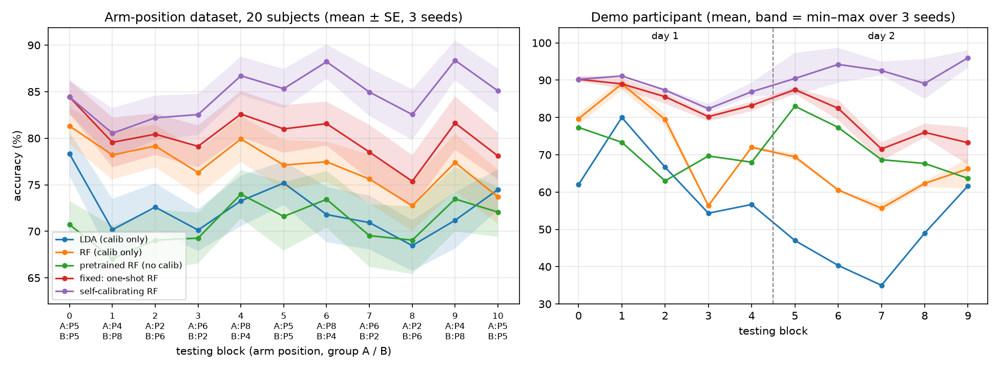
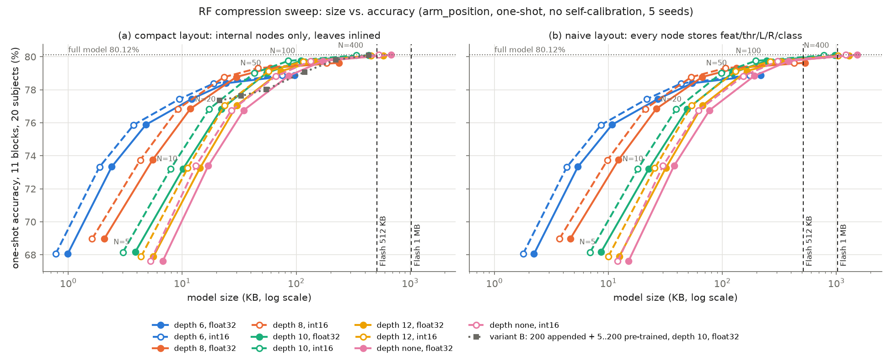

# 自我校正隨機森林肌電控制：PC 基準重現與 STM32H743 記憶體分析

> 論文題目：在 STM32H7 上實現有記憶體預算、不需要標籤的自我校正隨機森林（RF）肌電手勢控制
> 日期：2026-10-17　｜　目標硬體：NUCLEO-H743ZI2（Cortex-M7，2 MB Flash，AXI SRAM 512 KB + SRAM1–4 + DTCM 128 KB）
> 上游程式碼與資料：MoveR-Digital-Health-and-Care-Hub/self-calibrating-rf（commit `48ea4d1`）

報告中的數字，除了明確標示為「估算」的部分，都來自實際執行的結果。每個數字都可以用 `README.md` 裡的指令重新產生。
各階段的詳細說明在 `results/stage1_summary.md`、`stage2_summary.md`、`stage3_summary.md`。
本報告的數字都是在 Windows 11 上跑出來的；之後的實驗改在 WSL2 + Docker（`docker/`）進行，兩個平台的差異見 1.6 節。

## 摘要

| 問題 | 答案 |
|---|---|
| PC 基準重現得出來嗎？ | 可以。自我校正 RF 在 arm_position 資料（20 人、11 個 block）的平均準確率是 **84.63 ± 8.58%**，論文是 84.6 ± 8.5%；所有和論文對得上的指標差距都 < 1 個百分點。 |
| 原始模型放得進 H743 嗎？ | 推論模型可以。論文的完整設定（剪枝後的 200 棵 + 附加的 200 棵，深度不限）用 compact float32 格式，編譯後 Flash 是 **693.8 KB**；照題目設定的 naive 格式要 1519 KB，也放得進 2 MB Flash。 |
| 推薦的壓縮設定 | **100 棵、深度 10、int16 門檻值**：Flash 88.1 KB，one-shot 準確率 79.75%（完整模型是 80.12%，差 −0.37 個百分點）。Flash 夠用的話，400 棵、深度 10、int16 只差 −0.04 個百分點，要 345.5 KB。**自我校正之後**（3.1 節）：100 棵是 83.96%，完整模型 84.43%，差 −0.47 個百分點，差距沒有明顯擴大。 |
| 推論需要多少 RAM？ | 實測 **552 B**（特徵緩衝區 + 最壞情況的 stack）。 |
| 自我校正放得進 MCU 嗎？（估算） | 照論文原樣做（float32 buffer + t-SNE）約需 1208 KB，**放不下**。改用 int16 buffer、100 棵樹、不做 t-SNE，約 334 KB，放得進 AXI 512 KB。但「不做 t-SNE」在論文的 ablation 裡準確率比較低，這是論文要解決的核心問題。 |
| 能壓到 256 KB 以下嗎？（實測，3.5–3.6 節） | 可以：buffer 375 筆（int16）＋ 新樹 32 葉 ＋ t-SNE，自我校正 83.44%、增益 +3.76，RAM 估算 219 KB，和基準無顯著差異（p = 0.17）。250 筆開始明顯變差。t-SNE 在 PC 上每次 2.1 s（1500 筆 9.3 s），MCU 上的時間還沒量。 |
| t-SNE 迭代可以減少嗎？（實測，3.7 節） | 可以減半：同一設定下 500 次迭代自我校正 83.27%、增益 +3.59，和 1000 次（83.44%、+3.76）差 −0.17 個百分點，不顯著（p = 0.14）；PC 上 t-SNE 時間 1.96 → 1.01 s。400 次開始顯著變差（−0.41，p = 0.017），250 次增益只剩 +0.48。 |
| 降低 t-SNE perplexity 有用嗎？（實測，3.8 節） | 不太有用：perplexity 3／5／7 在 PC 上**不省時間**（時間由 octree 排斥力決定，和近鄰數無關），只省 t-SNE 的近鄰表 RAM（估算 100 → 54–81 KB），準確率全都比 perplexity 10 低（−0.07 到 −0.69，部分顯著）。維持 perplexity 10、500 次迭代。 |
| 上板前能先用 C 做完嗎？（實測，第 6 節） | 可以：特徵擷取、t-SNE、K-Means、建樹、整個自我校正迴圈都用 C（靜態記憶體）寫好並在 PC 上驗證，端到端 83.22%（sklearn 83.27%，p = 0.90；修正樹的亂數種子之後，7.1 節），沒有一項有顯著差異。跨兩天的 demo（1 人）上，C 韌體邏輯把第 2 天的 75% 拉回 93%（6.6 節）。MCU 時間要等板子。 |
| one-shot 校正也能在 MCU 上做嗎？（實測，第 7 節） | 可以：剪枝和 Python 逐節點相同（20/20 人），one-shot 79.40%（sklearn 79.68%，p = 0.52），自我校正後 82.98%（83.27%，p = 0.28）。整個路線 B 韌體（序列協定＋即時迴圈＋MCU 上 one-shot＋自我校正）linker 實測 RAM 約 248.7 KB（含中斷 stack 上界），Flash 115.6 KB；加上硬體層（只編譯）253.2 KB。之後 octree 改配 2.5 n（準確率逐列不變）：路線 B 242.1 KB、含硬體層 246.5 KB（7.5 節）。 |
| 怎樣才放得進 512 KB？（實測，3.3–3.4 節） | **不必拿掉 t-SNE**：buffer 存成 int16（無損失）並縮到 750 筆，自我校正 83.83%、增益 +4.15，RAM 估算 394 KB；500 筆 280 KB、增益 +3.78。新樹限制 32 葉讓附加樹保證 ≤ 10.6 KB、準確率無顯著差異。兩者合併使用還沒實測。 |
| 不做 t-SNE 會掉多少？（實測，3.2 節） | 推薦設定上，只用 K-Means 81.03%、不分群 81.64%，t-SNE 版 83.98%；自我校正增益從 +4.30 掉到 +1.35 / +1.96 個百分點（20 人配對 p < 0.001）。完整模型的結果重現了論文的 ablation（84.66 / 80.89 / 82.16 vs 論文 84.6 / 81.0 / 82.7）。 |
| 換平台結果會變嗎？ | 特徵、預測、one-shot、C/ARM 編譯在 Docker（Linux）和 Windows 上都相同。**自我校正不會逐位元相同**：Linux 84.66% vs Windows 84.43%（差 0.23 個百分點，和 seed 之間的變動同一個等級）。同一個比較只用同一個平台的數字（1.6 節）。 |

---

## 1. 重現結果（vs. 論文）

### 1.1 環境與作法
- Python 3.12.3（conda-forge 版），numpy 2.1.2 / scipy 1.14.1 / scikit-learn 1.5.2（版本和 requirements 一樣，joblib 模型才能正確載入）。
- 上游程式沒有設亂數種子，所以用 `src/run_upstream.py` 先固定 numpy 的全域種子再執行，上游程式碼不做任何修改。同一個 seed 重跑兩次，結果逐位元相同。
- arm_position 跑了 3 個 seed（0/1/2），每個 seed 約 57 分鐘；demo 也跑了 3 個 seed。

### 1.2 方法重點（讀程式碼得到）
| 項目 | 實際做法 |
|---|---|
| 濾波 | 每個 channel 用 4 階 Butterworth 帶通 10–500 Hz，`lfilter`（單向、因果） |
| 視窗 | 200 ms（400 點），步長 100 ms；每個 2 秒的 trial 只取後 1 秒 → 10 個視窗 |
| 特徵（10 種 × 8 ch = 80 維） | RMS、WL、SSC、ZC、MAV、偏度、VCF、MDF、MNF、PKF（Welch：Hamming、nperseg 400、nfft 512）；用該受試者 calibration 資料的 mean/std 做 z-score |
| One-shot 校正 | 6 個手勢各 1 個 trial（共 60 個視窗）。預訓練的 200 棵樹由下往上剪枝（calibration 準確率**嚴格提高**才剪），再附加 200 棵只用這 60 筆訓練的新樹 → 400 棵 |
| 自我校正 | 每個 block 結束後，把資料放進最多 1500 筆的 buffer（滿了就刪掉數量最多的偽標籤類別中最舊的一筆）。每類都 ≥ 10 筆時，先做類別平衡 → t-SNE 3 維 → 用 RF 預測的各類中心初始化 K-Means，得到偽標籤。用「偽標籤 + 60 筆真標籤」訓練 80 棵樹，取代 200 棵附加樹中的 80 棵 |
| 偽標籤篩選 | **沒有信心門檻**。buffer 裡的樣本全部會用到（只做類別平衡） |

程式和論文描述不一樣的地方：
- 剪枝條件：論文寫 `≤`，程式是嚴格 `>`。
- 偽標籤初始化：論文寫用「current model」，程式其實一直用最初的 one-shot 模型。
- 比較方向：預測用 `x < thr`，剪枝和 sklearn 用 `x <= thr`。
- bootstrap 比例：JNE 寫 7%，實際模型是 1%–2%。

### 1.3 arm_position 結果（20 人 × 11 block，3 個 seed 平均；`results/baseline.csv`、`baseline_by_position.csv`）

| 方法 | P2 | P4 | P5 | P6 | P8 | 全部 |
|---|---|---|---|---|---|---|
| LDA（只用 calibration） | 69.59 | 70.15 | 75.99 | 71.47 | 73.06 | 72.41 |
| RF（只用 calibration） | 75.67 | 77.84 | 77.37 | 76.25 | 78.66 | 77.18 |
| 預訓練 RF（不校正） | 68.09 | 70.35 | 71.46 | 70.36 | 73.62 | 70.84 |
| **固定模型：one-shot RF** | 78.09 | 81.04 | 81.17 | 78.63 | 81.63 | **80.21** |
| **自我校正 RF** | 82.24 | 85.59 | 84.95 | 83.88 | 86.33 | **84.63** |

20 人中有 18 人的自我校正準確率高於固定模型。

### 1.4 和論文比較（Front. Neurorobot. 2024，只用論文文字和 Table 1 裡的數字；`results/paper_comparison.csv`）

| 指標 | 論文 | 我們（3 個 seed 平均） | 差距 |
|---|---|---|---|
| 自我校正 RF，全部 block | 84.6 ± 8.5 | 84.63 ± 8.58 | +0.03 |
| LDA @P5 | 76.0 ± 9.3 | 75.99 ± 9.26 | −0.01 |
| RF @P5 | 77.6 ± 9.6 | 77.37 ± 10.05 | −0.23 |
| LDA 換到 P2/P4/P6/P8 的下降 | 6.4 / 5.8 / 4.5 / 2.9 | 6.40 / 5.84 / 4.52 / 2.94 | ≤ 0.04 |
| one-shot 比 RF 多的增益 P2/P4/P5/P6/P8 | 2.5 / 3.5 / 4.2 / 2.6 / 3.1 | 2.42 / 3.20 / 3.80 / 2.38 / 2.97 | −0.08 ~ −0.40 |
| 自我校正比 one-shot 多的增益 P2/P4/P5/P6/P8 | 3.3 / 4.2 / 3.7 / 5.0 / 4.1 | 4.14 / 4.55 / 3.77 / 5.25 / 4.69 | +0.07 ~ +0.84 |

**差距都很小，沒有需要特別解釋的大差異。** 可能的小差異來源：
1. RF 訓練和 t-SNE 本身有隨機性：3 個 seed 之間，自我校正的全部平均在 84.38–84.80% 之間變動。
2. 論文本身沒寫 seed 數量和重複次數。
3. 自我校正增益在 P2、P8 的論文值落在我們 seed 的範圍外（+0.8、+0.6），可能來自論文作者用的程式版本或亂數。我們無法再細分原因。

### 1.5 Demo（JNE 2025 的 1 位受試者、10 個 block、跨兩天）
3 個 seed 平均：固定 one-shot 81.89% → 自我校正 90.02%。到了第 2 天後段（block 7–9），固定模型降到 71.6–76.0%，自我校正則是 89.1–96.0%。
JNE 論文報告的是 28 人平均（固定模型 84.3% → 78.6%，自我校正最後 86.5%），不是這位受試者的數字，所以只能比較趨勢：趨勢一致。

### 1.6 實驗環境與跨平台可重現性（`results/platform_check.md`）
原本的結果在 Windows 11 上產生（conda-forge Python 3.12.3、MinGW gcc 8.1、WSL2 裡的 arm-none-eabi-gcc 10.3.1）。
之後的實驗在 WSL2 + Docker 執行（Ubuntu 22.04、Python 3.12.3、同樣的套件版本、gcc 11.4、arm-none-eabi-gcc 10.3.1），
專案放在 WSL 的 `~/model`。兩個平台的比較（實測）：

| 部分 | Docker（Linux）vs. Windows |
|---|---|
| 特徵擷取 | 10 種特徵中 7 種逐位元相同；MNF、偏度、VCF 只差最後一位（相對誤差 ≤ 7e-15） |
| 預測、壓縮掃描（subject 0，660 列）、one-shot（20 人 × 3 seed，660 列） | 完全相同 |
| C 匯出、PC 檢查、Cortex-M7 編譯 | text/data/bss/stack 和預測完全相同 |
| 自我校正（400 棵、深度不限、float64，20 人 × 3 seed） | Linux **84.66%**（84.50–84.81）vs Windows **84.43%**（84.08–84.83）；只有 157/660 個 block 相同 |

- 每個 (seed, 受試者) 的差（Linux − Windows）：平均 +0.23 個百分點，SD 0.85；20 人的 Wilcoxon 檢定 p = 0.040。
  差異小於 Windows 自己 seed 之間的差距（0.75 個百分點），只有 3 個 seed，不足以判斷是系統性的還是偶然。
- 原因：t-SNE → K-Means → 重新訓練樹 這條鏈對極小的浮點差異很敏感；連 Linux 單執行緒和多執行緒的結果都不一樣。
  **Windows 單執行緒**（和原本 joblib worker 的條件一樣）可以逐位元重現原本的結果，所以差異來自平台，不是程式錯誤。
- **規則**：同一張表、同一個比較的數字只用同一個平台的結果；新的實驗都在 Docker 裡跑，對照組也一起在 Docker 裡重跑。

---

## 2. 原始模型大小，以及能不能放進 H743

### 2.1 預訓練模型結構（`results/model_stats.csv`）
| | 38 人模型 | 66 人模型 |
|---|---|---|
| 樹數 / 特徵 / 類別 | 200 / 80 / 6 | 200 / 80 / 6 |
| 每棵樹節點數 平均（最大） | 778.6（855） | 821.4（895） |
| 深度 平均（最大） | 18.6（31） | 18.5（24） |
| 平均葉節點深度 | 10.8 | 10.7 |
| 總節點數 | 155,730 | 164,284 |

### 2.2 原始大小（只算走得到的節點，外加每棵樹 4 B 的 offset 表）
| 66 人預訓練模型 | float32 | int16 |
|---|---|---|
| naive（每個節點都存 feature u8 + thr + L/R u16 + class u8） | 1605 KB | 1284 KB |
| compact（只存內部節點，葉節點編在 child index 裡） | 722 KB | 562 KB |

實際部署的是「剪枝後的 200 棵 + 附加的 200 棵」。剪枝只讓每棵預訓練樹從 821 個節點降到約 764 個；
附加樹只用 60 筆資料訓練，每棵約 13 個節點。實測：compact float32 是 682 KB、naive float32 是 1519 KB。
**結論：放得進 2 MB Flash（naive 格式佔約 74%），但不論哪種格式都超過 512 KB 的參考線。**

---

## 3. 壓縮取捨曲線與推薦設定

掃描做法（`src/compression_sweep.py`，20 人 × 11 block × 5 個 seed，**one-shot 固定模型**）：
把預訓練樹截到深度 d → 剪枝 → 保留 N/2 棵 → 附加 N/2 棵新樹（max_depth = d）。
int16 用 Q5.10 定點（z-score 後的門檻值範圍是 −9.9 到 20.8，放得進 ±32）。

one-shot 準確率（%，int16；和 float32 的差距在所有設定下都 ≤ 0.023 個百分點）：

| depth \ N | 5 | 10 | 20 | 50 | 100 | 400 |
|---|---|---|---|---|---|---|
| 6 | 68.06 | 73.32 | 75.87 | 77.44 | 78.38 | 78.88 |
| 8 | 68.97 | 73.75 | 76.84 | 78.76 | 79.31 | 79.62 |
| 10 | 68.16 | 73.21 | 76.82 | 79.01 | 79.75 | 80.08 |
| 12 | 67.89 | 73.25 | 77.04 | 79.13 | 79.72 | 80.06 |
| 不限 | 67.61 | 73.39 | 76.75 | 78.83 | 79.74 | 80.11 |

大小（KB，compact int16）：深度 10 時，N = 5/10/20/50/100/400 分別是 3.0 / 7.9 / 17.1 / 42.8 / 85.4 / 338.2。
完整表格在 `results/sweep_summary.csv`，Pareto 前緣在 `results/sweep_pareto.csv`。

觀察：
1. **int16 量化完全沒有準確率損失**，大小少 22%。
2. **深度 10 就夠了**：和不限深度的差距 ≤ 0.1 個百分點，大小少 36%。
3. **準確率主要看樹的數量**：N = 100 時差 −0.37 個百分點，N = 20 時差 −3.3，N = 10 時差 −6.9。
   題目舉的「20 棵、深度 10」只要 17 KB，但要付出 3.3 個百分點的代價。
4. 變體 B（固定保留 200 棵附加樹，只減少預訓練樹）只有在深度 6 時有幾個點落在 Pareto 前緣上，在深度 10 都比一半一半的組合差。

**推薦設定：100 棵（50 棵剪枝後的預訓練樹 + 50 棵附加樹）、深度 10、int16 Q5.10。**
理由：Flash 只要 88 KB（佔 2 MB 的 4%），one-shot 準確率只差 0.37 個百分點；而且只有 50 棵附加樹會被自我校正替換，放在 RAM 的部分比較小（見第 5 節）。
備選：400 棵、深度 10、int16（345.5 KB，−0.04 個百分點），適合 Flash 很充裕、想最接近原始模型的情況。

上面的準確率都是 one-shot（固定模型）。自我校正之後的結果在 3.1 節。

### 3.1 壓縮後模型的自我校正準確率（`src/selfcal_sweep.py` → `results/selfcal_sweep*.csv`）

做法：照上游 `main_replay_arm_position.py` 的迴圈重寫（buffer_update / manifold_clustering / replace 直接呼叫上游函式，沒有改）。
設定 (N, d, 精度)：預訓練樹截到深度 d → 剪枝 → 保留 N/2 棵 → 附加 N − N/2 棵；每個 block 之後用
buffer（1500 筆）+ t-SNE（3 維、perplexity 10）+ K-Means（min_sample_class 10）產生偽標籤，
訓練 round(0.4 × 附加樹數) 棵新樹（同樣 max_depth；N = 400 時是 80 棵）替換隨機選的附加樹。
所有預測（包含 manifold_clustering 內部的預測）都用該設定的精度；新樹用 float64 訓練。
照上游行為，K-Means 初始中心用的偽標籤一律由**最初的 one-shot 模型**產生，不是當下自我校正過的模型。
亂數照上游走 numpy 全域 RNG，每個 (seed, 受試者) 呼叫 `np.random.seed`。20 人 × 11 block × 3 個 seed（0/1/2）。

**驗證**：(400, 不限, float64) 得到 **84.43%**（seed 0/1/2 = 84.38 / 84.08 / 84.83），
上游 3 個 seed 是 84.38–84.80（平均 84.63），平均值落在範圍內。one-shot 80.03%（上游 80.21%）。

| 設定 (N, 深度, 精度) | one-shot | 自我校正（seed 範圍） | 增益 | 自我校正 vs 完整模型 | one-shot vs 完整模型 |
|---|---|---|---|---|---|
| 400, 不限, float64（上游） | 80.03 | **84.43**（84.08–84.83） | +4.40 | — | — |
| 400, 不限, float32 | 80.03 | 84.46（84.25–84.67） | +4.43 | +0.03 | 0.00 |
| 400, 10, int16 | 79.84 | 84.37（84.17–84.54） | +4.53 | −0.06 | −0.19 |
| **100, 10, int16（推薦）** | 79.68 | **83.96**（83.89–84.07） | +4.28 | **−0.47** | −0.35 |
| 50, 8, int16 | 78.77 | 83.19（82.94–83.40） | +4.42 | −1.24 | −1.26 |
| 20, 10, int16 | 77.17 | 81.93（81.69–82.14） | +4.76 | −2.50 | −2.86 |

（%，20 人平均；增益的 seed 範圍在 `results/selfcal_sweep_summary.csv`。受試者間標準差 8.7–9.5。
這裡的 one-shot 是 3 個 seed、全域 RNG，和上面 5 個 seed 的掃描差 ≤ 0.1 個百分點。）

觀察：
1. **自我校正的增益在所有壓縮設定下都差不多（+4.3 到 +4.8 個百分點）**，所以 one-shot 的差距大致原樣保留：
   推薦設定從 −0.35 變成 −0.47（差 0.12，和 seed 範圍同等級），N = 20 反而從 −2.86 縮小到 −2.50。
2. **int16 和深度 10 在自我校正後仍然沒有損失**：400 棵、深度 10、int16 只差 −0.06。
3. **自我校正後的樹比 one-shot 的附加樹大很多**（實測，`results/selfcal_sweep_trees.csv`）：
   one-shot 附加樹只用 60 筆 calibration 資料訓練，平均 13 個節點；自我校正後的附加樹是用 buffer + calibration 訓練的，

   | 設定 | 自我校正後附加樹節點數：平均 / 最大 | 整個模型 compact 大小：one-shot → 自我校正後平均（最大） |
   |---|---|---|
   | 400, 不限, float32 | 149 / 443（深度最深 26） | 682.4 → 802.3 KB（942.1） |
   | 400, 10, int16 | 133 / 343 | 338.2 → 420.5 KB（494.8） |
   | 100, 10, int16 | 135 / 331 | 85.4 → 106.3 KB（122.6） |
   | 50, 8, int16 | 105 / 223 | 23.2 → 31.1 KB（36.3） |
   | 20, 10, int16 | 141 / 309 | 17.1 → 21.5 KB（24.9） |

   深度 10 的單棵樹最大 331–343 個節點（165–171 個內部節點），比原本的近似值（每棵最多 107 個內部節點，
   來自 `compression_sweep.py` 不做 t-SNE/K-Means 的近似訓練集）大約 1.6 倍。但不會每棵樹都長到最大，
   所以 5.2 節改用**實測的整個附加樹區塊**：二元樹的內部節點數 = (節點數 − 1) / 2，每次執行的區塊大小 =
   附加樹數 × (平均節點數 − 1) / 2 × 每節點 bytes，再取 20 人 × 3 個 seed 中的最大值。
   推薦設定（50 棵附加樹）：平均 22.9 KB、最大 **38.8 KB**；400 棵、深度 10、int16：平均 90.5 KB、最大 163.5 KB；
   400 棵、深度不限、float32：平均 130.4 KB、最大 267.8 KB。

### 3.2 低記憶體的偽標籤方法（實測，Docker；`src/analyze_pseudo.py` → `results/pseudo_label_summary.csv`）

`selfcal_sweep.py --pseudo` 用上游 `manifold_clustering` 原有的分支比較三種偽標籤做法（上游程式不改）：
t-SNE + K-Means（上游預設）、只用 K-Means（80 維，`embedding=None`）、不分群（`min_sample_class = ∞`，
直接用 one-shot 模型的預測、只做類別平衡）。20 人 × 11 block × 3 seed，全部在 Docker 上跑，彼此可以直接比較
（但不要和上面 Windows 的數字混著比，見 1.6 節）。RAM 是 5.2 節的估算方式，但可替換附加樹用**各方法自己實測**的樹大小。

| 模型 | 偽標籤方法 | 自我校正後（seed 範圍） | 增益 | 和 t-SNE 版比（20 人配對） | 論文 ablation | RAM（估算） |
|---|---|---|---|---|---|---|
| 400 棵、深度不限、float64 | t-SNE + K-Means | **84.66**（84.50–84.81） | +4.63 | — | 84.6 | 1206 KB |
| | 只用 K-Means | 80.89（80.77–81.06） | +0.86 | −3.77，3/20 人較好，p < 0.001 | 81.0 | 879 KB |
| | 不分群 | 82.16（82.02–82.29） | +2.13 | −2.50，4/20 人較好，p < 0.001 | 82.7 | 758 KB |
| 100 棵、深度 10、int16 | t-SNE + K-Means | **83.98**（83.90–84.03） | +4.30 | — | — | 737 KB |
| | 只用 K-Means | 81.03（80.94–81.21） | +1.35 | −2.94，2/20 人較好，p < 0.001 | — | **341 KB** |
| | 不分群 | 81.64（81.60–81.66） | +1.96 | −2.33，3/20 人較好，p < 0.001 | — | **327 KB** |

（one-shot 都是 80.03%（400 棵）和 79.68%（100 棵）；配對差異是 seed 平均後的 20 人 Wilcoxon 檢定。）

觀察：
1. **重現了論文的 ablation**：完整模型的三個數字和論文高低順序相同，差距 ≤ 0.6 個百分點，所以這裡的實作和論文作者的做法一致。
   「不分群」比「只用 K-Means」好，和論文一樣。
2. **壓縮後研究問題仍然成立**：放得進 AXI 512 KB 的兩種做法（只用 K-Means、不分群），自我校正增益從 +4.30 掉到 +1.35 / +1.96，
   少了一半以上；20 人中只有 2–3 人比 t-SNE 版好。t-SNE 本身（估算 401 KB）是放不進去的主因。
3. 只用 K-Means 的附加樹長得比較大（完整模型最大 597 個節點，t-SNE 版 449），偽標籤比較雜時樹會變複雜，RAM 也跟著變大。

### 3.3 限制自我校正新樹的大小（實測，Docker；`src/analyze_leaf_buffer.py` → `results/leaf_buffer_summary.csv`）

推薦設定（100 棵、深度 10、int16）＋ t-SNE + K-Means，只限制自我校正時新訓練的樹（one-shot 的附加樹不變），
20 人 × 11 block × 3 seed。基準是同一模型、不限制（3.2 節的 Docker 結果 83.98%）。
附加樹區塊 = 50 棵 × (平均節點數 − 1) / 2 × 7 B，取 20 人 × 3 seed 中最大的一次；`max_leaf_nodes = L` 時另有保證上限 50 × (L − 1) × 7 B。

| 新樹的限制 | 自我校正後（seed 範圍） | 增益 | 和不限制比（20 人配對） | 附加樹區塊（實測最大） | 保證上限 |
|---|---|---|---|---|---|
| 不限制 | 83.98（83.90–84.03） | +4.30 | — | 40.3 KB | 無 |
| **max_leaf_nodes 32** | **83.90**（83.78–84.05） | +4.22 | −0.08，7/20 人較好，p = 0.35 | **10.6 KB** | **10.6 KB** |
| max_leaf_nodes 64 | 84.05（83.89–84.22） | +4.37 | +0.07，9/20，p = 0.73 | 21.5 KB | 21.5 KB |
| max_leaf_nodes 128 | 84.00（83.78–84.15） | +4.32 | +0.02，11/20，p = 0.76 | 38.5 KB | 43.4 KB |
| min_samples_leaf 5 | 83.83（83.70–83.91） | +4.15 | −0.14，8/20，p = 0.12 | 24.9 KB | 無 |
| min_samples_leaf 10 | 83.75（83.66–83.87） | +4.07 | −0.22，6/20，p = 0.064 | 16.1 KB | 無 |

觀察：
1. **`max_leaf_nodes = 32` 把附加樹的 RAM 從「實測最大 40 KB、沒有上限」變成保證 ≤ 10.6 KB，準確率沒有可量測的損失**（−0.08 個百分點，在 seed 範圍內，p = 0.35）。
2. `min_samples_leaf` 也能讓樹變小，但沒有保證上限，而且準確率掉得比較多；MCU 上要配置固定大小的記憶體池，所以用 `max_leaf_nodes`。
3. 這組結果是在 t-SNE + K-Means 上量的；和低記憶體偽標籤方法（3.2 節）一起用時的準確率還沒量。

### 3.4 buffer 大小與 int16 buffer（實測，Docker；同上 `leaf_buffer_summary.csv`）

推薦設定 ＋ t-SNE + K-Means，不限制樹大小。`--buffer-int16`：buffer 和自我校正訓練用的校正資料都存成 Q5.10 int16
（量化後再讀回來做 t-SNE、K-Means 和訓練），one-shot 模型不變。RAM 用 5.2 節的算法，buffer、t-SNE、K-Means、偽標籤、
RF 訓練暫存都依 buffer 大小重算，附加樹用各組實測的最大區塊。

| buffer | 自我校正後（seed 範圍） | 增益 | 和基準比（20 人配對） | t-SNE | 自我校正 RAM 合計（估算） |
|---|---|---|---|---|---|
| 1500 筆 float32（基準，上游） | 83.98（83.90–84.03） | +4.30 | — | 401 KB | 980 KB |
| 1500 筆 int16 | 84.00（83.95–84.04） | +4.32 | +0.02，11/20 人較好，p = 0.96 | 401 KB | 735 KB |
| 1000 筆 int16 | 84.05（83.80–84.40） | +4.37 | +0.08，11/20，p = 0.48 | 268 KB | **508 KB** |
| **750 筆 int16** | **83.83**（83.62–84.18） | **+4.15** | −0.15，11/20，p = 0.87 | 201 KB | **394 KB** |
| 500 筆 int16 | 83.46（83.40–83.55） | +3.78 | −0.52，9/20，p = 0.11 | 134 KB | **280 KB** |
| （3.2 節）不分群，1500 筆 int16 | 81.64（81.60–81.66） | +1.96 | −2.33，3/20，p < 0.001 | 0 | 327 KB |

觀察：
1. **int16 buffer 沒有損失**（84.00 vs 83.98，p = 0.96），buffer 和校正資料的 RAM 直接減半。
2. **縮小 buffer 就能把 t-SNE 版放進 AXI 512 KB，而且增益幾乎都保住**：750 筆 394 KB、增益 +4.15；500 筆 280 KB、增益 +3.78。
   在差不多的 RAM 下，小 buffer 的 t-SNE 遠比拿掉 t-SNE 好（不分群 327 KB、增益只有 +1.96）。
3. 所以 5.2 節「放得進 512 KB 的只有不做 t-SNE 的做法」要修正：**t-SNE 本身不必拿掉，縮小 buffer 就夠了**。
   下一個真正的限制是 256 KB 以下（目前最小 280 KB），以及 t-SNE 在 MCU 上的運算時間（還沒量）。
4. 小 buffer ＋ `max_leaf_nodes 32` 一起用的結果在 3.5 節。

### 3.5 小 buffer ＋ 新樹限制 32 葉（實測，Docker；同上 `leaf_buffer_summary.csv`）

推薦設定 ＋ t-SNE + K-Means，buffer 存成 int16，新樹 `max_leaf_nodes = 32`（附加樹保證 ≤ 10.6 KB），20 人 × 11 block × 3 seed。

| buffer | 自我校正後（seed 範圍） | 增益 | 和基準比（20 人配對） | t-SNE | 自我校正 RAM 合計（估算） |
|---|---|---|---|---|---|
| 750 筆 | 83.78（83.68–83.88） | +4.10 | −0.20，9/20 人較好，p = 0.60 | 201 KB | 382 KB |
| 500 筆 | 83.58（83.51–83.66） | +3.90 | −0.39，7/20，p = 0.14 | 134 KB | 273 KB |
| **375 筆** | **83.44**（83.17–83.69） | **+3.76** | −0.54，7/20，p = 0.17 | 100 KB | **219 KB** |
| 250 筆 | 82.83（82.53–83.03） | +3.15 | −1.15，2/20，**p = 0.001** | 67 KB | 164 KB |

觀察：
1. **256 KB 以下也做得到**：buffer 375 筆 ＋ 32 葉，RAM 估算 219 KB，增益 +3.76（基準 +4.30），和基準沒有顯著差異。
2. 250 筆開始明顯變差（−1.15 個百分點，20 人中 18 人變差，p = 0.001），所以 buffer 的下限大約在 375 筆。
3. 和兩項限制分開跑的結果一致（750 筆：單獨 83.83、合併 83.78；500 筆：83.46 / 83.58），兩項限制之間沒有明顯的交互作用。

### 3.6 t-SNE 的運算量（PC 實測；`src/tsne_cost.py` → `results/tsne_cost.csv`）

用和自我校正相同的 buffer（int16、類別平衡後才進 t-SNE）和相同的 t-SNE 設定（3 維、perplexity 10、Barnes-Hut），
在 PC 上單執行緒量每次 t-SNE 的 CPU 時間，3 位受試者平均：

| buffer | 實際進 t-SNE 的點數 | 迭代次數 | PC CPU 時間 | 相對 1500 筆 |
|---|---|---|---|---|
| 1500 | 1060 | 999 | 9.3 s | 1.00 |
| 1000 | 776 | 999 | 6.0 s | 0.64 |
| 750 | 650 | 999 | 4.7 s | 0.50 |
| 500 | 444 | 999 | 2.8 s | 0.31 |
| 375 | 362 | 999 | 2.1 s | 0.22 |
| 250 | 188 | 999 | 0.9 s | 0.10 |

- 時間大致和點數成正比；buffer 375 筆時是 1500 筆的 22%。
- **每次都跑到迭代上限（sklearn 預設 1000 次）**，沒有提早停止，所以減少迭代次數是另一個可以省運算量的方向（準確率影響還沒量）。
- 這是 PC（x86、sklearn 的 Cython 實作）的時間，**不是 Cortex-M7 的時間**；MCU 上要用 C 實作 Barnes-Hut t-SNE 後在板子上量。
  自我校正每個 block（30 個 trial）才做一次，所以 MCU 上能接受的時間比即時推論寬鬆得多，但具體能不能接受要等實測。

### 3.7 減少 t-SNE 迭代次數（實測，Docker；`src/analyze_tsne_iter.py` → `results/tsne_iter_summary.csv`）

設定和 3.5 節的 256 KB 以下版本相同（100 棵、深度 10、int16、buffer 375 筆 int16、新樹 32 葉），只改 t-SNE 的迭代次數
（sklearn `max_iter`；`src/selfcal_sweep.py --tsne-iter`，上游程式不改，在 worker 裡把 `emg_functions.TSNE` 換成固定 `max_iter` 的版本）。
20 人 × 3 seed；比較對象是同一次執行的 1000 次（上游預設），它和 3.5 節的結果 660 個 block 完全相同。
時間是 `src/tsne_cost.py --sizes 375 --iters ...`：CPU 空閒時單執行緒、3 位受試者平均、同一個 t-SNE 輸入和 seed。

| 迭代次數 | 自我校正 | seed 範圍 | 增益 | vs 1000 次（20 人配對） | 較好／較差人數 | Wilcoxon p | PC t-SNE CPU 時間 | 相對 1000 次 |
|---|---|---|---|---|---|---|---|---|
| 250 | 80.16 | 79.72–80.84 | +0.48 | −3.28 | 0 / 20 | < 0.001 | 0.46 s | 0.23 |
| 300 | 82.15 | 81.96–82.47 | +2.47 | −1.28 | 2 / 18 | < 0.001 | 0.62 s | 0.32 |
| 350 | 82.72 | 82.57–82.93 | +3.04 | −0.72 | 5 / 15 | < 0.001 | 0.78 s | 0.40 |
| 400 | 83.03 | 82.84–83.29 | +3.35 | −0.41 | 6 / 14 | 0.017 | 0.81 s | 0.41 |
| **500** | **83.27** | 83.13–83.37 | **+3.59** | −0.17 | 8 / 12 | 0.14 | **1.01 s** | **0.51** |
| 750 | 83.41 | 83.25–83.58 | +3.73 | −0.03 | 9 / 11 | 0.50 | 1.63 s | 0.83 |
| 1000（上游） | 83.44 | 83.17–83.69 | +3.76 | — | — | — | 1.96 s | 1.00 |

觀察：
1. **500 次迭代可以把 t-SNE 時間減半**（PC 上 1.96 → 1.01 s），準確率差 −0.17 個百分點，和 1000 次沒有顯著差異。
   但「不顯著」不等於「相同」：20 人中 12 人略差，只有 3 個 seed，所以論文裡要寫成「差異小於 seed 間的變動」，不能寫成無損。
2. **400 次以下開始顯著變差**，250 次幾乎沒有增益（+0.48）。原因是 sklearn 的前 250 次是 early exaggeration 階段，
   只跑這一段時嵌入還沒收斂成可分群的形狀；之後每多 50–100 次迭代都還有明顯的改善，到 500 次才趨於平緩。
3. 時間大致和迭代次數成正比（每次迭代的運算量固定）。這次 1000 次量到 1.96 s，3.6 節是 2.1 s：同一個輸入在不同時間量的差異，
   所以只在同一次量測裡比較相對值。
4. 這仍然是 PC 的時間；迭代次數對 MCU 時間的影響要等 C 版 t-SNE 上板後量（預期也大致成正比，但沒有實測就不報數字）。

---

### 3.8 降低 t-SNE perplexity（實測，Docker；`src/analyze_tsne_px.py` → `results/tsne_px_summary.csv`）

同 3.7 節的設定，perplexity 改成 3／5／7（每個點的近鄰數 3 × perplexity + 1 = 10／16／22，上游 10 → 31），各配 500 和 1000 次迭代
（`src/selfcal_sweep.py --tsne-perplexity`；上游呼叫時自己傳了 `perplexity=10`，所以替換的 TSNE 會強制覆寫這個參數）。
perplexity 10 的兩列來自 3.7 節那次執行。比較對象：上游設定（perplexity 10、1000 次）。時間：`src/tsne_cost.py --perplexities`，CPU 空閒時單執行緒、3 人平均。
RAM 是估算（t-SNE 近鄰表依近鄰數縮放，其他項同 3.5 節）。

| perplexity | 迭代 | 近鄰數 | 自我校正 | 增益 | vs 上游（20 人配對） | 較好／較差 | p | PC t-SNE 時間 | t-SNE RAM（估算） | 總 RAM（估算） |
|---|---|---|---|---|---|---|---|---|---|---|
| 3 | 500 | 10 | 82.75 | +3.07 | −0.69 | 4 / 16 | 0.004 | 1.15 s | 54 KB | 173 KB |
| 3 | 1000 | 10 | 83.01 | +3.33 | −0.42 | 8 / 12 | 0.19 | 2.06 s | 54 KB | 173 KB |
| 5 | 500 | 16 | 83.19 | +3.51 | −0.25 | 8 / 12 | 0.13 | 1.08 s | 67 KB | 186 KB |
| 5 | 1000 | 16 | 83.21 | +3.53 | −0.23 | 8 / 12 | 0.23 | 2.12 s | 67 KB | 186 KB |
| 7 | 500 | 22 | 83.05 | +3.37 | −0.38 | 4 / 16 | 0.012 | 1.05 s | 81 KB | 199 KB |
| 7 | 1000 | 22 | 83.36 | +3.68 | −0.07 | 9 / 11 | 0.65 | 2.01 s | 81 KB | 199 KB |
| **10** | **500** | 31 | **83.27** | **+3.59** | −0.17 | 8 / 12 | 0.14 | **0.99 s** | 100 KB | 219 KB |
| 10（上游） | 1000 | 31 | 83.44 | +3.76 | — | — | — | 1.99 s | 100 KB | 219 KB |

觀察：
1. **降低 perplexity 在 PC 上不省時間**：同樣迭代次數下，perplexity 3–10 的時間差不到 ±0.1 s（perplexity 小的甚至略慢）。
   3.6 節的工作量模型（近鄰吸引力 n × k ＋ octree n log n）認為近鄰項是大宗，**這個假設不成立**：sklearn 的時間主要在
   Barnes-Hut 排斥力（octree），和近鄰數無關。C 版 t-SNE 要優化的應該是排斥力那一段（例如 angle、octree 的實作）。
2. **只省 RAM**：近鄰表從 100 KB 降到 54–81 KB（估算），總 RAM 219 → 173–199 KB。但 219 KB 已經在 256 KB 以內，這不是目前的瓶頸。
3. **準確率都比較低**，而且不是單調的（perplexity 7、500 次比 5、500 次差），看起來是 seed 層級的雜訊加上真實的小損失；
   3／500 和 7／500 顯著變差。沒有一個設定同時比 perplexity 10、500 次更快又更準。
4. 結論：**維持 perplexity 10、500 次迭代**。如果之後 RAM 預算要降到 200 KB 以下，perplexity 5 是可以考慮的備案（−0.25，不顯著）。

## 4. 編譯後的 Flash/RAM 用量

PC 正確性檢查（MinGW gcc 8.1，3300 筆測試視窗）：3 個設定 × 2 種實作，C 和 Python 的預測**100% 一致**（`results/c_check.csv`）。
在 Docker 裡用 gcc 11.4 重跑，結果也相同（`results/logs/linux/c_check.csv`）。

交叉編譯（WSL2，arm-none-eabi-gcc 10.3.1；`-mcpu=cortex-m7 -mthumb -mfpu=fpv5-d16 -mfloat-abi=hard -Os -ffunction-sections -fdata-sections -Wl,--gc-sections --specs=nano.specs --specs=nosys.specs`；`results/arm_size.csv`）：

| 設定 | 實作 | text | data | bss† | Flash | 靜態 RAM | 最壞 stack | 推論 RAM |
|---|---|---|---|---|---|---|---|---|
| 400 棵 / 不限 / float32 | 自寫 table | 710,480 | 4 | 324 | **693.8 KB** | 328 B | 72 B | **400 B** |
| 400 棵 / 不限 / float32 | emlearn inline | 2,024,756 | 4 | 324 | 1977.3 KB | 328 B | 192 B | 520 B |
| 400 棵 / 深度 10 / int16 | 自寫 table | 353,796 | 4 | 484 | **345.5 KB** | 488 B | 64 B | **552 B** |
| 400 棵 / 深度 10 / int16 | emlearn loadable | 404,180 | 32 | 488 | 394.7 KB | 520 B | 212 B | 732 B |
| **100 棵 / 深度 10 / int16** | **自寫 table** | 90,204 | 4 | 484 | **88.1 KB** | 488 B | 64 B | **552 B** |
| 100 棵 / 深度 10 / int16 | emlearn loadable | 103,108 | 32 | 488 | 100.7 KB | 520 B | 212 B | 732 B |

† 已經扣掉 linker script 為 stack 保留的 4096 B。最壞 stack 是用 `-fcallgraph-info=su` 沿最深的呼叫路徑加總。

重點：
- 自寫 table 格式的實際大小和階段 2 的估算完全相同，每種設定都比 emlearn 小 12.5%–65%。
  emlearn 的 int16 節點因為 padding 是 8 B（我們是 7 B）；emlearn 的 float inline 把每個節點都編成程式碼。
- emlearn 的 float inline 用 `%.6f` 印門檻值，93% 的門檻值有最多 9.5e-7 的誤差。這次測試沒有任何預測因此改變，但仍然有風險。**建議用自寫的 table runtime。**
- C 端一定要用 `x < thr`。在 int16 下換成 `<=`，預測只有 99.70% 相同。
- **Cycle 數沒有量。** QEMU 和 Renode 都不模擬 Cortex-M7 的 pipeline、cache 和 Flash wait state，它們的 cycle 數其實是用指令數推算的，所以不報。
  要拿到真正的推論時間，就燒到 NUCLEO 板上讀 `g_cycles`（main.c 已經用 DWT CYCCNT 量好）。ARM 上的預測正確性也要在板子上確認。

---

## 5. 下一步

### 5.1 特徵擷取移植到 C
- **濾波**：把 4 階 Butterworth 帶通改成 4 個 biquad（SOS 形式），每個 channel 串流處理。
  上游用的是 `lfilter` 的 b/a 形式，每個 trial 都從 0 初始狀態開始；串流處理的初始狀態不同，所以要先在 PC 上確認 SOS 串流版和上游的特徵差多少（暫態大約在前 1 秒內衰減，而上游本來就只用後 1 秒）。
- **時域特徵**（RMS/WL/SSC/ZC/MAV/偏度）：單次掃過視窗就能算完。
- **頻域特徵**：Hamming（400 點，常數表放 Flash）+ CMSIS-DSP 的 `arm_rfft_fast_f32`（512 點）→ Welch PSD（257 個 bin）→ MNF/MDF/PKF/VCF。要逐項和 scipy 對照。
- **驗收方式**：用 dataset 的原始 EMG 在 PC 上跑 C 版特徵，和 `features_arm_position/` 比對誤差，再把 C 版特徵丟進 RF，確認準確率不變。
- **RAM 估算**：濾波後的 ring buffer 12.5 KB + IIR 狀態 0.25 KB + FFT 4 KB + PSD 1 KB ≈ **18 KB**（依設計計算，`results/ram_estimate.csv`）。

### 5.2 MCU 上自我校正需要的 RAM（估算，`src/ram_estimate.py` → `results/ram_scenarios.csv`）

| 項目 | 大小 | 依據 |
|---|---|---|
| Buffer 1500 × 80，float32 / int16 | 468.8 / 234.4 KB | 上游參數（論文寫「~500 KB」） |
| Calibration 資料 60 × 80，float32 / int16 | 18.8 / 9.4 KB | |
| 可替換的附加樹區塊（自我校正後，20 人 × 3 seed 中最大的一次）：50 棵深度 10 int16 / 200 棵深度不限 float32 | 38.8 / 267.8 KB | **實測**（`results/selfcal_sweep_trees.csv`，第 3.1 節） |
| RF 訓練暫存（一次訓練一棵樹） | 26.2 KB | 索引陣列、排序後的特徵值、2^11 個節點的建樹緩衝區 |
| K-Means（80 維） | 5.2 KB | |
| Barnes-Hut t-SNE（3 維，31 個鄰居） | 401 KB | 稀疏 P 矩陣 272.5 KB + 嵌入/梯度 70.3 KB + octree 58.6 KB |

| 情境 | 合計 | 放進 AXI 512 KB？ |
|---|---|---|
| A 照論文原樣：float32 buffer、400 棵（深度不限）、t-SNE + K-Means | **1208 KB** | 否（連全部 SRAM 都放不下） |
| B int16 buffer、100 棵、t-SNE + K-Means | 735 KB | 否（要拆到好幾塊 SRAM，沒有這麼大的連續區塊） |
| C int16 buffer、100 棵、只用 K-Means | **334 KB** | 是 |

（合計已包含推論 552 B、特徵擷取約 18 KB、偽標籤 1.5 KB、RF 訓練暫存 26 KB。）

**論文的核心問題就在這裡**：t-SNE 是最大的記憶體負擔，但論文的 ablation（Frontiers Table 1）顯示：
- 拿掉 t-SNE、只做 K-Means：81.0%
- t-SNE 和 K-Means 都拿掉：82.7%
- 完整模型：84.6%

也就是說，直接拿掉 t-SNE 會掉 3.6 個百分點。在記憶體預算內找到 t-SNE 的替代方案，就是論文的主要貢獻。

> **更新（3.4 節實測）**：上表都假設 buffer 是 1500 筆。實際上不必拿掉 t-SNE：buffer 存成 int16 並縮到 750 筆，
> t-SNE 版約 394 KB（估算）、增益 +4.15，放得進 512 KB。所以研究問題改成：能不能壓到 256 KB 以下，以及 t-SNE 在 MCU 上算不算得完。

### 5.3 具體待辦（依優先順序）
0. ~~量壓縮後模型的自我校正準確率~~（已完成，3.1 節）：推薦設定（100 棵、深度 10、int16）自我校正後 83.96%（seed 範圍 83.89–84.07），
   比完整模型（84.43%）低 0.47 個百分點；one-shot 階段的差距是 −0.35，自我校正後沒有明顯擴大。
   另外發現自我校正後的單棵附加樹比原本的近似值大約 1.6 倍（深度 10 最大 165 個內部節點）；5.2 節已改用實測的附加樹區塊大小重算。
1. ~~**限制自我校正新樹的大小**~~（已完成，3.3 節）：`max_leaf_nodes = 32` 讓附加樹區塊保證 ≤ 10.6 KB，準確率 83.90%（不限制 83.98%，p = 0.35）。
2. **低記憶體的偽標籤方法**：在 PC 上比較下面幾種，看準確率和 RAM 的取捨：
   - ~~K-Means 直接在 80 維做~~、~~不分群~~（已完成，3.2 節：增益只剩 +1.35 / +1.96 個百分點，t-SNE 版是 +4.30）
   - 先投影到低維（PCA 或用 calibration 資料訓練的 LDA）再做 K-Means
   - t-SNE 縮小 buffer（例如 500 筆）
   - 依信心門檻篩選樣本
3. ~~**Buffer 精度和大小**~~（已完成，3.4 節）：int16 buffer 無損失；750 筆 394 KB、增益 +4.15。
   ~~(a) 小 buffer ＋ 32 葉一起跑~~、~~(b) 往 256 KB 以下推~~（已完成，3.5 節：375 筆 219 KB、增益 +3.76）。
   接著要做：~~(c) 用 C 實作 Barnes-Hut t-SNE~~（已完成，6.1 節；Cortex-M7 上的時間要等板子）；
   ~~(d) 減少 t-SNE 迭代次數~~（已完成，3.7 節：500 次時間減半、−0.17 個百分點不顯著；400 次以下顯著變差）。
   ~~降低 perplexity~~（已完成，3.8 節：PC 上不省時間，只省近鄰表 RAM，準確率較低；維持 perplexity 10）。
4. ~~**特徵擷取移植到 C**~~（已完成，6.4 節：連續特徵相對誤差中位數 ≤ 1.3e-5，自我校正準確率不變）。
5. **上板**：設定好時脈（480 MHz）和 I/D-cache，量 `rf_predict` 和特徵擷取的 cycle 數，並在板上確認 `g_pred`。
6. ~~**MCU 上的 RF 訓練**~~（已完成，6.2 節：C 版 CART，max_features = 8（sklearn 的 sqrt(80)），暫存 5.0 KB，自我校正 −0.33 不顯著）。
7. ~~C 版 t-SNE、整個自我校正迴圈、Cortex-M7 編譯~~（已完成，6.1、6.3、6.5 節）。**剩下的都需要板子**：燒錄 `main_selfcal.c`，
   量 `sc_push`／`sc_end_block`／`fe_push` 的 cycle 數（480 MHz、開 I/D-cache），確認板上的預測和 PC 相同。

---

## 6. 上板前的 C 實作（實測，Docker；PC 驗證＋Cortex-M7 編譯）

推薦設定（100 棵、深度 10、int16、buffer 375 筆 int16、新樹 32 葉、t-SNE 500 次）的自我校正**整條管線都已經用 C 寫好**，
全部是靜態記憶體（沒有 malloc），並在 PC 上逐段和 sklearn／上游程式對照。彙整：`src/analyze_c_impl.py` → `results/c_impl_summary.csv`。
比較對象都是同一設定、同一次 Docker 執行的 sklearn 版（3.7 節，500 次 83.27%）；配對檢定為 seed 平均後 20 人的 Wilcoxon。

| 用 C 取代的部分 | 自我校正 | 增益 | vs sklearn | 較好／較差 | p |
|---|---|---|---|---|---|
| t-SNE（`src/c/tsne.c`），500 次 | 83.23 | +3.55 | −0.04 | 13 / 7 | 0.65 |
| t-SNE，1000 次（對照 sklearn 1000 次 83.44） | 83.59 | +3.91 | +0.16 | 14 / 6 | 0.14 |
| t-SNE＋K-Means（`kmeans.c`） | 83.23 | +3.55 | −0.04 | 13 / 7 | 0.65 |
| 建樹（`rf_train.c`） | 82.94 | +3.26 | −0.33 | 7 / 13 | 0.076 |
| 以上全部（Python 迴圈呼叫） | 83.23 | +3.55 | −0.04 | 9 / 11 | 0.70 |
| **整個韌體邏輯（`selfcal.c`，端到端）** | **83.04** | **+3.36** | −0.23 | 9 / 11 | 0.20 |
| 上游流程，但特徵改用 C 版（`features.c`） | 83.23 | +3.55 | −0.04 | 8 / 12 | 0.67 |

**沒有一項和 sklearn／上游有顯著差異。** 下面分段說明。

### 6.1 Barnes-Hut t-SNE（`src/c/tsne.c`；`src/check_tsne_c.py` → `results/tsne_c_check.csv`）
- 照 sklearn 1.5 的演算法寫：kNN（k = 31）＋困惑度二分搜尋、自由度 2、early exaggeration 12（前 250 次）、momentum 0.5 → 0.8、gains、
  learning rate auto、octree 用 sklearn 的近似條件（θ = 0.5）。輸入是 buffer 裡的 int16 列（用列指標，不複製），計算用 float32。
  和 sklearn 的差別：對稱化的 P 不轉成 CSR，改成每條 kNN 邊同時作用在兩端（數學上相同）；沒有實作「KL 沒進步就停」（實測從來沒觸發）。
- 20 位受試者的真實 buffer、同一個初始嵌入：精確 KL 500 次 C 0.735／sklearn 0.716，1000 次 0.584／0.596；
  K-Means 偽標籤 C 和 sklearn 的一致率 84%（500 次）／90%（1000 次）。t-SNE 對微小的數值差異很敏感（會收斂到不同的局部解），
  所以逐點不會相同，但接進自我校正之後準確率沒有差異（上表）。
- octree 最多用到 2.1 n 個 cell（當時配置 3 n，沒有溢位），最大深度 18。之後改配 2.5 n，見 7.5 節。
- PC 單執行緒時間（500 次）：C 0.30 s，sklearn 0.90 s。**這是 x86 的時間，不是 MCU 的時間。**

### 6.2 K-Means 與建樹（`src/c/kmeans.c`、`src/c/rf_train.c`；`src/c_train.py`）
- K-Means 照 sklearn 的 Lloyd（給定初始中心、相對 tol、空群重新指派）：自我校正的結果和 sklearn **逐位元相同**。
- 建樹照 sklearn 的 RandomForest 單棵樹：bootstrap、每個節點隨機 8 個特徵、Gini、max_leaf_nodes 時用 best-first 展開；資料直接用 int16。
  **門檻值的位置很重要**：一開始取「右側最小值」，在 60 筆 calibration 上準確率掉了約 12 個百分點；改成和 sklearn 一樣取中點（向上取整，
  使 `x < thr` 在訓練資料上的切法完全不變）之後就和 sklearn 一致（4 位受試者 80.5／80.4、54.7／55.8、83.7／84.5、77.3／77.1%）。
- C 建樹在自我校正裡 −0.33 個百分點（p = 0.076，不顯著）；和 C t-SNE、C K-Means 一起用時 −0.04。

### 6.3 整個自我校正韌體邏輯（`src/c/selfcal.c`；`src/check_selfcal_c.py` → `results/selfcal_c_check.csv`）
- 一位使用者的完整上游迴圈：一次性模型（50 棵剪枝後的預訓練樹＋50 棵 calibration 樹）在 Flash，**每次 calibration 只寫一次 Flash**，
  自我校正期間不寫 Flash；50 個可替換的位置，每個位置用原本的一次性樹（Flash）或新樹（RAM，≤ 32 葉）。
- 每來一筆特徵就 `sc_push()`（預測＋放進 buffer），block 結束時 `sc_end_block()`：用原始的一次性模型重新標記 buffer、類別平衡、
  t-SNE＋K-Means 偽標籤、訓練 20 棵新樹、隨機替換 20 個位置。buffer 的順序和淘汰規則和上游 `buffer_update` 相同，
  但不必把整個 block（48 KB）存在 RAM：串流版和整個 block 一次處理的結果**逐位元相同**。亂數用 C 自己的（xorshift）。
- **更新（2026-10-23，7.1 節）**：發現並修正樹的亂數種子相關的 bug，重跑後 C 韌體邏輯是 **83.22%**、增益 +3.54，
  和 sklearn 差 −0.05（p = 0.90）；下面這一點是修正前的數字，保留作紀錄（`results/selfcal_c_check.csv` 已是修正後的結果）。
- PC 端到端（20 人 × 3 seed）：一次性模型的預測和 Python 的 int16 預測**完全相同**（79.68%）；自我校正 **83.04%**、增益 +3.36，
  和 sklearn 差 −0.23（p = 0.20）。99.5% 的 block 有做 t-SNE 分群，新樹最多 31 個內部節點（32 葉），t-SNE 最多 372 點、792 個 cell。

### 6.4 特徵擷取（`src/c/features.c`；`src/check_features_c.py` → `results/features_c_check.csv`）
- 串流處理：每個樣本 4 個 biquad（SOS，float32，和上游一樣每段錄音從零狀態開始）→ 400 點 ring buffer → 每 200 點算一次 80 個特徵
  （Hamming＋512 點 FFT 算 Welch PSD）。PSD 的縮放在 4 個頻域特徵裡都會約掉，所以不算。
- 全部 20 人的原始資料（每種特徵 537,600 個值）：連續特徵的相對誤差中位數 2.6e-7（WL）到 1.3e-5（偏度）；
  SSC／ZC／MDF／PKF 分別只有 27／245／22／4 個值不同（≤ 0.05%）。
- 用 C 版特徵跑整個自我校正：一次性模型 660 個 block 中 658 個準確率完全相同，自我校正 83.23% vs 83.27%（p = 0.67）。

### 6.5 Cortex-M7 編譯（`src/build_arm_selfcal.py` → `results/arm_selfcal_size.csv`、`arm_selfcal_modules.csv`）
arm-none-eabi-gcc 10.3.1，旗標同第 4 節，`-Os`；`.bss` 放 512 KB AXI SRAM、stack 放 DTCM（`src/c/stm32h743_axi.ld`）。
一次性模型用 `build/d10_n100_i16/rf_model.h`（subject 0）。**以下是 linker 實測，不是估算。**

| 韌體 | Flash（text＋data） | AXI SRAM（.bss） | .data | 最壞 stack | RAM 合計 |
|---|---|---|---|---|---|
| 自我校正（重播 calibration 特徵） | 112.8 KB | 222.2 KB | 104 B | 1.27 KB | **約 223.6 KB** |
| 完整管線（原始 EMG → 特徵 → 推論 → 自我校正） | 181.1 KB | 243.1 KB | 104 B | 1.78 KB | **約 245.0 KB** |

- RAM 的組成（.bss）：自我校正狀態 89.5 KB（buffer 375 × 80 int16 = 58.6 KB、calibration 9.4 KB、RAM 樹 10.6 KB、工作陣列），
  t-SNE 121.8 KB（P 45.4 KB、octree 39.6 KB、近鄰表 22.7 KB、梯度等 17.6 KB），建樹 5.0 KB，K-Means 1.8 KB，特徵擷取 20.3 KB。
  3.5 節的估算是 219 KB（自我校正部分），實測 223.6 KB，相差 2%。
- **更新（2026-10-23）**：one-shot 的樹需要最多 64 片葉，`RFT_MAX_LEAVES` 由 32 改成 64，建樹的工作陣列多約 3 KB；
  同樣兩個版本重新編譯後是 226.7 KB／248.2 KB（`results/arm_selfcal_size.csv`）。正式的路線 B 韌體見 7.4 節。
- Flash 裡的 88 KB 是一次性模型；完整版另含 64 KB 的原始 EMG 範例資料（替代 ADC）、9.6 KB 的 calibration 範例資料，正式版不需要。
- `src/c/main_selfcal.c` 已經用 DWT 包好 `sc_push`、`sc_end_block`、`fe_push` 的 cycle 計數，**板子到了直接燒錄就能量時間**。
  沒有板子不報 cycle 數。
- octree 配置 3 n 個 cell，實測最多 2.11 n，若改配 2.5 n 可再省約 6.6 KB（已在 7.5 節完成）。

### 6.6 跨兩天的 demo 資料（實測，Docker；`results/c_impl_demo.csv`）
JNE 2025 的 demo 錄音（1 位受試者、10 個 block、跨兩天，上游 `demo_replay.py` 的預訓練模型 `model_pretrain.joblib`），10 個 seed：
`selfcal_sweep.py --dataset demo` 和 `check_selfcal_c.py --dataset demo`。

| 設定 | 一次性 | 自我校正（seed 範圍） | 增益 | 第 2 天後段 block 7–9：一次性 → 自我校正 |
|---|---|---|---|---|
| 完整模型（400 棵、不限深度，論文設定） | 82.40 | 89.33（87.33–90.83） | +6.93 | 74.8 → 92.0 |
| 100 棵、深度 10、int16，上游設定（buffer 1500） | 81.93 | 89.55（86.93–91.60） | +7.62 | 75.4 → 91.8 |
| MCU 設定（buffer 375 int16、32 葉、t-SNE 500 次），sklearn | 81.93 | 91.29（89.93–92.47） | +9.36 | 75.4 → 92.8 |
| **MCU 設定，C 韌體邏輯（`selfcal.c`）** | 81.93 | **91.30**（89.67–92.27） | **+9.37** | 75.4 → **92.8** |

- 第 2 天固定模型掉到約 75%，MCU 設定的 C 韌體邏輯把它拉回 93%，**跨日的自我校正增益在記憶體預算內保住了**。
  （修正樹的亂數種子之後重跑的數字；修正前是 90.89%、增益 +8.95、第 2 天後段 92.2%。）
- MCU 設定甚至比完整模型高（91.3 vs 89.3）；可能是較小的 buffer 對第 2 天的變化反應比較快，但**只有 1 位受試者**，不能下結論。
  跨日的效果要靠正式實驗（RQ2，每人兩天）驗證。
- Docker 上完整模型 89.33%，1.5 節的 Windows 結果是 90.02%（3 seed），差異和平台／seed 數一致（1.6 節）。

---

## 7. 韌體：one-shot 上 MCU、指令決策、路線 B（實測，Docker；PC 驗證＋Cortex-M7 編譯，2026-10-23）

板子改成 NUCLEO-H753ZI（和 H743 同一塊 MB1364 板，只多加密模組），**還沒到**。這一節的東西都只有「編譯通過、PC 驗證」。
完整的狀態和待辦見 `results/firmware_report.md`。

### 7.1 one-shot 校正搬上 MCU（`src/c/oneshot.c`；`src/check_oneshot_c.py`）
- MCU 自己做：校正特徵的平均和標準差（同 `pipeline.load_subject`）→ Q5.10 → 把上游 `emg_functions.prune` 移植成 C（Flash 裡的預訓練樹不動，
  剪枝結果是 RAM 裡的位元圖＋排序過的「節點 → 類別」清單）→ 用 `rf_train.c` 長 50 棵新樹（深度 10，葉數上限 64，60 筆資料實際最多 14 片葉）
  → 全部串流寫進 Flash 最後一個 128 KB sector 的 one-shot image（每個位元組只寫一次，PC 上用模擬 Flash 檢查）。
  工作記憶體借用 t-SNE 的工作區（約 39 KB），所以不多佔 RAM。
- **剪枝決策和 Python 逐節點相同：20／20 位受試者**（每人 370–934 個剪枝節點；`results/oneshot_prune_check.csv`）。
  比對時兩邊用同一組 Q5.10 校正資料，Python 端把門檻 T 換成 (T − 0.5)/1024，讓它的 `x <= thr` 等於 MCU 的 `x < T`。
- 端到端（20 人 × 3 seed；`results/oneshot_c_summary.csv`）：one-shot **79.40%** vs sklearn 79.68%（−0.28，p = 0.52）；
  自我校正後 **82.98%** vs 83.27%（−0.29，p = 0.28）。one-shot image 6.1–8.6 KB。
- **找到的 bug**：韌體用同一條 xorshift32 序列的連續輸出當每棵樹的種子，而 xorshift 是線性的，第 k+1 棵樹的亂數等於第 k 棵往後錯一步，
  bootstrap 幾乎一樣、樹高度相關。one-shot 因此低了 0.91 個百分點（p = 0.027）。消融（`src/diag_oneshot.py`，`results/oneshot_ablation_summary.csv`）
  顯示 Q5.10 剪枝、C 建樹各自都 ≤ 0.1 個百分點。改用 splitmix32 打散每棵樹的種子後就沒有差異；同一個 bug 也影響 `selfcal.c` 的新樹，
  修正後第 6 節的韌體邏輯從 83.04% 變成 83.22%，demo 從 90.89% 變成 91.30%。

### 7.2 多數決平滑＋低信心拒絕（`src/c/decision.c`；`src/eval_decision.py`）
- 每個 100 ms 視窗：最高票比例 < τ 就拒絕；連續 k 個被接受的視窗同一類才「確立」，確立時送一次該手勢的指令（Tripod＝夾、Open＝放、
  Power／Pointer＝預設位置 A／B，Lateral、Rest 不送），一直維持同一手勢不會重複送。
- 回放：MCU 韌體（MCU 上 one-shot＋自我校正）跑 20 人 × 3 seed，共 198,000 個視窗（330 分鐘）；C 的決策和 Python 重寫版在三組設定下逐窗相同。
- 自我校正後（`results/decision_sweep.csv`，圖 `results/decision_tradeoff.png`）：

| τ | k | 拒絕的視窗 | 被接受視窗的準確率 | 錯誤指令／分鐘 | 送對指令的試次 |
|---|---|---|---|---|---|
| 0（不平滑） | 1 | 0% | 83.0% | 26.1 | 86.8% |
| 0.5 | 1 | 25.6% | 91.5% | 7.3 | 82.9% |
| 0.6 | 3 | 43.0% | 95.4% | 1.17 | 58.7% |
| 0.7 | 3 | 59.6% | 97.8% | 0.40 | 41.4% |
| 0.8 | 3 | 76.3% | 99.1% | 0.05 | 22.1% |

- 這個資料集每個試次只有 1 秒（10 個視窗），k 越大越難在試次內確立；實際使用時手勢可以維持更久，所以「送對指令的試次」會被低估。
  門檻要用每位受試者第 1 天的資料決定（RQ1／RQ2 的實驗設計），這裡只提供工具和曲線。

### 7.3 路線 B：序列協定與即時迴圈（`src/c/protocol.c`、`src/c/rt.c`、`src/pc/`；`src/check_rt.py`、`src/pc/test_pc_tools.py`）
- 封包：`A5 5A | type | seq | len | payload | CRC-16/CCITT-FALSE`；樣本 int16、0.25 µV/LSB（±8.19 mV），每包 20 幀，32.9 KB/s（921600 baud 的 36%）。
- 解析器：故意損壞的串流（2% 位元翻轉、1% 掉包、2% 插入雜訊、隨機切段，5 組）中，每個完好的封包都依序收到、沒有損壞的封包被接受，C 和 Python 相同。
- 即時迴圈：UART 中斷裡做解析 → 特徵 → z-score → 推論 → 決策 → 指令；主迴圈做 one-shot 建模和自我校正。自我校正期間的視窗只分類不進 buffer；
  換樹時那個位置暫時改用 Flash 的 one-shot 樹，中斷不會讀到寫到一半的樹。
- 回放（原始 EMG → int16 → 封包 → `rt_rx`，校正也在「MCU」上做；`results/rt_summary.csv`）：自我校正若在 block 結束時立刻完成，
  準確率 **82.99%**，和用上游浮點特徵的同一套韌體（82.98%）相同（p = 0.87）；若自我校正跑 20／50 個視窗（2／5 秒），
  那段時間的視窗不進 buffer，準確率 82.46%／82.37%（−0.52，p = 0.006／−0.61，p = 0.040）。
- PC 工具（標準函式庫＋pyserial）：`trigno_bridge.py`（TCU 50040／50041 → CSV → 序列埠，同時記錄 MCU 回傳）、`mcu_logger.py`。
  整合測試：假的 TCU → bridge → TCP → C 的 `rt.c` → 回傳狀態 → CSV，24,000 幀逐筆正確（`results/pc_tools_test.csv`）。
  TCU 的實際協定（參照 pytrigno）和序列埠都要在實驗室電腦上驗證。

### 7.4 交叉編譯（`src/build_arm_selfcal.py` → `results/arm_selfcal_size.csv`、`arm_selfcal_modules.csv`）
arm-none-eabi-gcc 10.3.1，`-Os`，.bss 在 AXI SRAM，stack 在 DTCM，最後一個 Flash sector 保留給 one-shot image。**linker 實測：**

| 韌體 | Flash | .bss | .data | stack（thread＋中斷上界） | RAM 合計 |
|---|---|---|---|---|---|
| 路線 B 正式版（`main_rt.c`：協定、即時迴圈、MCU 上 one-shot、自我校正） | 115.6 KB | 246.4 KB | 108 B | 1,776 + 432 B | **248.7 KB** |
| 基準測試版（`main_selfcal.c` device：重播資料、MCU 上 one-shot） | 194.9 KB | 245.3 KB | 108 B | 2,272 B | 247.6 KB |

- 中斷的 stack：`rt_rx` 由 UART 中斷透過函式指標呼叫、封包處理又是函式指標，呼叫圖接不起來，所以用「`rt_rx` 深度＋`on_packet` 深度＋104 B 例外框架」當上界。
- 正式版的 Flash 裡沒有任何範例資料；約 89 KB 是預訓練的 50 棵樹（`main_rt.o` 的 text 91,037 B，表格在其中）。

### 7.5 硬體層（`src/c/board_h7.c`、`src/c/startup_h7.c`；**只編譯，沒有對照 RM0433／UM2407**）
- CMSIS 標頭檔（使用者同意後下載）：ST `cmsis-device-h7` v1.10.7、ARM `CMSIS_5` 5.9.0，來源、大小、SHA-256 見 `src/c/cmsis/README.md`。
- 480 MHz（HSE bypass 8 MHz、PLL1 M=1 N=120 P=2、VOS0、Flash 4 個等待週期）、I/D cache＋AXI SRAM 的 MPU 區、TIM2 1 MHz 時間戳、
  USART3（PD8／PD9、AF7、921600 baud）接收中斷 → 環形緩衝 → SysTick 1 kHz 交給 `rt_rx`、bank 2 sector 7 的抹除和 256-bit 寫入。
  暫存器名稱來自官方標頭檔（能編譯），**數值沒有對照手冊**（手冊不在授權下載範圍），程式裡每一處都標了 `check:`。
- 含硬體層的路線 B 韌體（`board` 版本，`-Os`，沒有警告）：Flash 117.5 KB、.bss 250.5 KB、stack 1,776 B＋中斷上界 836 B，
  **RAM 合計約 253.2 KB**，離 256 KB 只剩約 2.8 KB（`results/arm_selfcal_size.csv`）。

### 7.5 t-SNE octree 改配 2.5 n（省 6.6 KB）

- `src/c/tsne.h`：`TSNE_CELLS` 從 3 × 375 = 1,125 改成 2.5 × 375 = 937 個 cell。
- 重跑 `check_selfcal_c.py`（20 人 × 3 seed，660 列）和 `--dataset demo`（1 人 × 10 seed，100 列）：one-shot 和自我校正準確率**逐列完全相同**，實際最多用到 787／749 個 cell，沒有溢位（溢位時會合併點，準確率就會變）；`check_oneshot_c.py`、`check_rt.py` 的結果檔沒有變化。
- 每個版本的 .bss 都少 6,768 B，Flash 不變。含硬體層的完整系統（`board`，`-Os`）：**RAM 253.2 → 246.5 KB**，離 256 KB 的餘裕 2.8 → 9.5 KB；路線 B（`rt`）248.7 → 242.1 KB（`results/arm_selfcal_size.csv`）。

### 7.6 t-SNE 的 P 改存 16 位元（省 22.7 KB）

- `src/c/tsne.c`：P 原本存成 float32（375 × 31 條邊 × 4 B = 46.5 KB）。每個點的 31 個條件機率加起來等於 1，所以每個值都在 [0, 1]；
  改成存「條件機率 × 65535」的 uint16，正規化常數 1 / (2 Σ) / 65535 另存一個 float，計算吸引力時再乘回去（絕對誤差 ≤ 7.6e-6）。
  編譯選項 `TSNE_P16`（`tsne.h` 預設 1，韌體用）；`c_tsne.py`（3.7 節 sklearn 對照實驗）指定 `-DTSNE_P16=0`，之前的結果不受影響。
- t-SNE 的工作陣列併成一個結構，`tsne_scratch()` 借出整塊（約 70 KB），MCU 上的 one-shot 需要 39,915 B，仍然夠用。
- PC 驗證（和改之前的 float 版本配對 Wilcoxon，都在 Docker）：

| 檢查 | float32 | uint16 | 差 | p |
|---|---|---|---|---|
| 自我校正韌體（`check_selfcal_c.py`，20 人 × 3 seed） | 83.22% | 83.23% | +0.01 | 0.70 |
| 跨兩天 demo（1 人 × 10 seed） | 91.30% | 91.06% | −0.24 | 0.28 |
| MCU 上 one-shot＋自我校正（`check_oneshot_c.py`） | 82.98% | 83.06% | +0.08 | 0.38 |
| 即時迴圈回放（`check_rt.py`，延遲 0／20／50 視窗） | 82.99／82.46／82.37% | 82.94／82.40／82.54% | −0.05／−0.06／+0.16 | 0.26／0.73／0.26 |

  one-shot 準確率逐列完全相同（one-shot 不用 t-SNE，借工作區也正常）；自我校正只有第一個 block（還沒跑 t-SNE）相同，之後因為 t-SNE
  對微小數值差異敏感而不同，但平均沒有顯著差異。
- RAM（.bss 少 23,252 B）：含硬體層的完整系統 **246.5 → 223.8 KB**（離 256 KB 32.2 KB），路線 B 242.1 → 219.4 KB；Flash 多約 0.1 KB。
- 三個版本的 RAM 與各模組 .bss 整理在 `results/ram_history.csv`（`src/ram_history.py` 從各 commit 的結果檔讀出）。

## 8. 電極轉一格（45°）的模擬（實測，Docker，2026-10-25；`src/shift_sweep.py` → `results/shift_sweep*.csv`）

> **更正（同日）**：這一節的做法是先用 calibration 統計值做 z-score，再把特徵欄位挪一格，等於每個通道還是用「它自己電極」的
> 平均和標準差標準化；裝置上是用模型通道原本的 calibration 統計值，所以低估了轉動的影響。正確的版本在 8.1（轉原始 EMG
> 再算特徵、再標準化）：轉一格固定模型是 45.9％／47.0％（不是 52.2％／50.1％），UHC 反而變差。下面的表保留作紀錄，請以 8.1 為準。

- 情境：第 1 天照原位置做 one-shot 校正；所有測試 block 都把電極環轉一格（模型的第 c 通道讀到第 c ± 1 個電極的 10 個特徵）。
  假設通道 1–8 依序繞前臂一圈（作者沒有寫明）。保留的 calibration 資料不轉（和裝置上一樣）。
- 設定：作者的 66 人模型＋推薦 MCU 設定（100 棵、深度 10、int16、375 筆 int16 buffer、20 棵 ≤ 32 葉新樹、t-SNE 500 次），20 人 × 11 block × 3 seed。
- 比較：本研究的 t-SNE＋K-Means 偽標籤，和 Campbell 等人（JNER 2024）的 UHC 基準：用目前模型自己的預測當偽標籤，只取最高票比例 ≥ 0.6 的列（少於 10 列就不更新）。

| 轉動 | 固定模型 | t-SNE 自我校正 | 差（p，贏的人數） | UHC | 差（p） | t-SNE − UHC（p） |
|---|---|---|---|---|---|---|
| 0（對照） | 79.68% | 83.27% | +3.59（< 0.001，19／20） | 80.02% | +0.34（0.31） | +3.25（< 0.001） |
| +1 格 | 52.18% | 58.08% | +5.90（< 0.001，18／20） | 52.39% | +0.21（0.84） | +5.69（0.002） |
| −1 格 | 50.09% | 54.36% | +4.28（0.009，16／20） | 49.68% | −0.40（0.29） | +4.68（0.004） |

- 轉 0 格時 t-SNE 版 83.27% 和 `selfcal_sweep` 的參考值相同，程式沒有改到原本的流程。
- 電極轉一格，固定模型掉約 28–30 個百分點；t-SNE 自我校正顯著拉回 4–6 個百分點，但最後幾個 block（8–10）也只有 58.1％／55.8％，
  離沒轉時差很遠。UHC 完全沒有效果（和 Campbell 2024 的結論一致）：轉動後符合門檻的列平均只有約 92 列（t-SNE 版 184–214 列），
  而且是模型自己的錯誤預測，重新訓練只會強化錯誤。
- 解讀：免標籤自我校正能處理小幅的日間變化，但處理不了整圈電極轉一格這麼大的偏移。正式實驗要在皮膚上標記電極位置；
  如果穿戴時可能轉動，需要另外的對策（例如重新做 one-shot、或通道重排對齊），這是待驗證的方向。

### 8.1 束帶情境：部分偏移與開機對齊（`shift_sweep.py --raw` → `results/shift_sweep_raw*.csv`）

- 背景：感測器要固定在束帶上給受試者戴，重戴時整圈轉動是真實情況，而且通常不是剛好一格。
- 做法：轉動加在**原始 EMG** 上：轉 s = k + f 格時，每個通道錄到 (1 − f) × 第 c + k 個電極 ＋ f × 第 c + k + 1 個電極
  （相鄰兩個電極的線性內插，是一階近似：兩個訊號相加不等於中間那個位置真的會錄到的訊號），再用 C 特徵擷取算特徵，
  最後用（沒轉的）calibration 統計值標準化。沒轉時 83.23％，和 C 特徵的參考值相同（6.4 節）。
- 開機對齊（`align`，免標籤）：用第一個測試 block，算每個通道 log RMS／MAV／WL 的平均，和 calibration 的同一組輪廓比，
  在 8 種整數轉法中挑相關最高的，把通道排回去。裝置上只用到已經存著的 calibration 平均值，計算量可以忽略（未在 MCU 上量）。
- 20 人 × 11 block × 3 seed，作者的 66 人模型＋推薦 MCU 設定；配對 Wilcoxon（seed 平均後 20 人）。

| 偏移（格） | 固定模型 | 自我校正 | 對齊＋自我校正 | 對齊 vs 自我校正（p） | 對齊後 vs 沒轉（p） | 估到的轉法（人數） |
|---|---|---|---|---|---|---|
| 0 | 79.68% | 83.23% | 83.23% | 0 | 0 | 0：20 |
| +¼ | 76.59% | 79.83% | 79.83% | 0 | −3.40（< 0.001） | 0：20 |
| −¼ | 77.24% | 80.60% | 80.60% | 0 | −2.64（0.009） | 0：20 |
| +½ | 66.43% | 70.88% | 71.42% | +0.55（0.48） | −11.81（< 0.001） | 0：12、1：7、−3：1 |
| −½ | 65.84% | 70.96% | 71.42% | +0.46（0.81） | −11.81（< 0.001） | −1：12、0：7、−4：1 |
| +¾ | 53.95% | 59.65% | 80.60% | +20.94（< 0.001） | −2.64（0.009） | 1：20 |
| +1 | 45.90% | 49.99% | 83.23% | +33.25（< 0.001） | 0 | 1：20 |
| −1 | 46.97% | 50.39% | 83.23% | +32.84（< 0.001） | 0 | −1：20 |

- 同樣做法下的 UHC（`shift_sweep_raw_summary_uhc.csv`）：轉 +1／−1 格時 43.74％／45.84％，比固定模型**低** 2.16（p = 0.027）／1.13（p = 0.053），
  比 t-SNE 自我校正低 6.25／4.55（p < 0.001／0.003）；沒轉時 80.02％（+0.34，不顯著）。
- 結論：
  1. 整數格的轉動，開機對齊 20／20 人都估對，準確率完全回到沒轉的水準；¾ 格會被對到最近的一格，剩下 ¼ 格（約 80.6％）。
  2. 最難的是**半格**（約 22°、1.5 cm）：兩個方向一樣像，對齊沒有幫助（不顯著），自我校正後也只有約 71％，比沒轉低約 12 個百分點。
     ¼ 格時掉約 3 個百分點。
  3. 自我校正在每一種偏移下都顯著比固定模型好（+3.2～+5.7），但單靠它救不了 ½ 格以上的偏移。
  4. 所以束帶方案要兩件事一起做：配戴時對齊記號把偏移壓在 ¼ 格（約 0.7 cm）以內，加上開機對齊處理整格的轉動。
     半格的情況可能要更密的電極或內插式對齊，這是待驗證的方向。
- 限制：內插只是近似；arm_position 資料的電極是貼的，不是束帶；沒有模擬使用中慢慢滑動（對齊只在開機做一次）。

## 9. 從訊號判斷論文 1–8 通道的順序（實測，Docker，2026-10-25；`src/channel_order.py` → `results/channel_order_*.csv`）

目的：作者沒寫明 8 個通道在前臂上的排法。先導實驗時想用自己知道位置的資料比對出來；這裡先在作者的 arm_position
資料上（20 人，不在 66 人預訓練模型的訓練資料裡）檢查兩件事。

**A. 誰跟誰相鄰（環狀順序）**：相鄰電極有串音，帶通 10–500 Hz 後的原始 EMG 相關性比較高。對每個人算 8 × 8 相關矩陣
（所有 trial 平均），在全部 2,520 種環狀排法中找相鄰相關總和最大的。

- 20 人的平均和**每一個人**的最佳環都是 **1-2-3-4-5-6-7-8**（8 接回 1）；相鄰通道的相關約 0.28–0.45，隔一個以上約 0.03–0.16
  （`channel_order_corr.csv`、`channel_order_ring.csv`）。
- 所以電極轉動模擬（第 8 節）假設的「1–8 依序繞一圈」有資料支持；第 1、8 通道相鄰，原本以為 1–4、5–8 是兩段的看法不對。

**B. 打亂的順序能不能還原**：留一人驗證，把這個人的通道隨機打亂（10 種＋原順序，共 220 次），只用其他 19 人當參考。

| 方法 | 8 個全對 | 平均對幾個 | 每一種都全對的人數 |
|---|---|---|---|
| 手勢指紋（每個通道在 6 個手勢下的相對大小、MNF；一對一配對） | 35% | 5.6 | 7／20 |
| 相關結構（比對 8 × 8 相關矩陣，試全部 8! 種） | 55% | 4.4 | 11／20 |
| **兩者合用** | **95%** | 7.6 | **19／20** |
| 模型當裁判（合用的前 50 名，挑 66 人模型最準的） | 15% | 4.75 | 3／20 |

- 只用相關結構會分不出環的轉動和鏡像（環是對稱的）；只用手勢指紋會把相鄰、相似的通道弄錯；兩者合用互補。
- **唯一失敗的是第 12 人**：每一種打亂都 0／8，但它一致地估成「錄到的第 c 通道在別人的第 c + 1 個位置」，也就是整圈轉了一格；
  照這個順序排回去，66 人模型（不做 one-shot）的準確率從 41.4% 升到 65.8%（20 人照原順序平均 73.1%）。
  第 12 人自己的相關矩陣環狀順序也是 1–8，所以**很可能是第 12 人的電極整圈貼偏了一個位置**，不是方法出錯（推論，資料裡沒有位置紀錄可以確認）。
- 模型當裁判不可靠：它挑出的順序平均比真的順序準 4.41 個百分點（最多 25.9，就是第 12 人），表示跨人時「讓模型最準的排法」
  不一定是真正的排法。這是用有標籤的測試資料挑的，偏樂觀，只能說明它不能拿來判斷位置。
- 對先導實驗的意義：自己錄的資料（知道位置、有手勢標籤）用「手勢指紋＋相關結構」和作者 20 人的平均比，在同一份資料內 95% 能完全還原；
  換成不同實驗室、不同人，準確度會更低（待驗證），要報成「最可能的排法＋前幾名的分數差」。先導時手勢要和論文一樣（6 個），
  錄 calibration 加幾個 block 就夠算指紋。

## 10. z-score 線上更新（免標籤特徵統計量對齊）（實測，Docker，2026-10-26；`src/zscore_sweep.py` → `results/zscore_sweep*.csv`）

- 動機：特徵的 z-score 一直用第 1 天 calibration 的平均和標準差；Odeyemi & Zhang 2026（arXiv 2607.27568）發現免標籤的特徵統計量對齊是唯一讓每位受試者都進步的方法。
- 做法：每個 block 結束後，用這個 block（無標籤）的視窗更新 80 個特徵的平均與變異數：μ ← (1 − a) μ + a · 平均(block)，σ² 同理；
  下一個 block 才用新的值（因果，不偷看當前 block）。裝置上是兩個 80 維向量（約 640 B）。比較 a = 0.1／0.3／1，
  以及 a = 0.3 但只用「休息佔一半」的子集算統計值（arm_position 每個 block 6 種手勢數量相同，日常使用不會）。
  每次同時記錄固定模型（＝只做 z-score 更新）和自我校正後的準確率。buffer 內的列保留存入時的標準化；新樹用的 calibration 仍用第 1 天的統計值。
- arm_position：20 人 × 11 block × 3 seed，66 人模型＋推薦 MCU 設定，C 特徵，電極環偏移 0／¼／½／1 格（都加開機對齊）。
  demo：1 人跨兩天、10 seed、上游 model_pretrain.joblib。不更新時 arm 83.23%、demo 91.29%，和之前的結果相同。

| 資料 | 偏移 | 更新方式 | 只更新 z-score（vs 不更新） | 自我校正＋更新（vs 只自我校正） |
|---|---|---|---|---|
| arm | 0 | 不更新 | 79.68% | 83.23% |
| arm | 0 | a = 0.1 | 81.36%（+1.68，p < 0.001，17／20） | 84.22%（+0.98，p = 0.024） |
| arm | 0 | a = 0.3 | 81.92%（+2.24，p = 0.002） | **84.61%（+1.37，p = 0.030）** |
| arm | 0 | a = 1 | 81.34%（+1.66，p = 0.064） | 83.34%（+0.10，p = 0.90） |
| arm | 0 | a = 0.3，休息佔一半 | 66.84%（**−12.84**，p < 0.001，0／20） | 71.04%（**−12.19**，p < 0.001） |
| arm | ¼ | 不更新／a = 0.3 | 76.59% → 79.78%（+3.18，p < 0.001） | 79.83% → 82.41%（+2.58，p = 0.001） |
| arm | ½ | 不更新／a = 0.3 | 67.70% → 72.02%（+4.32，p = 0.002） | 71.42% → 75.33%（+3.91，p = 0.012） |
| arm | 1（對齊後） | — | 和偏移 0 逐列相同 | 和偏移 0 逐列相同 |
| demo | 0 | 不更新／a = 0.1／0.3／1 | 81.93 → 85.03／84.85／83.81% | 91.29 → 92.69／92.37／88.34% |
| demo | 0 | a = 0.3，休息佔一半 | 71.90%（−10.04） | 81.39%（−9.90） |

- 結論：
  1. 手勢比例平均時，慢速更新（a = 0.1–0.3）有效：只做 z-score 更新就 +1.7～+4.3，和自我校正疊加還有 +1.0～+3.9（都 p < 0.05），
     偏移越大幫助越多（½ 格 71.4% → 75.3%）。更新太快（a = 1）不穩定，demo 上反而讓自我校正掉 3.0。
  2. **但手勢比例不平均時會嚴重變差**（休息佔一半就掉約 12 個百分點，20 人沒有一人變好）：統計值被休息拉走，其他手勢全部偏掉。
     arm_position 的 block 是平衡的，所以上面的正面結果偏樂觀，不能直接放進韌體。
  3. 下一步（待驗證）：做「類別平衡」的更新，用模型預測的類別各自累積平均，再把 6 類等權平均（或只用被接受、信心高的視窗），
     看能不能在休息佔多數時保住好處。RAM 會變成 6 × 80 × 2 個值（約 3.8 KB，int16），仍在 32 KB 餘裕內。

### 10.1 類別平衡的更新（`zscore_sweep.py --suffix _bal` → `results/zscore_sweep_bal.csv`、`zscore_sweep_summary_bal.csv`）

- 做法（仍然不用標籤）：把 block 的視窗依**自我校正模型的預測類別**分組，每個至少有 5 個視窗的類別算自己的平均和變異數，
  再把各類別**等權**合起來（平均 = 類別平均的平均；變異數 = 類別變異數的平均＋類別平均之間的變異數），之後一樣用 a = 0.3 更新。
  `balconf` 另外只用最高票比例 ≥ 0.6 的視窗。同樣測「休息佔一半」的情況（只有統計值用這個子集，準確率照全部視窗算）。
- 同一次執行也重跑了不更新、a = 0.3（混合）和 a = 0.3（休息佔一半），三者和第 10 節逐位相同。

| 偏移 | 更新方式 | 只更新 z-score（vs 不更新） | 自我校正＋更新（vs 只自我校正） |
|---|---|---|---|
| 0 | 不更新 | 79.68% | 83.23% |
| 0 | 混合，手勢平均 | 81.92%（+2.24，p = 0.002） | 84.61%（+1.37，p = 0.030） |
| 0 | 混合，休息佔一半 | 66.84%（−12.84） | 71.04%（−12.19） |
| 0 | **類別平衡，手勢平均** | 81.39%（+1.71，p = 0.002） | 84.14%（+0.90，p = 0.14） |
| 0 | **類別平衡，休息佔一半** | 81.56%（+1.88，p = 0.001，17／20） | 84.17%（+0.94，p = 0.083） |
| 0 | 類別平衡＋信心，休息佔一半 | 80.17%（+0.48，p = 0.76） | 83.06%（−0.18，p = 0.81） |
| ¼ | 不更新／類別平衡，休息佔一半 | 76.59% → 79.35%（+2.76，p = 0.001） | 79.83% → 81.85%（+2.01，p = 0.003） |
| ½ | 不更新／類別平衡，休息佔一半 | 67.70% → 71.47%（+3.77，p = 0.003） | 71.42% → 74.65%（+3.23，p = 0.021） |
| demo | 不更新／類別平衡，休息佔一半 | 81.93% → 84.69% | 91.29% → 92.55% |
| demo | 類別平衡＋信心，休息佔一半 | 84.98% | 93.38% |

- 結論：
  1. **類別平衡解決了手勢比例的問題**：休息佔一半時，混合更新掉 12 個百分點，類別平衡和手勢平均時幾乎一樣（84.17% vs 84.14%）。
  2. 代價是手勢平均時的增益小一點（84.14% vs 混合的 84.61%）；沒有偏移時，疊加在自我校正上的增益不顯著（+0.9，p = 0.08–0.14），
     有偏移時顯著（¼ 格 +2.0，½ 格 +3.2）。只做 z-score 更新時各種情況都顯著（+1.7～+3.8）。
  3. 加信心門檻（balconf）在 arm_position 休息佔一半時沒有幫助（反而抵消了增益），只在 demo（1 人）上最好，所以不採用。
  4. 建議放進韌體的版本：類別平衡、a = 0.3、每類至少 5 個視窗。MCU 上每個 block 要累積 6 類 × 80 特徵的和與平方和（float32 約 3.8 KB，
     還在 32 KB 餘裕內），block 結束時更新兩個 80 維向量；用的是自我校正模型本來就算出的預測類別，不需要標籤。尚未寫成 C、未在 MCU 上量時間。
- 限制：類別是模型預測的，預測錯的視窗會混進別的類別；「休息佔一半」只是一種簡化的不平衡情境，真實使用中可能長時間只有一兩種手勢，
  那時每類少於 5 個視窗的類別會被跳過（可能整個 block 都不更新），要在先導資料上確認。

## 11. 偽標籤前的嵌入：t-SNE 能不能換成線性投影或拿掉（實測，Docker，2026-10-27；`src/embed_sweep.py` → `results/embed_sweep*.csv`）

- 動機：t-SNE 佔韌體 RAM 92.5 KB（223.8 KB 中最大的一塊），PC 上每個 block 要 2.5–3.2 s CPU；Colot 等 2026（BSPC 111:108283）
  只用 LDA＋K-Means 就能產生免標籤偽標籤。
- 做法：上游 `manifold_clustering` 不改，只替換它呼叫的 `TSNE(...).fit_transform`（輸出照樣標準化，再由 one-shot 模型的類別中心初始化 K-Means）。
  比較：t-SNE（現行）、不嵌入（K-Means 直接在 80 維上，`embedding=None`）、用第 1 天 calibration 擬合的 LDA（5 或 3 維，裝置上是 80 × 5 矩陣）、
  在 buffer 上 LDA 與 K-Means 交替 3 輪（Colot 式）、PCA 5 維。z-score 不更新；arm_position 20 人 × 11 block × 3 seed（偏移 0 與 ½ 格，加開機對齊），demo 1 人 × 10 seed。

| 嵌入 | 偏移 0 | vs t-SNE（p） | 偏移 ½ | vs t-SNE（p） | demo | PC 時間／block |
|---|---|---|---|---|---|---|
| t-SNE（現行） | 83.23% | — | 71.42% | — | 91.29% | 3.19 s |
| **不嵌入（K-Means 80 維）** | **83.21%** | **−0.03（0.65）** | **71.18%** | **−0.24（0.83）** | **91.25%** | 不需要 |
| LDA（calibration，5 維） | 83.33% | +0.10（0.62） | 70.39% | −1.03（0.030） | 91.30% | 0.001 s |
| LDA（calibration，3 維） | 82.91% | −0.32（0.28） | 69.47% | −1.95（0.002） | 91.21% | 0.001 s |
| LDA（buffer，與 K-Means 交替） | 82.95% | −0.29（0.26） | 71.51% | +0.09（0.47） | 89.67% | 0.10 s |
| PCA 5 維 | 82.83% | −0.41（0.26） | 70.78% | −0.64（0.30） | 91.56% | 0.007 s |

  所有方法的自我校正增益都顯著（p ≤ 0.005）；固定模型 79.68%（偏移 ½：67.70%；demo 81.93%）。不嵌入、t-SNE 時，arm 偏移 0 的數字和第 6–10 節一致。
- 和第 3 節的差異：第 3 節（buffer 1,500 筆 float、新樹不限葉數）t-SNE 增益 +4.30、只用 K-Means +1.35；在現在的 MCU 設定
  （375 筆 int16 buffer、新樹 ≤ 32 葉、t-SNE 500 次）t-SNE +3.55、只用 K-Means +3.53。也就是 **t-SNE 的好處只在大 buffer 時出現**，
  小 buffer 時 K-Means 直接在 80 維上就夠。
- 結論：
  1. 在 MCU 設定下，**t-SNE 可以拿掉**，三種情境都沒有顯著差異（≤ 0.25 個百分點）。用 calibration 擬合的 LDA 在偏移時顯著變差（投影是第 1 天的），不採用；
     buffer 上交替的 LDA 和 t-SNE 差不多，但比不嵌入多一個解特徵值的步驟，沒有理由用。
  2. RAM（估算，未重新編譯）：t-SNE 的 92.5 KB 不再需要，但 MCU 上的 one-shot 借用 t-SNE 的工作區（39,915 B，7.6 節），要另外給它一塊；
     完整韌體約 223.8 − 92.5 + 39.0 ≈ 170 KB，餘裕從 32 KB 變成約 86 KB。每個 block 少了數秒的 t-SNE（MCU 上未量）。
  3. 下一步（待驗證）：省下的 RAM 可以換成更大的 buffer（例如 750 筆 int16 多 60 KB），看「不嵌入＋大 buffer」能不能超過現在的 83.23%；
     還要把韌體改成不嵌入版、重新用 linker 量 RAM，並在 C 版上逐列比對。（兩者都已做，見 11.1、第 12 節）

### 11.1 不嵌入時 buffer 要多大（`embed_sweep.py --embed tsne none --buffers 375 500 750 1000 --suffix _buf`）

| 設定 | 偏移 0 | vs t-SNE 375（p） | 偏移 ½ | vs t-SNE 375（p） | demo |
|---|---|---|---|---|---|
| t-SNE，375 筆（原本） | 83.23% | — | 71.42% | — | 91.29% |
| 不嵌入，375 筆 | 83.21% | −0.03（0.65） | 71.18% | −0.24（0.83） | 91.25% |
| 不嵌入，500 筆 | 83.04% | −0.20（0.65） | 70.75% | −0.67（0.29） | 91.33% |
| 不嵌入，750 筆 | 82.60% | −0.63（0.20） | 70.44% | −0.98（0.13） | 89.97% |
| 不嵌入，1,000 筆 | 82.19% | −1.04（0.13） | 70.32% | −1.11（0.18） | 89.17% |

- 不嵌入時 buffer 越大反而越差（不顯著但趨勢一致，demo 也一樣）：大 buffer 混了更舊、分布不同的資料，在 80 維上直接分群時更難分開；
  t-SNE 的好處正好是在大 buffer 時把它們拉開（第 3 節：1,500 筆時 t-SNE +4.30、只用 K-Means +1.35）。
- 所以韌體維持 375 筆、不做 t-SNE，省下的 RAM 當成餘裕，不拿去換大 buffer。

## 12. 韌體 v2：不做 t-SNE＋開機對齊＋類別平衡 z-score 更新（PC 驗證＋Cortex-M7 編譯，2026-10-27）

- 改動（`src/c/`）：
  - `selfcal.h/.c`：編譯選項 `SC_EMBED`（預設 0）。0 = K-Means 直接在 375 筆 buffer 的 80 個 int16 特徵上跑（上游 `embedding=None`），
    以 one-shot 模型的類別中心初始化；1 = 原本的 t-SNE 版。
  - `kmeans.c`：新增 `km_fit_q`／`group_centres_q`（直接讀 buffer 列、不複製，和 3 維版同樣的 sklearn Lloyd 規則）。
  - `oneshot.c/.h`：沒有 t-SNE 時不能借 t-SNE 工作區，改用自己的 40,960 B（`OS_WORK_BYTES`；需要 39,915 B）。
  - `adapt.c/.h`（新）：開機對齊（`ad_align_push`／`ad_align_finish`，和 `shift_sweep.estimate_rotation` 同一算法）、
    `ad_map`（通道重排）、`ad_normalize`（目前統計值的 z-score＋Q5.10）、`ad_observe`／`ad_end_block`（類別平衡更新，Welford，a = 0.3、每類 ≥ 5 個視窗）。
  - `rt.c/.h`：`RT_ADAPT`（預設 1）。特徵 → `ad_map` → `ad_normalize` → `sc_push_votes` → `ad_observe(預測類別)`；
    每個自我校正 block 後 `ad_end_block`；新控制指令 `RT_ALIGN_START`／`RT_ALIGN_END`（收一段任意動作、估轉法，狀態事件 `RT_EV_ALIGNED`）。
  - 舊版仍可用 `-DSC_EMBED=1 -DRT_ADAPT=0` 編出；`check_selfcal_c.py`、`check_oneshot_c.py`、`check_rt.py` 固定用舊版（它們的結果檔是舊版做的）。
- PC 驗證（`src/check_adapt_c.py` → `results/adapt_c_check*.csv`）：同一個 one-shot 模型，C（`adapt.c`＋`selfcal.c`，SC_EMBED = 0）
  對照 Python（`zscore_sweep.run(..., embed='none')`），20 人 × 11 block × 3 seed，偏移 0／½／1 格：

| 偏移 | z-score 更新 | C 自我校正 | Python | C − Python（p） | 估到的轉法相同 |
|---|---|---|---|---|---|
| 0 | 關 | 83.20% | 83.21% | −0.01（0.52） | 60／60 |
| 0 | **開** | **83.87%** | 83.67% | +0.21（0.058） | 60／60 |
| ½ | 關 | 71.17% | 71.18% | −0.01（0.93） | 60／60 |
| ½ | **開** | **74.74%** | 74.56% | +0.18（0.11） | 60／60 |
| 1（對齊後） | 開 | 83.87% | 83.67% | +0.21（0.058） | 60／60 |

  更新關閉時 one-shot 準確率 C 和 Python 完全相同（79.68%）；更新開啟時差異來自 C 用 float32 統計值、樹的亂數不同，都不顯著。
  PC 上 `sc_end_block` 平均 0.025 s CPU（t-SNE 版約 1 s；MCU 時間未量）；K-Means 跑了 96.3% 的 block（其餘是某類別少於 10 筆，用模型標籤）。
- Cortex-M7 編譯（`build_arm_selfcal.py` 新增 `rt2`／`board2`，`results/arm_selfcal_size.csv`、`arm_selfcal_modules.csv`）：

| 版本（含硬體層，-Os） | RAM | Flash | 最大的幾塊 |
|---|---|---|---|
| 舊版 `board`（t-SNE） | 223.8 KB | 117.6 KB | t-SNE 工作區 94.5 KB、buffer 60.0 KB |
| **新版 `board2`** | **175.9 KB** | 111.1 KB | buffer 60.0 KB、one-shot 工作區 40.0 KB、特徵 ring 12.5 KB、RAM 樹 10.6 KB、adapt 5.0 KB |

  離 256 KB 的餘裕從 32.2 KB 變成 80.1 KB。舊版各變體重新編譯後 RAM 不變（±4 B 對齊）。最深 stack 路徑從 t-SNE 變成建樹（`rft_train`）。
- 準確率對照：新版完整流程（不嵌入＋z-score 更新）83.87%，t-SNE 版＋類別平衡更新（第 10.1 節）84.14%、只自我校正 83.23%。
- 尚未做：上板量時間；路線 A／B 實際串流測試（`check_rt.py` 仍是舊版）；`RT_ALIGN_*` 指令的 PC 端工具。

## 13. 校正資料的轉動增強：用模擬的束帶偏移訓練附加樹（實測，Docker，2026-10-27；`src/aug_sweep.py` → `results/aug_sweep*.csv`）

- 做法：第 1 天校正的原始 EMG 用第 8.1 節同一個混合模型轉 ±¼、±½ 格，C 特徵、用未轉動校正的統計值正規化，標籤沿用校正標籤。
  其餘是韌體 v2 的 Python 流程（開機對齊、剪枝 50 棵、50 棵附加樹、K-Means 不嵌入、類別平衡 z-score 更新）。
  - `app`：50 棵附加樹用 校正＋4 種轉動 訓練；`app25`：只加 ±¼；`appsc`：同 app，且每次自我校正的標籤集也用增強後的校正資料（300 筆，RAM 中校正集變 5 倍）。
  - 注意：測試偏移和增強用同一個混合模型模擬，所以這是對這個想法偏樂觀的檢查。
- 20 人 × 11 block × 3 seed，對照「不增強」（同偏移，Wilcoxon 配對）：

| 偏移 | 不增強（自我校正） | app | app25 | appsc | 固定模型：不增強 → app |
|---|---|---|---|---|---|
| 0 | 83.67% | 83.00%（−0.67，p = 0.13） | 83.18%（−0.48，p = 0.097） | 82.22%（**−1.45，p = 0.007**） | 81.39% → 78.87%（**−2.52，p = 0.001**） |
| ¼ | 81.18% | 81.49%（+0.31，p = 0.57） | 81.34%（+0.16，p = 0.60） | 80.99%（−0.19，p = 0.60） | 79.12% → 78.39%（−0.74，p = 0.17） |
| ½ | 74.56% | 75.52%（+0.96，p = 0.37，10／20 人變好） | 75.00%（+0.44，p = 0.12） | 75.12%（+0.56，p = 0.99） | 71.26% → 71.52%（+0.25，p = 0.96） |

- −½ 和 ½、1 和 0 的結果逐列完全相同：開機對齊後兩者是同一份資料（估到的轉法剛好差 1），所以表中只列 3 種。
- 後段 block（8–10）偏 ½：不增強 77.55%、app 77.02%，增強的好處沒有留到後段。
- 結論：**不採用**。偏 ½ 格沒有顯著改善（+0.96，p = 0.37），沒偏移時固定模型顯著變差（−2.52），把增強資料放進自我校正的標籤集更差。
  可能的原因（未驗證）：增強讓附加樹學到「通道混在一起」的邊界，犧牲了沒偏移時的精準度；而自我校正和 z-score 更新本來就在補偏移。

## 14. 更大的預訓練樹池：one-shot 時挑最適合的 50 棵（實測，Docker，2026-10-27；`src/pool_sweep.py` → `results/pool_sweep*.csv`）

- 作者的 66 人模型只有 200 棵樹，所以樹池最多 200 棵（沒有 400 棵可用）；比較樹池 100 和 200 棵。
- 做法：樹池的樹（深度 10）只用校正資料打分數，取前 50 棵剪枝；其餘為韌體 v2 的 Python 流程。剪枝會用校正資料重新標記節點，剪枝後的校正準確率分不出好壞，所以比較兩種分數：
  - `raw`：未剪枝的樹在校正資料上的準確率
  - `cv`：每類校正資料按時間分前後兩半，一半剪枝、另一半算準確率，兩個方向取平均
- Flash（我們的表格式，未剪枝深度 10）：50 棵 88.7 KB、100 棵 175.9 KB、200 棵 351.2 KB（2 MB 內都放得下）。
- 20 人 × 11 block × 3 seed，自我校正後的準確率，對照「前 50 棵」（同偏移，Wilcoxon 配對）：

| 偏移 | 前 50 棵 | raw 100 | cv 100 | raw 200 | cv 200 |
|---|---|---|---|---|---|
| 0 | 83.67% | 84.03%（+0.36，p = 0.76） | 83.88%（+0.21，p = 0.60） | 83.62%（−0.04，p = 0.63） | 83.35%（−0.32，p = 0.13） |
| ¼ | 81.18% | 81.40%（+0.22，p = 0.65） | 81.16%（−0.02，p = 0.26） | 80.97%（−0.21，p = 0.12） | 80.79%（−0.39，p = 0.076） |
| ½ | 74.56% | 74.50%（−0.06，p = 0.73） | 74.57%（+0.02，p = 0.90） | 74.24%（−0.32，p = 0.33） | 74.21%（−0.35，p = 0.41） |

- 固定模型（只 one-shot）：樹池 200 在 ¼ 格（cv，−0.30，p = 0.027）和 ½ 格（raw，−0.32，p = 0.033）顯著變差，其餘都不顯著。
- 挑出來的 50 棵中，原本前 50 棵的比例：樹池 100 約 26 棵、樹池 200 約 13.5 棵（等於隨機的期望值 25、12.5），表示 60 筆校正資料打的分數幾乎分不出樹的好壞。
- 結論：**不採用**，維持前 50 棵。可能的原因（未驗證）：60 個校正視窗太少，分數主要是雜訊；樹池越大，越可能挑到只是剛好符合校正資料的樹。

## 15. 決策模組調整：τ × 平滑規則（韌體 v2 的票數；實測，Docker，2026-10-27；`src/decision_v2.py` → `results/decision_v2_*.csv`）

- 票數：韌體 v2 的 C 版流程（同 `check_adapt_c.py`，開機對齊＋類別平衡 z-score 更新＋不嵌入自我校正），記下每個 100 ms 視窗 100 棵樹的票數；
  20 人 × 3 seed × 偏移 0／½，共 396,000 個視窗。每個試次 1 秒（10 個視窗），狀態每個試次重設（同 7.2 節）。
- 規則：
  - `streak k`：`decision.c`（連續 k 個被接受的視窗同一類，用 C 的 `dc_replay`）；k = 1–5
  - `major N`（新，只有 Python）：最近 N 個視窗裡某一類超過一半（被拒絕的視窗不算票）；N = 3／5／7
  - τ = 0、0.30–0.95（間隔 0.05）
- 指標：**有效準確率**＝（指令手勢試次的第一個指令正確＋Rest／Lateral 試次沒有送指令）／全部試次；錯誤指令／分鐘；延遲（試次開始到第一個正確指令）。
- 用「留一人」選設定（在其他 19 人、偏移 0 上選，套到被留下的人、兩種偏移），對照韌體目前的預設 τ = 0.6、streak 3：

| 自我校正後 | 選法 | 選到的設定（20 次中） | 有效準確率 | 錯誤指令／分 | 延遲 | 拒絕 |
|---|---|---|---|---|---|---|
| 偏移 0 | 預設 τ 0.6、k 3 | — | 73.6% | 1.14 | 376 ms | 39.7% |
| 偏移 0 | 只看有效準確率 | major7 τ 0.3（16 次） | **86.2%**（19／20 人較好，p < 0.001） | **6.72** | 422 ms | 0.6% |
| 偏移 0 | 錯誤指令 ≤ 1／分 | major5 τ 0.65（15 次） | 71.3%（p = 0.0003，較差） | 1.06 | 400 ms | 46.2% |
| 偏移 ½ | 預設 | — | 60.2% | 1.20 | 405 ms | 54.6% |
| 偏移 ½ | 只看有效準確率 | 同上 | 77.9%（19／20，p < 0.001） | 9.85 | 436 ms | 1.4% |
| 偏移 ½ | 錯誤指令 ≤ 1／分 | 同上 | 57.2%（較差，p < 0.001） | 1.05 | 425 ms | 61.8% |

- 同樣的錯誤指令預算下，兩種規則幾乎一樣（全部 20 人的曲線，偏移 0）：

| 錯誤指令預算 | streak 最好 | major 最好 |
|---|---|---|
| ≤ 0.5／分 | 64.7%（k 4、τ 0.65、0.42／分、483 ms） | 64.8%（N 5、τ 0.70、0.38／分、416 ms） |
| ≤ 1.2／分 | 73.7%（k 1、τ 0.70、1.17／分、223 ms） | 73.5%（N 7、τ 0.6、1.05／分、472 ms） |
| ≤ 2／分 | 78.0%（k 3、τ 0.55、1.90／分、359 ms） | 78.0%（N 3、τ 0.6、1.98／分、277 ms） |
| ≤ 4／分 | 84.1%（k 5、τ 0.35、3.91／分、523 ms） | 82.7%（N 5、τ 0.5、3.42／分、346 ms） |

  （這張表是在全部受試者上挑的，偏樂觀，只用來看曲線形狀。）
- 結論：
  - 有效準確率可以從 73.6% 拉到 86%，但代價是錯誤指令從每分鐘約 1 次變成約 7 次；同樣錯誤率下沒有「免費」的進步。
  - 「最近 N 筆多數決」和 streak 在同一條取捨曲線上，**不加進韌體**；目前的 τ 0.6、k 3 已經在曲線上（1.14／分、73.6%）。
  - 同一錯誤率下，延遲可以靠選規則調（例如 ≤ 1.2／分時 streak 1、τ 0.7 只要 223 ms，但拒絕 58%）。
  - 該選哪一點取決於任務能容忍多少誤觸發（Kinova 夾放：錯誤的「放」比慢一點嚴重），要在先導實驗中決定；
    這個資料集每試次只有 1 秒，k、N 大的設定被低估（同 7.2 節）。

## 16. 偽標籤篩選：K-Means 和森林投票一致才拿來訓練（實測，Docker，2026-10-27；`src/filt_sweep.py` → `results/filt_sweep*.csv`）

- 做法：韌體 v2 的 Python 流程；K-Means 給出 buffer 的偽標籤後，只留下和森林投票一致的列再訓練 20 棵新樹（剩不到 10 列就不更新）。
  - `os`：和 one-shot 模型一致；`sc`：和目前自我校正模型一致；`both`：三者一致。
  - 診斷用：buffer 旁邊另外記真實標籤（只用來算偽標籤正確率，流程不用）。upstream 的 buffer 不是先進先出（會刪掉最多的那類），所以用列的內容對回標籤。
  - 裝置成本：每個 block 對 ≤ 375 列多跑一次森林、375 B 的遮罩。
- 20 人 × 11 block × 3 seed，對照不篩選（同偏移，Wilcoxon 配對）：

| 偏移 | 篩選 | 留下的列 | 偽標籤正確率（全部 → 留下的） | 自我校正後 | vs 不篩選（p，變好人數） |
|---|---|---|---|---|---|
| 0 | 不篩選 | 100% | 84.1% | 83.67% | — |
| 0 | os | 84.8% | 84.0% → 90.4% | 83.74% | +0.07（0.96，9／20） |
| 0 | **sc** | 85.8% | 84.2% → 91.2% | 83.96% | +0.30（0.31，12／20） |
| 0 | both | 82.4% | 84.2% → 91.7% | 83.76% | +0.09（0.84，9／20） |
| ¼ | 不篩選／sc | 100%／84.0% | 81.6%／81.7% → 89.3% | 81.18%／81.08% | −0.10（0.67） |
| ½ | 不篩選／sc | 100%／81.0% | 74.7%／75.0% → 82.9% | 74.56%／74.66% | +0.10（0.81） |

- 結論：**不採用**。篩選讓偽標籤正確率提高約 7–8 個百分點，但最後的準確率沒有顯著改變（−0.24～+0.30，全部 p ≥ 0.27）。
  可能的原因（未驗證）：被篩掉的多半是兩個模型都不確定的邊界列，新樹本來就從校正資料學得到乾淨的部分；少了這些列，新樹學到的邊界資訊也變少，兩者抵消。

## 17. 比較組：Zanghieri 2023 [8] 的免標籤 PCA 對齊（實測，Docker，2026-10-27；`src/pca_baseline.py` → `results/pca_baseline*.csv`）

- [8] 的做法（讀原始程式 github.com/pulp-bio/online-semg-posture-adaptation 的 `protocol.calibration_experiment`）：分類器（MLP）訓練在
  參考 session 標準化後通道的主成分上；新 session 不用標籤，重新估平均、尺度和主成分（Oja SGA，用參考主成分初始化），
  依參考主成分重新排序並對齊正負號，再用新的主成分投影。**分類器不更新**。
- 套到本研究（我們的改寫，不是原文設定）：
  - 每種特徵（10 種）各自在 8 個通道的空間做同樣的 PCA 對齊：參考＝第 1 天校正，新＝測試 block 0（無標籤，和開機對齊用同一份資料）。
  - 對齊後的主成分座標放回參考特徵空間，所以同一個 one-shot RF（第 1 天 z-score）可以直接分類。
  - 用批次 PCA（`eigh`）取代 Oja：等於線上估計收斂後的結果，是 [8] 的最好情況。
  - `pca`：只用 block 0 估一次；`pca_cum`：每個 block 用之前所有 block 重新估（因果）。
  - 原文是 4 個通道、手臂姿勢改變、MLP；這裡是 8 通道、束帶轉動、RF，結果只代表這個改寫在本資料上的表現。
- 20 人 × 11 block × 3 seed，同一個 one-shot 模型（同 seed）。韌體 v2 的數字取自 `aug_sweep.csv`（不增強），同 seed、同模型：

| 偏移 | 不適應（不對齊） | [8] PCA（block 0） | [8] PCA（逐 block） | 韌體 v2（本研究） | v2 − [8] block 0（p，人數） | v2 − [8] 逐 block（p，人數） |
|---|---|---|---|---|---|---|
| 0 | 79.68% | 72.07%（−7.61，p < 0.001） | 75.68%（−4.00，p = 0.003） | **83.67%** | +11.59（< 0.001，20／20） | +7.99（< 0.001，20／20） |
| ¼ | 76.59% | 73.73%（−2.86，p = 0.11） | 74.76%（−1.83，p = 0.13） | **81.18%** | +7.45（< 0.001，20／20） | +6.42（< 0.001，20／20） |
| ½ | 66.43% | 68.43%（+2.00，p = 0.19） | 70.92%（+4.49，p = 0.006） | **74.56%** | +6.13（0.002，18／20） | +3.65（0.009，16／20） |
| 1 | 45.90% | 49.63%（+3.74，p = 0.076） | 50.80%（+4.91，p = 0.012） | **83.67%** | +34.03（< 0.001，20／20） | +32.86（< 0.001，20／20） |

- 「不適應」和第 8.1 節的固定模型逐位相同（79.68／76.59／66.43／45.90%），流程沒有改到。
- 結論：
  1. 在這份資料上，[8] 的 PCA 對齊**沒偏移時反而顯著變差**（−7.6），偏 ½ 格和 1 格時逐 block 版有小幅改善（+4.5／+4.9）。
  2. 本研究的韌體 v2 在每一種偏移下都顯著比 [8] 好：對 [8] 較好的逐 block 版 +3.6～+32.9（16–20／20 人，p ≤ 0.009）。
     整格轉動的差距主要來自開機對齊；半格時（開機對齊沒有幫助）差距 +3.6 來自自我校正＋z-score 更新。
  3. 可能的原因（未驗證）：PCA 對齊假設新舊資料只差一個旋轉，但 block 0 的手勢分布和校正資料不同，主成分本身會變；
     而且 8 維、每種特徵分開做，排序和正負號的配對容易出錯。RF 也不像 [8] 的 MLP 是在主成分上訓練的。
- 限制：這是改寫，不是 [8] 原文的完整重現（原文的 MLP、量化、UniBo-INAIL 資料都沒有用）；正式論文要說明這一點，最好也在先導資料上跑。

## 18. 第一次上板：韌體 v2 在 NUCLEO-H753ZI 上的時間（實測，2026-10-29；`src/c/bench.c` → `results/bench_board_*.txt`）

- 板子：NUCLEO-H753ZI（STM32H753ZI rev V，ST-LINK V3）。專案用 STM32CubeMX 產生（CMake、HAL），時脈和 USART3 用 CubeMX 的設定；
  韌體模組由 `src/export_stm32.py` 複製進去，硬體層用 `src/c/board_hal.c`（HAL 的 Flash 抹除／寫入，取代還沒對照手冊的 `board_h7.c`）。
  變數放 AXI SRAM（連結腳本的複製版）：RAM 168,848 B（AXI）＋ 1,536 B（DTCM，stack），Flash 529,716 B（其中 384 KB 是測試錄音）。
- 編譯：gnu-tools-for-stm32 14.3.1，Release `-Os -g`（`-g` 不改變程式碼，大小逐位相同）。
- 量了兩種設定（同一份程式，只改 CubeMX 的時脈和快取）：
  - 最慢：SYSCLK 64 MHz（HSI）、I-cache 和 D-cache 都關（`results/bench_board_64mhz_nocache.txt`）
  - **正式：SYSCLK 480 MHz**（HSI → PLL1 M=4 N=60 P=2，HCLK 240 MHz，APB 120 MHz，VOS0，LDO，Flash latency 4），**I-cache、D-cache 開**
    （`results/bench_board_480mhz_cache.txt`；用 STM32_Programmer_CLI 2.23.0 燒錄、ST-LINK 虛擬 COM port 115200 收結果）
- 流程（`bench.c`，和 `rt.c` 同樣的步驟）：MCU 上 one-shot 校正（60 個校正特徵向量 → 剪枝 50 棵＋建 50 棵 → 寫進 Flash bank 2 sector 7）
  → 開機對齊（50 個視窗）→ 3 個 block × 300 個視窗（特徵 → 通道重排＋z-score → 100 棵投票 → 類別統計），每個 block 後自我校正＋z-score 更新。
  輸入是受試者 0 testing_block0 每個手勢第一段 2 秒錄音（`build/bench/raw_bench.h`），讓 buffer 有 6 類、走 K-Means 的路徑。每個呼叫用 DWT 計數器量。

| 步驟 | 次數 | 480 MHz＋快取：平均（最大） | 64 MHz 無快取：平均（最大） | 備註 |
|---|---|---|---|---|
| **每個 100 ms 視窗合計** | — | **2.75 ms**（預算的 2.8%） | 46.0 ms | 平均值相加 |
| 特徵（完成一個視窗的那次 `fe_push`：FFT、PSD、80 個特徵） | 950 | 2.23 ms（2.24 ms） | 37.5 ms（37.6 ms） | 480 MHz 時佔一個視窗的 81% |
| 濾波（其他 199 個樣本，每個） | 199,050 | 1,094 cycles ≈ 2.3 µs（2.9 µs） | 39 µs（41 µs） | 一個視窗 0.45 ms／7.8 ms |
| 通道重排＋z-score | 900 | 8 µs（8 µs） | 79 µs（80 µs） | |
| 100 棵樹投票（`sc_push_votes`） | 900 | 58 µs（74 µs） | 0.61 ms（0.75 ms） | |
| 類別統計（`ad_observe`） | 900 | 6 µs（6 µs） | 60 µs（62 µs） | |
| **自我校正一次（`sc_end_block`）** | 3 | **0.125 s**（0.150 s） | 1.65 s（1.98 s） | 每 300 個視窗（30 s）一次，背景執行 |
| z-score 更新（`ad_end_block`） | 3 | 0.11 ms | 1.0 ms | |
| **one-shot 校正＋寫 Flash** | 1 | **1.03 s** | 2.0 s | 每次配戴一次 |
| 開機對齊（估轉法） | 1 | 15 µs | 0.14 ms | |

（bench 印出的微秒是整數除法，濾波一列用 cycle 數換算：1,094 ÷ 480 MHz。）

- 和 PC 對照（`results/bench_pc.txt`，同一份 `bench.c`、gcc -O2）：每類預測次數（142／92／191／100／128／247）、對的視窗數（568／900）、
  每個 block 的 K-Means、選用列數、新樹最大節點數、one-shot 模型大小（6,323 B）、剪枝節點數、新樹節點數**全部相同**；
  一開始 one-shot 模型的雜湊（板子 `577de879`、PC `d43d66c3`）和票數的雜湊（板子 `c0268fe1`、PC `302aed91`）都不同；兩種時脈／快取設定下板子自己的結果逐位相同。查出兩個原因：
  1. **模型檔：寫 Flash 的程式錯誤（已修正）。** 用 STM32_Programmer_CLI 把 sector 讀回、和 PC 的模型檔逐位元組比對：只有 48 個位元組不同，
     都在各段之間的對齊空隙（PC 是 0xFF、沒寫），內容是前一個 Flash word 同位置的資料，sector 在模型檔結尾後也有 13 個位元組不是 0xFF。
     原因：`board_hal.c`（和從它來源的 `board_h7.c`）重設 32 位元組暫存區時寫成 `memset(s_word, 0xFF, sizeof s_word)`，`s_word` 是指標，只清了 4 個位元組，
     沒填滿的 Flash word 尾端就帶到前一個 word 的資料。這些位元組不在任何一段裡，`os_model` 不讀，所以模型的行為沒有受影響。改成清整個 32 位元組後，
     板子的模型檔雜湊變成 `d43d66c3`，**和 PC 逐位相同**（`results/bench_board_480mhz_cache_fixed.txt`；時間不變）。
  2. **票數：FMA。** 把 `emg/` 用 `-ffp-contract=off` 編（CMake `-DEMG_NO_FMA=ON`），板子的票數雜湊變成 `302aed91`，**和 PC 逐位相同**
     （`results/bench_board_480mhz_nofma.txt`），確認差異來自 ARM 編譯器把乘加合成 FMA 指令；預設編譯（有 FMA）時部分視窗的票數有小差異，但每類預測次數完全相同。
     關掉 FMA 時每個視窗 2.71 ms（有 FMA 2.75 ms），所以正式韌體維持預設（FMA）。
- 解讀：
  1. **480 MHz＋快取：每個 100 ms 視窗 2.75 ms，只用掉 2.8% 的時間**；自我校正一次 0.125 s（最大 0.15 s），每 30 s 才做一次。
     即時分類和自我校正都遠在時間預算內（RQ3 的時間部分）。最慢的設定（64 MHz、無快取）也只用掉 46%。
  2. 從 64 MHz 無快取到 480 MHz＋快取：每個視窗快 16.7 倍、自我校正快 13 倍（時脈 7.5 倍，其餘來自快取：特徵擷取的 cycle 數從 2.40 M 降到 1.07 M）。
  3. **one-shot 只快 2 倍**，而且 cycle 數反而從 128 M 變成 492 M：表示它的時間主要不是計算，而是 Flash 扇區抹除（固定的實際時間，不隨時脈變快）。
     這是從 cycle 數推論的，抹除時間沒有單獨量。1 s 對「每次配戴一次」的步驟沒有影響。
  4. 時間主要花在特徵擷取（81%），FFT 是自己寫的 radix-2，換成 CMSIS-DSP 的 `arm_rfft_fast_f32` 還能再快；RF 推論只要 58 µs，不是瓶頸。
- 尚未做：功耗（量法見 19.1）；用真正的 Trigno 資料在板子上跑準確率。（模型檔比對見上；路線 B 見第 19 節。）

## 19. 路線 B 上板：PC 即時串流錄好的 EMG，板子跑整條即時迴圈（實測，2026-10-29；`src/board_replay.py` → `results/board_replay_*.csv`）

- 韌體：`src/c/app_rt.c`（`rt.c` 接在 HAL 硬體層上，CMake `-DEMG_APP_RT=ON`），USART3 921600 baud。接收：USART3 中斷（最高優先）→ 4 KB 環形緩衝 →
  TIM6 1 kHz 中斷把位元組交給 `rt_rx()`（特徵、投票、決策、送封包）；main loop 跑 `rt_idle()`（one-shot 校正、自我校正）。
  main loop 送封包時會暫時遮掉 TIM6，兩個情境的封包不會交錯。warmup 9 個視窗（和上游同樣用每段 2 秒錄音的第 9–18 個視窗）。
  RAM 173,996 B（AXI）＋ 1,536 B（DTCM），Flash 124,176 B。
- PC 端：`board_replay.py make` 用 `protocol.py` 產生受試者 0 的串流：6 段校正錄音（RESET、CAL_START、4000 個樣本、CAL_END）→ CALIBRATE → 停 3 秒 →
  testing_block0、1（每段 RESET＋樣本），int16 0.25 µV、每封包 20 個樣本，依 2 kHz 的時間送；`src/pc/serial_replay.ps1`（Windows 內建的
  System.IO.Ports，不用裝 pyserial）照時間送出、記下收到的每個位元組和時間；`board_replay.py decode` 解碼，並把同一串流餵給 PC 版的
  `rt.c`（v2：不嵌入、開機對齊、z-score 更新，同 seed、warmup 9）逐視窗比較。共 13,280 個封包、4.34 MB、135 秒。

| | block 0 | block 1 |
|---|---|---|
| 板子的準確率（300 個視窗） | 88.00% | 86.67% |
| PC 同一串流 | 88.00% | 86.67% |
| **逐視窗和 PC 相同** | **100%** | **100%** |
| 延遲：送出含視窗最後一個樣本的封包 → 收到板子的結果，中位數 6.7 ms（全部 600 個視窗）；p95 | 7.2 ms | 7.2 ms |
| 延遲最大 | 101.6 ms（見下） | 8.2 ms |

- 板子回報：校正視窗 60 個、one-shot 建立成功（0）、自我校正 2 次、遺失封包 0、CRC 錯誤 0；送出 27 個指令。
- 最大延遲 101.6 ms 只發生在 block 0 第 27 段的連續 5 個視窗（101 → 65 → 29 → 36 → 18 ms）：PC 端的送出記錄在 70.0 s 有 960 ms 的空檔
  （Windows 的排程），之後累積的約 96 個封包一次送出，以 921600 baud 要約 0.34 s 才傳完；板子的時間戳顯示這些視窗依位元組到達的速度
  每 35 ms 處理一個，不是板子延遲。第一次自我校正在 75.1 s 才完成，和這段無關。其餘 595 個視窗的延遲都在 5.8–8.2 ms。
- 解讀：PC → UART → 板子（特徵、100 棵樹、決策、z-score 統計、背景自我校正）→ UART → PC 的整條路在板子上可用，結果和 PC 模擬逐視窗相同；
  端到端約 7 ms，其中板子的計算約 2.75 ms（第 18 節），其餘是兩個方向的 USB 虛擬序列埠。換成 Trigno 只要把 PC 端的資料來源換成
  `trigno_bridge.py`（尚未在真的 TCU 上測）。
- 限制：只用 1 位受試者、2 個 block；錄好的資料，不是即時配戴；PC 端用 USB 虛擬序列埠，Kinova 的指令轉送還沒接。

### 19.1 功耗的量法（待做，要電流表）

- NUCLEO-144 板上有一個標示 **IDD** 的跳線（依 UM2407 確認位置，Nucleo-144 通常是 JP5）：拔掉跳線，在兩個腳之間串一個電流表（mA 檔），
  量到的就是 STM32 本身（不含 ST-LINK）的電流；電壓用板子的 3.3 V（燒錄時 CubeProgrammer 讀到 3.28 V）。
- 三種情況各量一次（燒對應的程式，等數值穩定後讀）：
  1. 閒置：路線 B 韌體開機後沒有資料（主迴圈 `__WFI()` 睡眠）
  2. 即時分類：路線 B 串流中（`board_replay.py make` 的 test 部分）
  3. 自我校正：bench 韌體跑 `sc_end_block` 時（約 0.125 s，電流表要能看最大值，或改成連續重複做）
- 功率 = 3.3 V × 電流；每個 100 ms 視窗的能量 ≈ 功率 ×（2.75 ms 的計算時間），其餘時間是閒置功率。

## 20. 評估有效性：因果的開機對齊、buffer 的座標（實測，Docker，2026-10-30；`src/causal_check.py` → `results/causal_check*.csv`）

起因：老師角度的審查提出兩個疑點，對照程式後都成立。

- **開機對齊偷看了 block 0。** `check_adapt_c.py`（第 12 節的 83.87%）用整個 block 0（300 個視窗）估轉法，再回頭分類、計分同一批視窗。
  韌體裡對齊期間的視窗不分類也不進 buffer（`rt.c` 的 `RT_MODE_ALIGN`），所以因果的做法是：block 0 的前 N 個視窗只拿來對齊，
  從第 N 個視窗開始才分類、計分。block 0 的順序是一次一個手勢錄音（受試者 0 前 100 個視窗：0×20、5、2、0、2、5、1、3、5 各 10），
  N = 30／60／100 ≈ 3／6／10 秒，分別含 2／3／5 種手勢。另外測只用 block 0 裡 Power（`g0`）或 Rest（`g5`）的視窗對齊（開機只做一種動作）。
- **buffer 混了不同的座標。** buffer 存的是當時已經標準化的 int16，而且跨 block 保留（375 筆），z-score 更新後舊資料還是舊的統計值；
  校正資料一直是第 1 天的統計值。新增 `sc_rescale()`（`selfcal.c`，韌體沒有呼叫）：q → q × (inv_new／inv_old) + 1024 ×(mu_old − mu_new) × inv_new，
  不用多佔記憶體。比較：`off` 不更新 z-score；`base` 韌體 v2（先 `sc_end_block` 再 `ad_end_block`）；`R1` base 後把 buffer 轉到新座標；
  `R2` 先更新 z-score、轉 buffer，再訓練新樹（新樹和之後的輸入同一個座標）；`R3` R2 再加上校正資料也轉。
- 20 人 × 3 seed × 3 種偏移，同一個 one-shot 模型（同 check_adapt_c.py 的 seed），每個組合從 `sc_init`／`ad_init` 重新開始。
  主要指標：block 1–10 的準確率（每個組合計分的視窗都一樣）；p 是 20 人配對 Wilcoxon（3 seed 先在每人內平均）。
- 重現檢查：`leak`＋`base` 的 11 個 block 準確率 83.87%（偏 ½ 格 74.74%），和第 12 節逐位相同。

開機對齊（z-score 更新＝`base`；括號是和現在的 `leak` 比，block 1–10）：

| 對齊用的資料 | 沒偏移／整格 1 格 | 估的轉法和 leak 相同 | 偏 ½ 格 | 估的轉法和 leak 相同 |
|---|---|---|---|---|
| 整個 block 0（leak，現在報的） | 83.84% | — | 75.38% | — |
| 前 30 個視窗（3 秒） | 81.18%（−2.65，p = 0.66） | 19／20 | 74.81%（−0.57，p = 0.65） | 14／20 |
| **前 60 個視窗（6 秒）** | **83.94%（+0.10，p = 0.47）** | 20／20 | **74.40%（−0.98，p = 0.076）** | 14／20 |
| 前 100 個視窗（10 秒） | 83.73%（−0.11，p = 0.43） | 20／20 | 72.08%（−3.29，p = 0.027） | 13／20 |
| 只做 Power | 70.90%（−12.94，p = 0.011） | 15／20 | 66.49%（−8.88，p = 0.058） | 10／20 |
| 只做 Rest | 57.08%（−26.76，p < 0.001） | 7／20 | 58.39%（−16.98，p < 0.001） | 8／20 |

buffer 座標（括號是和同一種對齊的 `base` 比：差、變好／變差人數、p）：

| 對齊 | z-score 做法 | 沒偏移／整格 1 格 | 偏 ½ 格 |
|---|---|---|---|
| 前 60 個視窗 | off（不更新） | 83.25%（−0.69，9／11，p = 0.43） | 71.16%（−3.24，4／16，p = 0.002） |
| | base（韌體 v2） | 83.94% | 74.40% |
| | R1 | 84.16%（+0.22，13／7，p = 0.033） | 75.04%（+0.64，15／5，p = 0.015） |
| | R2 | 84.29%（+0.35，15／5，p = 0.053） | 75.65%（+1.25，16／4，p = 0.001） |
| | **R3** | **84.71%（+0.78，15／5，p = 0.030）** | **75.76%（+1.36，17／3，p < 0.001）** |
| leak | R3 | 84.69%（+0.85，p = 0.070） | 76.68%（+1.31，19／1，p < 0.001） |

- 整格 1 格的數字和沒偏移完全相同：轉法估對時，通道重排把整格轉動完全還原（第 8.1 節）。
- 結論：
  1. **偷看 block 0 讓數字略為偏高，但不大**：用前 6 秒（3 種手勢）因果對齊，沒偏移時一樣（83.94% vs 83.84%），偏半格低 1.0 個百分點
     （p = 0.076）。11 個 block 合計：沒偏移 83.91%（原報 83.87%），偏半格 74.04%（原報 74.74%）。之後報因果版的數字。
  2. **開機只做一種動作，對齊會壞**：只做 Power 時 20 人裡 5 人估錯、準確率掉 12.9 個百分點；只做 Rest 時 13 人估錯、掉 26.8。
     3 秒也不夠（1 人估錯，平均 −2.65）。開機對齊必須規定「依序做幾種手勢、至少約 6 秒」，或加上信心門檻（第 1 名和第 2 名差太小就不轉）。
     偏半格時轉法本來就模稜兩可（14／20 和 leak 相同），對齊資料越多反而越差（10 秒 −3.29），原因還沒查。
  3. **buffer 座標的問題是真的，修正後有小而一致的增益**：R3（先更新 z-score，再把 buffer 和校正資料都轉到新座標，最後訓練新樹）
     比韌體 v2 高 0.78（沒偏移，15／20 人變好）和 1.36 個百分點（偏半格，17／20 人）。不用多佔記憶體，只多一次 375＋60 筆 × 80 維的乘加。
  4. 只更新 z-score 不自我校正、只自我校正不更新 z-score 的拆解見 `results/adapt_c_check_summary.csv`（79.68／81.42／83.20／83.87%）。
- 限制：這些組合（N、R1–R3）都是在同一批 20 人上比較、挑選的，挑出來的 R3＋6 秒算是開發結果，要用獨立受試者（先導資料）確認；
  `g0`／`g5` 只是 block 0 裡現成的那一種手勢的視窗（約 50 個），不是真的開機流程。

### 20.1 放進韌體（2026-10-30；`src/check_align_rt.py` → `results/align_rt_check.csv`）

- `rt.c`：`RT_RESCALE = 1`（預設）時 block 結束的順序改成 R3：`ad_end_block_map()`（更新 z-score，同時算出舊→新座標的
  scale／offset）→ `sc_rescale(…, 1)`（buffer＋校正資料）→ `sc_end_block()`。`RT_RESCALE = 0` 是韌體 v2 的順序。
  `causal_check.py` 的 R1–R3 也改用同一個 C 函式算 scale／offset，重跑結果和用 Python 算的到小數第 2 位相同（上表）。
- 開機對齊：`RT_ALIGN_END` 時視窗少於 `RT_ALIGN_MIN = 60`，轉法不變，改送 `RT_EV_ALIGN_SHORT`（值＝收到的視窗數）。
  TrignoBridge 新增 `align`：reset＋`ALIGN_START`，8 秒後自動 `ALIGN_END`（79 − 9 warmup = 70 個視窗），請使用者依序做 6 個手勢。
- 順便修了一個 bug：`ad_init()` 只清了每類的視窗數，沒清平均和平方和。一個 block 還沒結束就重新校正時，上一段的平方和會混進
  第一次 z-score 更新（板子上就是沒斷電重新 `calibrate`）。PC 測試時同一個 library 跑第二次結果會不同，才發現的。
  `causal_check.py` 不受影響（每個組合最後都有 `ad_end_block()`，會清掉）。
- 即時迴圈測試（PC 版 `rt.c`，走真的序列協定；受試者 0：校正 → 開機對齊用 block 0 前 8 段錄音連續串流 → block 1、2，
  每段錄音的 8 個通道都轉 r 格）：

| 情況 | 對齊結果 | block 1 | block 2 |
|---|---|---|---|
| 只給 1 段錄音（10 個視窗） | too short（10），轉法不變 | 79.33% | 85.33% |
| 8 段錄音，r = 0／1／2／−1 | 轉法 0／−1／−2／+1（全對） | 79.33% | 85.33%（4 種逐視窗相同） |
| r = 1，不對齊 | — | 44.00% | 51.00% |
| r = 0，`RT_RESCALE = 0`（v2 的順序） | 0 | 79.33% | 84.00% |

- Cortex-M7（`build_arm_selfcal.py`，`board2`，-Os）：RAM 176.5 KB（.data 116＋.bss 178,104＋stack 2,496 B；多了 scale／offset 640 B），
  餘裕 79.5 KB。CubeMX 專案（`build/rt`）：Flash 124.6 KB、AXI SRAM 174.6 KB＋DTCM 1.5 KB。
- lab_kit 的 replay 預期值（PC 版 `rt.c`，受試者 0）：新韌體 88.00%／85.00%，舊韌體 88.00%／86.67%（和之前板子上的結果相同，
  所以修 bug 沒有改到正常流程）。這個受試者的 block 1 用 R3 低 1.67 個百分點；20 人平均是 +0.78（15 人變好、5 人變差），他是變差的 5 人之一。
- 上板（2026-10-30，`build/rt` 燒進 NUCLEO-H753ZI，`serial_replay.ps1`＋`board_replay.py decode`）：block 0／1 準確率 88.00%／85.00%，
  和 PC 版逐視窗 100% 相同；CRC 錯誤 0、遺失封包 0；板子上做了 2 次自我校正；延遲平均 6.9 ms，整段（含更新期間）最大 8.46 ms，但沒有逐窗標出哪些視窗碰上更新。
  `results/board_replay_*.csv` 換成這次的結果（之前的韌體是 88.00%／86.67%，第 19 節）。

## 21. 驗收 A：背景更新會不會傷到即時控制（板子實測，2026-10-30；`board_replay.py --continuous` → `results/board_replay_longrun_*.csv`）

- 韌體只加診斷，演算法沒變（PC 版 2 個 block 的預測和之前逐視窗相同）：每次自我校正前後送 `RT_EV_SC_BEGIN`（當時的視窗數）／
  `RT_EV_SC_END`（花了幾 µs），兩者之間收到的 PRED 就是更新期間分類的視窗；主迴圈每 10 秒送接收環形緩衝（4 KB）的最大深度、
  stack 峰值（開機時把 DTCM 頂端以下 32 KB 填上固定圖樣，看被蓋到多深）、UART 丟掉的位元組與錯誤數。
- 串流：受試者 0 校正後，11 個測試 block 重複 3 次、**中間不 reset**（像真實使用一樣連續，19,790 個視窗全部分類、全部進 buffer；
  只有每段錄音的第 9–18 個視窗計分，共 9,900 個），1,995 秒（33 分鐘），PC 照錄音時間即時送出。
- 前兩次失敗、資料不用：一次是 `build/board_longrun` 是 Docker 建的、Windows 寫不進結果；一次是 USB 接觸不良加上筆電進入
  Modern Standby。之後 `serial_replay.ps1` 改成出錯也存下已收到的資料，並在串流期間要求螢幕和系統保持開著。
  第一次有效但每段錄音都 reset 的版本（15.6 分鐘）發現：更新都落在 reset 後的 warmup 裡，「更新期間」一個視窗都沒有，測不到要測的東西，
  所以改成連續串流。

| 指標 | 結果 | 建議門檻（VALIDATION_PLAN 4A） |
|---|---|---|
| 自我校正 | 65 次；每次平均 179 ms、最長 285 ms（每 100 ms 一個視窗，所以每次有 1–3 個視窗在更新期間進來） | — |
| 遺失 | 封包 0、CRC 錯誤 0、UART 丟掉 0 位元組；19,790 個視窗全部有回 PRED | 0 |
| 更新期間的視窗 | 81 個：全部有分類、有送出決策（不進 buffer）；更新期間送出 3 個指令 | 每個視窗都有輸出 |
| 延遲（PC 送出完成視窗的封包 → 收到 PRED） | 全部：P50 6.79、P95 7.27、P99 7.42、最大 41.9 ms；更新期間：P50 6.83、P99 7.83、最大 9.72 ms | 最大 < 100 ms |
| 接收緩衝最大深度 | 251 B（4 KB 的 6.1%） | < 50% |
| stack 峰值（執行期） | 2,160 B（靜態分析上界 2,496 B） | — |
| UART 錯誤 | 1（開機時、串流開始前就有，之後沒有增加） | — |

- 最大的 41.9 ms 在第 1 個 block 的第 19 段錄音，不在更新期間（排第 2 的 18.7 ms 也不是）；更新期間最大只有 9.7 ms，所以這些尖峰
  應該是 PC 端（Windows 排程／USB），不是板子；沒有另外證明。
- 換樹後 10 個視窗（共 341 個計分視窗）準確率 89.15%，其他時間 91.17%；同一串流的 PC 版也一樣低（87.39% vs 91.12%），
  所以是模型更換（或剛好落在那些錄音）的效果，不是板子的時序問題。樣本少，沒做檢定。
- 板子和 PC 逐視窗 95.9% 相同：連續串流時板子每次更新有 1–3 個視窗不進 buffer，PC 版只能用固定的延遲（2 個視窗）模擬，
  buffer 內容不同、新樹就不同；加上板子編譯開著 FMA（第 18 節）。逐位一致的證據仍是第 18 節（關 FMA）和第 20.1 節（reset 版串流 100%）。
- 結論：門檻都通過。33 分鐘、65 次更新中，即時分類沒有中斷、沒有掉資料，更新期間延遲沒有變長，緩衝只用到 6%。
- 限制：只有 1 位受試者的錄音、同一批資料重複 3 次（準確率 91% 不能當泛化效能，後面的重複已經看過前面的資料）；
  PC 只送資料，沒有同時接 Trigno 與 Kinova；量的是傳輸＋運算延遲，不是使用者的反應時間。

## 22. 驗收 B：壓力測試與回退規則（開發資料，Docker，2026-10-30；`src/stress_check.py` → `results/stress_check*.csv`）

- C 版韌體（6 秒因果開機對齊＋R3），20 人 × 3 seed（每人先平均 3 seed，p 是 20 人配對 Wilcoxon）。情況：
  `base` 照錄的 block；`rest2` 每個 block 只留 Rest、Tripod、Open（約 150 個視窗）；`absent` Power 在 block 1–6 消失、7–10 回來；
  `wrong` block 1–4 用電極整圈轉 1 格的錄音（開機對齊後束帶滑掉，沒有重新對齊）、5–10 恢復；`half` 校正每個手勢只用前 5 個視窗；
  `low` 校正的原始 EMG × 0.5 再算特徵（出力弱；ZC／SSC 的門檻作用在縮小後的訊號上）。
- 候選規則：`abs90`／`abs80` 更新後的模型在存著的校正資料上準確率 < 90%／80% 就退回（樹、z-score、buffer 座標都還原）；
  `drop05`／`drop10` 比更新前低 > 5／10 點就退回；`cls4`／`cls5` 這個 block 的預測裡 ≥ 5 個視窗的類別少於 4／5 類就整次不更新。
- 「重點」欄：`absent` 是 Power 回來後（block 7–10）的召回率，`wrong` 是恢復後（block 5–10）的準確率，其他是 block 1–10。

| 情況（重點） | 固定模型 | 韌體 | abs90 | drop05 | cls4 | cls5 |
|---|---|---|---|---|---|---|
| base | 79.22 | **84.71** | 84.71 | 84.71 | 84.71 | 84.73 |
| rest2 | **87.71** | 81.29（−6.42，18／20 人變差，最差 −24.0） | 81.29 | 81.36 | 83.18 | **86.40**（−1.31，p = 0.38） |
| absent（Power 召回） | 74.07 | 76.43（+2.37，p = 0.29；最差 −25.7） | 76.43 | 76.43 | 76.43 | 77.62 |
| wrong（恢復後） | 78.69 | 81.64（+2.94，p = 0.027；平均 2.1 個 block 回到正常的 2 點內，20／20 都回得來） | 81.64 | 81.81 | 81.89 | 81.80 |
| half | 79.22 | 84.84（+5.62） | 84.84 | 84.84 | 84.84 | 84.88 |
| low | 42.23 | **72.66**（+30.42，20／20） | 71.04 | 68.41 | 70.95 | 62.77（比韌體 −9.89，12／20 人變差） |

- `rest2` 時韌體把沒出現的手勢（Power、Lateral、Pointer）預測出來的比例從 10.6%（固定模型）升到 18.0%；cls5 降到 12.6%。
- 結論：
  1. **最嚴重的失敗模式是「一段時間只出現少數手勢」**：自我校正比不更新還差 6.4 點、有人差 24 點。這正是真實使用（大多休息、只夾放）會發生的情況。
  2. **用校正資料檢查的回退規則沒有用**：在 rest2 幾乎不觸發（模型在校正資料上仍然很準），在 low 反而把該做的更新退回去（drop05 −4.25）。不採用。
  3. **cls5（少於 5 類就不更新）擋住了 rest2**（−6.42 → −1.31，不顯著），base／half／wrong 不受影響、absent 小幅變好；
     但第 1 天校正很差（low）時，一開始預測集中在少數類，更新一直被跳過，拉不回來（比韌體低 9.9 點）。
  4. 所以兩者互斥：要嘛靠 cls5 防止少數手勢時越學越差，同時在第 1 天確認校正品質（不合格就重做校正）；要嘛維持現狀、把 rest2 寫成限制。
- 限制：開發資料（同一批 20 人），規則和門檻都在這裡挑；`rest2`、`absent` 是把錄音挑掉一部分，不是真的休息時的訊號；`low` 只模擬整體振幅變小。

### 22.1 採用：cls5 放進韌體＋第 1 天的校正檢查（2026-10-30；`src/verify_check.py` → `results/verify_check*.csv`）

- 韌體（`rt.c`）：`RT_MIN_CLASSES = 5`。block 結束時，預測裡 ≥ 5 個視窗的類別（`ad_classes()`，只算進了 buffer 的視窗）少於 5 類，
  就整次不更新（`sc_skip_block()`／`ad_skip_block()`：不更新 z-score、不訓練新樹，這個 block 的資料留在 buffer），並送
  `RT_EV_SC_SKIP`（值＝類別數）。和 `stress_check.py` 的 `cls5` 同一條規則。
- cls5 在第 1 天校正很差時會拉不回來，所以第 1 天加校正檢查：校正完後每個手勢再做一次（有標籤，2 秒，TrignoBridge `verify <手勢>`），
  第 1 天的模型認對的比例 < 70%（60 個視窗中 < 42 個）就重做校正。門檻在開發資料上模擬（驗證＝block 0 裡每個手勢的第一段錄音，
  和校正同一天、同一個手臂姿勢；20 人 × 3 seed）：

| 校正 | 驗證準確率 平均（5 百分位，最低） | 門檻 65% 通過 | **門檻 70% 通過** | 門檻 75% 通過 |
|---|---|---|---|---|
| 正常 | 85.8%（69.5，55.0） | 95.0% | **95.0%** | 81.7% |
| 每個手勢只用一半視窗 | 83.2%（64.9，58.3） | 95.0% | 85.0% | 80.0% |
| 出力弱（原始 EMG × 0.5） | 46.9%（16.7，16.7） | 20.0% | **8.3%** | 5.0% |

  → 70%：正常校正 5% 要重做一次，出力弱的校正 92% 會被擋下來。
- 驗證：
  - PC 版 `rt.c`：一般的 2 個 block 回放預測和之前逐視窗相同（6 類都在，不會跳過）；`check_align_rt.py` 原本的 7 個情況結果不變；
    新加的情況（block 1–4 只有 Rest、Tripod、Open）跳過 2 次、沒有做自我校正。
  - 板子：燒進去重跑 2 個 block 的回放，88.00%／85.00%，和 PC 逐視窗 100% 相同，CRC 錯誤 0。
  - Cortex-M7 RAM 176.5 KB（`board2`：.data 116＋.bss 178,104＋stack 2,488 B），和之前一樣。
- 這兩條是在開發資料上訂的；凍結成 `pilot-freeze-2`，先導資料只驗證。

## 23. 重開機、斷電與實驗條件切換（2026-10-30；`src/check_load_rt.py` → `results/load_rt_check.csv`，板子實測）

- 問題：第 1 天的模型寫在 Flash，但重開機後韌體不會讀回來（只有 `CALIBRATE` 會建模型），而且 Flash 裡沒有自我校正要用的校正資料、
  開機對齊要用的通道輪廓。板子在兩天之間斷電（或 USB 接觸不良）就得重新校正，第 2 天「不重新校正」的設計就不成立。
  交叉設計也需要在同一塊板子上切換「固定模型」和「完整系統」，原本只能用編譯選項（`RT_ADAPT`）。
- 修改（演算法不變）：
  - one-shot 映像檔版本 2：最後多存校正的原始特徵（60 × 80 float）和標籤；header 仍然最後寫，斷電寫到一半的映像檔沒有有效 header，會被忽略。
    `os_cal_data()` 讀回。映像檔多 19.3 KB（Flash 一個 sector 128 KB）。
  - `RT_LOAD`（TrignoBridge `load`）：從 Flash 還原第 1 天的狀態（模型、z-score、校正資料、開機對齊的輪廓、自我校正的亂數種子），
    和剛 `CALIBRATE` 完完全一樣；適應過的樹不寫回 Flash（不磨損 Flash，每次校正只擦寫 1 次），所以每次 `load` 都從第 1 天重新開始。
    回 `RT_EV_LOADED`（值＝還原的校正筆數，−1＝沒有有效的映像檔）。
  - `RT_SET_ADAPT 0／1`（TrignoBridge `adapt 0／1`）：0＝固定的第 1 天模型（分類但不進 buffer：沒有 z-score 更新、自我校正、開機對齊）。
- 驗證（PC 版 `rt.c`，走序列協定）：

| 情況 | 結果 |
|---|---|
| B：校正後重開機（RAM 清掉、Flash 保留）→ `load` → 測試 | 預測和沒重開機的 A 逐視窗相同（600／600） |
| C：校正後把映像檔 header 清掉（模擬 header 寫入前斷電）→ 重開機 → `load` | 回 −1，之後一個視窗都不分類 |
| D：用完兩個 block 後 `load` 再跑同兩個 block | 第二遍和第一遍完全相同（適應從第 1 天重新開始） |
| E：`adapt 0` 跑兩個 block → `load` → `adapt 1` 再跑 | 固定模型那遍不做自我校正（block 1 有 36 個視窗和完整系統不同）；完整系統那遍和 A 相同 |

- 板子實測（NUCLEO-H753ZI）：只送校正 → **硬體重置板子** → `load`＋2 個 block：88.00%／85.00%，和沒中斷的 PC 版逐視窗 100% 相同；
  一般回放也一樣（88.00%／85.00%，100%）。重置清掉 RAM、Flash 保留，等於斷電再開機（真的拔電源中途斷電沒有在板子上做，只在 PC 模擬 header 遺失）。
- Cortex-M7 RAM 176.5 KB（`board2`：.data 120＋.bss 178,108＋stack 2,504 B），Flash 112.1 KB。
- 凍結成 `pilot-freeze-3`。實驗流程（每個條件先 `load`，再 `adapt 0` 或 `adapt 1`）寫在 `PROTOCOL.md`。

## 24. 外部資料驗證：Kyranou 2025 的 8 人兩天資料（預先登錄，Docker，2026-11-02；`src/external_check.py` → `results/external_check*.csv`）

- 計畫 `EXTERNAL_PLAN.md` 在看資料前 commit（8d16592）；通道對應與分析程式在跑任何分類前 commit（82653be）；照計畫**只跑一次**。
  韌體 `pilot-freeze-3` 的同一份 C 碼（PC 版），參數全部沒改。這份資料從此不再是獨立資料。
- 資料：Kyranou, Szymaniak, Nazarpour, *Sci Data* 2025（Dryad doi:10.5061/dryad.8sf7m0czv，CC0）。8 位健常受試者、Delsys Trigno 16 通道 2 kHz、
  兩天、每天 2 個 session（同一天兩個 session 之間沒拿下感測器；論文說感測器最多錄 3 小時就要拿下充電，所以**推測**兩天之間是重新配戴；論文與 README 沒有明寫，
  2026-11-05 精讀全文後更正原本「是重新配戴」的寫法。論文裡引用時要寫成「依充電限制推測重新配戴」）。
  README 與 metadata 的 SHA-256 和 Dryad 公布的相同；`data.zip` 由使用者用瀏覽器下載解壓（Dryad API 要 token、網頁下載有機器人檢查），zip 本身沒有比對 hash。
- 分類前定下的事（`src/external_check.py` 開頭）：
  - 手勢編號照錄製程式 `graspsDict`：1 Power、2 Lateral、3 Tripod、4 Pointer、5 Open、6 Rest → 標籤＝編號 − 1（和 arm_position 同順序）。
  - 通道排列文件沒寫。不看標籤的包絡相關（`src/external_channels.py`）呈鋸齒狀 9–1–10–2–…–16–8：通道 1–8 和 9–16 各是一圈、照檔案順序、
    互相錯開半格＝計畫的預設。哪一圈從尺側伸腕肌開始看不出來（不影響分析）。
  - 單位、取樣率、長度和開發資料相同（V、2 kHz；每段取 4000 個樣本當一段錄音），每通道 RMS 10–45 µV（開發資料 17–54 µV）。
- 校正檢查：48 次（8 人 × 3 seed × 2 個時間段）中 46 次第一次就過、2 次第二次過；第一次的平均 93.0%；沒有人被排除。
- 結果（每人 3 seed 平均；F＝固定模型、不對齊；A＝完整系統；兩者都不計前 60 個視窗）：

| 比較（0–2 秒，主分析） | F | A | A − F（95% CI） | 變好／變差 | 最差的人 | 開機對齊估 ≠ 0 |
|---|---|---|---|---|---|---|
| **A1 跨日 P5 → P5（主）** | 73.07% | 71.75% | **−1.32（−8.27, +5.63）**，Wilcoxon p = 0.38 | 6／2 | −21.54（受試者 8） | 6／24 次（25%） |
| A2 同日 session 2，同一圈（對照） | 84.70% | 81.75% | −2.95（−9.93, +4.03） | 0／1 | −23.61 | 3／24 |
| A2 同日 session 2，錯開半格的另一圈 | 53.58% | 52.76% | −0.82（−12.11, +10.47） | 2／3 | −21.67 | −1：12、0：9、−4：3 |
| A3 手臂位置 P2／P4／P6／P8（合併） | 80.32% | 77.73% | −2.58（−7.56, +2.39） | 4／4 | −15.62 | 6／96 |

  - 敏感度（每段改取 2–4 秒）：A1 68.77 → 69.77%，+1.00（−5.24, +7.23），5／2；A3 合併 −1.91（−5.77, +1.95）。
  - A2 只有 1 個 block，自我校正的更新碰不到計分的視窗，所以 A2 只比較「開機對齊」。
- **判讀（照計畫）：A1 的 95% CI 含 0 → 在這份獨立的 8 人跨日資料上「沒有確認」增益**（不是「無效」；8 人可偵測 dz ≥ 1.16）。
  開發資料上同樣的比較是 79.68 → 84.63%（第 20 節）。
- 真實的錯開半格（另一圈電極）讓固定模型從 84.70% 掉到 53.58%（−31 點），開機對齊沒有救回來（估到 −1 的 12 次、0 的 9 次、−4 的 3 次）。
  開發資料上用內插模擬的偏半格是 67.70 → 75.29%：內插的模擬比真實的另一圈樂觀很多（另一圈還差了前後位置）。
- **事後診斷（不是預先登錄的分析，`src/external_posthoc.py` → `results/external_posthoc.csv`）**：A1、A3 裡束帶沒有被轉動，開機對齊卻估出轉了
  （A1：受試者 1、8 三個 seed 都估 +1；A3：P2 一人估 −1、P8 一人估 −3）。估對（k = 0）的 18 次 A1：A − F 平均 +1.51（13／4）；
  估錯的 6 次：−9.81。A3 估錯的 6 次平均 −49.1。也就是說主要的損失來自**開機對齊的誤轉**，不是自我校正本身；
  估對時的增益也比開發資料小（+1.5 vs 約 +5）。
- 限制：8 人；A1 只有 2 個 block（自我校正只更新 1 次就結束，開發資料有 11 個 block）；這 8 人是否在預訓練模型的 66 人裡不知道
  （同一個實驗室；上游只說 66 人是 Jiang 2024 [JNE] 用過的全部資料，沒有名單，要問作者）；資料在錄製時已經濾波（20–450 Hz）。
- 之後的處理（照 `EXTERNAL_PLAN.md` 第 6 節）：若因此修改開機對齊（例如對齊信心不足就不轉、或只接受 ±1），修改後的版本要用新的資料
  （先導受試者）驗證，不能再用這份資料宣稱改善。

## 25. 開機對齊的信心規則：沒把握就不轉（2026-11-02；`src/align_margin.py` → `results/align_margin.csv`、`causal_check_freeze4*.csv`、`external_check*_freeze4.csv`）

- 起因：第 24 節的外部資料上，主要損失來自開機對齊在束帶沒轉時估成轉了（A1 受試者 8 −21.5 點；A3 P2、P8 各一人）。
  **這個修改是看過第 24 節之後才做的，所以 Kyranou 從此只能當開發資料，不能證明修改有效**；有效與否要靠先導受試者。
- 規則（`adapt.h`）：估到的轉法 k 只在 |k| ≤ 1（`AD_ALIGN_KMAX`），而且分數比 k = 0 高至少 0.20（每個輪廓項；`AD_ALIGN_MARGIN`）時採用，
  否則維持 k = 0，並回新的狀態 `RT_EV_ALIGN_UNSURE`（值＝被拒絕的 k，TrignoBridge 顯示「alignment unsure … redo align if the strap moved」）。
  - 0.20 只用開發資料決定：在開發資料上，真的轉一格時最佳轉法比 k = 0 高 0.222–1.39（40／40）；取「讓 40 個都照樣被認出的最大 0.05 倍數」。
  - 代價：束帶轉兩格以上不再修正（開發資料 ±2 格 40／40 都改成不轉）。實驗時靠束帶上的記號，戴的時候偏差不能到兩格。
  - C 版和 Python 版的規則在開發資料 140 次與 Kyranou 48 次逐次相同。RAM 多 4 B；板子的韌體可以編譯（RAM 174.7 KB、Flash 122.6 KB），**還沒燒進板子**。
- 開發資料（arm_position 20 人 × 3 seed，`causal_check.py --tag _freeze4`，全部計分視窗）：

| 開機時做的動作／電極偏移 | pilot-freeze-3 | 加信心規則 | 估法和整個 block 一致的人數（舊 → 新） |
|---|---|---|---|
| 規定的 6 種手勢，沒偏移 | 84.63% | 84.63% | 20 → 20 |
| 規定的 6 種手勢，轉一格 | 84.63% | 84.63% | 20 → 20 |
| 規定的 6 種手勢，偏半格（內插） | 75.29% | **76.74%** | 14 → 19 |
| 只做 Power，沒偏移 | 71.28% | **83.94%** | 15 → 20 |
| 只休息，沒偏移 | 57.35% | **80.39%** | 7 → 17 |
| 只做 Power，轉一格 | 71.28% | 75.96% | 15 → 15 |
| 只休息，轉一格 | 57.35% | 59.92% | 7 → 4 |

  照規定做時完全沒有變差；做錯開機流程時，誤轉造成的大損失大部分消失了（真的轉了卻只休息時仍然救不回，所以開機時仍要做 6 種手勢）。
- 即時迴圈（`check_align_rt.py`，PC 版 `rt.c` 走序列協定）：轉 0／1／−1 格、對齊太短、不對齊、RT_RESCALE 0、少於 5 類的情況和之前逐項相同；
  轉 2 格現在回 `ALIGN_UNSURE −2`、不轉（準確率 33.3%／36.7%，之前 79.3%／85.3%）。
- Kyranou（**不獨立**，`external_check.py --tag _freeze4`，同一個預先登錄的分析）：A1 跨日 73.07 → 74.44%，+1.37（95% CI +0.01, +2.74），6／1，
  最差 −0.56（之前 −1.32，最差 −21.54）；敏感度 2–4 秒 +1.24（−0.19, +2.68）。A2 錯開半格 +4.37（−2.40, +11.15）。
  A3 的 P2 那一人（同一天、沒動束帶、分數領先 0.43）規則擋不住，仍然 −64 點：門檻再高就會漏掉開發資料上真的轉一格的情況。
  這些數字只說明「規則照設計擋下了大部分誤轉」，不能寫成外部驗證的增益。
- 凍結成 `pilot-freeze-4`（演算法只改開機對齊；其他參數和 `pilot-freeze-3` 相同）。

## 26. `pilot-freeze-4` 上板與任務畫面端到端（板子實測，2026-11-03；`board_replay.py --tag _freeze4` → `results/board_replay_freeze4_*.csv`、`results/taskscreen_e2e_freeze4.csv`）

- 燒錄：`export_stm32.py` → `D:\stm32\blink`、`cmake --build build/rt`（text 125,436、data 108、bss 176,084 B，和 report 25 相同），
  STM32_Programmer_CLI 2.23.0 SWD 寫入並驗證成功。
- 板子回放（受試者 0，校正＋2 個 test block，135 秒，`serial_replay.ps1`，COM6）：block 0／1 準確率 88.00%／85.00%，和 PC 版 `rt.c`
  **逐視窗 100% 相同**（600 個視窗）；CRC 錯誤 0、遺失封包 0、one-shot 成功、自我校正 2 次（156–166 ms）、27 個指令；
  延遲 p50 6.76 ms、p95 7.30 ms、最大 18.3 ms；receive ring 最高 249 B、stack 峰值 2,100 B、UART 錯誤 1（和之前的韌體一樣）。
- 端到端（板子 → `TrignoBridge replay` → UDP → `TaskScreen`）：同一個串流再跑一次，任務畫面收到 27 個指令和 64 個狀態，
  指令的視窗編號和板子回傳的 27 個逐一相同。`TrignoBridge replay` 本身也報 88.00%／85.00%（修正：新版 `windows.csv` 多一欄
  `test_block`，原本照固定欄位讀標籤會顯示 0%，改成照欄名讀；實驗室包裡舊格式的檔案也重跑一次，88.00%／85.00%）。
- 沒測到的：真的 Trigno → 板子 → 任務畫面（要實驗室的 TCU）、Kinova。

## 27. 文獻精讀後的補充分析與實驗工具（2026-11-05；韌體 `pilot-freeze-4` 不變）

起因：精讀 48 篇相關度高、中的論文之後（Notion「文獻精讀整理」），能在不改凍結版、不需要 IRB 的情況下先做的事。

### 27.1 偽標籤品質與下一段的增益（`src/pseudo_quality.py` → `results/pseudo_quality*.csv`）

- 問題：Odeyemi 2026 指出目標日準確率約 67% 時偽標籤會讓模型變差。我們在 Kyranou 上沒有增益，是不是偽標籤太雜？
- 做法：PC 版韌體 C 碼多一個編譯選項 `SC_DIAG`，記錄每次 `sc_end_block()` 拿來訓練的列和它們的偽標籤，再和真實標籤比對。
  - 韌體不受影響：`SC_DIAG = 0` 時 Cortex-M7 的 `selfcal.o` 機器碼和改之前逐位元相同（`.text` md5 一致）。
  - 每次更新（沒被 cls5 跳過的 block b）記錄：
    - **偽標籤準確率**：訓練列中偽標籤正確的比例；
    - 偽標籤在 K-Means 之前（one-shot 模型重新標的）的準確率；
    - 下一個 block 的增益 A − F，以及增益的變化（b+1 減 b）。
- 重現檢查：開發資料 block 1–10 是 A 84.73%、F 79.22%，和 report 22 的 `cls5` 相同；Kyranou A1 是 A 74.44%、F 73.07%，和 report 25 相同。

| 資料 | 更新次數（被跳過） | K-Means 有跑 | 訓練列數 | 偽標籤準確率 平均（10 百分位） | K-Means 前 | 下一段增益 A − F |
|---|---|---|---|---|---|---|
| 開發 base（20 人 × 3 seed） | 657（3） | 98.8% | 281 | **86.5%**（69.7） | 84.6% | +5.53 |
| 開發 rest2（只有 3 種手勢） | 195（465） | 95.9% | 196 | 71.3%（53.4） | 70.8% | −3.06 |
| Kyranou A1 跨日（8 人 × 3 seed） | 42（6） | **45.2%** | 114 | **71.8%**（50.1） | 70.0% | +1.41 |
| Kyranou A3 手臂位置 | 190（2） | 63.2% | 162 | 76.7%（47.6） | 74.3% | −0.77 |

依偽標籤準確率分組，看下一段的增益 A − F（所有更新合併；括號是更新次數）：

| 偽標籤準確率 | < 60% | 60–70% | 70–80% | 80–90% | ≥ 90% |
|---|---|---|---|---|---|
| 開發資料 | −5.11（66） | +1.61（84） | +3.61（141） | +4.22（171） | +5.37（319） |
| Kyranou | −5.81（34） | +1.94（28） | +3.97（10） | +1.21（24） | +1.67（19） |

- 結論：
  1. **外部資料的偽標籤明顯比開發資料雜**：71.8% 對 86.5%，正好落在 Odeyemi 2026 說會出問題的範圍。
     偽標籤準確率低於 60% 的更新，之後的增益在兩份資料上都是負的（−5.1、−5.8）。
  2. **在 Kyranou 上 K-Means 大多沒跑**：只有 45% 的更新有跑 K-Means，其他次因為某一類少於 10 列，直接用模型標籤。
     原因是每個 block 只有 300 個視窗，而 A1 只更新 1–2 次，buffer 還沒累積起來（114 列；開發資料是 281）。
     K-Means 在三組資料上的淨效果都只有約 +2 個百分點：開發 base 改對 6.7%、改錯 4.8%；Kyranou A1 改對 3.5%、改錯 1.6%。
  3. 偽標籤準確率和「下一段增益」的相關在 rest2（Spearman r = 0.38，p < 0.001）和 A3（r = 0.25，p = 0.014）明顯，
     在開發 base 幾乎沒有（r = 0.03）：base 的偽標籤大多已經夠準。
  4. 論文可以這樣寫：增益取決於偽標籤品質。外部資料上第 1 天模型在第 2 天只有約 73% 準確，偽標籤約 72% 對，
     所以自我校正能拿的增益很小。下一版可考慮的方法（先導之後、新版本）：
     - 偽標籤品質的估計值不夠時就不更新，例如用 K-Means 和森林投票的一致率，不需要標籤；
     - 每類列數不夠時先累積，不要直接用模型標籤。
- 限制：開發資料與 Kyranou 都已經用過，這是診斷，不能拿來挑參數。「下一段增益」也受當時模型本身準確率影響（混淆），只能當相關，不是因果。

### 27.2 「6 個通道和 8 個一樣」的巢狀重測（`src/channel_nested.py` → `results/channel_nested*.csv`）

- 問題：之前的 backward elimination（`channel_sweep.py --greedy`）用 20 人的平均挑通道，再用同一批 20 人報結果：
  6 通道 `ch123567` 81.53% 對 8 通道 81.85%，p = 0.99，寫成「沒有差別」（簡報 10/24）。挑選和檢驗用了同一批人，有挑選偏差。
  Çalıkuşu 2026 也提醒過，不能把這種結果寫成「6 = 8」。
- 做法：設計、程式、種子都和原本一樣（2-fold 預訓練、推薦的 MCU 設定、t-SNE＋K-Means，seed 0–2），只改挑選方式：
  - 要在 fold A（受試者 0–9）上報結果時，只用 fold B（10–19）的分數挑掉 2 個通道；
  - fold B 反過來做；
  - 最後 20 人每人一個「挑出來的 6 通道 − 8 通道」差值。
- 重現檢查：8 通道 81.85%，和原本相同。
- 結果（44 分鐘）：
  - 兩個 fold 挑出**不同**的通道：A 挑 `ch123567`（和原本一樣），B 挑 `ch123568`；
  - 6 通道 80.48% 對 8 通道 81.85%：**−1.37 個百分點**（95% t CI −3.45, +0.71；bootstrap −3.48, +0.26），Wilcoxon p = 0.50；
  - 10 人變好、10 人變差，最差的一人 −16.6；
  - 用同一份結果算原本的偏差版（同一批人挑、同一批人報）是 −0.32。
- 結論：挑選偏差讓差距看起來小了約 1 個百分點，而且兩半資料挑出不同的通道，挑選不穩定。
  信賴區間含 0，所以不能說 6 通道比較差；但下限到 −3.5，也**不能說「6 個和 8 個一樣」**。
  論文和簡報要改寫成：「6 通道差 −1.4 個百分點（95% CI −3.5, +0.7），不能宣稱等效；韌體維持 8 通道。」
  沒有改動任何設定：韌體一直是 8 通道。

### 27.3 TrignoBridge 對齊閘門與 Kinova 橋接（板子實測，NUCLEO-H753ZI `pilot-freeze-4`，COM6）

- TrignoBridge `run` 新增：
  - **對齊閘門**（`--gate 1`，預設開）：`calibrate`、`load` 或 `adapt 1` 之後，板子的指令只寫進 `mcu.csv`，對齊成功前不轉給任務畫面與機器人，
    改送一行 status「command held before alignment」。
    - 對齊太短：提示重做。
    - 對齊沒把握：提示檢查束帶記號後重做；連續第 2 次沒把握，就照韌體規則用 rotation 0 繼續。
    - `adapt 0`：直接放行。
  - `align` 結束 1 秒內沒有回應時，提示「板子沒有回應，再打一次 align」。
  - `note <文字>` 記進 `ops.csv`，用來記溫度、偏差等。
  - `--udp 50555,50556` 同時轉給任務畫面和 Kinova 橋接。
- 測試：假 TCU（`fake_tcu.py`，受試者 0 的校正＋block 0）→ TrignoBridge → 真板子 → UDP，72 秒的腳本。
  - `calibrate` 後 0.3 秒就打 `align`：板子還在建模型（`calibrated` 在 1 秒後才回），**這次 `align` 被板子默默忽略**。
    這是真實操作會遇到的情況，所以才加「沒有回應」的提示；第二次測試時提示照預期出現。
  - 對齊只做 2 秒：回 10 個視窗、太短，有提示，閘門維持關閉。
  - 正常對齊（rotation 0）之後閘門打開。`load` 之後關、`adapt 0` 時開、`adapt 1` 之後關，再對齊後打開。
  - 3 次測試分別擋下 2、3、3 個指令；放行的 7 個指令，任務畫面的監聽和 `kinova_bridge.py --sim` 都收到同一批（`robot.csv`）。
    沒有指令在對齊前漏出去。
  - 機器人是模擬的（`--sim`，每個動作 1.5 秒）。**真的 Kinova（Kortex API）還沒測**：程式依 Kinova 的文件寫，要在實驗室、手臂周圍淨空時先試。
- 發現：板子沒有重開就再執行一次 `run` 時，一開始會報「packets lost 58,336」。這個數字是 65,536 − 7,200，7,200 是上一次送的樣本封包數：
  韌體只在開機時重設封包編號（`rt_init`）。這不是資料遺失，韌體不改，處理方式如下：
  - TrignoBridge 在本次第一個 PRED 之前看到遺失時，畫面會註明這是編號重設；
  - PROTOCOL 第 10 節的排除規則不算這一筆。
- TaskScreen 新增：
  - `--retry 1`：第一個指令錯了，試次繼續開到時限，記錄第二次有沒有對（`retry_end`）。主終點仍然只看第一個指令。
  - `tlx` 段：raw NASA-TLX 6 項（0–100）。
  - `task_summary.py` 會算出 `retry_trials`／`retry_success2`、`tlx_*`。
  - 用模擬的 UDP 指令測過：8 個試次，第一次對 2 個、第二次對 6 個；重算結果和畫面記錄的差 0 個。
- PROTOCOL v3：每個條件後做 NASA-TLX、第二次嘗試成功率、溫度紀錄、對齊閘門、遺失封包的判讀，並加上範圍限制（坐姿、6 個手勢）。

### 27.4 Pareto 圖（`src/plot_pareto.py` → `results/pareto.png`）

- 只用既有結果畫圖，沒有重跑，也沒有重新挑設定：
  - (a) 森林壓縮：自我校正後的準確率對模型大小；
  - (b) buffer 與新樹大小：準確率對自我校正的 RAM **估算**值。這是第 3.6 節含 t-SNE 的估算；最後的韌體沒有 t-SNE，實測靜態上界是 176.5 KB。
- 用途是說明為什麼選 100 棵、深度 10、int16，以及 buffer 375 筆、新樹 ≤ 32 葉：這是 256 KB 內準確率最高、而且還在曲線平緩段的點。
- 設定是在同一批 20 人上挑的，所以這張圖只能說明「為什麼這樣選」，不能當泛化效能。

### 27.5 板子指令驅動 RViz 裡的模擬 Gen3（板子實測，2026-11-06；`results/rviz_sim_*`）

- 路線：假 TCU → TrignoBridge（對齊閘門）→ 真板子（`pilot-freeze-4`，COM6）→ UDP 50556 → `kinova_bridge.py run --ros`
  → TCP → `src/pc/sim/ros_relay.py`（WSL，ROS 2 Humble）→ ros2_control 模擬硬體上的 Gen3 7 軸＋Robotiq 2F-85，RViz 顯示。
  - 模擬手臂用 Kinova 的 `ros2_kortex` 0.2.3（apt）啟動：`src/pc/sim/gen3_sim.sh`。
  - apt 版本不相容：kortex 會把 `isaac_joint_commands`／`isaac_joint_states` 傳給 Robotiq 0.0.1 的巨集，但巨集沒有這兩個參數，xacro 會失敗。
    處理方式：在 `~/.cache` 放一份 Robotiq 描述檔的 overlay，只補宣告這兩個參數（用不到，只有預設值），`/opt/ros` 下的檔案不動。
  - WSL 不轉送 Windows 本機的 UDP，只轉送 TCP，所以橋接程式留在 Windows（收 UDP、按鍵、`robot.csv`、一次一個動作），透過 TCP 交給 WSL 裡的 relay。
  - 關節動作的時間 = 最大關節變化 ÷ 速度上限（這次 20°/s），和真手臂的 `JOINT_CONSTRAINT_SPEED` 同一個規則。
  - 預設姿勢用 `src/pc/sim/poses_sim.json`，是示範值，**沒有在實驗室的手臂和桌面上確認過**。
- 先用 Python 直接送 6 個 UDP 指令測試（`rviz_sim_robot.csv` 的前 18 行）：4 個執行完成，2 個在手臂動作中收到，記成 busy、沒有執行。
  時間符合速度限制，例如 `pose_A` → `pose_B` 第 1 軸轉 70°，花 3.5 s。
- 板子測試（72 秒腳本：校正 → `calibrate` → `align`）：
  - 板子送出 12 個指令。對齊前的 1 個被閘門擋下（`pose_A`，HELD），對齊結果 rotation 0。
  - 之後的 11 個指令 relay 全部收到並執行完成，0 個 busy。紀錄在 `rviz_sim_robot.csv`、`rviz_sim_mcu.csv`、`rviz_sim_bridge.txt`。
  - 截圖：`results/rviz_sim_gen3.png`。
- 限制：
  - 模擬硬體會完美照做指令，沒有動力學、負載和真實延遲。夾爪在模擬中約 0.05 s 就到位，真實夾爪要更久。
  - 這只是流程驗證，不能取代真手臂測試，論文只能寫成「模擬環境中的端到端流程驗證」。
  - 這次的指令來自錄好的 EMG（受試者 0），不是即時肌電控制。
- 另外看到：板子每 10 秒回報的 `UART errors` 一直是 1，沒有增加。之前的板子測試也是這樣，CRC 錯誤是 0。
  查程式（`board_hal.c` 的 `USART3_IRQHandler`）：它累計開機以來 UART 的溢位、框架或雜訊錯誤，第一次回報（約 9 秒）就已經是 1，
  最可能是 PC 打開 COM port 時線路抖了一下。壞掉的封包會被 CRC 擋掉、算成遺失，而遺失是 0，所以不影響資料，韌體不改。

## 28. `pilot-freeze-5`：Lateral＝回原位（板子實測，2026-11-06；`results/decision_home_*.csv`、`board_*_freeze5*`、`rviz_sim_freeze5_*`）

- 為什麼改（PROTOCOL 3.1、5）：預測少於 5 類時自我校正會跳過（cls5，report 22）。Lateral 沒有指令時，任務裡很少有人做它，
  A 條件會常常不更新。改成 Lateral＝回原位（home），讓 6 種手勢都會出現在任務中。2026-11-06 由使用者決定；老師還要確認。
- 改動：只有指令表。
  - `decision.c` 的 `dc_class_command`：Lateral 從不送改成 `DC_HOME = 5`（`decision.h`）。演算法、門檻（τ 0.6、k 3）、其他指令都不變。
  - PC 工具認得 5＝`home`：`TrignoBridge.cs`、`protocol.py`。`TaskScreen` 的 `--commands` 預設加上 home。
  - `eval_decision.py` 的 Python 對照表跟著改；舊的 `results/decision_*.csv` 是 Lateral 不送時做的，沒有重跑。
- PC 驗證（`src/check_decision_home.py`，report 7.2 錄下的票數，20 人 × 3 seed × 11 block，198,000 個視窗）：
  C 的 `dc_replay` 和 Python 在 6 組設定（自我校正／one-shot × 3 組 τ、k）都**逐視窗相同**。
- 離線估計 home 好不好用（`src/decision_home_rate.py`，韌體 v2 的票數，偏移 0，每個 1 秒試次的第一個指令，τ 0.6、k 3）：

| 手勢 → 指令 | 自我校正後：第一個指令就對 | 錯的指令 | 沒有指令 | one-shot：就對 |
|---|---|---|---|---|
| Power → pose_A | 57.7% | 3.0% | 39.3% | 47.9% |
| **Lateral → home** | **41.0%** | **4.9%** | 54.2% | 25.3% |
| Tripod → grip | 51.1% | 4.1% | 44.8% | 42.6% |
| Pointer → pose_B | 57.7% | 1.8% | 40.5% | 45.1% |
| Open → release | 80.3% | 1.2% | 18.5% | 72.1% |
| Rest → 不送 | — | 0.8% | 99.2% | — |

  - Lateral 是最難的一類，「回原位」的成功率要預期比較低，主終點以外要**分指令報**。
  - 這是 1 秒試次的離線代理指標；實驗的任務有 5 秒時限、連續串流，數字會不一樣。
  - 現在 Lateral 被誤認時會多送一個 home。之前 Lateral 沒有指令，誤認成 Lateral 不會送出任何東西，所以其他手勢的錯誤指令可能略增。
- 韌體：`export_stm32.py` → `D:\stm32\blink`、`cmake --build build/rt`。text 125,436、data 108、bss 176,084 B，和 freeze-4 完全相同（只改一個表的值）。
  STM32_Programmer_CLI 2.23.0 SWD 寫入並驗證成功。freeze-4 的 ELF 另外備份。
- 板子回放（`serial_replay.ps1`，COM6，同一個 135 秒串流）：
  - block 0／1 準確率 88.00%／85.00%，和 PC 版 `rt.c` 逐視窗 100% 相同；CRC 錯誤 0、遺失 0；自我校正 2 次（147、166 ms）。
  - 延遲 p50 6.76 ms、p95 7.20 ms、最大 7.74 ms。
  - 指令 28 個（freeze-4 是 27 個，多出來的是窗 318 的 home），和 PC 版逐一相同（`src/check_commands_board.py` → `results/board_commands_freeze5.csv`）。
- 端到端：
  - 假 TCU → TrignoBridge（閘門）→ 板子 → RViz：對齊前 1 個指令被擋下，之後 11 個都送到手臂（8 個執行、3 個 busy）。
    這段串流剛好沒有產生 home。
  - `TrignoBridge replay --udp 50556` → `kinova_bridge.py --ros`：TrignoBridge 也報 88.00%／85.00%；手臂收到 28 個指令（26 個執行、2 個 busy），
    **home 在 1.8 s 內回到 home 姿勢**（`rviz_sim_freeze5_replay_robot.csv`）。
  - `test_pc_tools.py` 結果和之前相同。
- 版本：git tag `pilot-freeze-5`。目前還沒有收任何先導資料，所以沒有資料要改列為開發資料。

## 29. 決策模組的性質：證明與實作檢查（2026-11-07；`src/check_decision_props.py` → `results/decision_props.csv`）

- 論文第三章 3.8.1–3.8.3 把 `dc_step` 寫成狀態 (last, run, latched) 的轉換規則，並證明四個性質。這些性質對任何票數序列都成立，與分類準確率無關；
  「段」指兩次 `dc_reset`（開機、串流重設）之間的視窗。
  1. 確立一個類別之前，必有 k 個連續、被接受（票數比例 ≥ τ）、同一類的視窗。決策規則本身造成的延遲下界是 (k − 1)H = 200 ms。
  2. 同一個指令要再送一次，中間必須先確立別的類別（包括 Rest）；維持同一個手勢只送一次。
  3. 相鄰兩次確立至少相隔 k 個視窗，所以每分鐘最多 200 個指令；同一指令重送至少相隔 2k 個視窗。
  4. 被拒絕的視窗不送指令，之後 k − 1 個視窗也不送；Rest 不送。
- 實作檢查：PC 版 `dc_replay`（韌體同一份 `decision.c`），韌體 v2 錄下的票數（`votes_v2.npz`），自我校正與 one-shot 兩種模型，
  τ ∈ {0, 0.3, 0.5, 0.6, 0.7, 0.8, 0.95} × k ∈ {1…5}，共 70 組設定、每組 396,000 個視窗，每個試次重設一次：
  **四個性質的違反次數全部是 0。** 觀察到的最小指令間隔在 τ ≤ 0.5 時正好等於 k（例如 k = 3 時是 3 個視窗），所以定理 3 的界線是緊的。
  試次只有 10 個視窗，長時間維持同一手勢的情況要看實驗的連續串流。
- 這些只保證「指令什麼時候才可能送出」，不保證送出的指令是對的。誤觸發率仍要在非控制動作段實測。

---

## 附錄：檔案
| 類別 | 檔案 |
|---|---|
| 程式 | `src/run_upstream.py`、`make_baseline.py`、`compare_paper.py`、`model_stats.py`、`rf_size.py`、`pipeline.py`、`compression_sweep.py`、`selfcal_sweep.py`、`plot_sweep.py`、`export_c.py`、`check_c.py`、`build_arm.py`、`ram_estimate.py`、`verify_platform.py`、`compare_features.py`、`compare_selfcal_platform.py`、`analyze_pseudo.py`、`analyze_leaf_buffer.py`、`tsne_cost.py`、`analyze_tsne_iter.py`、`analyze_tsne_px.py`、`c_tsne.py`、`c_train.py`、`check_tsne_c.py`、`check_selfcal_c.py`、`check_features_c.py`、`build_arm_selfcal.py`、`analyze_c_impl.py`、`check_oneshot_c.py`、`diag_oneshot.py`、`eval_decision.py`、`check_rt.py`、`aug_sweep.py`、`pool_sweep.py`、`decision_v2.py`、`filt_sweep.py`、`pca_baseline.py`、`causal_check.py`、`check_align_rt.py`、`stress_check.py`、`verify_check.py`、`check_load_rt.py`、`power_calc.py`、`external_check.py`、`external_channels.py`、`external_posthoc.py`、`align_margin.py`、`bench.c`、`board_hal.c`、`export_stm32.py`、`check_bench.py`、`board_replay.py`、`app_rt.c`、`src/pc/*`（含 `serial_replay.ps1`）、`src/c/*`（`tsne.c`、`kmeans.c`、`rf_train.c`、`selfcal.c`、`features.c`、`oneshot.c`、`decision.c`、`protocol.c`、`rt.c`、`board.h`、`board_stub.c`、`main_selfcal.c`、`main_rt.c`、`stm32h743_axi.ld`） |
| 環境 | `docker/Dockerfile`、`docker/requirements.txt`、`docker/run.sh`、`docker/run_all.sh` |
| 結果 | `results/baseline*.csv`、`paper_comparison.csv`、`model_stats*.csv`、`sweep_*.csv`、`selfcal_sweep*.csv`（`_validation_linux` 是 Docker 的結果）、`c_check.csv`、`arm_size.csv`、`ram_estimate.csv`、`ram_scenarios.csv`、`ram_scenarios_pseudo.csv`、`pseudo_label_summary.csv`、`leaf_buffer_summary.csv`、`tsne_cost.csv`、`tsne_cost_iter.csv`、`tsne_iter_summary.csv`、`tsne_cost_px.csv`、`tsne_px_summary.csv`、`tsne_c_check.csv`、`selfcal_c_check*.csv`、`features_c_check.csv`、`arm_selfcal_size.csv`、`arm_selfcal_modules.csv`、`c_impl_summary.csv`、`c_impl_demo.csv`、`oneshot_*.csv`、`decision_*.csv`、`rt_*.csv`、`causal_check*.csv`、`align_rt_check.csv`、`stress_check*.csv`、`verify_check*.csv`、`load_rt_check.csv`、`power_calc.csv`、`external_check*.csv`、`external_verify*.csv`、`external_posthoc.csv`、`align_margin.csv`、`pc_tools_test.csv`、`firmware_report.md`、`*.png`、`stage*_summary.md`、`platform_check.md`、`advisor_summary.md`、`logs/`（`logs/linux/` 是 Docker 的紀錄） |
